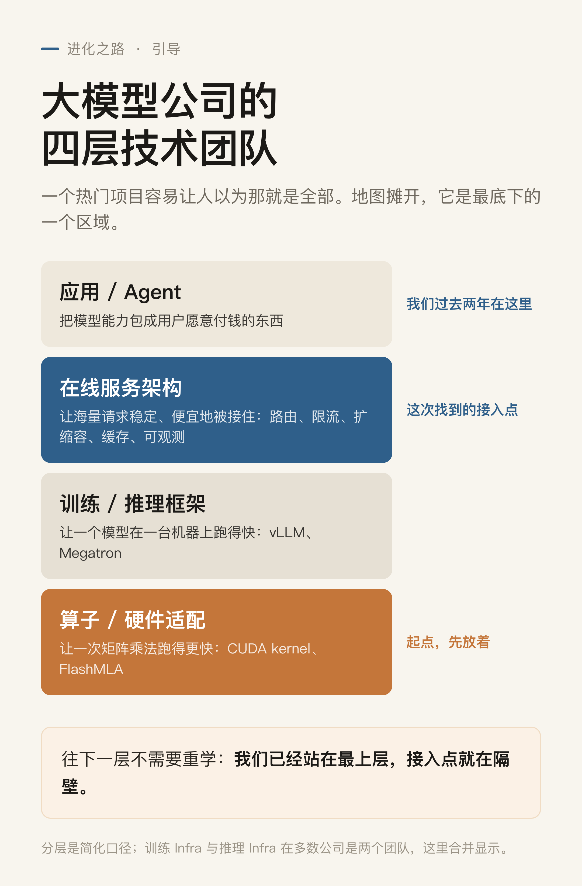
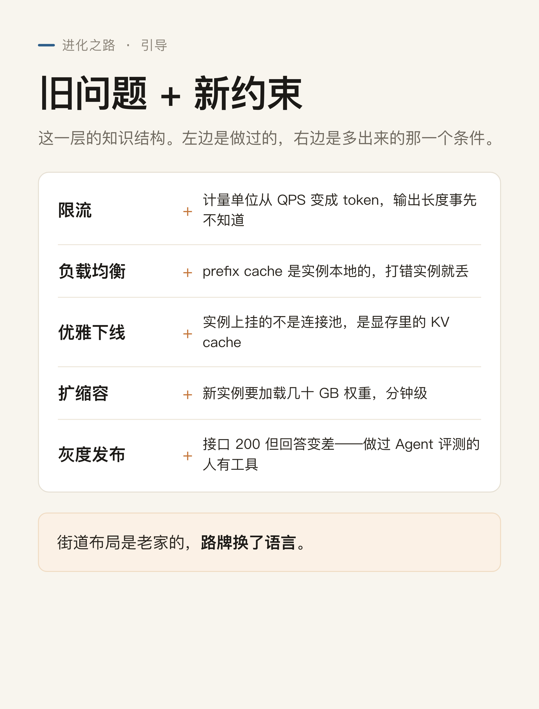
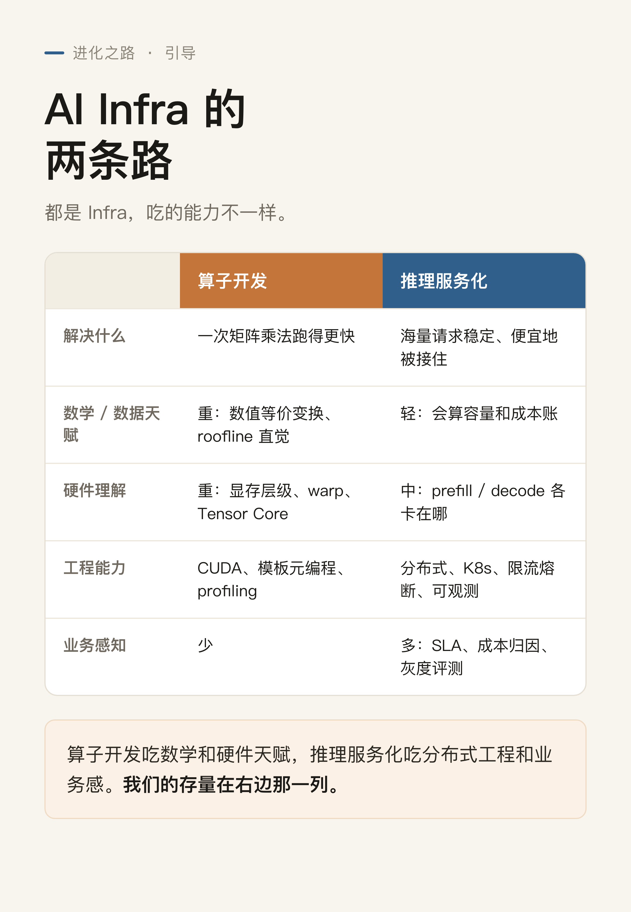
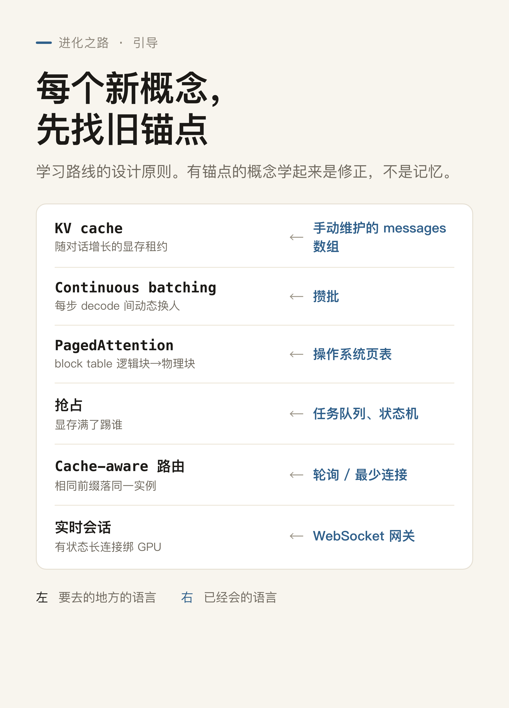
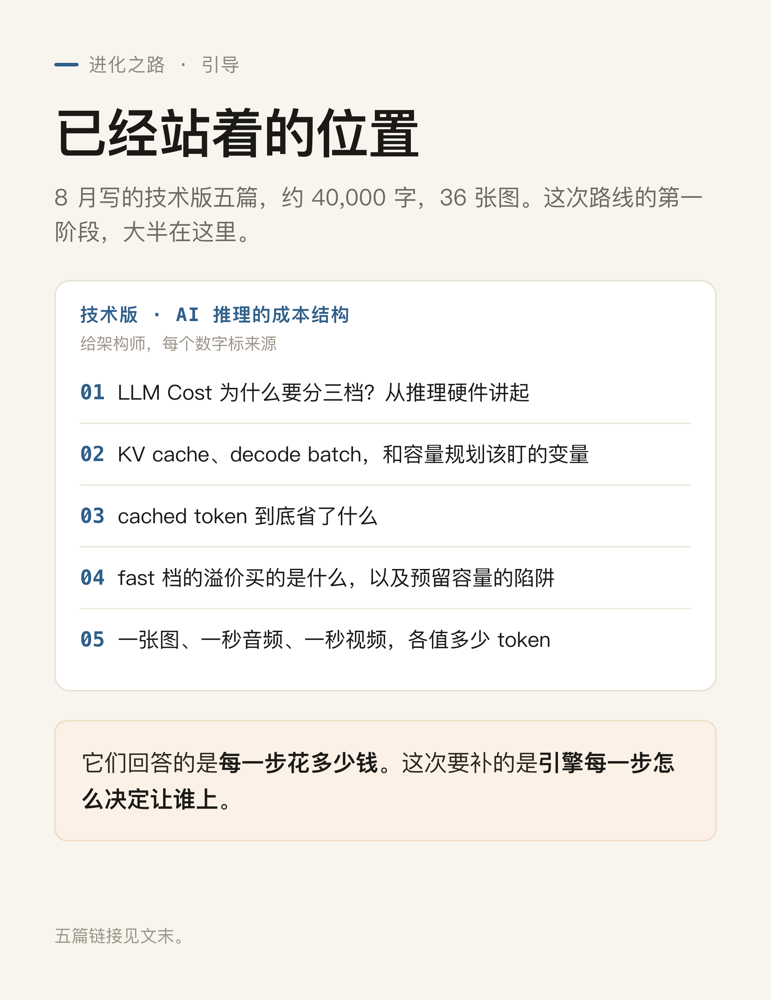
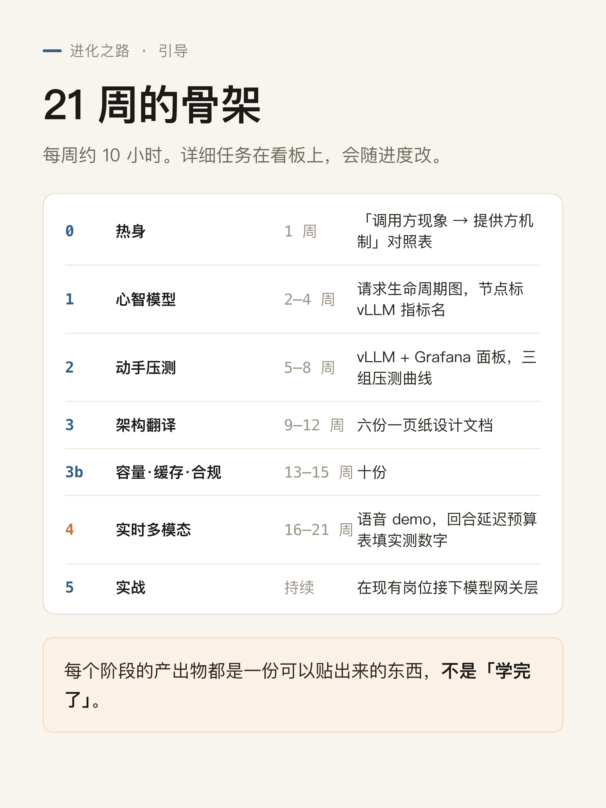

# 进化之路 · 引导 ｜ 一次对话的考古：从 FlashMLA 到在线架构

> 读了一篇写算子的人的告别文，顺着往下看，看到 AI Infra 有两条路：算子开发，和推理服务化。
> 后者用得上我们手里已有的东西。这篇记录这一个下午是怎么走到这个判断的。

---

## 一、背景

过去两年在做 Agent、记忆系统、RAG。每天调大模型 API，对它的脾气熟：首字慢、后面快；system prompt 长了贵；高峰期 429。

熟的是它对外那一面。`POST /v1/chat/completions` 发出去到 token 回来，中间那几秒，没细看过。

起点是一篇文章：[《我不得不把才华埋葬在昨天》](https://mp.weixin.qq.com/s/zk0KxuLzhmMJ4LPYW_OHMA)。作者是 FlashMLA 的作者，DeepSeek v4.1 的主 Attention 算子出自他手。他写的是：AI 写算子的水平快要追上他了，他大概要从手写算子转去做 Agent 的「机甲驾驶员」。

读完两个念头。一是算子开发到底是什么，值得看一眼；二是他往 Agent 那边走，我们在 Agent 这边，中间那几层是什么样的。

拿 FlashMLA 做起点，看看这一块能不能成为一个新的接入点。目的不强，先看。

---

## 二、路径：从一棵树到一张地图

这个下午走了三步。

### 第一步：看懂这棵树

FlashMLA 是 DeepSeek 为 MLA 注意力结构手写的高性能算子。MLA 把 KV cache 压成低秩向量，省显存；压完之后现成的 FlashAttention 用不上，所以要专门写一个 kernel。

算子开发要同时精通三层：数学（计算顺序能不能变）、硬件（GPU 显存层级、warp、Tensor Core）、工程（CUDA、模板元编程、跨架构重写）。全球能写生产级 kernel 的人很少。

挑了一个点看进去：FlashAttention 的 online softmax。分块算和一次算严格等价，四个数字手算能对上。好看。

看懂原理和写出一个跑满带宽的 kernel 是两件事，中间隔着 GPU 体系结构、CUDA、profiling 一整套。这一步的结论：树看清了，先别急着爬。

### 第二步：摊开地图

一个热门项目容易让人以为那就是全部。换个角度，先看大模型公司里都有哪些技术团队。

四层。最底下是算子和硬件适配，往上是训练与推理框架，再往上是在线服务架构，最上面是应用和 Agent。

我们过去两年在最上层。FlashMLA 在最底层。中间隔着两层。

### 第三步：在地图上找自己站着的位置

在线服务架构这一层，管的是：路由与调度、弹性伸缩、限流降级、缓存复用、可观测与成本、安全合规。

读到这里，眼熟。

LLM 推理服务和传统 Web 服务确实不一样：请求耗时差几十倍且事先不知道；prefill 和 decode 两种负载混跑互相拖慢；每个对话占一块随对话增长的显存，服务不是无状态的；一个请求花 0.001 元、另一个花 1 元，按请求数限流失效。

但这些「不一样」的形状，是**旧问题 + 新约束**。

限流做过，只是计量单位从 QPS 变成 token。负载均衡做过，只是多了一个约束——prefix cache 是实例本地的。优雅下线做过，只是实例上挂的不是连接池，是显存里的 KV cache。扩缩容做过，只是新实例要加载几十 GB 权重，分钟级。

街道布局是老家的，路牌换了语言。

---

## 三、方案对比：AI Infra 的两条路

| | 算子开发 | 推理服务化 |
|---|---|---|
| 解决什么 | 一次矩阵乘法跑得更快 | 海量请求稳定、便宜地被接住 |
| 数学 / 数据天赋 | 重：数值等价变换、roofline 直觉 | 轻：会算容量和成本账即可 |
| 硬件理解 | 重：显存层级、warp、Tensor Core | 中：知道 prefill / decode 各卡在哪 |
| 工程能力 | CUDA、模板元编程、profiling | 分布式系统、K8s、限流熔断、可观测 |
| 业务感知 | 少 | 多：SLA、成本归因、灰度评测 |

两条都是 AI Infra。算子开发吃数学和硬件天赋，推理服务化吃分布式工程和业务感。我们的存量在后者那一列。先走后者，前者的链接留着，不急。

---

## 四、做对了什么

**1. 先看地图，再看树。** 起点是最底层的一个热门项目。摊开四层之后，接入点在隔壁那一层，不用从头爬。

**2. 学习路线的设计原则：每个新概念先找旧锚点。**

KV cache 是随对话增长的显存租约，锚点是手动维护的 messages 数组。Continuous batching 锚点是攒批。PagedAttention 的 block table 锚点是操作系统页表。有状态长连接服务化，锚点是做过的 WebSocket 网关。

有锚点的概念学起来是修正，不是记忆。快，也牢。

**3. 拿六大模块对账，补齐空白。** 路由、伸缩、限流、缓存、可观测、合规六块逐一对照初版路线，三块有空白：弹性伸缩、语义缓存、安全合规。补了一个阶段，10 项。

**4. 把 Agent 经验算进去。** 灰度发布一个新模型版本，接口 200 但回答变差了怎么发现——传统 SRE 没有工具，做过 Agent 评测的人有。把 evaluation 接进发布流程，是应用层经验直接变成 Infra 层稀缺能力的地方。这类任务在路线上标了「护城河」。

**5. 加上实时多模态。** 语音、视频会话把「请求—响应」变成「有状态的双向流」，服务化的假设整套重写：延迟预算表、WebRTC 与 SFU、会话绑 GPU 实例、打断的全链路取消。单列一个阶段，9 项。

---

## 五、可以更好的地方

初版路线的第一阶段叫「心智模型：请求在推理引擎里的一生」，从 prefill、decode、KV cache 学起。

这部分 8 月写过。

技术版《AI 推理的成本结构》五篇，每个数字标来源，约 40,000 字，36 张图。prefill/decode 正交、KV cache 占显存 74%、上下文换并发（2K→703，128K→11）、TP/PP/EP 通信账、冷启动五级加载台阶、prefix cache 盈亏平衡 0.28 次命中回本——都在里面。

它们回答的是**每一步花多少钱**。这次要补的是**引擎每一步怎么决定让谁上**。于是第一阶段重排：

- ~~Prefill vs Decode~~ ~~KV Cache~~ ~~Continuous Batching~~ ~~PagedAttention~~ ~~Prefix Caching~~ —— 删掉，01–03 篇已讲透
- 换成 7 个没碰过的：请求状态机、抢占 recompute vs swap、block table 与 copy-on-write、chunked prefill、投机解码、把 01–03 的结论翻译成调度约束、画生命周期图
- 后面的冷启动和 PD 分离任务，改成「承接 02 篇的数字，不从零起步」

可以更好的地方：这一步应该在排路线之前做，先盘一遍已有的积累，再排。晚了几轮，多出一版要重排的路线。

---

## 六、思考

一句话总结这个下午：

> 先看整张地图，再在地图上找自己已经站着的位置。

热门项目是地图上最醒目的一个点，但不一定是离自己最近的接入点。写算子的人往 Agent 走，做 Agent 的人往 Infra 走，同一张地图上两个方向，中间那两层总要有人站着。过去两年的应用层经验、8 月那五篇文章，都是已经站着的位置。从这里往隔壁走一层，比从最底层重新爬要近得多。

一个使用习惯：**积累要放在能被读到的地方。** 写出来、做出来、留在能被找到的位置。下一次排路线之前，先盘一遍它们。

---

## 七、下阶段

约 21 周，每周 10 小时。每个阶段的产出物都是一份可以贴出来的东西，不是「学完了」。

**TODO**

- [ ] Phase 2 租第一张卡。压测数据出来写第 02 篇
- [ ] 把已有的积累整理成一页索引
- [ ] FlashMLA 链接留着，路修好了回头看引擎

---

## 附：技术版《AI 推理的成本结构》

- [01 · LLM Cost 为什么要分三档？从推理硬件讲起](https://mp.weixin.qq.com/s/vFLgVKQd3sa2zeiP82MD8A)
- [02 · KV cache、decode batch，和容量规划该盯的变量](https://mp.weixin.qq.com/s/V49ReCqRfYmphHNSJdDytA)
- [03 · cached token 到底省了什么](https://mp.weixin.qq.com/s/7djx-6s9Ld-fVAeBiWiCNg)
- [04 · fast 档的溢价买的是什么，以及预留容量的陷阱](https://mp.weixin.qq.com/s/9P4nAdrruHvwDSZdpMCNlg)
- [05 · 一张图、一秒音频、一秒视频，各值多少 token](https://mp.weixin.qq.com/s/s5A2HSWOvLtY6h_3VRhjrA)
