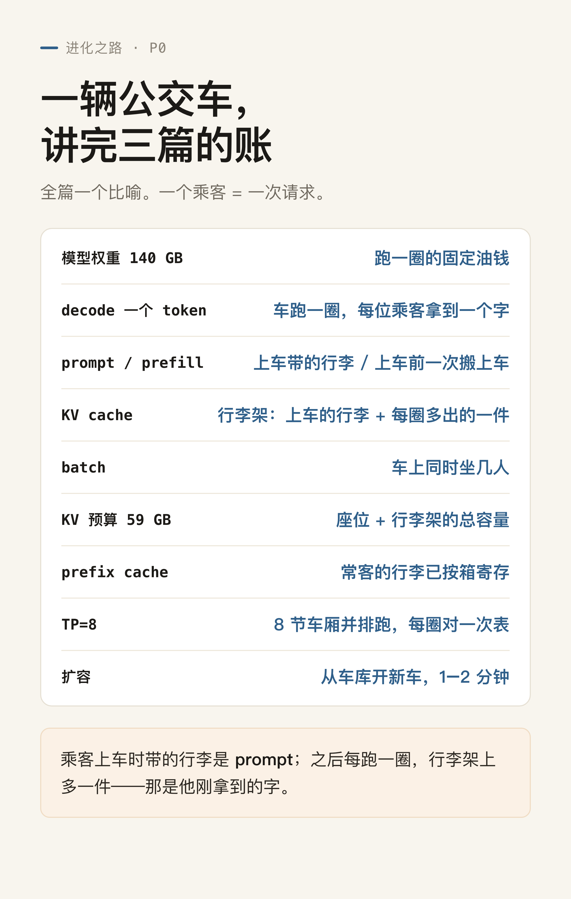
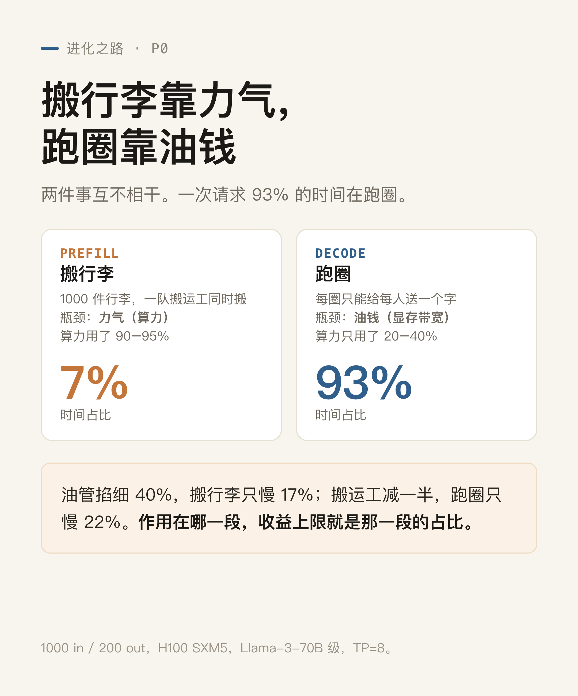
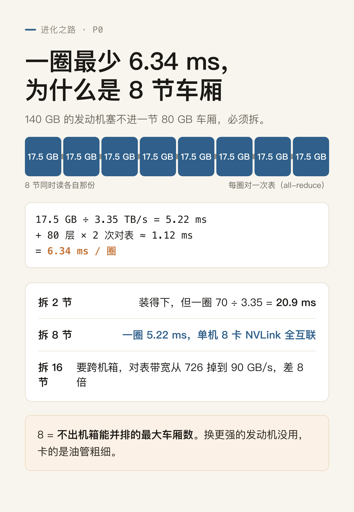
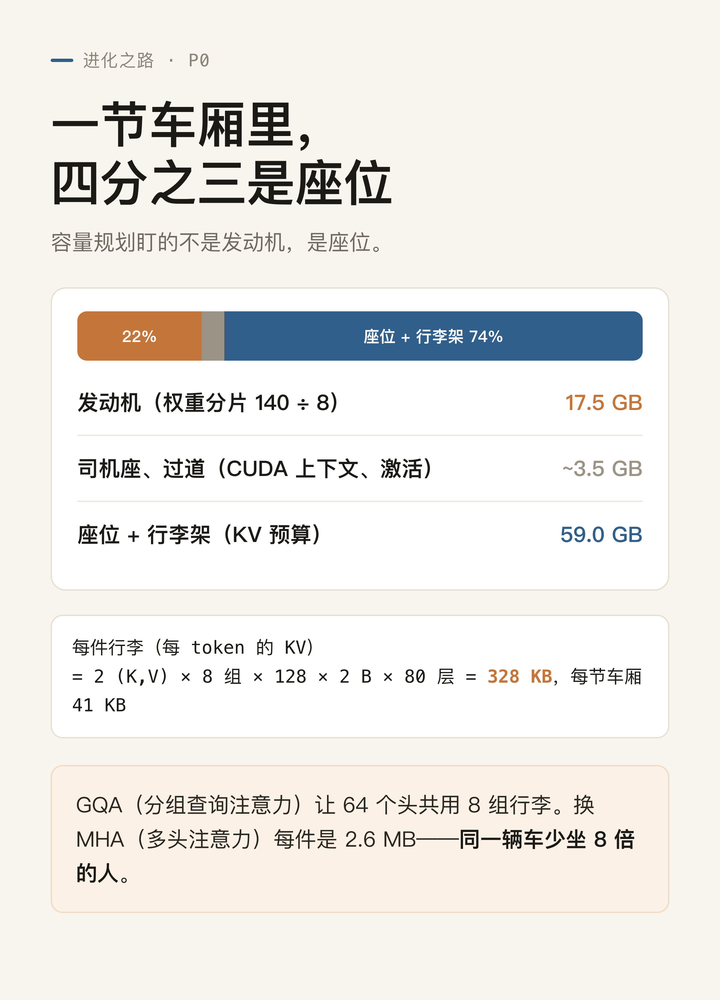
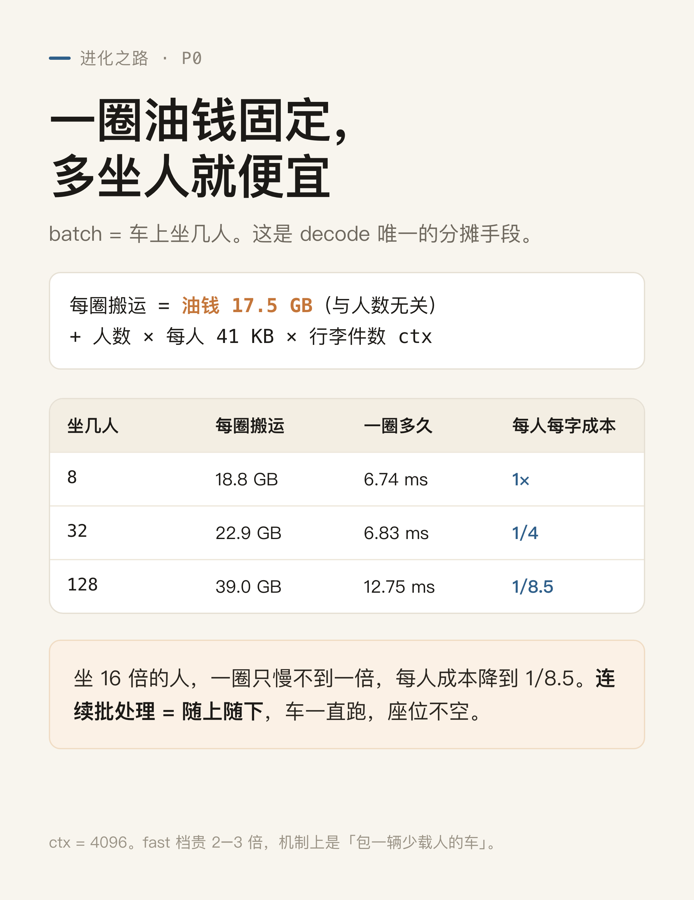
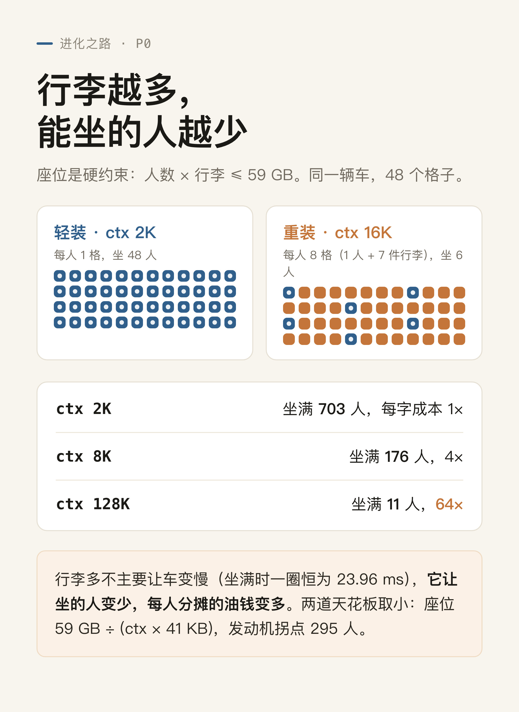
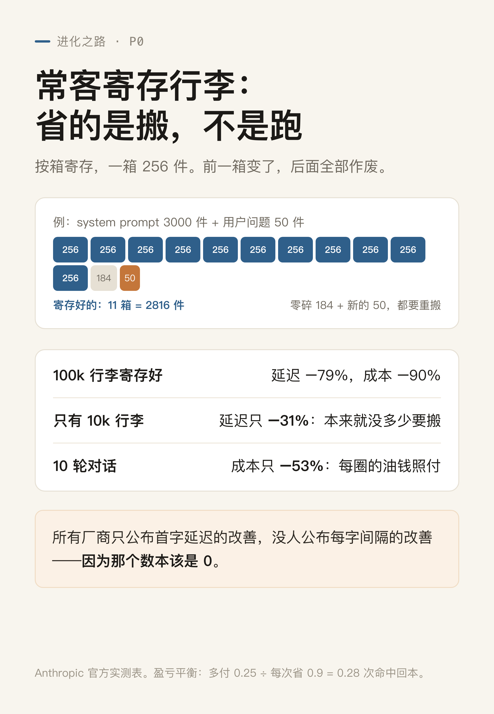
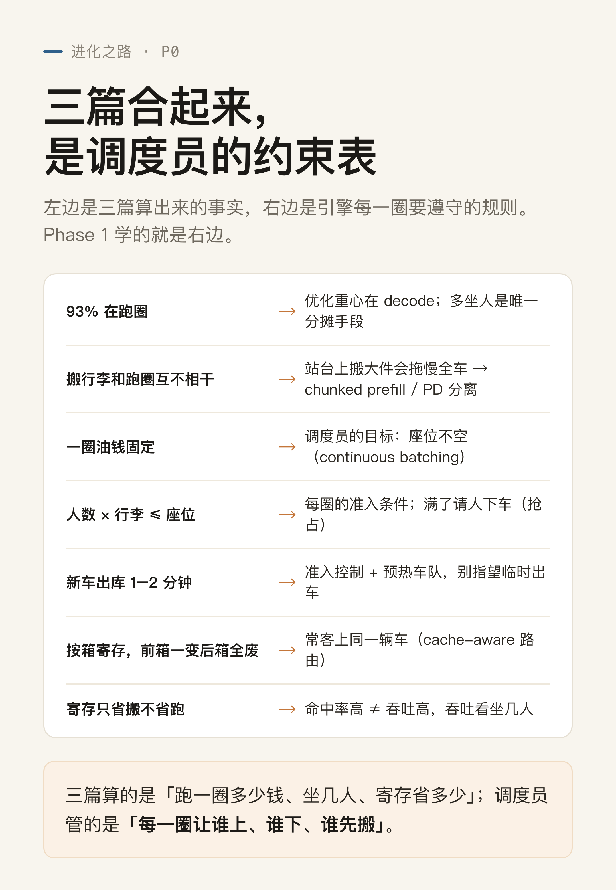

# 进化之路 P0 ｜ 一辆公交车，讲完推理成本的三篇账

> 进化之路 · Phase 0。上一篇摊开了地图，定了接入点。路线的第 0 站是热身：把 8 月写的技术版 01–03 篇——prefill / decode、KV cache、batch、prefix cache——重新过一遍，压成后面每一站都要用的约束表。
> 这次换个讲法，全篇只用一个比喻：**一辆公交车**。数字口径沿用系列：H100 SXM5、Llama-3-70B 级 dense、TP=8、ctx=4096。

先把比喻的对应表放在最前面，后面所有数字都挂在这张表上：

| 真实概念 | 公交车里的说法 |
|---|---|
| 模型权重 140 GB | 公交车跑一圈的固定油钱 |
| decode 生成一个 token | 车跑一圈，给车上每位乘客送一个字 |
| prompt（输入） | 乘客上车时带的**行李**——一个 token 一件 |
| prefill 处理输入 | 上车前把这些行李一次性搬上车 |
| KV cache | 行李架上放着的东西：上车时的行李 + 之后每圈多出来的一件（生成的字） |
| 上下文长度 ctx | 行李架上现在一共多少件 = prompt + 已生成的字 |
| 显存 KV 预算 59 GB | 整辆车的座位 + 行李架容量 |
| batch | 车上同时坐着多少乘客 |
| prefix cache 命中 | 常客的行李已经寄存在车上，不用再搬 |
| TP=8（Tensor Parallelism，张量并行） | 一辆车拆成 8 节车厢并排跑，每圈要对一次表。为什么是 8：见第一节 |
| 扩容 | 从车库再开一辆车出来 |

**一个乘客 = 一次请求**（引擎里叫一条 sequence）。他的一生：

| 请求的生命周期 | 公交车里 |
|---|---|
| 请求到达，排队 | 在站台等车（waiting） |
| 调度器准入 | 车上有空位（KV 预算够）才让上 |
| prefill | 上车前把行李搬上车（输入 token 的 KV） |
| 每 decode 一步 | 车跑一圈，他拿到一个字 |
| KV 随生成增长 | **每跑一圈，他的行李多一件**（新 token 的 KV 也占座） |
| 输出结束 | 到站下车，座位腾出来 |
| 抢占 | 车满了请他先下车；行李扔掉重搬（recompute）或寄到站台（swap） |
| 多轮对话的下一轮 | 同一个人再来坐车，行李要重搬——除非上一轮的箱子还寄存着（prefix cache） |

同一圈，车上每位乘客各拿一个字：batch=32 的一圈送出 32 个字，油钱一份。每一圈车上的人都可能不同——这一圈有人下车，站台就有人立刻上。

---

## 一、01 篇 · 车为什么跑得慢：油钱在跑圈上

**一句话**：搬行李（prefill）靠力气，跑圈（decode）靠油钱，两件事互不相干。

### 搬行李 vs 跑圈

一位乘客上车，先把 1000 件行李搬上车——1000 件可以让一队搬运工同时搬，这是**并行**的，考验的是力气（算力）。

车开起来之后，每跑一圈，只能给车上每位乘客送**一个字**。想送 200 个字，就跑 200 圈。跑圈考验的不是力气，是**每圈的油钱**——每圈都要把 140 GB 权重从显存完整读一遍。

| | 搬行李（prefill） | 跑圈（decode） |
|---|---|---|
| 一次处理 | 1000 个 token 一起 | 一个 token |
| 瓶颈 | 力气：算力 | 油钱：显存带宽 3.35 TB/s |
| H100 上算力用了几成 | 90–95% | 20–40%（大部分时间在等油） |
| 一次请求（1000 in / 200 out）时间占比 | 7% | **93%** |

两件事互不相干的证据：把油管掐细 40%（带宽降 40%），搬行李只慢 17%；把搬运工减一半（算力降 50%），跑圈只慢 22%。

### 每圈至少要多久：物理地板

140 GB 的发动机塞不进一节 80 GB 的车厢，必须拆。拆成几节？

- 拆 2 节就装得下（每节 70 GB），但一圈要 70 ÷ 3.35 = **20.9 ms**
- 拆 8 节，每节 17.5 GB，8 节**同时**读各自那份，一圈 **5.22 ms**——车厢越多，每圈越短
- 不拆到 16 节，因为车厢之间每圈要对表，靠机箱内的 NVLink（726 GB/s）；跨机箱只有 90 GB/s，差 8 倍。**一台标准 GPU 服务器正好 8 张卡全互联**，8 就是「不出机箱」的上限

所以 TP=8 不是随便选的：它是单机能并排的最大车厢数，追求的是每圈最短。每节车厢管 17.5 GB 权重。跑一圈：

> 17.5 GB ÷ 3.35 TB/s = 5.22 ms，8 节车厢每圈对一次表（all-reduce，80 层 × 2 次）≈ 1.12 ms，**一圈 ≈ 6.34 ms**

**这是地板**。不管司机多厉害、你付多少钱，一圈最少 6.34 ms。换更强的发动机（算力涨十倍）没用，因为卡的是油管粗细（带宽）。

### 为什么价目表长这样

- **输入便宜**：1000 件行李一起搬上车，每件摊到的油钱 = 140 GB ÷ 1000 = 0.14 GB
- **输出贵**：每个字都要跑一整圈，一圈油钱 140 GB 摊给车上 32 位乘客 = 4.4 GB 一个字。**0.14 对 4.4，差 31 倍**——换成 GPU 时间口径约 6.3 倍，和各家 out/in 定价 5 倍同量级
- **cached input 只要 0.1–0.2×**：常客行李已经在车上，省的是搬行李的力气；但他坐车还是要分摊每圈的油钱——**decode 一分不省**

---

## 二、02 篇 · 车上能坐多少人：座位是硬约束

**一句话**：油钱是固定的，座位是有限的，而且座位比你想的更紧。

### 一辆车的空间怎么分

| 一节车厢 80 GB | | 公交车里 |
|---|---|---|
| 权重分片 | 17.5 GB（22%） | 发动机和油箱，固定占地 |
| CUDA 上下文 + 激活 | ~3.5 GB | 司机座和过道 |
| **KV 预算** | **59 GB（74%）** | **乘客座位 + 行李架** |

**四分之三的空间是给乘客坐的。容量规划盯的不是发动机（权重），是座位（KV）。**

### 每位乘客占多大地方

每个 token 的 KV = 2（K 和 V）× 8 头 × 128 × 2 字节 × 80 层 = **328 KB**。8 节车厢分摊，每节 41 KB。

这里有个细节：GQA（Grouped-Query Attention，分组查询注意力）让多个 query 头共用一组 KV 头，8 组而不是 64 组。换成传统 MHA（Multi-Head Attention，多头注意力，每个 query 头各配一组 KV），每 token 是 2.6 MB——**同一辆车，能坐的人直接少 8 倍**。大家都用 GQA，是为了多坐人，不是为了省力气。

### batch：跑一圈，多送几个人

跑一圈的油钱是固定的 17.5 GB。车上坐 1 个人，这一圈只送出 1 个字；坐 100 个人，同样一圈送出 100 个字。

> 每圈搬运量 = **油钱 17.5 GB**（固定）+ **乘客数 × 每人行李 41 KB × 行李件数 ctx**

关键在「固定」两个字。举例，ctx = 4096：

| 车上坐几人（batch） | 每圈搬运 | 一圈多久（TPOT） | 每人每字成本 |
|---|---|---|---|
| 8 | 18.8 GB | 6.74 ms | 1× |
| 32 | 22.9 GB | 6.83 ms | 1/4 |
| 128 | 39.0 GB | 12.75 ms | **1/8.5** |

坐 16 倍的人，一圈只慢了不到一倍，**每人成本降到 1/8.5**。所以所有运营商都想把车坐满。

**连续批处理（continuous batching）**就是「随上随下」：不等一车人凑齐再发车，车一直在跑，有人到站就下、站台有人就上，让座位尽量不空。

batch 也是 01 篇价目表和 04 篇 fast 档的公共变量：out/in 价差的具体倍数由车上坐几人决定；fast 档贵 2–3 倍，机制上就是「包一辆少载人的车」——batch 从 128 压到 40，每人分摊的油钱翻倍。

### 但座位就那么多：batch 和行李抢的是同一块地方

上面那张表有个前提：坐得下。而 59 GB 是硬上限：

> 乘客数 × 每人行李 41 KB × 行李件数 ctx ≤ 59 GB

**batch 的真正约束不是发动机（算力）、不是油管（带宽），是座位（KV 显存）。** 左边是乘积，所以**乘客带的行李越多，能坐的人越少**：

| 每人行李（ctx） | 坐满时人数（batch） | 每人每字成本相对 2K |
|---|---|---|
| 2K | 703 | 1× |
| 8K | 176 | 4× |
| 32K | 44 | 16× |
| 128K | 11 | 64× |

**座位数的物理上限就是这条不等式解出来的**：batch_max = 59 GB ÷ (ctx × 41 KB)。ctx=4096 时是 352 人。

还有第二道天花板，来自发动机：01 篇的 roofline 拐点，H100 是 295 FLOP/byte。车上人数超过约 295，每圈从「等油」变成「等发动机」，再多坐人一圈也不会更划算。H20 的拐点只有 37——同一个模型在 H20 上坐到 37 人就撞墙。**两道天花板取小的那个**：H100 上 ctx=4096，座位上限 352、发动机上限约 295，先撞发动机；ctx=8K，座位只剩 176，先撞座位。

坐满时一圈的时间是常数 23.96 ms（油钱 17.5 + 满载行李 59 = 76.5 GB，不管是 703 个轻装还是 11 个重装）。所以：**行李多不主要让车变慢，它让车上坐的人变少，每人分摊的油钱变多。** 一个带 128K 行李的乘客占掉 64 个轻装乘客的位置，票价却只按字数收——长上下文难赚钱的结构性原因。

### 拆车厢：三种拆法

一辆车装不下 140 GB 的发动机，必须拆。

- **TP（并排 8 节）**：每圈每层都要对一次表，80 层 160 次。车厢之间用 NVLink（726 GB/s），跨机器的 RDMA 只有 90 GB/s，差 8 倍——所以**车厢不出机箱**。8 节并排只比 1 节快 4.75 倍，四成被对表吃掉
- **PP（前后接龙）**：每站只传一次包，可以跨机器；代价是接龙有空档（气泡 (p−1)/m），推理的 batch 切不出足够多的小批次填空档，所以推理少用
- **EP（MoE 专用）**：每位乘客按需被送到不同车厢的专家那里，走 all-to-all，最难，跨机器后带宽掉到 1/8 还随节点数继续劣化

### 从车库开一辆新车要多久

140 GB 发动机要从仓库装上车，五级台阶：对象存储 70 s → NVMe 10 s → PCIe 2.5 s → 主存 0.46 s → 显存 0.04 s，由最慢一级决定；加上引擎启动约 20 s 固定开销。**新车就绪 1–2 分钟，而乘客高峰是秒级涌来的。** 这就是火山「每分钟增长超 20% 的流量会被降级」那条规则的由来——车库来不及出车，只能限流保存量。

---

## 三、03 篇 · 常客寄存行李：省的是搬，不是跑

**一句话**：缓存只省搬行李，跑圈一分不省；改善上限 = 搬行李在这次请求里的占比。

### 机制：为什么改一个字就全废

行李是**按箱**寄存的（block），每箱的标签 = 上一箱标签 + 这一箱的内容。推论：
- **前面任何一箱变了，后面所有箱的标签全变，缓存全废**
- **只寄存整箱**，不到一箱的零碎不寄存，而且是静默的，不报错

举例：system prompt 3000 token + 用户问题 50 token，block 大小 256。3000 ÷ 256 = 11 箱整、余 184 件零碎。命中的是 11 × 256 = 2816 个 token；后面 184 + 50 都要重搬。

### 证据：厂商自己的实测

| 场景 | 延迟改善 | 成本改善 |
|---|---|---|
| 100k 行李寄存好 | −79% | −90% |
| 只有 10k 行李 | **−31%** | −86% |
| 10 轮对话 | −75% | **−53%** |

第二行：行李少了，搬行李本来就不占时间，寄存了也快不了多少（OpenAI 同方向：1024 token 只快 7%）。第三行：成本只降一半，因为**每一圈的油钱照付**。

一个空白本身是论据：所有厂商只公布首字延迟（TTFT）的改善，没人公布每字间隔（TPOT）的改善——因为那个数本该是 0。

### 两种收费，同样的单位，相反的经济学

- **一次性寄存费**：Anthropic 5 分钟档写 1.25× / 命中 0.1×，OpenAI 同。盈亏平衡：多付 0.25 ÷ 每次命中省 0.9 = **0.28 次回本**——有一次复用就赚。社区流传的「12 次回本」漏算了不寄存也要付 1.0×
- **按小时收行李架租金**：火山 0.017 元/M/hr，一次命中省 4.8 元/M，租金是收益的 0.35%，可忽略；Gemini $4.50/M/hr，一次命中省 $1.125，**放一小时的租金 = 4 次命中**，一小时命中不到 4 次就是净亏

### 工程现实

- 命中率：Mooncake 真实 trace，对话 40%、agent 59%；输入截断能把 85% 打到 45%
- 静默失效层级：tools → system → messages，动上层下层全废；改 speed 档也失效
- TTL 从请求开始算且**包含生成时间**：流式跑了 4 分钟，5 分钟档只剩 1 分钟
- 并发首轮必全 miss：行李要等第一位乘客上完车才算寄存好

---

## 四、三篇合起来，就是调度员的约束表

| 篇 | 公交车里的事实 | 翻译成调度器的话 |
|---|---|---|
| 01 | 93% 的时间在跑圈，卡油管 | 优化重心在 decode 步；多坐人（batch）是唯一分摊手段 |
| 01 | 搬行李和跑圈互不相干 | 一位乘客的大件行李在站台上搬很久，会拖慢车上所有人 → chunked prefill / PD 分离的动机 |
| 02 | 一圈油钱固定，多坐人就便宜 | 调度器的目标是座位不空（continuous batching） |
| 02 | 乘客 × 行李 ≤ 座位 | 每一步的准入条件；坐满了要请人下车（抢占）；重装乘客先吃掉座位 |
| 02 | 新车出库 1–2 分钟 | 准入控制 + 预热车队，不能指望临时出车 |
| 03 | 按箱寄存，前箱一变后箱全废 | 路由要 cache-aware：常客上同一辆车，稳定行李放前面 |
| 03 | 寄存只省搬，不省跑 | 命中率高 ≠ 吞吐高，吞吐还是看车上坐几人 |

Phase 1 补的就是右边这一列：引擎每一圈是怎么决定「谁上、谁下、谁的行李先搬」的。

---

## 五、和线上 trace 反推的数对一下

用调用方的 trace（只有开始 / 结束时间和 token 数）做了一次反推。方法：同一模型的多条请求，把端到端耗时对输入、输出 token 数做三参数拟合——

> 端到端 ≈ 地板 + 搬行李单价 × 输入 + 跑一圈时间 × 输出

| 文章里的数 | 从 trace 反推出来的 | 对不对得上 |
|---|---|---|
| 一圈 6.34 ms（01/02 推导） | 某国产旗舰 endpoint，约 450 条请求拟合，一圈 **6.3–6.6 ms**，R² 0.75–0.88；另一 endpoint 独立拟合 **6.29 ms** | 同一量级。不能反推硬件，但账没算错 |
| 只寄存整箱（03） | 一条实时语音链路 200 余条命中，命中 token 数**全部是 256 的整数倍** | 直接看见了箱子的大小 |
| 行李少时寄存收益塌掉（03） | 一个 3.6K 输入、十几字输出的分类请求，耗时与输入长度**无关**（斜率 ≈ 0），400 ms 几乎全是地板 | 和 OpenAI「1024 token 只快 7%」同一件事 |
| 排队 + 车上邻居影响每圈（01/02） | 实时链路耗时~输入拟合 R² 只有 0.14 | 输入解释不了耗时，剩下的是排队与邻居——Phase 2 要测的 |
| 首字和每字要分开看（全系列） | 两个项目 **0 条** 首字时刻 | 数据缺口。先补 |

---

## 带走的一条

> **三篇算的是「跑一圈多少钱、车上坐几人、行李寄存省多少」；调度员管的是「每一圈让谁上、谁下、谁先搬」。前者的每个数，都是后者的一个约束。**

Phase 0 到此：账复习完，约束表有了，第一批线上数据也对上了两条。

**几个可以讨论的问题**

1. 一圈 6.34 ms 是 H100 + 70B + 8 节车厢算出来的地板。换成你正在用的模型和卡，这个数是多少？从线上 trace 反推出来的 TPOT 和它差多远？
2. 上下文换并发：2K 坐 703 人，128K 坐 11 人。一个默认给用户 128K 上下文的产品，实际平均用了多少？剩下的座位是不是白占着？
3. 缓存只省搬不省跑。你的请求里 prefill 占几成？如果输出很长（比如写代码），缓存开了到底省了什么？
4. 「新车出库 1–2 分钟，尖峰秒级」。你的服务高峰是可预测的（每天固定时段）还是突发的？这决定了该预热车队还是该限流。

---

## 附：技术版《AI 推理的成本结构》

- [01 · LLM Cost 为什么要分三档？从推理硬件讲起](https://mp.weixin.qq.com/s/vFLgVKQd3sa2zeiP82MD8A)
- [02 · KV cache、decode batch，和容量规划该盯的变量](https://mp.weixin.qq.com/s/V49ReCqRfYmphHNSJdDytA)
- [03 · cached token 到底省了什么](https://mp.weixin.qq.com/s/7djx-6s9Ld-fVAeBiWiCNg)
- [04 · fast 档的溢价买的是什么，以及预留容量的陷阱](https://mp.weixin.qq.com/s/9P4nAdrruHvwDSZdpMCNlg)
- [05 · 一张图、一秒音频、一秒视频，各值多少 token](https://mp.weixin.qq.com/s/s5A2HSWOvLtY6h_3VRhjrA)
