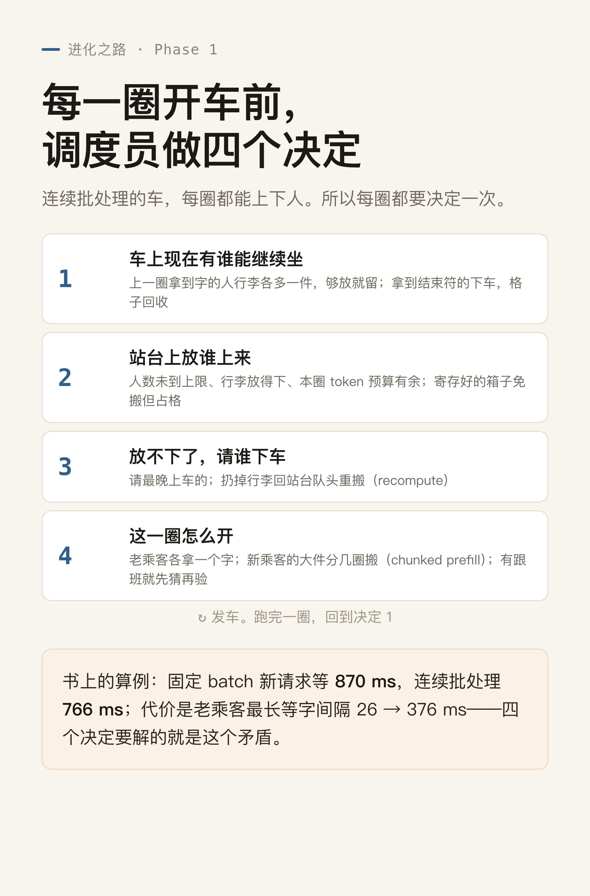
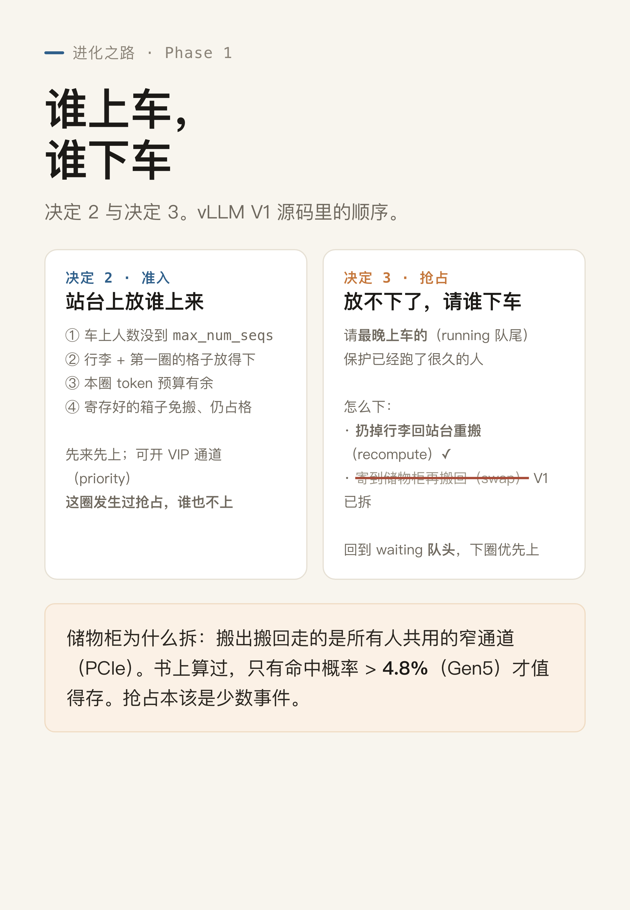
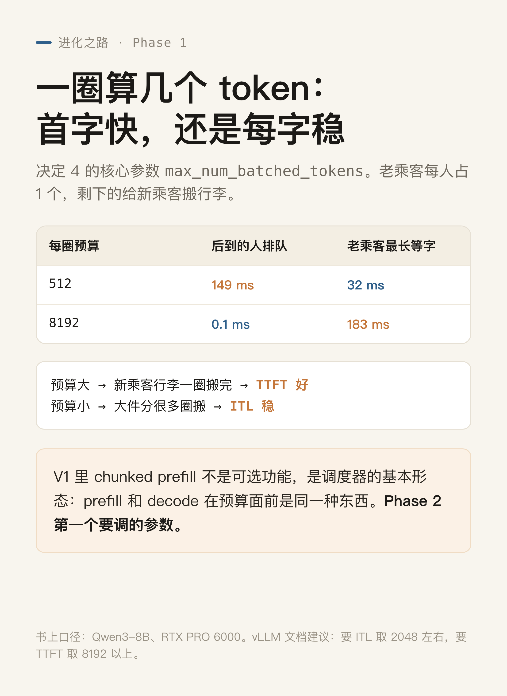

# 进化之路 P1·上 ｜ 调度员每一圈做的四个决定

> 进化之路 · Phase 1 · 上。Phase 0 用一辆公交车算清了三篇的账：跑一圈是 decode，搬行李是 prefill，座位是 KV，坐几人是 batch。这一篇看车上那位调度员——每一圈开车前，他要做四个决定，每个决定的两端都是上一篇表里的一个数。行李架怎么管、跟班怎么用、以及那张带指标名的生命周期图，放在下篇。
> 对照实现用 vLLM V1 的调度器源码。书上的实测口径换成 Qwen3-8B、RTX PRO 6000（单卡），和系列的 H100 / 70B 不同，数字只看形状。

先把 Phase 0 的比喻接上：**一个乘客 = 一次请求**。站台是 waiting 队列，车上是 running 队列。这辆车是连续批处理的车——不等一车人凑齐，每一圈都能上下人。

---

## 一、为什么每一圈都要决定

先说清楚「连续批处理」（continuous batching）和它之前的区别。

**静态批处理**是包车：凑齐 8 位上车，开车；有人 20 个字说完了，也要等车上说 500 个字的那位，全车一起下，下一批才能上。座位空着，油钱照烧。

**连续批处理**是公交：谁说完了这圈下车，格子回收；站台有人、格子够，下一圈就上。每一圈车上的人都可能不同。

它能成立，靠的是 Phase 0 那条账：每圈油钱固定，与人数无关。中途换人不增加固定成本。

代价是调度粒度变成了「一圈」。以前调度员一批做一次决定，现在**每圈都要做**。书上的算例（第 8 章）：固定 batch 时新来的请求等 870 ms 才上车，连续批处理降到 766 ms；但车上老乘客最长一次等字的间隔从 26 ms 涨到 376 ms——因为新乘客上车搬行李，全车在等。这就是四个决定要解的矛盾。

---

## 二、决定 1：车上现在有谁能继续坐

每圈开车前，先看车上的人。vLLM V1 的 `schedule()` 第一段就是遍历 running 队列。

- 上一圈拿到字的人，行李架上各多了一件（新 token 的 KV）。他的格子还够不够放？够，继续坐
- 拿到结束符、或到了 `max_tokens` 的人：下车，格子全部回收
- 格子不够了：先记下来，进决定 3

**顺序很重要**：V1 先处理 running，再处理 waiting。老乘客优先——已经在车上的人不该被新来的挤下去。

---

## 三、决定 2：站台上放谁上来

running 队列处理完，剩下的 token 预算给站台。

准入条件，按源码里的检查顺序：
1. 车上人数没到上限（`max_num_seqs`）
2. 他的行李（prompt）加上第一圈要用的格子，行李架放得下
3. **本圈的 token 预算还有余**——这是 V1 统一 prefill 和 decode 的关键，下面决定 4 细说
4. 行李里有几箱是寄存好的（prefix 命中）：那几箱不用搬，但要占格子

放谁：默认先来先上（FCFS）。也可以按优先级（`--scheduling-policy priority`），那就是 VIP 通道。

一个细节：这一圈如果发生了抢占（决定 3），**站台上谁也不上**。先把车上的人安顿好。

---

## 四、决定 3：放不下了，请谁下车

行李架满了，车上有人下一圈的字没地方放。调度员只能请人下车。

**请谁**：FCFS 下请**最晚上车的**（running 队列尾部）；优先级模式下请优先级最低、且最晚到的。逻辑是保护已经跑了很久的人——他们下车损失最大。

**怎么下**：两种办法。
- **扔掉行李，回站台重搬**（recompute）：他的 KV 全部释放，回到 waiting 队列**头部**，下一圈优先上车，prompt 重新 prefill 一遍
- **行李寄到站台储物柜**（swap）：KV 搬到 CPU 内存，等有格子了再搬回来

vLLM V1 **只有 recompute，删掉了 swap**。为什么？Phase 0 02 篇算过 PCIe 那条通道：Gen5 x16 每方向 64 GB/s。书上的数：6144 个 token 的行李从储物柜搬回来要 14.2 ms（Gen4 是 28.3 ms），而重新搬一遍（prefill 6K）大约 230 ms。看起来储物柜快得多——但储物柜要**搬出去一次、搬回来一次**，占的是所有人共用的那条窄通道，还要在 CPU 侧留一块地方。书上给了准入判断式：只有命中概率 p_h > T_m / (T_r − T_f) 时才值得存，Gen5 下算出来要 4.8%，Gen4 要 10.1%。V1 的取舍是：抢占本来就该是少数事件，为少数事件维护一整套储物柜不划算，不如重搬。

抢占的痕迹在指标里：`vllm:num_preemptions_total`。它不该是 0（那说明车太空），也不该持续涨（那说明车太小）。

---

## 五、决定 4：这一圈怎么开

车上的人定了，站台上的人也上了，这一圈怎么跑。

### 老乘客：各拿一个字

所有 running 的人各 decode 一步。这是每圈的主体，带宽受限，Phase 0 讲透了。

### 新乘客：大件行李分几圈搬

新上车的人要 prefill。一位带 8K 行李的乘客上车，如果一次搬完，全车等他 300 ms（书上 8K prefill 约 307 ms）。

**Chunked prefill** 的解法：把行李切成几份，每圈搬一份，同时给老乘客送字。V1 里这不是一个可选功能，是调度器的**基本形态**——每圈有一个 token 预算（`max_num_batched_tokens`），老乘客每人占 1 个，剩下的给新乘客搬行李，搬不完下圈接着搬。prefill 和 decode 在预算面前是同一种东西，都是「这圈要算几个 token」。

预算大小是一个取舍。书上的扫描：预算从 512 涨到 8192，后到的请求排队时间从 149 ms 降到 0.1 ms，但老乘客最长等字间隔从 32 ms 涨到 183 ms。**预算大 → 首字快（TTFT 好）；预算小 → 每字稳（ITL 好）。** vLLM 文档的建议：要 ITL 就 2048 左右，要 TTFT 就 8192 以上。这个数就是 Phase 2 压测要调的第一个参数。

### 有跟班的话：先猜再验

投机解码放到下篇。

---

## 六、和 Phase 0 的表对一下

| Phase 0 的事实 | Phase 1 里对应的决定 |
|---|---|
| 一圈油钱固定，多坐人就便宜 | 决定 1 / 2：尽量让车坐满，每圈都补人 |
| 人数 × 行李 ≤ 座位 | 决定 2 的准入条件；决定 3 的触发条件 |
| 搬行李和跑圈互不相干，混跑会拖慢 | 决定 4：chunked prefill，用 token 预算把两种事拌匀 |
| 按箱寄存，前箱一变后箱全废 | 下篇：hash 链认箱，block table 共用 |
| 新车出库 1–2 分钟 | 决定 3 的前提：来不及加车，只能在车上腾地方 |

---

## 带走的一条

> **调度器不是在「优化」，是每一圈做四个取舍。每个取舍的两端，都是 Phase 0 表里的一个数。**

下篇：行李架的账本（block table）、跟班和司机（投机解码），以及把四个决定画成一张带指标名的生命周期图——那张图就是 Phase 2 面板的布局。

**几个可以讨论的问题**

1. 决定 3 保护老乘客、请最晚上车的人下车。但如果最晚上车的是一位付费用户、最早上车的是免费用户呢？`priority` 策略解决了一半——另一半是谁来给请求打优先级、按什么打。
2. token 预算 2048 还是 8192，文档给的是「看你要 TTFT 还是 ITL」。一个同时跑聊天和长文档摘要的服务，这个数该怎么定？能不能按请求类型分车？
3. V1 拆掉了 swap，理由是「抢占应该是少数事件」。什么样的流量会让这个假设不成立——抢占变成常态，重搬的代价反而超过储物柜？
4. 决定 2 里「这圈发生过抢占，站台上谁也不上」。这条规则在极端情况下会不会让站台的人永远上不了车？

---

## 附：读了什么

- 李博杰《深入理解 AI Infra：量化分析与系统设计》[第 8 章 推理优化](https://bojieli.github.io/ai-infra-book/manuscripts/08-%E6%8E%A8%E7%90%86%E4%BC%98%E5%8C%96.html) 8.1–8.2、8.3.4——本文书上的数字均出自此处，口径 Qwen3-8B / RTX PRO 6000；[全书 GitHub](https://github.com/bojieli/ai-infra-book)
- vLLM V1 调度器源码 [`vllm/v1/core/sched/scheduler.py`](https://github.com/vllm-project/vllm/blob/main/vllm/v1/core/sched/scheduler.py)；[Optimization and Tuning 文档](https://docs.vllm.ai/en/latest/configuration/optimization/)（抢占、chunked prefill、`max_num_batched_tokens`）
- 技术版《AI 推理的成本结构》：[01 · LLM Cost 为什么要分三档](https://mp.weixin.qq.com/s/vFLgVKQd3sa2zeiP82MD8A)、[02 · KV cache、decode batch 与容量规划](https://mp.weixin.qq.com/s/V49ReCqRfYmphHNSJdDytA)、[03 · cached token 到底省了什么](https://mp.weixin.qq.com/s/7djx-6s9Ld-fVAeBiWiCNg)
- 公交车比喻见上一篇《进化之路 · 一辆公交车，讲完推理成本的三篇账》（发布后补链接）
