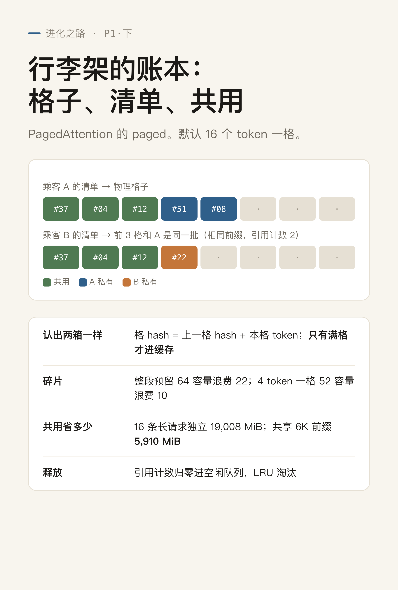
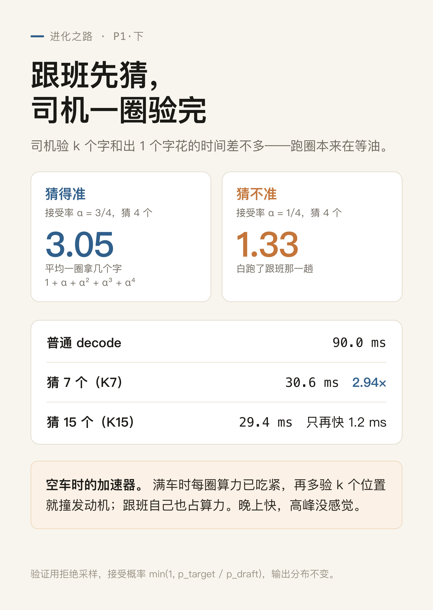
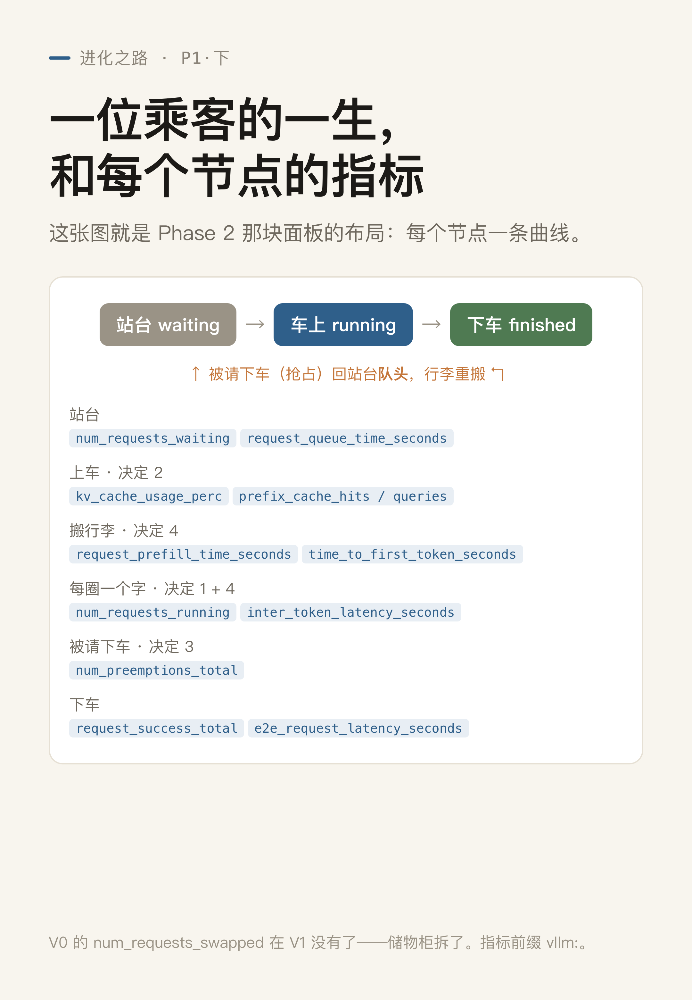

# 进化之路 P1·下 ｜ 行李架的账本与跟班

> 进化之路 · Phase 1 · 下。上篇讲了调度员每一圈的四个决定。这一篇补两个专题——行李架怎么管（block table）、跟班怎么用（投机解码）——然后把一位乘客的一生画成一张图，每个节点标上指标名。这张图就是 Phase 2 那块面板的布局。
> 口径同上篇：书上实测为 Qwen3-8B、RTX PRO 6000；实现对照 vLLM V1。

---

## 一、行李架的账本：block table

Phase 0 只说了「按箱寄存」，上篇的决定 2 说寄存好的箱子「免搬但占格」。这一节看箱子怎么管。

**格子**：行李架切成固定大小的 block，vLLM 默认 16 个 token 一格。为什么不按人整段预留？书上的四请求示例：整段预留，64 个 token 的容量浪费 22 个；4 token 一格的分页，52 个容量只浪费 10 个。碎片从三成降到两成。

**清单**：每位乘客手里一张 block table——我的第 1 格在架子第 37 号，第 2 格在第 4 号。逻辑格子连续，物理格子随便放。这就是 PagedAttention 的「paged」。

**共用**：两位乘客前几箱一样（相同前缀），清单指向同一批物理格子。每个格子记一个引用计数，最后一个人下车时才真正释放。书上的数：16 条长请求各自独立要 19,008 MiB，超了 12 GiB 的上限；共享 6144 token 前缀后只要 5,910 MiB。

**认出来**：怎么知道两箱一样？03 篇讲过的 hash 链——每格的 hash = 上一格 hash + 这一格的 token（+ LoRA ID、多模态 hash、cache salt）。只有**满格**才进缓存，这是 Phase 0 看到「命中数全是 256 的整数倍」的来源。

**释放**：没人用的格子进空闲队列，LRU 淘汰——最久没被碰的先让出来。

指标：`vllm:kv_cache_usage_perc` 是行李架用了几成，`vllm:prefix_cache_hits / prefix_cache_queries` 是上车的人里多少箱免搬。

---

## 二、跟班和司机：投机解码

司机（大模型）一圈只出一个字，但他**验**几个字和出一个字花的时间差不多——因为跑圈本来在等油，多算几个位置几乎不额外花时间。

于是找个跟班（小模型、或者 n-gram 匹配）先猜 k 个字，司机一圈验完：对的全收，从第一个错的地方截断，自己补一个。跟班猜得越准，一圈拿到的字越多。

书上的算例：接受率 α = 3/4，猜 4 个，平均一圈拿 1 + α + α² + α³ + α⁴ ≈ 3.05 个字；α = 1/4 就只有 1.33 个。实测：普通 decode 中位 90 ms，猜 7 个降到 30.6 ms（2.94 倍），猜 15 个只再快 1.2 ms——**边际收益递减得很快**。

输出分布不变：验证用拒绝采样，接受概率 min(1, p_target / p_draft)，拒绝时从修正分布重采。理论上无损，只到硬件数值精度为止。

**满车时收益消失。** 人多了每圈的算力已经吃紧（01 篇的 roofline 拐点），再多验 k 个位置就撞发动机了；跟班自己也要占车上的算力。vLLM 文档的定性表：低 QPS 高收益，高 QPS 中等到消失。所以它是**空车时的加速器**：晚上跑得快，高峰没感觉。

---

## 三、把四个决定画成一张图

一位乘客的一生，和每个节点上的指标名：

| 节点 / 边 | 谁在决定 | 指标 |
|---|---|---|
| 站台等车 | — | `num_requests_waiting`、`request_queue_time_seconds` |
| 上车（准入） | 上篇决定 2 | `max_num_seqs`、`kv_cache_usage_perc`、`prefix_cache_hits` |
| 搬行李（prefill，可能分几圈） | 上篇决定 4 | `request_prefill_time_seconds`、`time_to_first_token_seconds` |
| 每圈拿一个字 | 上篇决定 1 + 4 | `num_requests_running`、`inter_token_latency_seconds` |
| 被请下车，回站台队头 | 上篇决定 3 | `num_preemptions_total` |
| 下车 | 上篇决定 1 | `request_success_total`、`e2e_request_latency_seconds` |

V0 时代的 `num_requests_swapped` 在 V1 里没有了——储物柜拆了。

这张图就是 Phase 2 那块 Grafana 面板的布局：每个节点一条曲线。

---

## 四、Phase 1 收尾：一张图对三篇账

| Phase 0 的事实 | 引擎里的实现 |
|---|---|
| 一圈油钱固定，多坐人就便宜 | 每圈补人（上篇决定 1 / 2） |
| 人数 × 行李 ≤ 座位 | 准入与抢占（上篇决定 2 / 3） |
| 搬行李和跑圈互不相干 | chunked prefill 的 token 预算（上篇决定 4） |
| 按箱寄存，前箱一变后箱全废 | hash 链认箱 + block table 共用（本篇第一节） |
| 跑圈在等油，算力有余 | 投机解码有空间；满车时消失（本篇第二节） |

---

## 带走的一条

> **行李架的账本决定能坐几人，跟班决定一圈拿几个字，生命周期图决定 Phase 2 看哪些曲线。三样东西都能从 Phase 0 的数推出来。**

**几个可以讨论的问题**

1. 格子 16 个 token 一格，是碎片和管理开销的折中。什么场景会想把格子调小或调大？长上下文、多轮 Agent、短问答，各自偏向哪边？
2. 两位乘客共用前缀格子，靠的是「前缀完全一样」。Agent 场景里 system prompt 稍有不同（比如带了时间戳、用户名）就全废——这是 prompt 该怎么写的问题，还是引擎该怎么匹配的问题？
3. 投机解码「空车快、满车没感觉」。一个白天满载、夜里空闲的服务，值不值得为夜间流量开跟班？开了之后白天怎么办？
4. 生命周期图上的指标，哪一条最先告诉你「车该加了」——是 `num_requests_waiting`、`kv_cache_usage_perc`，还是 `num_preemptions_total`？为什么不是同一条？

---

## 附：读了什么

- 李博杰《深入理解 AI Infra：量化分析与系统设计》[第 8 章 推理优化](https://bojieli.github.io/ai-infra-book/manuscripts/08-%E6%8E%A8%E7%90%86%E4%BC%98%E5%8C%96.html) 8.3、8.5——数字口径 Qwen3-8B / RTX PRO 6000；[全书 GitHub](https://github.com/bojieli/ai-infra-book)
- vLLM 文档：[Automatic Prefix Caching 设计](https://docs.vllm.ai/en/latest/design/prefix_caching.html)、[Metrics 设计](https://docs.vllm.ai/en/latest/design/metrics.html)、[Speculative Decoding](https://docs.vllm.ai/en/latest/features/speculative_decoding/)
- 上篇《进化之路 · 调度员每一圈做的四个决定》（发布后补链接）
- 技术版《AI 推理的成本结构》：[02 · KV cache、decode batch 与容量规划](https://mp.weixin.qq.com/s/V49ReCqRfYmphHNSJdDytA)、[03 · cached token 到底省了什么](https://mp.weixin.qq.com/s/7djx-6s9Ld-fVAeBiWiCNg)
