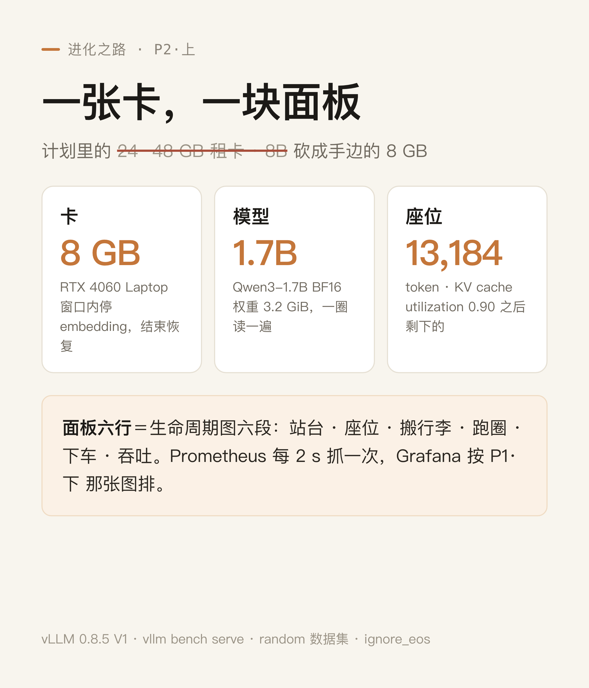
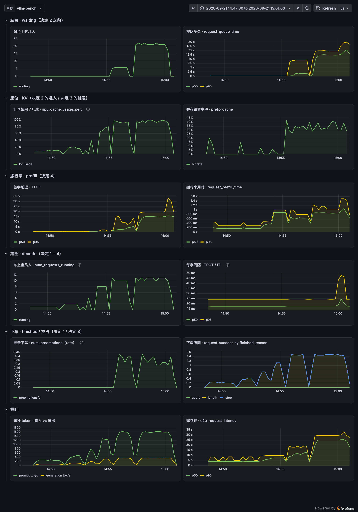
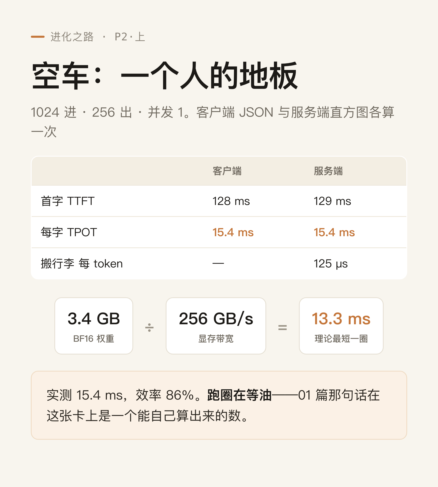
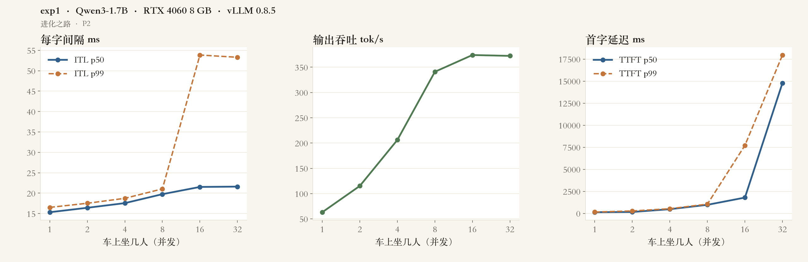
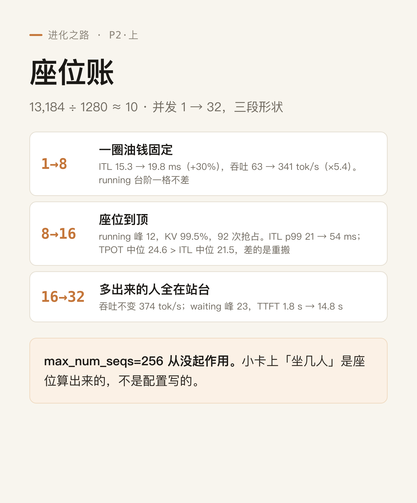

# 进化之路 P2·上 ｜ 把一辆车开起来：面板与第一组压测

> 进化之路 · Phase 2 · 上。前面三站都在纸上：P0 复习了三篇账，P1 讲了调度员的四个决定和一张生命周期图。这一站把车开起来——一张卡、一个模型、一块按生命周期图排的面板，然后坐进去数人。
> 口径：Qwen3-1.7B BF16，RTX 4060 Laptop 8 GB，vLLM 0.8.5 V1。数字都是这张卡上跑出来的，只看形状，不看绝对值。

---

## 一、环境：把计划砍到一张卡能装下

大纲里写的是 ~~租一张 24–48 GB 的卡，跑一个 8B~~。手边有一台带 4060 Laptop 的笔记本，8 GB 显存，平时跑 embedding 服务。决定不租，就用它：实验窗口停掉 embedding，起一个 Qwen3-1.7B，窗口结束恢复。

8 GB 的账要先算：权重 3.2 GiB，Windows 和驱动占掉 0.9 GiB，`gpu-memory-utilization` 0.90 之后留给行李架（KV cache）的只有 **13,184 个 token 的座位**。这个数决定了后面每一组实验的形状——它比书上小两个数量级，所以座位不够、抢占、排队这些事，不用刻意制造就会出现。

面板放在另一台闲置的 Mac 上：Prometheus 每 2 秒抓一次，Grafana 按 P1·下 那张生命周期图排成六行，每一行对应乘客一生的一段。

| | 选择 | 原因 |
|---|---|---|
| 卡 | 自有 4060 Laptop 8 GB | 不花钱，座位少反而容易看到调度 |
| 模型 | Qwen3-1.7B BF16 | 3.2 GiB 权重，能给行李架留出 13K token |
| 引擎 | vLLM 0.8.5，V1 调度器 | 指标名与 P1·下 那张图一致 |
| 压测 | `vllm bench serve`，random 数据集，`ignore_eos` | 输入输出长度可控，每次跑完落一份 JSON |
| 面板 | Prometheus + Grafana，SSH 隧道抓指标 | 六行 = 站台 / 座位 / 搬行李 / 跑圈 / 下车 / 吞吐 |

---

## 二、面板：先搭再压

P1·下 的结尾说，那张生命周期图就是面板布局。搭出来是这样：

六行，从上到下：

1. **站台**：`num_requests_waiting` 站台上几个人，`request_queue_time` 排了多久
2. **座位**：`gpu_cache_usage_perc` 行李架用了几成，`prefix_cache_hits / queries` 寄存箱命中率
3. **搬行李**：TTFT 首字延迟，`request_prefill_time` 搬行李用时
4. **跑圈**：`num_requests_running` 车上几人，TPOT / ITL 每字间隔
5. **下车**：`num_preemptions` 被请下车的速率，`request_success` 按下车原因
6. **吞吐**：每秒进出 token，端到端延迟

上面这张截图就是第一组压测的 13 分钟。先不解释曲线，下一节一段一段对。

一个搭面板时的小发现：vLLM V1 里没有 `num_requests_swapped` 了——P1·上 说的储物柜（swap）拆了，被请下车的人只能回站台重搬。面板上少一条线，正好对上。

---

## 三、空车：单并发的地板

先坐一个人，看空车的数字。每位乘客 1024 个 token 的行李，要 256 个字下车。

| | 客户端（bench JSON） | 服务端（Prometheus 直方图） |
|---|---|---|
| 首字 TTFT | 128 ms | 129 ms |
| 每字 TPOT | 15.4 ms | 15.4 ms |
| 输出吞吐 | 63 tok/s | — |

两边一致到 1 ms。这是 P0 三参数拟合里的「地板」：网络在本机，几乎为零；1024 个 token 的行李搬 128 ms，**每 token 125 µs**；跑一圈 15.4 ms。

拿 P0 的算法对一下：1.7B 参数，BF16 每圈要把 3.4 GB 权重从显存读一遍，4060 Laptop 的带宽约 256 GB/s，理论最短一圈 13.3 ms。实测 15.4，效率 86%。**跑圈在等油**——01 篇那句话，在这张卡上是一个可以自己算出来的数。

---

## 四、坐几人：并发 1 → 32

计划里是 ~~并发 1 → 128~~。13K 座位除以每人 1280，只坐得下 10 个人，扫到 32 就够了。

| 并发 | ITL p50 | ITL p99 | TPOT p50 | 输出 tok/s | TTFT p50 |
|---|---|---|---|---|---|
| 1 | 15.3 | 16.5 | 15.4 | 63 | 133 ms |
| 2 | 16.4 | 17.5 | 16.7 | 115 | 160 |
| 4 | 17.6 | 18.7 | 17.7 | 206 | 477 |
| 8 | 19.8 | 21.1 | 19.8 | 341 | 973 |
| 16 | 21.5 | **53.9** | **24.6** | 374 | 1.8 s |
| 32 | 21.6 | 53.3 | 24.4 | 372 | **14.8 s** |

三段。

**1 → 8：一圈油钱固定，多坐人就便宜。** 车上从 1 人到 8 人，每字间隔只从 15.3 涨到 19.8 ms（+30%），吞吐 63 → 341 tok/s（×5.4）。P0 那张 batch 表在这张卡上重现了。面板第四行 `num_requests_running` 是台阶：1、2、4、8，一格不差。

**8 → 16：座位到顶。** 13,184 ÷ 1280 ≈ 10 人。并发 16 时车上最多坐到 12（路上有人快下车，行李架腾出一点），`gpu_cache_usage_perc` 顶到 99.5%，整个窗口 **92 次抢占**。指标上是三处同时动：

- ITL p99 从 21 跳到 54 ms——被请下车的人回站台重搬，那一字间隔特别长
- TPOT 中位（24.6）开始高于 ITL 中位（21.5）——差的就是重搬时间。P1·上 决定 3 说的 recompute，在指标里就是这个差
- 吞吐停在 374 tok/s，不再涨

**16 → 32：多出来的人全在站台。** 吞吐一样，TTFT 从 1.8 s 到 14.8 s。面板第一行 `num_requests_waiting` 从 5 跳到 23，`request_queue_time` p50 13 s。座位定了上限，之后加并发只加排队。

---

## 五、对 P1 的两个决定

- **决定 2（准入）**：`max_num_seqs` 默认 256，从头到尾没起作用。真正卡住准入的是行李架预算——running 峰值 12，不是 256。在小卡上，「坐几人」是座位算出来的，不是配置写的。
- **决定 3（抢占）**：V1 只有 recompute 一种。它在指标里不是一条独立的线，而是 ITL p99 的那一跳，加上 TPOT 和 ITL 中位数之间的差。想知道抢占疼不疼，看这两个数就够。

---

## 带走的一条

> **座位数 = 行李架容量 ÷ 每人行李。这个数算出来之后，面板上六行曲线的形状都能预先画出来：座位没满时台阶往上走，满了之后 ITL p99 先跳，再往后站台排队，TTFT 一路向上。**

**几个可以讨论的问题**

1. 这张卡上 `max_num_seqs=256` 是空的，准入由 KV 决定。换到 80 GB 的卡、7B 模型，这两条约束谁先到？怎么用面板上的两条线判断当前是哪一条在卡？
2. 并发 16 时 ITL p50 只涨了 2 ms，p99 涨了 33 ms。对一个流式输出的聊天产品，哪一个数该进 SLA？为什么线上通常两个都盯？
3. 从 8 到 16，吞吐只从 341 涨到 374，抢占却从 0 到 92 次。如果目标是吞吐，这 10% 值不值得？如果目标是 p99，该把准入卡在哪？
4. 单并发一圈 15.4 ms，理论 13.3 ms，效率 86%。剩下 14% 去哪了？哪些是能靠调度拿回来的，哪些不能？

---

## 附：读了什么、用了什么

- vLLM 文档：[Metrics 设计](https://docs.vllm.ai/en/latest/design/metrics.html)、[Benchmark CLI](https://docs.vllm.ai/en/latest/cli/bench/serve.html)
- 李博杰《深入理解 AI Infra：量化分析与系统设计》[第 8 章 推理优化](https://bojieli.github.io/ai-infra-book/manuscripts/08-%E6%8E%A8%E7%90%86%E4%BC%98%E5%8C%96.html)——书上是 Qwen3-8B / RTX PRO 6000，这里是 1.7B / 8 GB，只对形状
- 上一站《进化之路 P1·下 ｜ 行李架的账本与跟班》（发布后补链接）——面板六行的来源
- 技术版《AI 推理的成本结构》：[01 · LLM Cost 为什么要分三档？从推理硬件讲起](https://mp.weixin.qq.com/s/vFLgVKQd3sa2zeiP82MD8A)、[02 · KV cache、decode batch，和容量规划该盯的变量](https://mp.weixin.qq.com/s/V49ReCqRfYmphHNSJdDytA)
