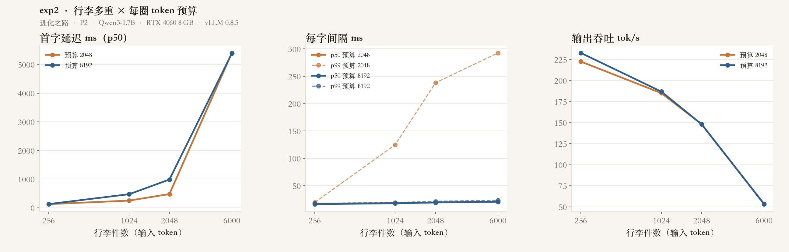
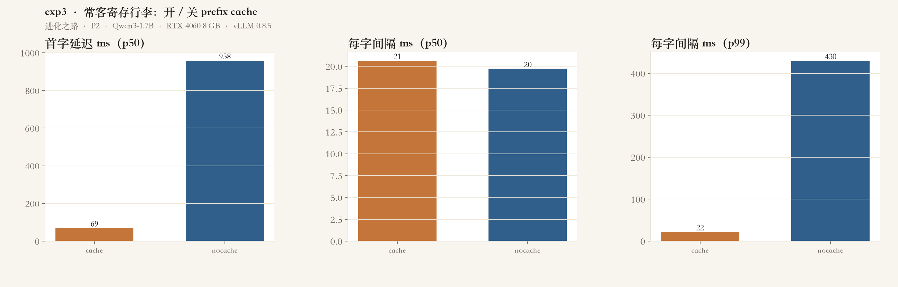
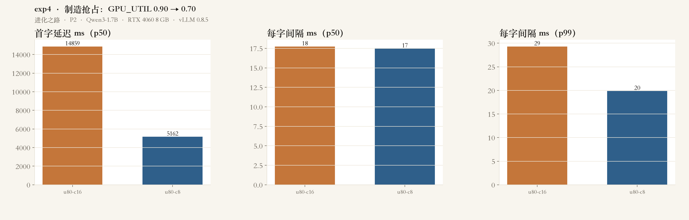
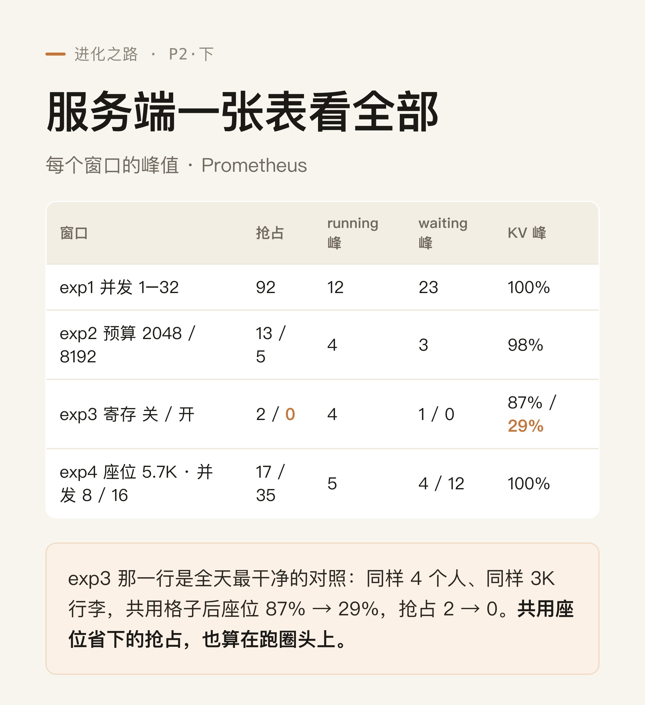
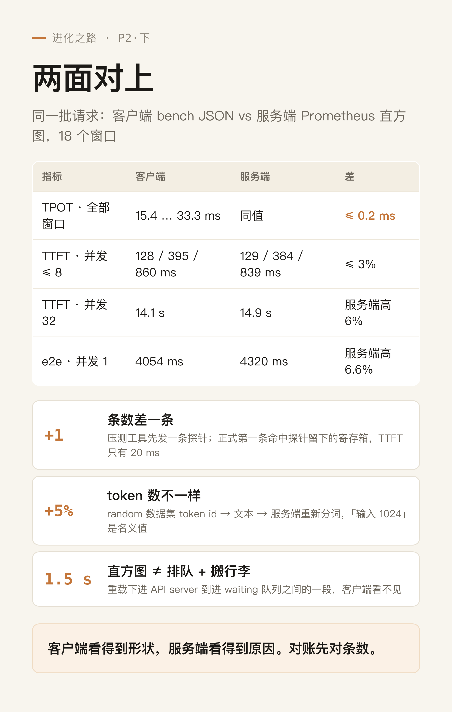

# 进化之路 P2·下 ｜ 拨那个参数：预算、常客、抢占，和两面对上

> 进化之路 · Phase 2 · 下。上篇把车开起来，坐满了一次。这一篇拨三个旋钮——每圈搬行李的预算、寄存箱、座位数——各看一次面板怎么动。最后把客户端和服务端两面的数对一遍：Phase 0 只有一面，现在两面都有。
> 口径同上篇：Qwen3-1.7B BF16，RTX 4060 Laptop 8 GB，vLLM 0.8.5 V1，座位 13,184 token。

---

## 一、行李多重 × 每圈预算

P1·上 的决定 4：chunked prefill 给每圈一个 token 预算 `max_num_batched_tokens`，大行李分几圈搬。文档说大预算 TTFT 好、小预算 ITL 稳。实测一下这个「好」和「稳」各是多少。

并发 4，每人输出 128，输入从 256 到 6K（计划里是 ~~到 16K~~，8K 的上下文上限放不下）。预算 2048 与 8192 各跑一遍。

| 输入 | 预算 | TTFT p50 | ITL p50 | ITL p99 | 吞吐 tok/s |
|---|---|---|---|---|---|
| 256 | 2048 | 127 | 17.2 | 19 | 223 |
| 256 | 8192 | 129 | 16.2 | 18 | 233 |
| 1K | 2048 | **250** | 18.1 | **125** | 185 |
| 1K | 8192 | 474 | 17.8 | 19 | 187 |
| 2K | 2048 | **479** | 19.5 | **238** | 148 |
| 2K | 8192 | 985 | 19.2 | 21 | 148 |
| 6K | 2048 | 5404 | 20.8 | **293** | 54 |
| 6K | 8192 | 5389 | 20.6 | 23 | 53 |

**预算决定的不是快慢，是谁先谁后。** 4 人各带 1K 同时上车：预算 8192 一圈把 4K 行李全搬完，每人 TTFT 都是 474 ms；预算 2048 先搬两人（250 ms），后两人下一圈。中位数被先上车的那一半拉低，看起来「小预算 TTFT 更好」，其实是先后顺序换了。

**小预算的代价全落在老乘客身上。** 预算 2048 时 ITL p99 从 19 → 125 → 238 → 293 ms，随行李线性涨；预算 8192 时全程 18–23 ms。一个 2K 的行李正好吃满 2048 的整圈，车上已经坐着的人这一圈拿不到字。**每圈预算 = 老乘客最多等多久**，这才是决定 4 的真正取舍。

**6K 时预算已经不是瓶颈。** 两种预算 TTFT 都 5.4 s、吞吐都 53：4 × 6K = 24K 行李，座位 13K，一次只坐得下两人，排队和抢占接管了。

吞吐三条线几乎重合：预算不改一圈的油钱，只改行李怎么切。

---

## 二、常客：寄存箱

3072 token 的公共前缀 + 64 个随机 token 的问题 + 64 个字输出，120 条，并发 4。寄存箱关一次、开一次。

| | TTFT p50 | TPOT p50 | ITL p99 | 吞吐 | KV 峰值 | 抢占 |
|---|---|---|---|---|---|---|
| 寄存箱关 | 958 ms | 32.6 | **430** | 76 tok/s | 87% | 2 |
| 寄存箱开 | **69 ms** | 20.7 | 22 | 187 tok/s | **29%** | 0 |

**首字 ÷14。** 3072 = 192 格 × 16，整段命中，每人只搬 64 件尾巴。03 篇「只缓存完整格」在这里正好整除。这是预期内的一层。

**第二层：跑圈也快了，但不是因为寄存让 decode 变快。** 寄存箱关时 4 人各占 3.1K 座位，合计 12.5K，贴着 13K 上限，ITL p99 430 ms 是抢占。开了之后 4 人的清单指向同一批物理格子（P1·下 第一节的 block 共用），座位占用 87% → 29%，抢占归零。

P0 说寄存「省搬不省跑」。这里补一句：**共用座位省下的抢占，也算在跑圈头上。** 这是全天最干净的一组对照——同样 4 个人、同样 3K 行李，只动一个开关。

---

## 三、制造抢占：把座位砍一半

计划是 ~~`gpu-memory-utilization` 0.90 → 0.70~~。0.70 起不来：权重 3.2 GiB 加系统基线 0.9 GiB 已经超预算，引擎报「没有内存给 cache blocks」。改成 0.80，并把上下文上限从 8K 降到 2K，座位 **13,184 → 5,696 token**。乘客同上篇：1024 进 256 出。

| 并发 | 座位 | TTFT p50 | ITL p50 | ITL p99 | 吞吐 | running 峰 | waiting 峰 | 抢占 |
|---|---|---|---|---|---|---|---|---|
| 8（上篇） | 13.2K | 973 ms | 19.8 | 21.1 | 341 | 12 | — | — |
| 8 | **5.7K** | **5.2 s** | 17.5 | 19.9 | 205 | 5 | 4 | 17 |
| 16 | 5.7K | 14.9 s | 17.7 | 29.3 | 207 | 5 | 12 | 35 |

**座位砍一半，吞吐砍四成，首字慢五倍。** 同样 8 个人，13K 座位时车上坐 8–12 人；5.7K 时只坐得下 4–5 人，其余在站台。

**抢占没有把 ITL 抖成上篇那样。** 上篇并发 16 时 92 次抢占、ITL p99 54 ms；这里 35 次抢占，p99 只有 29 ms。区别在上篇是 12 个人挤在 13K 里、每圈行李都在涨、随时有人被踢；这里调度员在门口就只放 4–5 人（4 × 1280 = 5120 < 5696，上了车的人到终点都放得下）。**准入卡得紧，排队代替了抢占。**

**ITL p50 反而更低**（17.5 vs 19.8）：车上人少，一圈更短。座位少的车跑得更快，只是载的人少。

三组实验的服务端峰值放一张表：

| 窗口 | 抢占 | running 峰 | waiting 峰 | KV 峰 |
|---|---|---|---|---|
| exp1 并发 1–32 | 92 | 12 | 23 | 100% |
| exp2 预算 2048 / 8192 | 13 / 5 | 4 | 3 | 98% |
| exp3 寄存关 / 开 | 2 / **0** | 4 | 1 / 0 | 87% / **29%** |
| exp4 并发 8 / 16 | 17 / 35 | 5 | 4 / 12 | 100% |

---

## 四、两面对上

Phase 0 只有客户端一面：Langfuse 里的 span，拿三参数拟合 `e2e ≈ 地板 + prefill × in + TPOT × out` 反推引擎里发生了什么。现在两面都有：每次压测落一份客户端 JSON，同一窗口服务端有 7 个直方图。对一遍。

| 指标 | 客户端 | 服务端 | 差 |
|---|---|---|---|
| TPOT，18 个窗口全部 | 15.4 … 33.3 ms | 同值 | ≤ 0.2 ms |
| TTFT，并发 ≤ 8 | 128 / 195 / 395 / 860 ms | 129 / 195 / 384 / 839 ms | ≤ 3% |
| TTFT，并发 16 / 32 | 3.7 s / 14.1 s | 4.0 s / 14.9 s | 服务端高 6–8% |
| e2e，并发 1 | 4054 ms | 4320 ms | 服务端高 6.6% |

**TPOT 严丝合缝。** 每圈的时间只由服务端决定，网络不参与。P0 拟合出的 TPOT 可以直接当服务端的数用。

**TTFT 在轻载时一致，重载时服务端反而高。** 服务端 TTFT 直方图 ≠ 排队 + 搬行李：并发 32 时排队 12.6 s + 搬行李 0.8 s = 13.3 s，直方图却是 14.9 s，差 1.5 s；并发 1 时差 0。这一段是请求进 API server 到进调度器 waiting 队列之间——分词、进程间转发——只在重载下变得可见。客户端只看到「首字变慢」，服务端能拆成三段。

**e2e 服务端一律高 1–7%，差的是三件小事。** 服务端条数比客户端多 1：压测工具正式开跑前先发一条探针请求，内容和正式第一条相同，所以正式第一条的 TTFT 只有 20 ms——命中了探针留下的寄存箱。服务端 prompt token 总数比客户端多 5%：random 数据集是 token id 解码成文本再发出去，服务端重新分词数不一样，「输入 1024」是名义值。并发 1 的窗口还有 3 条请求落在服务端 5–10 s 的桶里，客户端 p99 只有 4.2 s，没查清，先记着。

**对账先对条数。**

三参数拟合本身也要修一句。exp2 从 256 到 6K 全部点拟合：截距 **−817 ms**。截距为负说明模型错了——6K 那组 TTFT 里有 3.4 s 排队，线性拟合把排队摊进了斜率。P0 的假设是「不排队」，在座位不够时不成立。只取 ≤ 2K 的点：预算 8192 斜率 396 µs/token，服务端 prefill 时间 ÷ 输入 token 是 300，差的 100 是同一批 4 人一起搬时的等待。**客户端拟合给形状，参数要拿服务端直方图校。**

---

## 五、Phase 2 收尾：四个旋钮各管什么

| 旋钮 | 拨了之后先动哪条线 | 不动哪条 |
|---|---|---|
| 并发（上篇） | running 台阶 → KV 顶到 100% → ITL p99 跳 → waiting 涨 | 座位满后吞吐 |
| 每圈预算 | 小预算：ITL p99 随行李线性涨；大预算：同批 TTFT 一样 | 吞吐 |
| 寄存箱 | TTFT ÷14；KV 占用 87% → 29%，抢占归零 | 每圈时间 |
| 座位数 | running 上限降，waiting 和 TTFT 涨；抢占少而小 | ITL p50 反而降 |

---

## 带走的一条

> **每个旋钮都只动生命周期图上的一两个节点。知道它动哪个、不动哪个，面板上任何一条线变了，都能反推是谁拨的。**

**几个可以讨论的问题**

1. 预算 2048 让同批 4 人里 2 人先出首字、2 人晚一圈。如果这 4 人一个是交互式聊天、三个是后台批处理，调度器该不该知道这件事？知道了又能怎么排？
2. 寄存箱开了之后座位占用从 87% 降到 29%。这多出来的座位是继续多坐人（吞吐），还是留着当抢占的缓冲（p99）？谁来定？
3. exp4 里「排队代替了抢占」：准入卡紧，p99 好看，TTFT 难看。线上会更愿意让人在站台等，还是上车之后再被请下来？两种疼，哪一种更容易向用户解释？
4. 两面对账差了一条探针请求和 5% 的分词误差。如果线上只有客户端一面（比如调第三方 API），哪些结论还能信，哪些必须打折？

---

## 附：读了什么、用了什么

- vLLM 文档：[Chunked Prefill](https://docs.vllm.ai/en/latest/configuration/optimization.html)、[Automatic Prefix Caching](https://docs.vllm.ai/en/latest/design/prefix_caching.html)、[Metrics 设计](https://docs.vllm.ai/en/latest/design/metrics.html)
- 李博杰《深入理解 AI Infra：量化分析与系统设计》[第 8 章 推理优化](https://bojieli.github.io/ai-infra-book/manuscripts/08-%E6%8E%A8%E7%90%86%E4%BC%98%E5%8C%96.html)
- 上篇《进化之路 P2·上 ｜ 把一辆车开起来》（发布后补链接）；P1·上《调度员每一圈做的四个决定》、P1·下《行李架的账本与跟班》（发布后补链接）
- 技术版《AI 推理的成本结构》：[02 · KV cache、decode batch，和容量规划该盯的变量](https://mp.weixin.qq.com/s/V49ReCqRfYmphHNSJdDytA)、[03 · cached token 到底省了什么](https://mp.weixin.qq.com/s/7djx-6s9Ld-fVAeBiWiCNg)
