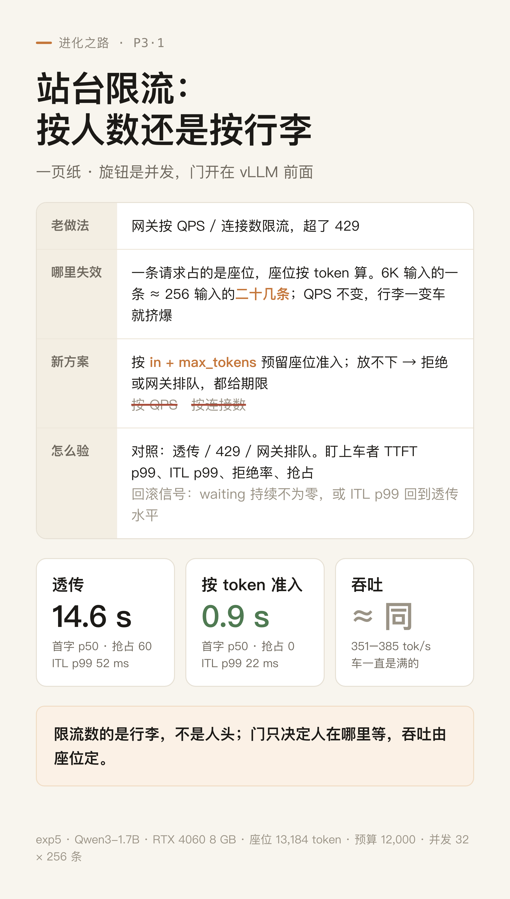
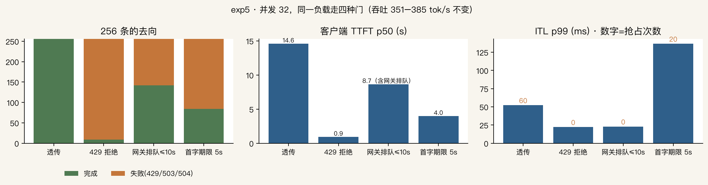
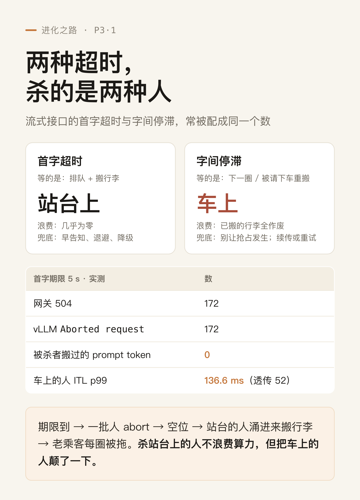

# 进化之路 P3·1 ｜ 站台限流：按人数还是按行李

> 进化之路 · Phase 3 · 1。Phase 2 拨了四个旋钮，每个都只动面板上一两条线。Phase 3 问下一个问题：线上这些旋钮由谁来拨，拨错了怎么兜住。第一个是并发——站台上那道门。
> 口径同 P2：Qwen3-1.7B BF16，RTX 4060 Laptop 8 GB，vLLM 0.8.5 V1，座位 13,184 token。

---

## 一、回看 exp1：多出来的人全在站台

P2·上 的第一组压测，每人 1024 进 256 出，并发从 1 拨到 32：

| 并发 | 输出 tok/s | TTFT p50 | waiting 峰 |
|---|---|---|---|
| 16 | 374 | 1.8 s | 5 |
| 32 | 372 | **14.8 s** | 23 |

并发 16 到 32，吞吐一样，首字慢了八倍。13K 座位 ÷ 每人 ≈ 1.3K 行李 ≈ 10 人，车上最多坐 12 个，多出来的 20 个在站台上等，排队 p50 13 s。

后端的直觉是在前面加一道门：超过 N 就 429。问题是 N 按什么数。

---

## 二、一页纸：限流从 QPS 到 token 预算

| 栏 | 内容 |
|---|---|
| 老做法 | 网关按 QPS 或连接数限流，超了 429 |
| 哪里失效 | 一条请求占的是座位，座位按 token 算。exp2 里 6K 输入的一条 ≈ 256 输入的二十几条；同一个 QPS，行李一变，车就从空到挤爆 |
| 新方案 | 按 **in + max_tokens** 预留座位准入；放不下的拒绝或在网关排队，给期限。~~按 QPS~~ ~~按连接数~~ |
| 怎么验 | 对照：网关拒绝 vs 站台排队 vs 透传。看上车者 TTFT p99、ITL p99、拒绝率、抢占次数；waiting 持续不为零、或 ITL p99 回到透传水平，就是预算设大了 |

预算为什么要带上 max_tokens：vLLM 自己的准入看的是「现在放得下」——上车时只算行李，跑着跑着每人每圈多占一格，座位不够了就请人下车重搬（P1·上 决定 3）。网关按「跑到 max_tokens 也放得下」预留，车上的人到终点都有座位，不会被请下来。

---

## 三、exp5：同一批人，四种门

在 vLLM 前面加一层约 290 行的 Python 网关，只用标准库。进来一条先调后端 `/tokenize` 数行李，加上 max_tokens 就是它要的座位；预算 12,000（13,184 留 10% 余量）。四种门：

- **透传**：不拦，只记账，等于重跑 exp1 并发 32
- **429 拒绝**：放不下直接拒
- **网关排队**：放不下在网关等，10 s 还没座位就 503
- **首字期限 5 s**：不拦，但 5 s 内没出首字就 504 断开

负载同 exp1：并发 32，256 条。压测客户端不重试，拿到错误立刻发下一条。

| 门 | 完成 / 失败 | 用时 | 上车者 TTFT p50 | ITL p99 | 输出 tok/s | running 峰 | KV 峰 | 抢占 |
|---|---|---|---|---|---|---|---|---|
| 透传 | 256 / 0 | 171 s | 14.6 s | 52.2 ms | 382 | 12 | 100% | 60 |
| 429 拒绝 | **9** / 247 | 6 s | 0.9 s | 22.2 ms | 385 | 9 | 84% | 0 |
| 网关排队 ≤ 10 s | 142 / 114 | 104 s | 0.8 s + 排队 | 22.9 ms | 351 | 9 | 91% | 0 |
| 首字期限 5 s | 84 / 172 | 61 s | 4.0 s | **136.6 ms** | 353 | 12 | 100% | 20 |

**门开在哪，排队就在哪，吞吐不变。** 四组输出吞吐 351–385 tok/s，车一直是满的。透传让 23 人在 vLLM 里等，网关排队让他们在网关等，429 直接不让进。座位定了上限，门只决定谁在哪儿等、等多久被告知。

**按 token 预留，抢占归零。** 12,000 ÷ 1280 = 9，网关最多放 9 人；vLLM 自己放 12 人、KV 顶到 100%、抢占 60 次。少坐 3 人换来 ITL p99 从 52 降到 22 ms——车上每个人的每字间隔稳了，exp1 里那一跳没了。代价是 KV 只用到 84–91%：**预留满 max_tokens 是保守的账**，实际输出短于上限时，座位空着。

**拒绝不配退避，就是空转。** 429 组 6 秒烧完 256 条，只完成 9 条：客户端拿到 429 立刻重发，又被拒。完成数难看，车上那 9 人的体验却是四组最好的。网关回的 429 带了 `Retry-After: 1`，但这个客户端不看。线上的 429 必须和客户端退避一起设计，否则限流器只是把排队搬到了网络上。

**数行李本身也在排队。** `/tokenize` 空载 2–8 ms，429 组高压下 p50 43 ms。分词和生成在同一个 API server 进程里，P2·下「两面对上」里那段只在重载下可见的 1.5 s，和这里同源。

---

## 四、两种超时，杀的是两种人

流式接口有两种超时，线上经常被配成同一个数：

| | 首字超时 | 字间停滞超时 |
|---|---|---|
| 等的是什么 | 排队 + 搬行李 | 下一圈；被请下车时要重搬 |
| 杀的是谁 | 站台上的人 | 车上的人 |
| 服务端浪费 | 几乎没有：行李还没搬 | 已搬的行李和已跑的圈全作废 |
| 兜底 | 早告知、让客户端退避或降级 | 查抢占，别让它发生；发生了续传或重试 |

首字期限组的服务端数据说得很清楚。vLLM 日志里 `Aborted request` **172 条**，与网关 504 数一致；窗口内 prompt token 增量 94,855 ≈ 87 条 × 1090，**被杀的 172 条一个 prompt token 都没搬**——期限到时它们都还在 vLLM 的 waiting 队列里。

但它不是免费的：这一组 ITL p99 136 ms，四组最差。期限到 → 一批人被 abort → 位置空出 → 站台上的人涌进来搬行李 → 车上的老乘客每圈被拖，还多了 20 次抢占。**杀站台上的人不浪费算力，但把车上的人颠了一下。** 这 136 ms 里 abort 本身的开销和重搬各占多少，还没拆清。

字间停滞这组没触发：按 token 预留时车上的人不会被请下来，停滞本来就少。它该在透传那种「放进来再说」的配置下盯。

---

## 带走的一条

> **限流数的是行李，不是人头；门只决定人在哪里等，吞吐由座位定。**

**几个可以讨论的问题**

1. 按 max_tokens 预留让 KV 空了 10–15%。如果按历史平均输出长度预留、超了再让 vLLM 自己抢占，这 10% 值不值得换回一部分 p99？
2. 网关排队和 vLLM waiting 队列都是排队，前者能给期限、能按租户排序，后者离座位最近。一个请求该在哪一层等？
3. 429 带 Retry-After 却没人看。调用方是自家 SDK 和是第三方直接调 HTTP，这道门要不要设计成两种？
4. 首字超时 5 s 杀掉的人没有浪费算力，但让车上的人颠了一下。期限应该在网关执行，还是交给调度器——它知道谁还没上车？

---

## 附：读了什么、用了什么

- 李博杰《深入理解 AI Infra：量化分析与系统设计》[8.6 到达率、排队、准入与 SLO 有效吞吐](https://bojieli.github.io/ai-infra-book/manuscripts/08-%E6%8E%A8%E7%90%86%E4%BC%98%E5%8C%96.html)、11.3 队列·优先级·抢占
- vLLM 文档：[Metrics 设计](https://docs.vllm.ai/en/latest/design/metrics.html)；网关只用 `/tokenize` 与 `/v1/completions`
- 前两站：P2·上《把一辆车开起来》、P2·下《拨那个参数》；P1·上《调度员每一圈做的四个决定》（发布后补链接）

口径：exp5 于 2026-09-23 17:20–17:28 连续跑完，Grafana 窗口同；「上车者」指拿到首字的请求；网关排队组 TTFT 不含网关内的排队时间。
