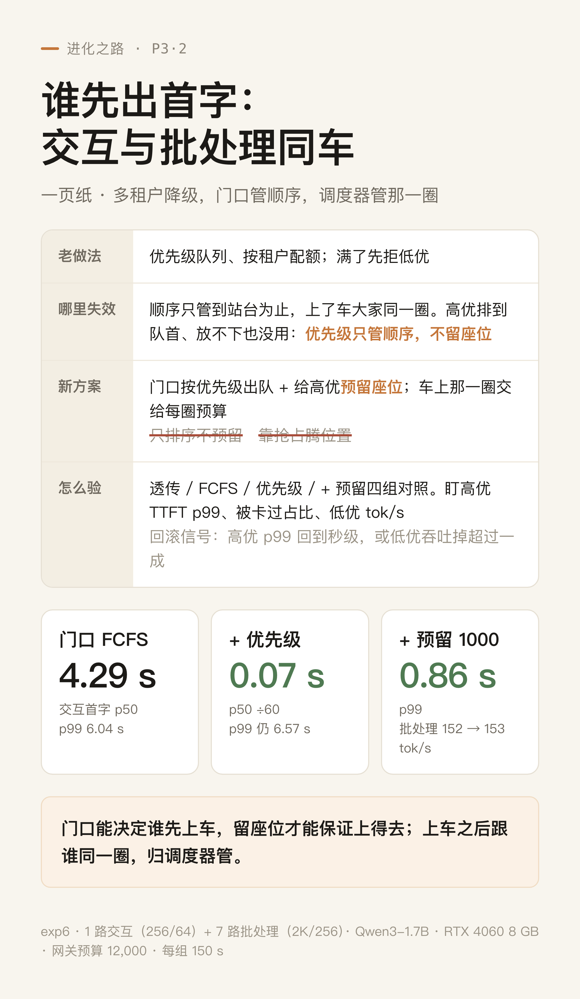
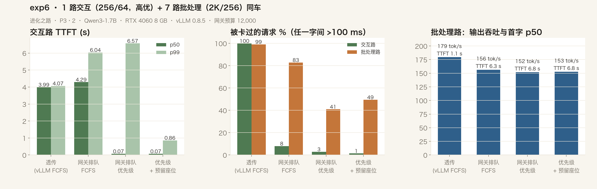
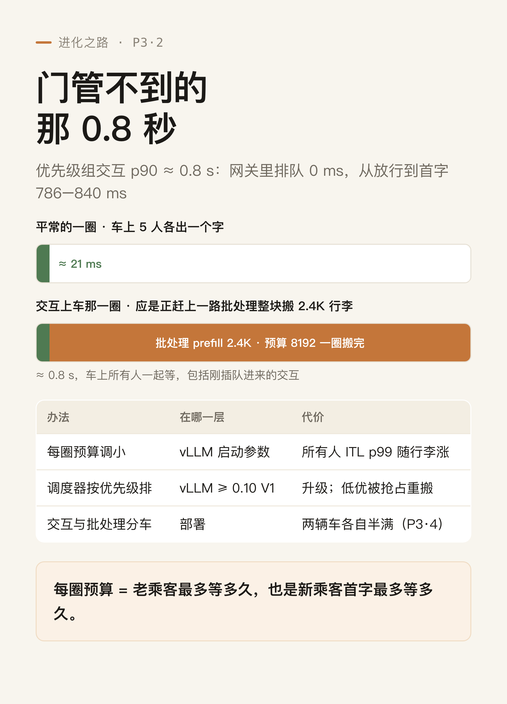

# 进化之路 P3·2 ｜ 谁先出首字：交互与批处理同车

> 进化之路 · Phase 3 · 2。上一篇在站台前加了一道门，门只决定人在哪里等。这一篇让两种乘客上同一辆车：一个在等回复的人，和七个跑离线任务的。门能不能让前者先走？能走多快，代价落在谁身上，以及哪一段门管不到。
> 口径同 P3·1：Qwen3-1.7B BF16，RTX 4060 Laptop 8 GB，vLLM 0.8.5 V1，座位 13,184 token，网关预算 12,000。

---

## 一、回看 exp2：调度器不知道谁是谁

P2·下 的第一组：4 人各带 1K 行李同时上车，每圈预算 2048。一圈只搬得下两人，先搬的两人 TTFT 250 ms，后两人晚一圈，474 ms。

谁先谁后由到达顺序决定。如果那 4 个人里有一个正盯着屏幕等回复，另外三个是后台的批量摘要，调度器也分不出来：vLLM V1 的 waiting 队列只有先来先上（P1·上 决定 2）。0.8.5 里 `--scheduling-policy priority` 存在，打开后会退回旧的 V0 引擎。

所以优先级只能先放在门口：P3·1 那道门本来就有一个队列，让它按请求头 `x-priority` 出队。

---

## 二、一页纸：多租户降级

| 栏 | 内容 |
|---|---|
| 老做法 | 优先级队列、按租户配额；满了先拒低优 |
| 哪里失效 | 顺序只管到站台为止。上了车，大家同一圈：别人整块搬行李的那一圈，高优的人也得等。另外高优排到队首，放不下也没用——**优先级只管顺序，不留座位** |
| 新方案 | 门口按优先级出队 + 给高优**预留座位**（低优只能用预算减去预留）；车上那一圈交给调度器侧的每圈预算。~~只排序不预留~~ ~~靠抢占腾位置~~ |
| 怎么验 | 对照：透传 / 门口 FCFS / 优先级 / 优先级 + 预留。盯高优 TTFT p99、被卡过的请求占比，低优 tok/s；高优 p99 回到秒级、或低优吞吐掉超过一成，就回滚预留量 |

---

## 三、exp6：1 个交互 + 7 个批处理

两类乘客同时开跑，闭环 150 s：

- **交互**：1 路，256 进 64 出，`x-priority: 1`，每条回复完想 0.5 s 再问下一句
- **批处理**：7 路，2K 进 256 出，`x-priority: 100`，一刻不停

压测工具 `vllm bench serve` 没法让每条请求带不同的头，另写了一个 ~120 行的 asyncio 客户端，流式记下每个字的到达时间。

先算预期。批处理每条实际约 2,400 token（随机文本重新分词多 5%，同 P2），7 路 16,800 > 预算 12,000，网关最多放 5 路，站台上常驻 2 路。交互只要 330，但 FCFS 下它得排在那 2 路后面。

| 门 | 交互 完成 | 交互 TTFT p50 / p99 | 交互被卡过 | 批处理 TTFT p50 | 批处理 tok/s |
|---|---|---|---|---|---|
| 透传（vLLM FCFS） | 24 | 3.99 / 4.07 s | **100%** | 1.1 s | **179** |
| 门口 FCFS | 25 | 4.29 / 6.04 s | 8% | 6.3 s | 156 |
| 门口优先级 | **69** | **0.07** / 6.57 s | 3% | 6.8 s | 152 |
| 优先级 + 预留 1000 | **72** | **0.07 / 0.86 s** | 1% | 6.8 s | 153 |

「被卡过」= 这条回复里任意两个字之间隔了 100 ms 以上。四组服务端抢占都是 0。

**换个地方排，顺序不变。** 透传时交互在 vLLM 的 waiting 里等，门口 FCFS 时在网关里等，TTFT 都是 4 s。它前面总有两三路批处理。

**门口插队：首字 ÷60，批处理让出 3%。** p50 4.29 s → 0.07 s，150 s 里交互完成 25 → 69 条。批处理吞吐 156 → 152，首字 6.3 → 6.8 s。插队便宜，因为交互的行李只有批处理的七分之一。

**优先级只管顺序，不留座位。** 优先级组 p99 还是 6.57 s。5 路批处理 × 2,400 正好把 12,000 吃满，交互排到队首也放不下，只能等一路批处理下车——网关日志里那一条排了 6,263 ms。给高优留 1,000 token（批处理只能用 11,000，放 4 路）之后，p99 → 0.86 s。批处理吞吐 152 → 153，**没掉**：车本来就是满的，少坐一路批处理，其余几路每圈更快。

**门也有代价：比 vLLM 自己少坐一个人。** 透传时批处理 179 tok/s，经过网关的三组 152–156，少 13%。vLLM 按「现在放得下」放 6 路，网关按「跑到 max_tokens 也放得下」放 5 路——P3·1 那笔保守的账，在这里是 13% 的批处理吞吐。换来的是被卡过的比例：透传时每一条交互都被卡过（最长字间中位 512 ms），经过网关只剩 1–8%。应是透传下 vLLM 一有人下车就一口气放进两路批处理一起搬行李，一圈 4.8K；网关每次只放一路。

---

## 四、门管不到的那 0.8 秒

优先级两组的交互 p90 都在 0.8 s 上下。这些请求在网关里一毫秒都没排，从放行到首字 786–840 ms。

应是它们上车的那一圈，正赶上一路批处理刚上车、整块搬 2.4K 行李。每圈预算 8192，一圈搬得完，于是这一圈拖到 0.8 s，车上所有人都等着，包括刚插队进来的交互。时间线还没和服务端逐条对上。

这是 P2·下 exp2 的那句「**每圈预算 = 老乘客最多等多久**」换了个角度：新乘客的首字，也要等这一圈跑完。门能决定谁先上车，决定不了上车后跟谁同一圈。要解决它得回到调度器：

| 办法 | 在哪一层 | 代价 |
|---|---|---|
| 每圈预算调小（2048） | vLLM 启动参数 | 大行李 TTFT 变长，所有人 ITL p99 随行李涨（P2 exp2） |
| 调度器按优先级排 | vLLM ≥ 0.10 的 V1 priority | 升级；低优可能被抢占重搬 |
| 交互和批处理分车 | 部署 | 两辆车各自半满，P3·4 的话题 |

---

## 五、满车时先降谁

把这一站的几个动作按对高优的伤害从小到大排，就是一条降级顺序：

| 顺序 | 动作 | exp6 里对应 | 谁付代价 |
|---|---|---|---|
| 1 | 高优插队 | 门口优先级 | 批处理首字 +0.5 s，吞吐 −3% |
| 2 | 给高优留座位 | 预留 1000 | 批处理少坐一路；这张卡上吞吐没变 |
| 3 | 批处理在门口限时，超时 503 | 排队上限（本组设 60 s，未触发） | 批处理重试，要配退避（P3·1） |
| 4 | 请车上的低优下车 | vLLM 抢占 | 已搬的行李作废，最贵，门口做不了 |

前两步几乎免费，这是这组实验最出乎意料的地方。车满的时候，少坐一个低优，其他人跑得更快，总吞吐不怎么掉。

---

## 带走的一条

> **门口能决定谁先上车，留座位才能保证上得去；上车之后跟谁同一圈，归调度器管。**

**几个可以讨论的问题**

1. 预留 1000 token 在这张卡上没花钱。如果高优请求变成 10 路、每路 2K 行李，留多少才够？留多了是不是又回到「座位空着」？
2. 交互路 p90 的 0.8 s 应是来自同车的批处理整块搬行李。把每圈预算从 8192 调到 2048 能救交互，但会让所有人的 ITL p99 涨。这个旋钮应该按租户分开拨吗？
3. 优先级是调用方在请求头里自报的。线上怎么防止每个人都把自己标成高优？
4. 透传时 vLLM 多放一路批处理，吞吐多 13%，代价是每条交互都被卡过一次。如果这辆车只跑批处理，还要不要这道门？

---

## 附：读了什么、用了什么

- 李博杰《深入理解 AI Infra：量化分析与系统设计》[第 11 章 资源调度与运行环境](https://bojieli.github.io/ai-infra-book/)（11.3 队列、优先级与抢占，11.4 限流与路由）、8.6 准入与 SLO 有效吞吐
- vLLM 文档：[Scheduling policy / priority](https://docs.vllm.ai/en/latest/configuration/engine_args.html)（0.8.5 下回落 V0，本文未用）
- 前几站：P3·1《站台限流：按人数还是按行李》、P2·下《拨那个参数》、P1·上《调度员每一圈做的四个决定》（发布后补链接）

口径：exp6 于 2026-09-23 18:06–18:19 连续跑完，每组 150 s；「被卡过」按客户端流式到达时间计，任一字间 > 100 ms；网关预算 12,000，批处理每条实测约 2,400 token。
