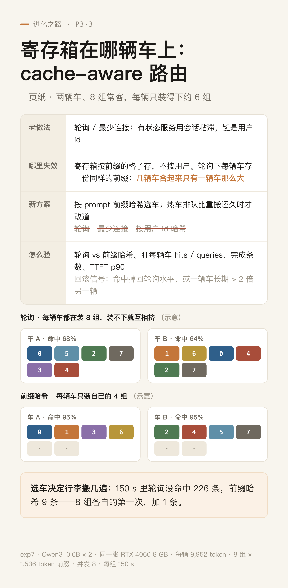
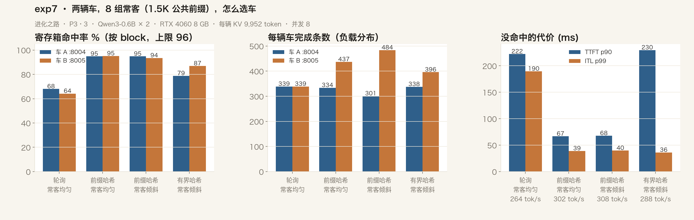
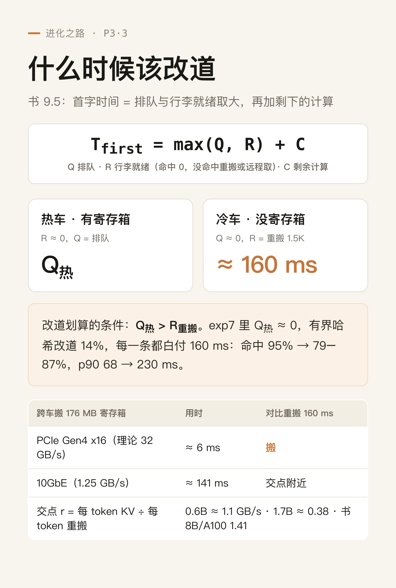

# 进化之路 P3·3 ｜ 寄存箱在哪辆车上：cache-aware 路由

> 进化之路 · Phase 3 · 3。前两篇只有一辆车，门决定谁在哪儿等、谁先上。这一篇开两辆车，同一批常客，看选车这件事能让寄存箱差出多少。
> 口径：两辆 Qwen3-0.6B BF16，同一张 RTX 4060 Laptop 8 GB，vLLM 0.8.5 V1，每辆座位 9,952 token、每圈预算 2048。和前两篇的 1.7B 不是同一辆车，数字只在本篇内比。

---

## 一、回看 exp3：寄存箱只在一辆车上

P2·下 的 exp3：3K 公共前缀的常客，寄存箱一开，TTFT 958 → 69 ms（÷14），座位占用 87% → 29%，抢占归零。

那是一辆车。线上是一排车，前面一个负载均衡。后端最常见的两种——轮询、最少连接——都不知道请求里有没有一段别的车已经搬过的行李。常客被均匀撒到每辆车上，每辆车都要为他再搬一遍。

---

## 二、一页纸：从一致性哈希到亲和路由

| 栏 | 内容 |
|---|---|
| 老做法 | 轮询 / 最少连接；有状态的服务用会话粘滞或一致性哈希，键是用户 id |
| 哪里失效 | 寄存箱按前缀的格子存（P1·下），不按用户。同一个系统提示词被一万个用户共用，按用户哈希照样撒到每辆车上；轮询下每辆车都存一份同样的前缀，**几辆车的寄存箱合起来只有一辆车那么大** |
| 新方案 | 按 prompt 前缀哈希选车；热车超载时有界改道。~~轮询~~ ~~最少连接~~ ~~按用户 id 哈希~~ |
| 怎么验 | 对照：轮询 vs 前缀哈希。盯每辆车的 `prefix_cache_hits / queries`、每辆车完成条数、TTFT p90；命中率掉回轮询水平或一辆车长期 > 2 倍另一辆，就回滚 |

---

## 三、exp7：两辆车，8 组常客

**车**：两辆 Qwen3-0.6B 挤一张 8 GB 的卡，每辆 9,952 token 座位。起车时踩了个坑：默认参数下 vLLM 为「最多 256 人 × 每圈 8192」预留的激活峰值，加权重 1.12 GiB、Windows 基线 0.87 GiB，一辆车就把 45% 的显存吃完了，行李架是 0。把人数上限降到 32、每圈预算降到 2048 才起来。

**乘客**：8 组常客，每组一段 1,536 token 的公共前缀（96 格）+ 64 个随机 token 的问题，输出 64。每条约 100 格，其中 96 格能命中——**命中率上限 96%**。闭环并发 8，每组 150 s。

**先算预期**：8 × 1,536 = 12.3K > 一辆车 9,952。轮询时每辆车都要装全部 8 组，装不下；按前缀哈希，每辆车只装自己那 4 组（6.1K），装得下。

**门**：P3·1 的网关加一个选车函数，四种：轮询；前缀哈希（prompt 前 512 字符算 crc32）；同样哈希但常客热度不均（Zipf 1.1，最热一组占 39%）；有界哈希（目标车在途数超过平均的 1.25 倍就改去最空的车）。每组换一批新前缀，上一组的寄存箱不会被命中。

| 选车 | 常客 | 命中 A / B | 没命中的条数 | 完成 A / B | TTFT p90 | ITL p99 | tok/s |
|---|---|---|---|---|---|---|---|
| 轮询 | 均匀 | 68% / 64% | 226（33%） | 339 / 339 | **222 ms** | **190** | 264 |
| 前缀哈希 | 均匀 | **95% / 95%** | **9** | 334 / 437 | 67 ms | 39 | 302 |
| 前缀哈希 | 倾斜 | 95% / 94% | 28 | 301 / **484** | 68 ms | 40 | **308** |
| 有界哈希 | 倾斜 | 79% / 87% | 138（19%） | 338 / 396 | 230 ms | 36 | 288 |

两辆车全程没有抢占。

**路由决定的不是命中率，是寄存箱的有效容量。** 轮询时两辆车各存一份同样的 8 组，每辆只装得下约 6 组，按随机访问估命中 ≈ 6/8 × 96% = 72%，实测 64–68%。前缀哈希时每辆车只存自己的 4 组，命中 95%，贴着上限；150 s 里只有 9 条没命中——8 组各自的第一次，加 1 条。同样两辆车，轮询时寄存箱合起来是一辆车的容量，哈希时是两辆车的和。

**没命中的代价在 p90 和别人的 ITL 上，不在 p50。** 四组 TTFT p50 都是 55–58 ms：中位数那条总是命中的。拆开看，命中的人 TTFT 53 ms，没命中的 215 ms。轮询组三分之一的人没命中，p90 就落在他们身上；他们整块搬 1.5K 行李的那一圈，车上其他人也等着，ITL p99 190 ms（哈希组 39）。P3·2 那 0.8 秒应是同一件事。吞吐 264 vs 302，少的 13% 全是重搬的行李。

**哈希天然不均。** 8 个常客分两辆车，均匀时就偏到 43 : 57；倾斜时最热的一组和另外三组落在同一辆车，38 : 62。但在这张卡上偏了没代价：吞吐 308 反而最高。两辆车共用一张 GPU，热的那辆一圈人多一点，每圈时间几乎不变；并发 8 也轻，谁都没排队。

**有界哈希在这里只付了代价。** 为了均衡改道 14% 的请求，改过去的车上没有它的寄存箱：命中掉到 79–87%，p90 68 → 230 ms，吞吐 308 → 288。均衡的收益要在两辆车各自独立、热车真的在排队时才出现，这张卡上只看得见命中的那一半。

---

## 四、什么时候该改道：T_first = max(Q, R) + C

书 9.5 把首字时间写成三段：

- **Q**：这辆车最早什么时候能开始算——排队
- **R**：这条请求的行李什么时候就绪——命中就是 0，没命中要重搬，或者从别处取
- **C**：行李就绪之后还要算的部分

T_first = max(Q, R) + C。热车有寄存箱，R ≈ 0，但 Q 大；冷车 Q ≈ 0，但 R 是一次重搬。改道划算的条件是：

> **Q_热 > R_重搬**

exp7 里 R_重搬 ≈ 215 − 53 ≈ 160 ms（1.5K 前缀），Q_热 ≈ 0。所以一条都不该改，有界哈希改了 14%，每一条都白付 160 ms。

这也说明了有界哈希用「在途条数」当阈值的问题：条数多不等于排队久。更贴近的阈值是**预计排队时间 vs 预计重搬时间**，后者和前缀长度成正比——3K 的常客比 300 的常客更值得等。

---

## 五、带宽交点：跨车搬寄存箱比重搬划算吗

改道的另一种做法：不重搬，从热车把寄存箱搬过来。书上算的交点是 **1.41 GB/s**（Qwen3-8B，A100）：取回带宽超过 GPU 生产 KV 的速度，搬就比算快。

用这张卡的数：

| | 每 token KV | 重搬速度 | KV 生产速率 r |
|---|---|---|---|
| Qwen3-0.6B，exp7 | 112 KB | 1,536 token / 160 ms ≈ 105 µs/token | **≈ 1.1 GB/s** |
| Qwen3-1.7B，P2 | 112 KB | 300 µs/token（服务端 prefill 直方图） | ≈ 0.38 GB/s |
| 书：Qwen3-8B，A100 | — | — | 1.41 GB/s |

1.5K 前缀的寄存箱是 1,536 × 112 KB ≈ 176 MB。

- 同机两张卡之间走 PCIe（Gen4 x16 理论单向 32 GB/s）：约 6 ms，远比重搬 160 ms 快
- 10GbE（1.25 GB/s）：141 ms，和重搬差不多——交点就在这
- 跨机房：不用算了

**重搬越慢，交点越低，搬越划算**：同一张 4060，0.6B 的交点 1.1 GB/s，1.7B 只有 0.38 GB/s，千兆网都快赶上了——每 token KV 一样大，1.7B 算得慢三倍。反过来，H100 一类的卡 prefill 快，交点往上走，只有 NVLink / RDMA 这一档才值得搬。

书里的例 9.7 是另一种问法：热车有寄存箱但排队 Q，冷车要远程取。冷车赢的条件是 V / B < Q，即 B > V / Q。代入 176 MB：Q = 250 ms 时要 0.70 GB/s，Q = 50 ms 时要 3.5 GB/s。

vLLM 0.8.5 的两个实例之间没有寄存箱迁移，这一节是纸面账；做这件事的是 Mooncake、LMCache 一类的 KV 存储层。

---

## 六、这张卡做不了的

- **倾斜的代价**：两辆车共用一张 GPU，热车排队、冷车空转的场景被抹平了。有界哈希的收益要两张卡才测得出
- **重载**：并发 8 时 Q ≈ 0，max(Q, R) 里只有 R。重载下热车的 Q 才会和 R 竞争，那时改道的阈值才有意义
- **跨车搬寄存箱**：只能纸面算

---

## 带走的一条

> **选车决定行李搬几遍。按前缀哈希，几辆车的寄存箱才是加起来的；热车排队比重搬还久的时候，才该改道。**

**几个可以讨论的问题**

1. 哈希的键取 prompt 前 512 字符。如果不同租户的系统提示词前 512 字相同、后面不同，会发生什么？键该取多长？
2. 有界哈希按「在途条数」改道，本文说该换成「预计排队时间 vs 预计重搬时间」。这两个数网关怎么拿到？
3. 扩一辆车，普通取模哈希下大部分常客会换车、寄存箱全部作废。一致性哈希能把这个比例降到多少？寄存箱要多久才能重新热起来？
4. 交点 = 每 token KV ÷ 每 token 重搬时间，同一张卡上换个模型就差三倍。同一个集群里混着新卡旧卡、大模型小模型，跨车搬寄存箱的策略要不要按「卡 × 模型」分开？

---

## 附：读了什么、用了什么

- 李博杰《深入理解 AI Infra：量化分析与系统设计》[第 9 章 分布式推理](https://bojieli.github.io/ai-infra-book/manuscripts/09-%E5%88%86%E5%B8%83%E5%BC%8F%E6%8E%A8%E7%90%86.html)（9.5 KV 分布与缓存亲和路由，例 9.7）
- vLLM 文档：[Automatic Prefix Caching](https://docs.vllm.ai/en/latest/design/prefix_caching.html)；指标 `vllm:gpu_prefix_cache_hits_total` / `queries_total`
- 前几站：P3·1《站台限流》、P3·2《谁先出首字》、P2·下《拨那个参数》、P1·下《行李架的账本与跟班》（发布后补链接）

口径：exp7 于 2026-09-23 19:41–19:53 连续跑完，每组 150 s；命中率 = 两辆车 `gpu_prefix_cache_hits / queries` 的窗口差（按格）；「没命中」按客户端 TTFT ≥ 120 ms 划分；两辆车共用一张 GPU。
