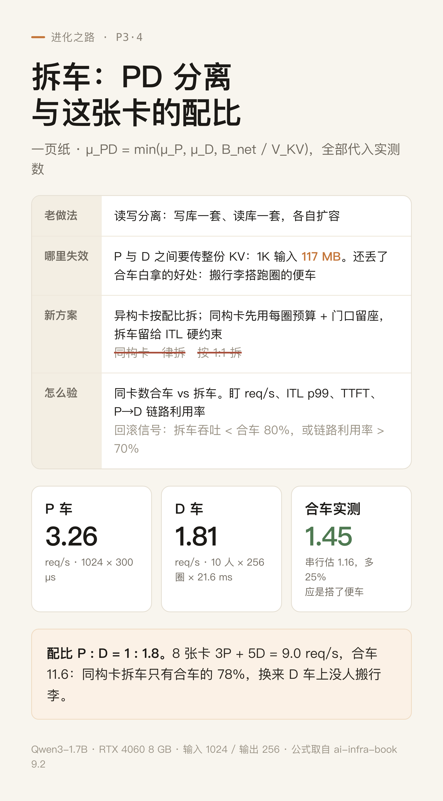
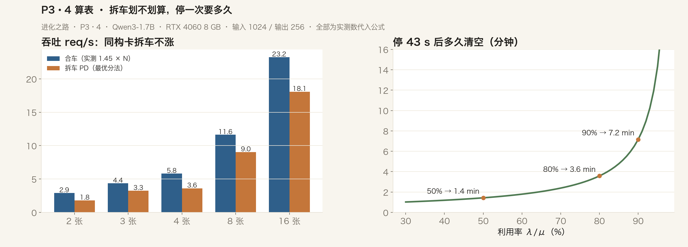

# 进化之路 P3·4 ｜ 拆车：PD 分离与这张卡的配比

> 进化之路 · Phase 3 · 4。前三篇都在门口做文章：放谁上、谁先上、上哪辆。这一篇动车本身——把搬行李的车和跑圈的车分开，值不值？这一篇不动手，只用前面测过的数代入书里的公式。最后是 Phase 3 的收尾：四个旋钮，线上由谁来拨。
> 口径同 P3·1：Qwen3-1.7B BF16，RTX 4060 Laptop 8 GB，vLLM 0.8.5 V1，座位 13,184 token；负载同 exp1，每人 1024 进 256 出。

---

## 一、回看：搬行李的一圈，车上的人都在等

前三篇反复撞到同一件事，换了四个样子：

| 在哪看到 | 现象 |
|---|---|
| P2·下 exp2 | 每圈预算 2048，ITL p99 随行李线性涨到 293 ms |
| P3·2 exp6 | 透传时每一条交互都被卡过；插队之后还剩 0.8 s 应是赶上别人整块搬行李 |
| P3·3 exp7 | 轮询没命中的人整块重搬 1.5K，同车 ITL p99 190 ms |
| P2·上 exp1 | 座位满了，被请下车的人回站台重搬，ITL p99 21 → 54 ms |

搬行李（prefill）和跑圈（decode）坐同一辆车，共用座位，共用每一圈。门口的办法只能挑谁先上，挡不住「这一圈有人在搬大件」。

PD 分离的想法很直接：**一种车只搬行李，搬完把行李（KV）送到另一种只跑圈的车上。**

---

## 二、一页纸：拆车

| 栏 | 内容 |
|---|---|
| 老做法 | 读写分离：写库一套、读库一套，各自扩容 |
| 哪里失效 | 读写之间只传一个 id；P 和 D 之间要传整份 KV，1K 输入就是 117 MB。拆开之后多了一段搬运，还丢了一件合车时白拿的好处：搬行李可以搭跑圈的便车 |
| 新方案 | 异构卡按配比拆（算力强的搬行李，显存带宽大的跑圈）；同构卡先用每圈预算 + 门口留座，拆车留给 ITL 硬约束。~~同构卡一律拆~~ ~~按 1:1 拆~~ |
| 怎么验 | 对照：合车 vs 拆车，同样卡数。盯 req/s、ITL p99、TTFT p50（多了一段搬运）、P→D 链路利用率；拆车吞吐低于合车 80%、或链路利用率 > 70%，就回滚 |

---

## 三、这张卡的配比

书 9.2 的式子：拆车之后整体吞吐是三者取小——

> μ_PD = min(μ_P, μ_D, B_net / V_KV)

P 车能搬多快、D 车能跑多快、中间那根线能送多快。三个数都用自己测过的：

| | 算法 | 每张卡 req/s |
|---|---|---|
| P 车（只搬行李） | 1 ÷ (1024 × 300 µs = 307 ms) | **3.26** |
| D 车（只跑圈） | 10 人 ÷ (256 圈 × 21.6 ms = 5.5 s) | **1.81** |
| 合车（exp1 并发 32 实测） | 372 tok/s ÷ 256 | **1.45** |

300 µs/token 取自 P2·下「两面对上」的服务端 prefill 直方图；21.6 ms 是 exp1 车坐满时的 ITL；10 人是 13,184 座位 ÷ 每人 1,280。

**配比 P : D = 1 : 1.8。** 一张 P 车搬的行李，够 1.8 张 D 车跑。

| 卡数 | 最优分法 | 拆车 req/s | 合车 N × 1.45 | 拆车 / 合车 |
|---|---|---|---|---|
| 2 | 1P + 1D | 1.81 | 2.91 | 62% |
| 4 | 2P + 2D | 3.62 | 5.81 | 62% |
| 8 | 3P + 5D | 9.04 | 11.62 | 78% |
| 16 | 6P + 10D | 18.08 | 23.25 | 78% |

**同构卡拆车，吞吐只有合车的六到八成。** 书上 8 张 A100 同构拆车是 −7%，这里差得更多。原因在合车那个 1.45：如果搬行李和跑圈老老实实轮流占车，一张卡应是 1 / (1/3.26 + 1/1.81) = **1.16** req/s，实测却是 1.45，多出 25%。

**多出来的 25%，应是搬行李搭了跑圈的便车。** P0 算过：跑圈的每一圈在等权重从显存里读出来（这张卡 13.3 ms 的地板，效率 86%），算力大半空着。chunked prefill 把行李切块塞进这些圈里，用的是本来闲着的算力。拆车之后，D 车的算力继续闲着，P 车的显存带宽也闲着——两边各浪费一半。

卡数少时更吃亏：2 张卡只能 1P + 1D，P 车一半时间在等 D 车。整数配比，书上也提了。

---

## 四、拆了之后，KV 怎么送过去

P 车搬完的行李要整份送到 D 车。每条 1024 token × 112 KB = **117 MB**；8K 上下文是 0.94 GB。

| 链路 | 1K 送一次 | 占 prefill 307 ms 的 | 链路能扛 req/s | 8K 送一次 |
|---|---|---|---|---|
| PCIe Gen4 x16（同机，理论） | 3.7 ms | 1% | 272 | 29 ms |
| RoCE 100G | 9.4 ms | 3% | 106 | 75 ms |
| 25GbE | 37.6 ms | 12% | 27 | 301 ms |
| 10GbE | 94 ms | 31% | 11 | 752 ms |

书 9.2 的那个 48 ms（Qwen3-8B、8K、1.125 GiB、25 GB/s）在这张卡上是 1.7B、8K、0.94 GB、同样 25 GB/s → **38 ms**。量级一样。

两件事：

- **首字多一段**：TTFT = 排队 + 搬行李 + **送过去**。10GbE 下 1K 请求首字多 31%；8K 请求多 0.75 s，比搬行李本身还久
- **线也是一个瓶颈**：16 张卡拆车要 18 req/s，10GbE 一根线只扛 11，得上 25GbE 以上。μ_PD 里第三项在这时候才会出来

这张卡的 1.7B 每 token KV 112 KB，其实是「小模型、大 KV」——GQA 8 个 KV 头、没有 MLA。书 9.7 算了 MLA 把每条 KV 从 1.125 GiB 压到 549 MiB，送的时间减半；DeepSeek 一类的模型拆车更划算，一半原因在这。

---

## 五、那拆车换来了什么

吞吐亏了，换来的是 D 车上**没有人搬行李**：每一圈都是平常的一圈。

| | 合车，前面测过的 | 拆车后 D 车（应是） |
|---|---|---|
| ITL p99 | 53 ms（exp1 抢占）、190 ms（exp7 没命中）、293 ms（exp2 预算 2048） | ≈ 21 ms，车坐满时的平常一圈 |
| 被卡过的交互 | 100%（exp6 透传） | ≈ 0 |
| 首字 | 排队 + 搬行李 | 排队 + 搬行李 + 送过去 |

右列是推算：D 车只跑圈，一圈的时间就是 exp1 车坐满时的 ITL，不再有别人的行李插进来。

所以拆车在同构卡上是**用吞吐换 ITL 的硬上限**。线上什么时候值：语音、实时对话这类「每个字都不能卡」的场景（Phase 4 的话题），或者有异构卡——算力强的卡搬行李、显存带宽大的卡跑圈，书 9.2 的 A100 + H20 就是这个配法，两边都不浪费。

---

## 六、从车库出新车：排空时间

最后一个旋钮不在车上，在车库里。一辆车停了（重启、扩容新车还没热），这段时间来的人全在站台攒着；车回来之后，它得一边接新来的，一边消化攒下的。书 9.6.1：

> T_drain = λ · T_s / (μ − λ)

T_s 是停了多久，λ 是到达率，μ 是车回来后的处理能力。这张卡上 bench-vllm 从 `systemctl start` 到 `/health` 就绪是 **43 s**（exp6 窗口实测，含加载权重和 CUDA graph），μ 用合车实测 1.45 req/s：

| 利用率 λ/μ | 攒下的人 | T_drain | 从停到清空 |
|---|---|---|---|
| 50% | 31 | 43 s | 1.4 min |
| 70% | 44 | 100 s | 2.4 min |
| 80% | 50 | 172 s | 3.6 min |
| 90% | 56 | 387 s | **7.2 min** |
| 95% | 59 | 817 s | 14.3 min |

**攒下的人数差不多，清空的时间差二十倍。** 50% 到 95%，站台上攒的只从 31 人到 59 人；但 μ − λ 从 0.73 缩到 0.07，车回来之后能腾出来消化积压的余力只剩一成。

后端扩容的直觉是「机器起来就好了」。这里机器起来只是开始：利用率 90% 时一次 43 s 的重启，站台要七分钟才清空，这七分钟里每个新来的人都在排队。**扩容要在利用率到 70% 之前扩**，或者新车起来之前先在门口限流（P3·1），不让 λ 贴着 μ。

---

## 七、Phase 3 收尾：四个旋钮，线上由谁拨

P2 收尾时是一张「每个旋钮动哪条线」的表。P3 回答的是：线上这个旋钮谁来拨，拨错了怎么兜。

| 旋钮 | 谁来拨 | 拨法 | 拨错了的信号 | 篇 |
|---|---|---|---|---|
| 并发 | **网关** | 按 in + max_tokens 预留座位准入；429 配退避；首字期限 | waiting 持续 > 0，或 ITL p99 回到透传水平 | P3·1 |
| 每圈预算 | **调度器**（+ 网关排序） | 门口按优先级出队 + 给高优留座位；那一圈交给调度器的每圈预算 | 高优 p99 回到秒级，或低优吞吐掉超一成 | P3·2 |
| 寄存箱 | **路由** | 按 prompt 前缀哈希选车；热车排队比重搬还久才改道 | 命中率掉回轮询水平 | P3·3 |
| 座位数 | **容量规划** | 同构卡先不拆；异构卡按 1 : μ_P/μ_D 拆；利用率 70% 前扩容 | 拆车吞吐 < 合车 80%；T_drain 超过 SLO 窗口 | P3·4 |

四个旋钮都指回同一张生命周期图：并发管站台，每圈预算管那一圈，寄存箱管要不要搬，座位数管车本身。

---

## 带走的一条

> **同构卡拆车是用吞吐换 ITL 上限；合车时搬行李搭了跑圈的便车，拆开之后这一份就没了。车停一次，利用率越贴近上限，站台越久才清空。**

**几个可以讨论的问题**

1. 合车比串行估算多出 25%，本文说应是 chunked prefill 用了跑圈时闲着的算力。怎么在面板上验证这件事？看哪两条线？
2. 配比 1 : 1.8 是按输入 1024、输出 256 算的。如果负载变成输入 8K、输出 64（RAG 类），配比会往哪边偏？P 车还够吗？
3. 利用率 90% 时一次重启要 7 分钟才清空。扩容触发线设在 70%，意味着平时三成算力空着。这三成能不能拿去跑 P3·2 里的批处理，需要时再让出来？
4. 拆车后首字多了一段「送过去」。如果 P 车搬完 KV 先流式送出前几层、D 车边收边开始第一圈，这段能省多少？

---

## 附：读了什么、用了什么

- 李博杰《深入理解 AI Infra：量化分析与系统设计》[第 9 章 分布式推理](https://bojieli.github.io/ai-infra-book/manuscripts/09-%E5%88%86%E5%B8%83%E5%BC%8F%E6%8E%A8%E7%90%86.html)（9.2 PD 分离与配比，例 9.2；9.6.1 启动与排空；9.7 综合比较，例 9.8）
- 算表脚本 `phase3/pd_ratio.py`：所有输入都是 P2 / P3 的实测数，公式照书
- 前几站：P3·1–3、P2·上《把一辆车开起来》、P2·下《拨那个参数》、P0《一辆公交车，讲完推理成本的三篇账》（发布后补链接）

口径：本篇无新实验，全部为实测数代入公式。μ_P 按 prefill 串行算（300 µs/token 已含批内并行）；μ_D 按座位满 10 人、ITL 21.6 ms；合车 1.45 req/s 为 exp1 并发 32 实测；重启 43 s 为 exp6 窗口 bench-vllm 从启动到就绪；KV 每 token 114,688 B（28 层 × 8 KV 头 × 128 × 2 × BF16）。
