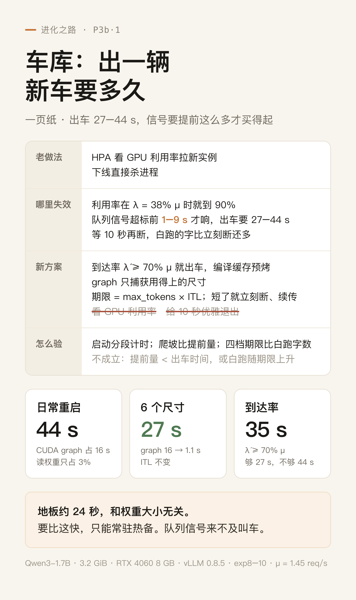
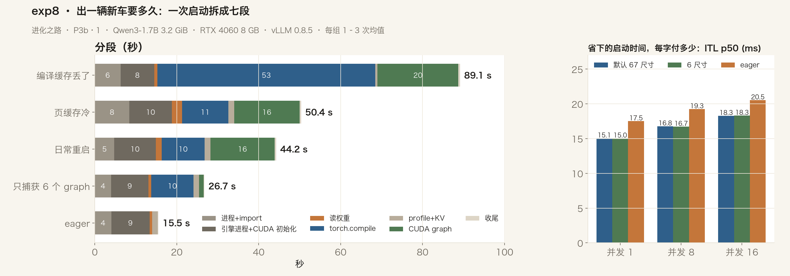
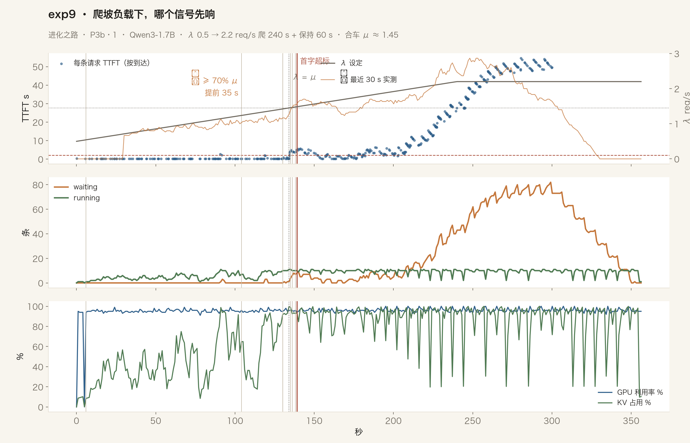
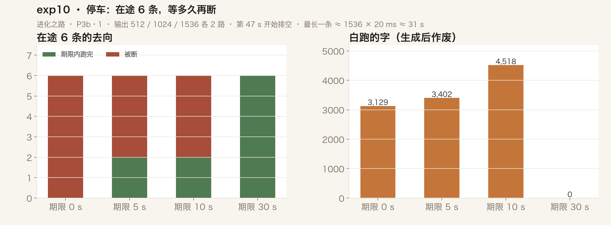
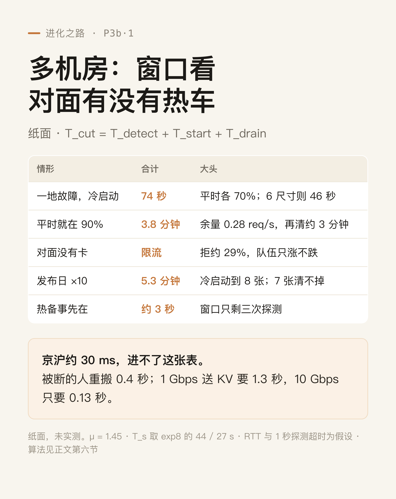

# 进化之路 P3b·1 ｜ 车库：出一辆新车要多久

> 进化之路 · Phase 3b · 1。P3 管的是车在跑的时候：放谁上、谁先上、上哪辆、要不要拆。这一篇管车库：出一辆新车要多久、什么信号来得及叫车、停车时车上的人怎么办。多机房一节只算账。
> 口径同 P3：Qwen3-1.7B BF16，RTX 4060 Laptop 8 GB，vLLM 0.8.5 V1，座位 13,184 token。μ = 1.45 req/s，沿用 exp1。

---

## 一、回看：43 秒是个黑盒

P3·4 用书 9.6 的式子算过一次重启。停了 T_s 秒，站台要再清这么久：

> T_drain = λ · T_s / (μ − λ)

T_s 取的是 bench-vllm 从 `systemctl start` 到 `/health` 的 **43 s**。利用率 90% 时，从停到清空 **7.2 分钟**。50% 到 90%，站台上攒的人只从 31 到 56，清空时间从 1.4 分钟拉到 7.2 分钟——余量 μ − λ 缩了，车回来之后腾不出手。

当时 43 秒没有拆开。技术版 02 篇给 140 GB 权重排过五级台阶，最慢一级 70 秒，引擎另有约 20 秒固定开销。这张卡的权重只有 3.2 GiB。43 秒里到底哪一段在走，哪一段能压，得把启动日志切开看。

---

## 二、一页纸：车库

| 栏 | 内容 |
|---|---|
| 老做法 | HPA 看 CPU / GPU 利用率拉新实例；下线直接杀进程，在途的流式连接随进程断 |
| 哪里失效 | GPU 利用率在 λ 只有 μ 的 38% 时就到 90%。waiting、KV、TTFT 挤在首字超标前 1–9 s 才响，出一辆车要 27–44 s。给 10 秒再断，白跑的字比立刻断还多 |
| 新方案 | 到达率 λ̂ ≥ 70% μ 就出车；graph 只捕获用得上的尺寸，编译缓存预烤进镜像。排空期限 = max_tokens × ITL，否则立刻断开，用已出的字续传。~~看 GPU 利用率~~ ~~给 10 秒优雅退出~~ |
| 怎么验 | 启动日志分段计时；爬坡比每个信号的提前量和出车时间；四种排空期限比白跑字数。提前量小于出车时间，或白跑字数随期限上升，方案就没成立 |

---

## 三、exp8：44 秒拆成七段

同一辆车反复起，按 journal 时间戳切成七段。日常重启 3 次，均值 **44.2 s**，和 P3·4 用的 43 s 是同一口径：从启动到就绪。

| 配置 | 进程 + import | 读权重 | torch.compile | CUDA graph | 合计 |
|---|---|---|---|---|---|
| 日常重启 | 4.8 | 1.4 | 10.5 | **15.7** | **44.2** |
| 页缓存冷 | 8.4 | 2.5 | 11.3 | 16.0 | 50.3 |
| 编译缓存移走 | 6.3 | 0.8 | **53.2** | 19.7 | **89.1** |
| 只捕获 6 个 graph 尺寸 | 4.0 | 0.7 | 10.4 | **1.1** | **26.7** |
| `--enforce-eager` | 4.0 | 0.7 | — | — | **15.5** |

表里没列的两段（引擎进程 + CUDA 初始化、profile + KV）每次都在，日常重启里分别是 10.1 s 和 1.4 s。编译缓存目录 `~/.cache/vllm/torch_compile_cache` 只有 **31 MB**。

**读权重只占 3%。** 3.2 GiB 从本机 NVMe 热读 1.4 s，页缓存全冷也只到 2.5 s。清缓存多出来的 6 秒里，一半是 Python 库自己从盘上读：import 从 4.8 s 涨到 8.4 s。02 篇五级台阶的主角是 140 GB 从对象存储搬下来的 70 秒；同样按 2 GB/s 估，这张卡的 3.2 GiB 只要约 1.6 秒。台阶塌了。

**最大的一段是 CUDA graph，而且大部分尺寸用不上。** 默认捕获 67 个尺寸（1–512）。这张卡车上最多坐 12 人，1–32 以外的 61 个一次都用不上。只捕获 `[32, 16, 8, 4, 2, 1]`，graph 从 15.7 s 降到 1.1 s，整次启动 44 → 27 s。

**编译缓存 31 MB，丢了就多等 45 秒。** 缓存在时 torch.compile 仍要 10 秒（重新追踪再加载），移走之后是 53 秒，合计 89 秒。它按模型、vLLM 版本和参数哈希分目录，任何一项变了就作废。镜像里预烤的该是这 31 MB，不是那 3.2 GiB 权重。

省下的启动时间，decode 付多少（256 进 128 出，ITL p50）：

| 配置 | 并发 1 | 并发 8 | 并发 16 |
|---|---|---|---|
| 默认 67 尺寸 | 15.1 ms | 16.8 ms | 18.3 ms |
| 6 尺寸 | 15.1 ms | 16.7 ms | 18.3 ms |
| eager | **17.5 ms** | **19.3 ms** | **20.6 ms** |

6 个尺寸和默认的 ITL 差在 0.1 ms 以内，吞吐同一水平。eager 起得最快，每个字慢约 15%（并发 1：15.1 → 17.5 ms），吞吐少一成到一成五。一辆车要是跑满一小时，省下的 11 秒启动早被慢下来的每一圈吃回去。eager 留给「起来跑一会儿就收」的短命实例。

**地板约 24 秒。** 6 尺寸那组里还剩：import 4.0、引擎进程 + CUDA 初始化 9.1、编译加载 10.4。这三段和权重多大无关。02 篇估的「约 20 秒引擎固定开销」，在这张卡上拆开是 24 秒；graph 那 16 秒不在地板里，按捕获的尺寸数缩放。要比 24 秒更快，只能不从零起：常驻热备，或 vLLM 的 sleep mode 把权重留在内存里、唤醒时只搬回显存。后一条没有测。

代回 P3·4 的式子，利用率 90% 时从停到清空 = 10 × T_s：

| T_s | 从停到清空 |
|---|---|
| 日常 44 s | 7.3 min（P3·4 用 43 s 算的是 7.2） |
| 6 尺寸 27 s | **4.5 min** |
| 编译缓存丢了 89 s | **15 min** |

出车时间直接乘进清空时间。利用率越贴上限，这段越放大。

---

## 四、exp9：哪个信号来得及

看板原话是：扩容要看 `num_requests_waiting` 的斜率，它比绝对值更有用；GPU 拉起是分钟级，信号必须提前。

开环泊松爬坡，每人 1024 进 256 出，λ 从 0.5 线性爬到 2.2 req/s（240 s），再保持 60 s。每秒采一次 waiting、running、KV 占用和 GPU 利用率。首字超标定义为：按到达时间滚动 10 秒，TTFT 中位数首次超过 2 秒。这一刻在 **t = 139 s**，λ 在 134 s 越过 μ。信号要连续 5 秒成立才算响。

| 信号 | 报警 | 当时 λ（λ/μ） | 比超标早 | 够 27 s 出车 | 够 44 s |
|---|---|---|---|---|---|
| 到达率 λ̂（近 30 s）≥ 70% μ | 104 s | 1.24（85%） | **35 s** | 够 | 不够 |
| GPU 利用率 ≥ 90% | 6 s | 0.55（38%） | 133 s | 开场即饱和 | — |
| KV 占用 ≥ 90% | 130 s | 1.42（98%） | 9 s | 不够 | 不够 |
| running ≥ 10 | 130 s | 1.42 | 9 s | 不够 | 不够 |
| waiting 斜率 ≥ 0.1 / s | 135 s | 1.46 | 4 s | 不够 | 不够 |
| waiting ≥ 5 | 136 s | 1.47 | 3 s | 不够 | 不够 |
| 已完成请求 TTFT p90 > 2 s | 138 s | 1.49 | 1 s | 不够 | 不够 |

**GPU 利用率开场就满。** λ 只有 μ 的 38% 时，利用率已经 90% 以上。decode 每一圈都在读权重，一个人坐车也是满油门——P0 说过，跑圈在等油。CPU 服务那套「利用率过 70% 就扩」搬过来，车一启动就报警。

**队列类信号挤在最后 10 秒。** KV、running、waiting、waiting 斜率、TTFT，五个都在 130–138 s 响，离超标 1–9 秒。λ < μ 时几乎不排队，一越过 μ 队伍就线性涨。这是一面墙，中间没有坡。看板里「斜率比绝对值早」，在这张卡上早了 1 秒（4 s 对 3 s）。

**来得及的是到达率本身。** λ̂ 用最近 30 秒的到达数估计。它在 104 s 响，提前 35 秒：104 + 27 = 131 s 车就绪，λ 刚好摸到 μ，比超标早 8 秒。104 + 44 = 148 s 车才就绪，超标已经过了 9 秒。exp8 把 graph 从 67 个尺寸砍到 6 个，差的就是这 17 秒——砍完，这条信号才买得起一辆车。

30 秒窗口自己也在拖。报警时真实 λ 已经是 μ 的 85%，λ̂ 还停在 70%。窗口再缩短，爬坡在 μ 附近的起伏会让它来回响；要更早，得靠日周期、发布日历，或者上游的流量预告。μ 也得是测出来的：这里 1.45 是 exp1 的数，行李一长它就变小。

---

## 五、exp10：停车时车上的人

出车是车库的一半。另一半是停车：重启、缩容、滚动发布，车上还有人在一个字一个字往下说。流式长连接不能直接杀。

网关加了排空：`POST /gw/drain?deadline=秒` 之后拒绝新请求，回 503 和 `Retry-After`；在途的请求再等这么多秒，到期断开后端，vLLM 随之 abort，日志记下已经发出去的字数。

负载是错开的 6 路：输出 512 / 1024 / 1536 各 2 路，输入 512。6 × 2,048 = 12.3K，低于座位 13.2K，排空期间不会被抢占搅进来。第 47 秒开始排空。客户端一收到 503 就停，不再对 503 空转。

| 期限 | 期限内跑完 | 被断 | 被断者已出的字 | 白跑的字 |
|---|---|---|---|---|
| 0 s | 0 / 6 | 6 | 350/512、351/1024、864/1536，各两路 | 3,129 |
| 5 s | 2 / 6 | 4 | 594/1024、1107/1536 | 3,402 |
| 10 s | 2 / 6 | 4 | 873/1024、1386/1536 | **4,518** |
| 30 s | **6 / 6** | 0 | — | **0** |

白跑的字 = 已经生成、随后作废的 token。同长度的两路进度一致。

**期限按最长那条留：max_tokens × ITL。** 这批在途在第 47 秒已经跑了一截，30 秒期限下 6 条都跑完，最晚一条在排空后 12.5 秒结束。最坏情况是一条刚上车、要出满 1536 字：1536 × 20 ms ≈ **31 s**。线上 max_tokens 放到 8K，这个数是 8,192 × 20 ms ≈ 2.7 分钟。滚动发布时，每台车摘流量的窗口按这个数留，不按「给个 10 秒优雅退出」。

**中间档最亏。** 等 10 秒再断，白跑 4,518 字，比立刻断的 3,129 还多。多等的时间里这些人又跑了几百圈，最后还是被断，多跑的圈全废。两条能用的策略：等到最长那条跑完，或者立刻断。

**断了的人可以续，不用从头跑圈。** 已出的字在客户端手里。把「原 prompt + 已出的字」发给另一辆车，新车只搬一次行李。立刻断时最长的那条是 512 + 864 ≈ 1.4K，按这张卡 300 µs/token 估，prefill 约 0.4 秒；重跑 864 圈则是约 17 秒。代价是新车上没有这份寄存，而且采样要续得上（temperature 0，或把随机状态一起带走）。这一条只算了账，没有实测。

---

## 六、多机房：窗口看对面有没有热车

这一节不动手。看板里的多机房是三件事叠在一起：发布日流量涨一个数量级、某个机房故障、卡在不同地方价格不一样。比 CPU 服务多出来的约束是：**卡在哪个机房，不是下单就有。**

切流窗口写成三段：

> T_cut = T_detect + T_start + T_drain

T_detect 是确认对面真的接得住，T_start 是对面那辆车从冷到热，T_drain 仍是 P3·4 的式子——切过去的人在对面站台上还要清。

公网 RTT 按常见量级取：京沪约 30 ms，跨洋约 180 ms。三次探测、每次超时按 1 秒算，T_detect ≈ 3 s。热备已经在的时候，这 3 秒就是窗口的全部，京沪那 30 ms 排不进去。车还是冷的时候，3 秒旁边是 44 秒，同样排不进去。**距离进不了这张表。**

下面的 λ 取整沿用 P3·4：70% → 1.02 req/s，90% → 1.31。对面若要冷启动，假设卡已经在那个机房，只是没热。

**一地故障。** 两地各一辆车。故障地把在途的人按上一节处理（立刻断、或等到跑完），新来的人全到活着的那一地。

| 平时利用率 | 对面 | 期间差额 | 攒下 | 起来后的余量 | 合计 |
|---|---|---|---|---|---|
| 各 70%，λ 合计 2.04 | 冷启动 44 s | 2.04 − 1.45 = 0.59 | 26 | 两张车余 0.86 | **74 s** |
| 各 70% | 冷启动 27 s | 0.59 | 16 | 0.86 | **46 s** |
| 各 90%，λ 合计 2.62 | 冷启动 44 s | 1.17 | 51 | 0.28 | **3.8 min** |
| 各 70% | **没有第二张卡** | 0.59 一直在 | 只涨 | 0 | 限流，拒约 **29%** |

74 秒的算法：0.59 × 44 ≈ 26 人，26 / 0.86 ≈ 30 秒，44 + 30 = 74。90% 那一行余量只剩 0.28 req/s，51 人要再清 182 秒，加上 44 秒启动是 3.8 分钟。P3·4 那张「越贴上限、清空越久」的表在机房之间照样成立。对面没有卡的时候窗口不存在，退回 P3·1 的门：2.04 里只放得下 1.45，大约三成请求要拒。

**发布日 ×10，是阶跃，不是爬坡。** 平时一辆车跑在 70%（λ = 1.02），阶跃之后 λ = 10.2。exp9 的 λ̂ 是过去 30 秒的平均数，阶跃发生之后才开始爬；车要在阶跃之前就热着，信号来不及。

现有 μ = 1.45，期间差额 8.75 req/s。7 × 1.45 = 10.15，刚好摸到 10.2，余量是零，队伍清不掉。要第 8 张才有 1.4 req/s 的余量。7 张并行冷启动：

| 出车 | 44 s 内攒下 | 再清 | 合计 |
|---|---|---|---|
| 日常 44 s | 8.75 × 44 = 385 | 385 / 1.4 = 275 s | **5.3 min** |
| 6 尺寸 27 s | 236 | 169 s | **3.3 min** |
| 7 张热备事先在 | 0 | 0 | 探测，约 3 s |

热备把 5.3 分钟收成探测的 3 秒，京沪 30 ms 仍排不进这 3 秒。现货更便宜的机房如果卡是冷的，切过去付的仍是上面某一行的时间；价差要盖过这段超标，热着的贵卡才比较贵。现货被收走，等于一次没写在日历上的故障。再找到一张卡的时间算进 T_start；找不到，就按「对面没卡」那一行，去门口限流。

**被断的人跨机房续上，这张卡默认重搬，不送 KV。** exp10 那条 512 + 864 的行李：

| | 重搬（300 µs/token） | 10 Gbps 送 KV | 1 Gbps 送 KV |
|---|---|---|---|
| 1K 输入，117 MB（P3·4） | 307 ms | 94 ms | 0.94 s |
| 被断的那条，512 + 864 | 0.4 s | 0.13 s | 1.3 s |
| 8K 上下文，0.94 GB | 2.5 s | 0.75 s | 7.5 s |

10 Gbps 的专线上，送 KV 比重搬便宜。跨机房若只有 1 Gbps 量级，送 1.3 秒，重搬 0.4 秒，重搬更短，而且不用一条 KV 传输链路。8K 在 1 Gbps 上要 7.5 秒，重搬 2.5 秒，仍然是重搬。模型更大、prefill 更贵之后，交点会往更瘦的链路移；这篇用的是这张 1.7B 的 300 µs，那一笔不算。

---

## 带走的一条

> **出一辆车的地板约 24 秒，和权重大小无关。队列信号来不及叫车；来得及的是到达率，而且只够砍过 graph 的那一辆。停车要么等到最长那条跑完，要么立刻断了续传。多机房的窗口看对面有没有热车。**

**几个可以讨论的问题**

1. 地板里编译加载占 10 秒。镜像如果把 dynamo 的追踪也预烤进去，换一个 `max_model_len` 或 vLLM 小版本，这 10 秒会整段回到 53 秒吗？预烤的失效条件和那 31 MB 缓存是不是同一条哈希？
2. λ̂ 的 30 秒窗口在报警时，真实 λ 已经是 μ 的 85%。改成 10 秒，提前量还够不够 27 秒出车？爬坡在 μ 附近来回时，它会不会反复响、把车拉起来又空转？
3. 续传只算了 0.4 秒的 prefill。temperature 不为 0、又不把随机状态带走，续出来的后文还算不算原来那一条？账上记成同一次请求，还是一次新的搬行李？
4. 现货机房的卡可以中途被收。收走再找卡的时间，算进 T_start，还是一超过某个上限就改走「对面没卡」、直接限流？这个上限该用首字的 2 秒，还是用排空的 31 秒？

---

## 附：读了什么、用了什么

- 李博杰《深入理解 AI Infra：量化分析与系统设计》[第 9 章 分布式推理](https://bojieli.github.io/ai-infra-book/manuscripts/09-%E5%88%86%E5%B8%83%E5%BC%8F%E6%8E%A8%E7%90%86.html)（9.6 启动、扩缩容、故障恢复；9.6.1 的 T_drain）
- 技术版 [02 · KV cache、decode batch，和容量规划该盯的变量](https://mp.weixin.qq.com/s/V49ReCqRfYmphHNSJdDytA) 第七、八节（五级加载台阶、约 20 秒引擎固定开销）
- 实验记录：`phase3b/results/exp8-结论.md`、`exp9-结论.md`、`exp10-结论.md`。分段脚本 `phase3b/bench/startlog.py`，爬坡 `ramp.py`，排空在网关 `POST /gw/drain`
- 前几站：P3·4《拆车》、P3·1《站台限流》、P0《一辆公交车，讲完推理成本的三篇账》（发布后补链接）

口径：exp8–10 于 2026-09-24 跑完。exp8 分段为组内均值，就绪 = `Application startup complete`；6 尺寸为 `cudagraph_capture_sizes [32,16,8,4,2,1]`。exp9 直连 vLLM，超标为 10 秒窗 TTFT 中位数 > 2 s，信号连续 5 秒成立；λ̂ 为近 30 秒到达数。exp10 经网关，第 47 秒排空，白跑字数按 SSE `data:` 计。第六节为纸面：μ、T_s、ITL、KV 体积沿用实测，RTT 与探测超时为假设，送 KV 与续传均未实测。
