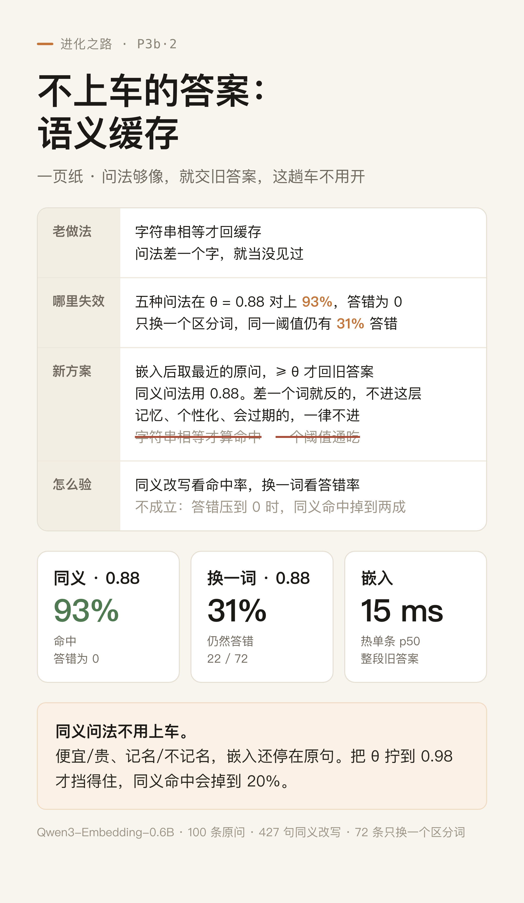
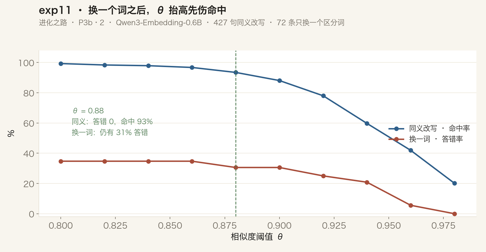

# 进化之路 P3b·2 ｜ 不上车的答案：语义缓存

> 进化之路 · Phase 3b · 2。上一篇算的是车库：出一辆新车要多久。这一篇问更前面的一件事：有些问题，答案已经在站台上，还用不用上车。
> 口径：缓存键是 100 条虚构的公交客服问答。同义句由 Qwen3-1.7B 改写。相似度用现网 Qwen3-Embedding-0.6B，1024 维。座位和 μ 仍是 P3 那张卡：RTX 4060 Laptop 8 GB，vLLM 0.8.5。

---

## 一、回看 exp3：寄存箱省的是搬行李

P2 exp3 把 3072 token 的公共前缀放进寄存箱。缓存关，首字 958 ms；缓存开，69 ms，首字快了 14 倍。人还是上了车。省掉的是搬那 3K 行李，跑圈还在，答案还是一个字一个字蹦出来。

语义缓存再往前走一步：**问法够像一条已经答过的题，就直接把旧答案交出去，这趟车不用开。**

代价是可能交错。寄存箱交错了，顶多再搬一次行李。这里交错了，用户拿到的是另一题的答案：市区月票的价钱，答成郊区的。

---

## 二、一页纸：不上车的答案

| 栏 | 内容 |
|---|---|
| 老做法 | 字符串相等才回缓存。问法差一个字，就当没见过，上车现算 |
| 哪里失效 | 五种问法在 θ = 0.88 能对上 93%，答错为 0。只换一个区分词时，同一阈值仍有 31% 答错：嵌入还停在原句上 |
| 新方案 | 嵌入后取最近的原问，相似度 ≥ θ 才回旧答案。同义问法用 0.88。差一个词答案就反的，不靠把 θ 拧到 0.98 硬扛。带用户记忆、个性化、会过期的，一律不进。~~字符串相等才算命中~~ ~~一个 θ 通吃~~ |
| 怎么验 | 同义改写看命中率，换一词的对照看答错率。答错压到 0 时同义命中掉到两成，这层就不该接那种句子 |

---

## 三、exp11：两条曲线，不是一条

现网嵌入服务上直接算的最近邻，还没接到网关的请求路径里。接上去多出来的是一次调用，不是另一套相似度。

缓存里是 100 条原问。查询两套。一套是 1.7B 按五种问法写的 427 句，意思和原题相同。另一套是在这些句子上只换一个区分词，72 条：市区换成郊区、便宜换成贵、记名换成不记名，以及免票/半票、学生/老人、自行车/狗、首班/末班。换完和任何一条原问逐字相同的丢掉。命中指最近的原问相似度 ≥ θ。答错指命中了，但不是该对上的那条。

同义改写：

| θ | 命中率 | 答错率 |
|---|---|---|
| 0.80 | 99.3% | 0.2%（1/427） |
| 0.88 | **93.4%** | **0** |
| 0.96 | 41.9% | 0 |
| 0.98 | 20.1% | 0 |

换一个词的 72 条：

| θ | 命中了 | 其中答错 | 72 条里的答错率 |
|---|---|---|---|
| 0.80 | 69 | 25 | 35% |
| 0.88 | 55 | 22 | **31%** |
| 0.96 | 15 | 4 | 5.6% |
| 0.98 | 5 | 0 | **0** |

**同义问法上，θ = 0.88 就够。** 答错为 0，命中还留 93%。大纲里事先写的预期是：θ 高到答错低于 1% 时，命中会掉到一半以下。只看这 427 句，预期不成立。五种固定问法离自己的原问近、离别人远。再把 θ 往上抬，砍的是命中，不是错。

那 1 条在 0.80 以上找错门的，是市区末班和郊区末班，相似度 0.869 对 0.862。θ = 0.88 把它挡在外面。另一句把「不记名」丢了，写成「丢了还能挂失吗？」，漂到「半夜能在 App 里挂失吗」，相似度 0.789，0.80 就拦住了。

**换一个词，预期反过来成立。** 72 条里 47 条的最近邻已经是换进去的那条，嵌入跟上了这一个词。另外 25 条最近邻仍是原句，相似度高的到 0.98。θ = 0.88 仍放走其中 22 条，答错率 31%。要把这 72 条的答错压到 0，θ 得抬到 0.98，同义改写的命中只剩 20%。压到 5.6% 要 θ = 0.96，同义命中 42%，这才掉到一半以下。

25 条里哪些词挪不动：

| 替换 | 条数 | 最近邻仍是原句 |
|---|---|---|
| 便宜 ↔ 贵 | 10 | 10 |
| 记名 ↔ 不记名 | 9 | 9 |
| 市区 ↔ 郊区 | 32 | 5 |
| 首班 ↔ 末班 | 3 | 1 |
| 免票/半票、学生/老人、自行车/狗 | 18 | 0 |

「改签到更贵的班次，差额怎么退」：贵字换了，整句还是退差额的句式，嵌入留在原来那条。「不记名」换成「记名」也一样。单程票价和首班车的市区/郊区，嵌入分得开。差一个词不是同一回事，要看换的是哪个词、句子的其余部分还像不像原题。

热了之后单条嵌入 p50 **15 ms**（20 次，14.5–18.0）。大纲事先估的约 10 ms，这台现网大约 1.5 倍。exp3 里寄存箱命中之后首字还有 69 ms，而且后面的字还没出。这里 15 ms 交的是整段旧答案。问法对上了，这趟车不用开。

---

## 四、谁不该进这个缓存

θ 只解决「像不像」。有些请求像了也不能回。

**差一个词、答案就反的，不要靠把 θ 拧到 0.98。** 便宜和贵、记名和不记名，嵌入经常分不开。这种题要么不进缓存，要么键里把这个词做成不能近邻的硬条件：先看出是「贵」还是「便宜」，再决定进不进最近邻。用 0.98 去挡，同义问法的命中会一起掉到 20%。

**带用户自己的数的，一律不进。** 「我的月票还剩几次」和「月票多少钱」可以嵌得很近。命中了，就是把价目表交给一个在问余额的人。个性化、会话里才有的事实，同一条规则。

**会过期的，进了也要有失效日。** 末班 23:00、月票 120 元，改一天，旧答案就是错的。模型或系统提示一换，整库作废：这些答案是某个模型、某段提示下写出来的，不是这条问题的固有属性。

---

## 带走的一条

> **同义问法用 θ = 0.88，命中 93%、答错为 0，这趟车不用开。只改一个词的邻居，嵌入常常还停在原句；要把它们的答错压掉，同义命中会掉到 20%。接不接这种句子，比 θ 的下一位小数更先决定。**

**几个可以讨论的问题**

1. 便宜和贵十条全留在原句上。是嵌入看不见这个形容词，还是「差额怎么退」这半句太重？把退也换成补，这十条会跟着走吗？
2. 93% 是五种固定问法测出来的。客服真实问法更散，命中率会往哪边掉？掉到多少这层就不值得开？
3. 缓存里的答案是 1.7B 在一段提示下写的。换成另一个模型，旧答案还回不回？全库作废的成本，和答错一条票价，哪边更大？
4. 「我的月票还剩几次」不该进缓存。进最近邻之前用什么把它挡下：句式里有「我的」，还是先做一次实体判断？挡错了，价目表类的问题会不会也被挡在外面？

---

## 附：读了什么、用了什么

- 李博杰《深入理解 AI Infra：量化分析与系统设计》[第 11 章 资源调度与运行环境](https://bojieli.github.io/ai-infra-book/)（11.4 限流、路由与成本比较）
- 实验记录：`phase3b/results/exp11-结论.md`。标准问答 `phase3b/exp11/faq_seed.jsonl`，同义改写 `rewrites.jsonl`，换一词 `adv_swap.jsonl`，扫描 `sweep.py`
- 前几站：P2·下 exp3《拨那个参数》（寄存箱）、P3b·1《车库：出一辆新车要多久》（发布后补链接）

口径：同义句由 Qwen3-1.7B 按五种问法生成，427 句，100 条原问都有覆盖。72 条对抗是在这些句子上做的单次替换，不是模型自由写的。相似度在现网 Qwen3-Embedding-0.6B 上计算，热单条 p50 为 15.3 ms（20 次）。最近邻没有经过网关转发。客服问答是虚构的「北城通」，数字不是真实票务。
