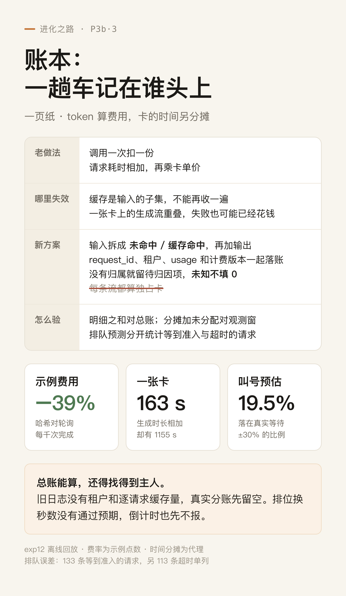
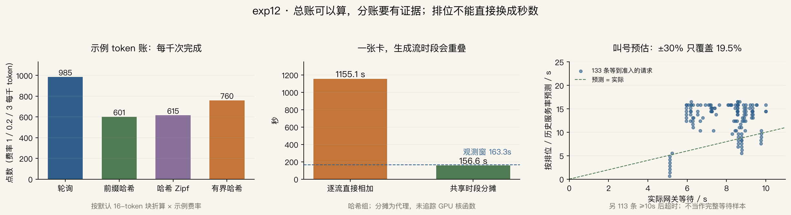

# 进化之路 P3b·3 ｜ 账本：一趟车记在谁头上

> 进化之路 · Phase 3b · 3。上一站看有没有不用上车就能交的答案。这一站把账记下来：输入搬了多少、寄存了多少、输出跑了多少圈，最后记在谁头上。
> 这一篇不新开实验窗口。exp12 回放前面三组日志；token 数来自历史实验，费率用示例点数，卡秒分摊单独标明估算。

---

## 一、同样叫了一趟车，账可以不一样

P3·3 的两辆车，轮询时前缀命中约六到七成，前缀哈希时约九成半。首字 p90 从 222 ms 降到 67 ms，吞吐从 264 涨到 302 tok/s。

那时看的是延迟。现在换个问题：寄存箱少搬的行李，账单有没有跟着变？

如果还是按「调用一次」扣一份额度，这两种请求在账上长得一样。换成 token 计费，也得先弄清一件事：**缓存命中的 token，已经包含在输入里。**

---

## 二、一页纸：同一趟车，两本账

| 栏 | 内容 |
|---|---|
| 老做法 | 调一次记一笔，耗时乘卡单价，按 Key 汇总 |
| 哪里失效 | 输入有命中和未命中；一张卡同时跑多条流；失败请求也可能已经花钱 |
| 新方案 | token 按未命中输入、缓存输入、输出拆账；卡的时间另按明确规则分摊；请求、租户、计费规则都带标识和版本 |
| 怎么验 | 明细之和对总账；卡的分摊加未分配时间等于观测窗；未知值不填零；失败耗费保留 |

token 账回答的是这次调用按合同收多少。资源账回答的是这张卡的支出怎么归给业务。两本账可以关联，金额和比例不必相等。

### 先把输入拆开

设输入总量为 P，其中缓存命中 C，输出为 O。费用是：

`(P − C) × 输入单价 + C × 缓存单价 + O × 输出单价`

这里 **C 是 P 的子集**。如果先收 P 的全价，再额外加一项缓存费，就把寄存的行李收了两遍。

为了让这组数容易比较，我们约定每千 token：输入 1 点、缓存输入 0.2 点、输出 3 点。这是教学费率，没有币种，也不是哪家服务商的报价。

---

## 三、exp12：先对窗口总账

这次读 exp7 两个后端的计数差。引擎是 vLLM 0.8.5 V1：输入计数包含已缓存的前缀，prefix cache 的命中计数按 block 记；这里按该版本 CUDA 默认的每块 16 token 换算，窗口缓存量为 `hits × 16`。旧记录没保存运行时的块大小，16 来自默认配置推断；四组后端的输入与查询块数相互校验，与这个值一致。

这一步不能拿「命中率 × 输入量」代替：命中率的分母是可查询的块，整条输入还有尾部。先确认指标单位，再换成账本单位。

| 路由 | 完成数 | 输入 token | 折算缓存 token | 输出 token | 折扣后点数 | 每千次完成点数 |
|---|---:|---:|---:|---:|---:|---:|
| 轮询 | 678 | 1,135,646 | 747,120 | 43,392 | 668.13 | **985.44** |
| 前缀哈希 | 771 | 1,294,028 | 1,222,976 | 49,344 | 463.68 | **601.40** |
| 哈希，常客偏斜 | 785 | 1,321,228 | 1,236,128 | 50,240 | 483.05 | 615.34 |
| 有界哈希 | 734 | 1,235,291 | 1,022,928 | 46,976 | 557.88 | 760.05 |

各组完成数不同，要按每千次完成比较。前缀哈希比轮询从 985 点降到 601 点，**约省 39%**。改道换均衡的有界哈希，账又涨回 760 点：P3·3 看到的重搬行李，在这份示例合同里也有价格。

这里的「完成」只是请求正常结束，没评回答质量。我们还不能把它叫作每千个合格任务的成本。

### 总账对上了，还找得到主人吗

旧日志里没有 tenant，也没有贯穿客户端和网关的 request_id。exp7 虽有 0 到 7 的前缀组，但它只是常客分组，不能改个字段名就当租户。

引擎告诉我们这一窗口一共用了多少输入、命中多少；它没有告诉我们每条请求分别命中了多少。完成顺序也不能拿来硬拼：流会交错，失败还会丢掉一端的记录。

所以这次真实数据做到窗口总账，逐请求的租户、缓存用量和费用留空。**未知是待归因项，填成 0 就会变成一笔错误账。**

租户账的合同另用四条手写样例验证，和历史数据分开：

| 租户 | 这笔发生了什么 | 输入 / 缓存 / 输出 | 示例点数 |
|---|---|---|---:|
| A | 正常生成，未命中 | 1000 / 0 / 100 | 1.30 |
| A | 正常生成，命中前缀 | 1000 / 800 / 100 | 0.66 |
| B | 已出 20 token 后中断 | 1000 / 800 / 20 | 0.42 |
| B | 语义命中，不调生成模型 | 0 / 0 / 0，另假定查询费 0.02 点 | 0.02 |

A 合计 1.96，B 合计 0.44，总计 2.40。B 那条失败没有从资源耗费里消失；是否向调用方收费，还要由合同决定。

语义命中也要记另一条路径：生成调用没发生，嵌入、检索和结果交付仍可能有成本。上篇只有最近邻阈值评测，没跑真实网关的命中路径，这里不补造「实测省了多少 GPU 秒」。

---

## 四、一张卡，不能把每人的车程相加

哈希组每条流从首个事件到最后事件的时长，加起来 **1155 秒**。这一组首请求到末请求结束，实际只经过 **163 秒**。

两辆车是同一张物理卡上的两个进程，许多乘客同时在车上。如果把每个人的生成时长都当作独占 GPU 时间，同一秒就会被收好几遍。

这次试一个简单分摊规则：在任意小时间段里，有几条流处于首个事件到末个事件之间，就把这一段等分给它们。所有流跨两个副本一起分，卡始终只有一张。

算下来，分给生成流的时间合计 **156.57 秒**，另有 **6.78 秒**没有分配，两者加起来是 163.35 秒。

这条守恒关系能帮我们查重复分摊，但它不是 GPU 核函数测量。流的区间里有调度和传输等待；搬行李可能与跑圈重叠；没有生成流的时段也可能在计算。因此 6.78 秒叫「未分配」，不能叫「卡空转」。

真正要归因，可以按输出、按预留资源、按加权占用分摊。规则可以换，前提是保留版本，并且总份额对得上同一张卡的支出。

---

## 五、站台叫号：前面几个人，不等于还要几秒

另一本面向用户的账是时间。P3·1 在网关排队时，用户能不能看到「前面还有 12 人，大约等 8 秒」？

大纲里的预期很朴素：`等待 ≈ 排位 ÷ 每秒处理数`，误差应在 ±30%。

exp12 回放 exp5 的网关排队日志。根据日志写入时刻、排队耗时、准入后耗时，反推出每条请求的入队和离队时刻，再数入队当时前面还在等的人。这个排位是近似重建，有毫秒级的舍入误差。服务率用更早 exp1 测过的 1.45 次/秒，不拿本窗口最后的吞吐倒填预测。

256 条网关记录里，143 条等到准入，其中 10 条基本不用排；另外 **113 条等了约 10 秒后超时**。

只对 133 条确实排过、最终等到准入的请求算误差：

| 项 | 结果 |
|---|---:|
| 实际等待中位数 | 8.54 s |
| 预测绝对误差 p50 | **5.88 s** |
| 预测绝对误差 p90 | **8.65 s** |
| 落在实际等待 ±30% 内 | **19.5%** |

预期没通过。只有约五分之一落在我们原先设的范围。

超时的 113 条不能当作「等到准入用了 10 秒」加进表里。我们只知道它们 10 秒还没上车，不知道如果继续等要多久。这种样本保留等待下界，单独统计。

这里的队列也不是食堂一个窗口挨个叫号。准入按 token 预算算，前面那件大行李可能堵住后面；乘客成批上车，位置也成批空出；排在前面的人还可能到期限就走。**排位数既不表示必须等多少人完成，也没包含车上还有多久腾位。**

误差图足以否定这个简单倒计时，不能再替每种机制分配一个未经测量的责任比例。

产品上可以先告诉用户正在排队、最长等多久、还能否取消。等后续预测能报出可靠区间，并验证区间的覆盖率，再把秒数给出来。报一个精确数字却经常跳回去，会比不报更难解释。

---

## 带走的一条

> **先把一张卡的总账对上，再找每笔账的主人；先验证等待预估的误差，再给用户倒计时。**

**几个可以讨论的问题**

1. 两个租户共用一段前缀，第二个租户享受命中折扣，第一份缓存的存放成本该由谁承担？
2. 调用方主动中断，生成模型已经跑了一半。资源归因和对外收费要不要采用两条规则？
3. 分摊按输出 token 和按预留座位，分别会让哪类租户承担更多成本？
4. 误差接近等待时间本身时，界面该展示排位、范围，还是只给排队状态与取消入口？

---

## 附：读了什么、用了什么

- 李博杰《深入理解 AI Infra：量化分析与系统设计》[第 11 章，11.4–11.5](https://bojieli.github.io/ai-infra-book/manuscripts/11-%E8%B5%84%E6%BA%90%E8%B0%83%E5%BA%A6%E4%B8%8E%E8%BF%90%E8%A1%8C%E7%8E%AF%E5%A2%83.html)：调用费用与完成任务的完整支出要一起看，失败尝试也留在总支出里。
- vLLM **v0.8.5 V1** 源码：[缓存块计数](https://github.com/vllm-project/vllm/blob/v0.8.5/vllm/v1/core/kv_cache_manager.py#L147-L161)、[完整输入统计](https://github.com/vllm-project/vllm/blob/v0.8.5/vllm/v1/metrics/stats.py#L100-L109)。本文按这一版本解释历史指标。
- 实验：exp7 路由窗口计数与逐流记录、exp5 网关排队记录、exp11 阈值结果；exp12 脚本保存输入文件摘要，可离线复现。

口径：2026-10-22 离线回放 2026-09 的历史数据；费率与四条租户账为示例，流重叠分摊为代理；排队误差只覆盖 133 条排队后准入的请求，113 条超时另计。本文没有真实逐租户账单，也没有新增 GPU 测量。
