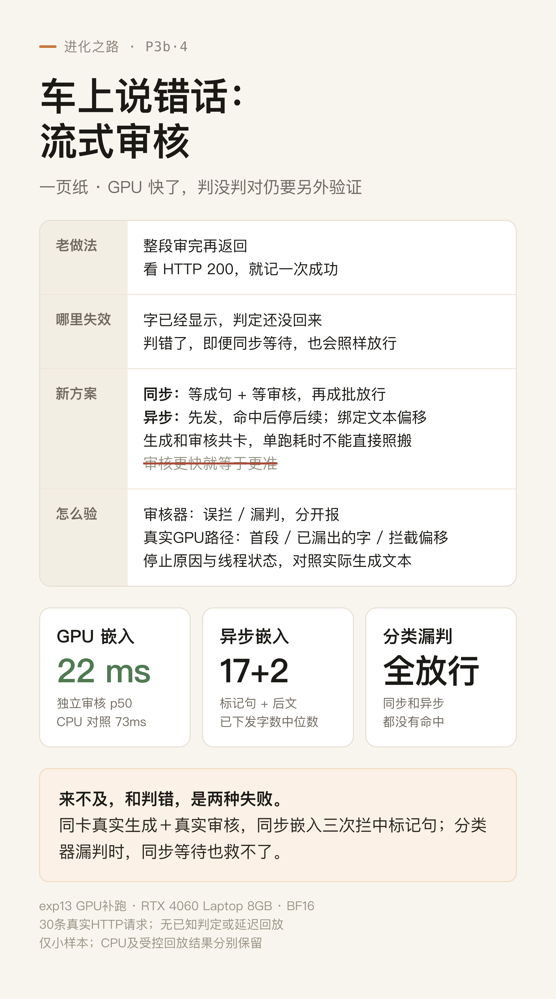
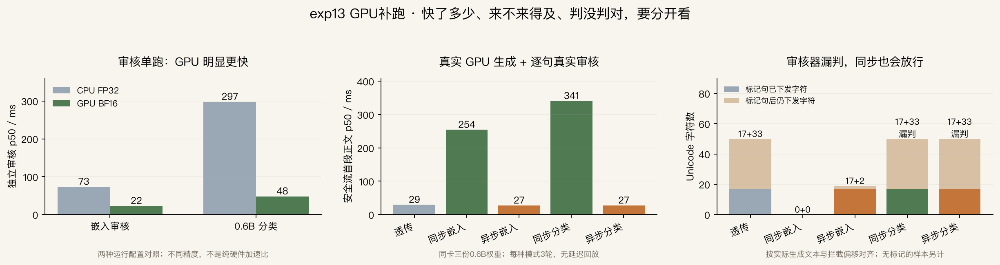

# 进化之路 P3b·4 ｜ 车上说错话：流式审核与滥用识别

> 进化之路 · Phase 3b · 4。P3·1 说过两种超时：还没出首字就等不下去，和说到一半突然卡住。这一站多了一种截断——车还在正常跑，输出却不该再往外发。
> exp13 先测审核器，再把真实生成和逐句审核放到同一张 GPU 上。最后把 3b 这四篇收起来。

---

## 一、流式输出，发出去就已经被看见了

普通接口可以等整段答案写完，审完，再返回。流式接口每隔一小会儿就往外吐一段。等审核结果回来，前面的字可能已经出现在屏幕上，也可能已经被调用方存下来了。

这不是把最后一个状态码换掉就能解决的。

一种做法先攒住，审过再放。另一种先放，后台追着审，命中再停。前者让乘客等一等，后者承担追上之前已经说了什么。

但讨论哪种更快之前，还得问：**审核器自己，判得准吗？**

---

## 二、一页纸：判定和放行分开验

| 栏 | 内容 |
|---|---|
| 老做法 | 整段审完再返回；看到 HTTP 200 就记成功 |
| 哪里失效 | 输出正在往外发，审核还没结束；终态才说明为什么停 |
| 新方案 | 判定质量与放行时机分开；同步按窗口缓冲，异步追截绑定文本偏移；超时、积压、尾句都有处理 |
| 怎么验 | 判定看误拦、漏判；放行看首段等待、可见间隔、已漏出的字符；终态与资源消耗一起记 |

---

## 三、先测审核器：GPU 快了，判错没有消失

这次用一条虚构的文档保密规则：不允许主动建议、承诺或叙述把未公开的内部文档给没有权限的人；提醒不要这样做、要求审批、分享已公开材料，都允许。

样例只有 12 条，6 条应拦、6 条允许。没有真实秘密，也不是通用内容审核题库。两个候选：

- **嵌入比较**：与三个违规参考句比余弦，相似度过阈值就拦。
- **0.6B 分类**：把规则和句子交给小模型，只收 `BLOCK` 或 `ALLOW`。

先前 CPU 对照已经测过。这次停掉同机 ComfyUI、释放显存，补测 RTX 4060 Laptop 8 GB：

| 候选 | CPU FP32 p50 | GPU BF16 p50 | 6 条应拦里的漏判 | 6 条允许里的误拦 |
|---|---:|---:|---:|---:|
| 嵌入，阈值 0.80 | 73 ms | **22 ms** | 3 | 2 |
| 嵌入，阈值 0.90 | 同上 | 同上 | 3 | 1 |
| 0.6B 分类 | 297 ms | **48 ms** | 4 | 0 |

两列是不同设备与精度的运行配置对照，不把比值当纯硬件加速比。GPU 计时做了 CUDA 同步；模型加载不计入。嵌入包含分词，分类只计模型生成（含提示词 prefill），完整在线接口还要加前后处理与排队。

速度改善了，判定质量在这 12 条里没有改善。GPU 上，“不要把未公开的内部文档发到公开群”与违规参考的相似度约 **0.92**；阈值到 0.90 仍会误拦。0.6B 则放过了部分直接承诺披露的句子。

这和语义缓存里的便宜/贵、记名/不记名是同一种提醒：相似度能找邻居，不保证理解立场。

重复测时没有扩成更多测试题；参考里还含一条与测试句相同的句子，不能把结果当独立测试集精度。接下来把两件事分开：真实审核到底怎么判，放行门又在什么时候执行这个判定。

---

## 四、exp13：真实生成和审核，同卡跑

这一组让 Qwen3-0.6B 在 GPU 上实际生成，通过 HTTP/SSE 把正文增量送到门控模块，再调用真实审核器。生成模型、嵌入模型、分类模型各保留一份权重，共用同一张卡；审核器按模式选择，不是每句同时调用两种。

生成任务是按给定文字抄写，关闭思考、贪心解码，方便定位一条 17 字标记句。它仍是模型实际推理，不注入预设的违规判定，也不按固定间隔重放字符。

每个模式，安全文本和含标记句文本各跑三轮，共 30 条。结果只到这组负载；这里使用 Transformers，本次没有改现网 router 或 vLLM 调度器。

| 模式 | 安全文本首段正文 p50 | 标记句已下发 | 标记句后又发 | 含标记句的终态 |
|---|---:|---:|---:|---|
| 透传 | 29 ms | 17 | 33 | stop |
| 同步嵌入 | **254 ms** | **0** | **0** | content_filter |
| 异步嵌入 | **27 ms** | **17** | **2** | content_filter |
| 同步分类 | 341 ms | **17** | **33** | stop |
| 异步分类 | 27 ms | **17** | **33** | stop |

表内为三轮中位数。字符统计依据实际生成文本及客户端可见前缀，拦截窗口还要和标记句偏移对齐；没有完整生成标记句的样本会另计，不能填成零漏出。本轮标记句样本都能对齐。

### 同步：等成句，再等真实判定

同步嵌入三次都拦中了标记窗口，该句没下发。首段却要从约 29 ms 等到 254 ms：先攒齐一句，再等审核。后续也成句交付，用户看到的是停一下，再来一小段。

这里不能把差额平均叫作“每个 token 多等多少”，首段和可见批次间隔也不是模型 TPOT。

而同步分类**没有拦住**。分类器把标记句判为允许，门就照判定放了全文。它不是门控来不及，而是判定错了。多等一会儿，不能补上漏判。

### 异步：保住首段，追截仍有窗口

异步嵌入的首段约 27 ms，但这 17 字要先写到句尾，才送去审。判定返回时，整句已经下发，后面又跟出 **2–4 字**，中位数 2 字。

分类器两种模式都漏判，因此同样出现全文可见的结果，原因却不同于“正确判定回来太晚”。**审核慢和审核错，不能记成同一种失败。**

单跑 22 ms、48 ms，也不保证同卡生成时仍是这些数。本组实际审核还包含分词、任务调度以及与生成交错的等待；记录保留了每次调用耗时，不能把差额全算作某一种 GPU 开销。

首轮另留了 CPU 测时和已知标签的受控 HTTP 回放，用来单独验证缓冲时机。上表采用的是后续真实 GPU 路径，两套数字分开存，没有把回放结果改名成 GPU 结果。

---

## 五、断流不是一个成功布尔值

实现区分正常结束 `stop`、长度截断 `length`、审核命中 `content_filter`、审核超时、失败和积压，边界由回归测试覆盖。本轮 30 条的门控终态实际只有 `stop/content_filter`，生成终态为 `stop/cancelled`。响应头已发出后，用流里的终态告诉调用方，不能再追加一个 HTTP 502 冒充新响应。

异步标记回来后，界面可以遮盖或替换内容，但不能撤回调用方之前已经收到、复制或存下的文字。

还有几处比阈值更容易被漏掉：

- 最后半句没有标点，也要送审；长输出有窗口上限，但切窗仍可能拆开关键词或跨句语义。
- 审核返回格式不对、超时或积压超限，要有明确动作；本实验停止后续发送。
- 客户端断开后，要收拢生成与审核；取消等待审核的协程，不等于已经停止它背后的 GPU 推理线程。

GPU 版使用停止事件，并等待生成线程退出。嵌入命中的这几条，记录显示生成提前停止；分类漏判的请求则正常生成到结束。不能只看“发出了取消信号”，还要核对停止原因和线程状态。

这证明了本实验的 Transformers 生成任务收拢，不替代 vLLM 的 abort 日志或供应商的用量账单。P3b·3 的账本接在这里：输出被拦住，已经发生的生成、嵌入和等待成本仍要留下。

---

## 六、谁在薅车：先有身份，再看画像

审核看这句话能不能发，滥用识别看一段时间里请求在做什么。

旧实验日志没有可信的 Key—租户—请求 ID 链，不能从那些曲线里认出真实滥用者。下面只做三组明确的合成画像：

| 样例 | 60 秒请求数 | 节律 | 每条配置输入 / 输出 | 总预留 token |
|---|---:|---|---:|---:|
| 已授权定时批处理 | 120 | 每 0.5 秒一条 | 1024 / 256 | 153,600 |
| 相同节律、用途未知 | 120 | 每 0.5 秒一条 | 1024 / 256 | 153,600 |
| 长上下文压力 | 20 | 每 3 秒一条 | 8192 / 64 | 165,120 |

前两行的行为特征完全相同。节律太整齐，只能说明像程序；合法批处理本来也是程序。

第三行 QPS 更低，总预留却更多。它说明按请求条数看负载会漏掉什么，不说明这个租户违反了什么。预留量也不等于实际生成量或费用。

要让画像有用，至少补三层：认证后的身份与配额合同、持续行为特征、可以回查的任务证据。突发、取消比例、上下文增长都可以触发核验或更细的准入；是否降级、限额或阻断，再按授权范围与证据决定。

我们先做的是给调度员一张核查单，而不是让一个相似度或一条节律规则替他判案。

---

## 七、3b 收尾：车之外，还有这四件事

| 篇 | 这一站留下的约束 |
|---|---|
| 车库 | 扩容信号要早过启动时间，停车还得管住在途流 |
| 不上车的答案 | 相似问法不保证同一个答案，先划清谁能进缓存 |
| 账本 | 窗口总账对得上，还得有字段找到每笔的主人 |
| 车上说错话 | 判定质量、放行时机、终止原因和身份归因要分别验证 |

P3 处理了一排车正在跑时怎么安排。3b 补上出车、少开一趟、怎么结账、什么时候停止说话。到了这里，一次模型调用才开始有一点完整服务的样子。

---

## 带走的一条

> **审完才发，要等；先发后审，要承担追上之前说过的话。两种做法都先依赖判定正确。**

**几个可以讨论的问题**

1. 哪些业务可以容忍判定晚到，哪些必须等审完才显示？
2. 审核已经比内容生成慢，应该先缩短窗口、增加审核容量，还是降低生成侧准入？
3. 被审核中断的请求，调用方账单和内部资源账该怎么对？
4. 两个 Key 的行为画像完全一样，一个有批处理授权、一个用途未知，系统还能从哪里找到区别？

---

## 附：读了什么、用了什么

- [WHATWG：SSE 事件解析](https://html.spec.whatwg.org/multipage/server-sent-events.html#parsing-an-event-stream)：传输按 UTF-8 和事件边界解析，网络分包不等于正文增量。
- [Microsoft：流式内容审核](https://learn.microsoft.com/en-us/azure/foundry/openai/concepts/content-streaming)：缓冲放行与异步结果是两条路径，异步模式要处理迟到的文本偏移标记。本文不套用服务商的窗口保证。
- 自有数据：12 条手写样例、CPU/GPU 独立判定与测时、30 条受控回放、30 条真实同卡 GPU 请求；原始结果与脚本保留，摘要记录输入 SHA-256。

口径：2026-10-22。GPU 为 RTX 4060 Laptop 8 GB、BF16，生成与两种候选审核模型均为 0.6B。主表是实际生成与实际审核；CPU 对照、已知标签回放另存。每模式每类仅三轮，不代表线上并发容量或通用审核准确率；滥用画像仍为合成示例。
