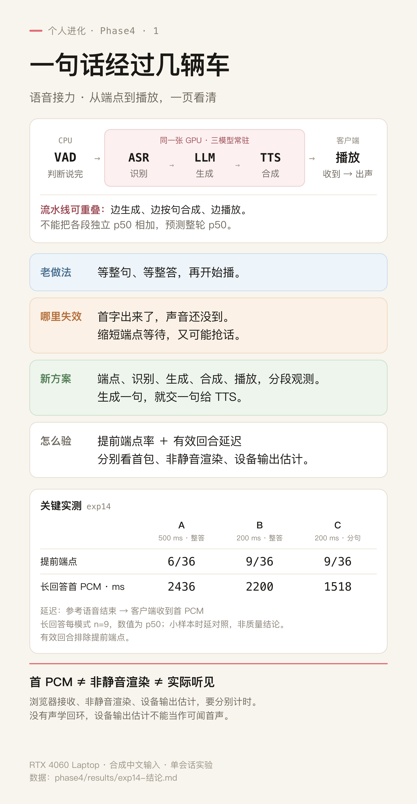
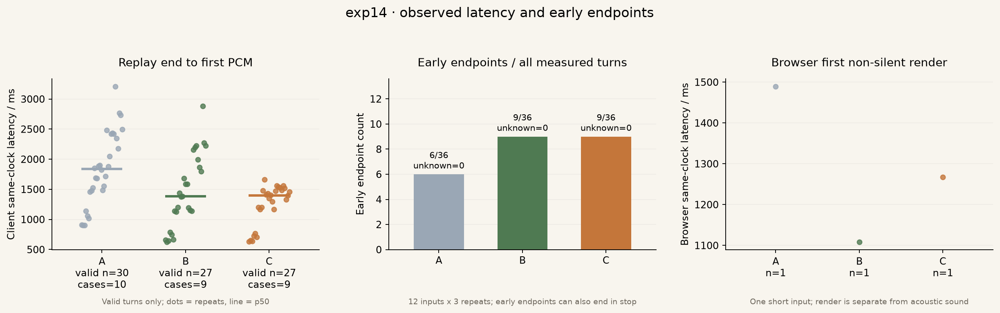

# 进化之路 P4·1 ｜ 接力：一句话经过几辆车

> 进化之路 · Phase 4 · 1。前面几站，调度员安排的是一趟模型请求。到了语音，乘客说完一句，得有人听、有人想、有人开口，还得真的播出来。
> exp14 把识别、生成、合成放在同一张 8 GB GPU 上，先量一遍这场接力。

---

## 一、首字出来了，车里还没声音

文字聊天里，第一个字出现，用户就知道它开始回答了。换成语音，第一个字出来时，耳机里可能还安安静静。

它也许正在等一句话写完，才交给语音合成；也许音频已经合成，开头却是一段静音；也许数据到了浏览器，还在缓冲区里。

输入端还有一次等待：你停顿了一下，到底是说完了，还是正在想下半句？

像一条接驳线路。乘客问的问题先交给识别，再转给生成，最后交给合成与播放。每次交接都可能等，前一段也可能还没结束，后一段就已经起步。

所以这一站先把问题换成：**从乘客说完，到回应开始播放，中间到底等在哪里？**

---

## 二、一页纸：把接力的每次交接记下来

| 栏 | 内容 |
|---|---|
| 老做法 | 收完整句，识别；写完整答，合成；用文字首字速度判断响应 |
| 哪里失效 | 首字不等于音频，音频首包也可能是静音；少等尾静音又可能抢话 |
| 新方案 | 端点、识别、生成、分句、合成、播放逐段记录，允许后续阶段提前接手 |
| 怎么验 | 提前端点单列；有效回合看延迟，客户端再核对接收、非静音渲染与设备输出估计 |

这里的“几辆车”说的是几段职责，不是一段就配一张 GPU。exp14 的三个模型共用一张卡。

---

## 三、先搭一条看得见交接的线路

这次走级联：**判断说完 → ASR 识别 → LLM 生成 → TTS 合成 → 客户端播放**。

VAD 判断当前是不是语音，再配合尾部静音规则，决定何时结束这一轮输入。它听见一小段安静，并不能直接知道句子的意思已经完整。

实验里，Silero VAD 在 CPU 上跑；其余三个模型常驻同一张 RTX 4060 Laptop 8 GB：

| 岗位 | 模型 | 运行配置 |
|---|---|---|
| 识别 ASR | faster-whisper-small | GPU，INT8/FP16 混合 |
| 生成 LLM | Qwen3-0.6B | GPU BF16，关闭思考 |
| 合成 TTS | Kokoro 中文 82M | GPU FP32，固定音色 |

三者都实际执行了 GPU 推理。采样处理、VAD、文本与音素处理、收发包等仍有 CPU 工作。本轮观测到的**整卡已用显存峰值为 3191 MiB**，包含桌面等基线，只说明这组小模型和单回合配置放得下。

这条线路有两个明确边界：ASR 等端点后识别本轮音频；TTS 接收一段文字，再产出波形。网络把波形切成 20 ms 包，不代表模型每 20 ms 就能合成一次新声音。

另一条路线是把音频理解和语音输出放进同一套模型。比如 [Qwen2.5-Omni 的 Thinker–Talker](https://huggingface.co/Qwen/Qwen2.5-Omni-7B)，就不适合原样套入三个独立模型的计时表。这次只用它做架构对照，没有测 Omni 的速度，也没有据此判断所有 Omni 能否在 8 GB 上运行。

无论中间怎样组织，客户端都还要收到、渲染、输出音频。接力少几个外部接口，最后几步仍得量。

---

## 四、exp14：少等 300 ms，先看有没有抢话

先写 12 句中文，用同一个本地合成音色做输入：6 句连续短问、3 句带句中停顿、3 句要求较长回答。句中停顿插入 300 或 600 ms 静音，用来观察“话还没完，系统已经作答”。

每句跑三轮，每轮轮换三种配置，共 **108 条正式回合**：

- **A：尾静音 500 ms，整段答案写完再交 TTS。**
- **B：尾静音 200 ms，仍等整段答案。**
- **C：尾静音 200 ms，遇句末标点或满 32 字就交 TTS，最后不足一句也补送。**

这些是本实验的对照参数。VAD 按 32 ms 窗口处理，实际端点等待会随窗口取整，不会恰好等于配置值。

正式批次由同机客户端按音频时长重放，通过回环地址连接服务。下面量的是**输入参考语音结束 → 客户端收到第一包 PCM 波形**。参考结束点由固定能量阈值推得，没有把答案位置提前告诉在线 VAD。

| 配置 | 提前端点 | 有效 n | 首 PCM p50 |
|---|---:|---:|---:|
| A | **6 / 36** | 30 | 1837 ms |
| B | **9 / 36** | 27 | 1385 ms |
| C | **9 / 36** | 27 | 1396 ms |

“有效”只表示没有提前端点、捕获错误或异常结束，没有评定回答是否正确、声音是否自然。12 句重复三次，也仍然只有 12 个独立文本。

三种配置在协议里全都以 `stop` 结束，但其中 **24 条在问题说完前就结束了输入**。如果把这部分混进速度榜，甚至会出现负延迟：乘客还没问完，答案已经往回走了。

这不能算更快的成功。

A 与 B/C 的有效样本不同。只保留三种配置都有效的 **27 组对应回合**，p50 分别是 **1719、1385、1396 ms**。少等确实缩短了这组等待，也多截断了部分句中停顿。

A/B 的 36 对输入中，还有 12 对的识别文本和回答发生变化。端点一变，交给 ASR 的音频也变了，不能把延迟差额全归因于那 300 ms。

调度员先得确认乘客已经上齐，才能讨论早发车省了多久。

---

## 五、分句能提前开口，但不是每轮都更快

B 和 C 的区别在输出端：等整段，还是先交一段。连续短问每种配置有效 n=18，长回答每种配置有效 n=9：

| 配置 | 连续短问 | 长回答 |
|---|---:|---:|
| A | 1508 | 2436 |
| B | **1148** | 2200 |
| C | 1201 | **1518** |

表内仍是参考语音结束到收到首 PCM 的 p50，单位 ms。

长回答里，C 不必等全文写完，首包从 B 的 2200 ms 提前到 1518 ms。短问里，B 本来就很快写完整答，C 没有更快；总体有效回合的中位数也没有优于 B。

分句打开了让生成和合成交叠的机会；同卡是否争用、切分多细、首段有多长，都还会影响结果。把它画成流水线，不等于每一段都能无代价地并行。

B/C 的 36 对回合，转写和回答文字都相同，却有 **12 对的输出音频样本数不同**。文字切开后，TTS 每次看见的上下文改变了，发音时长也可能变。

因此，这组证据只支持“长回答的首包提前”。我们还没有对应的长回答播放欠载对照，不能把它写成整段说话更流畅。

单组件测时也有同样的陷阱。固定样例、热身后，独立测得 ASR 约 69 ms、LLM 首段非空文本约 40 ms、TTS 首 PCM 约 61 ms。三项用的输入与在线回合不同，加载不计，彼此的计时终点也不同。**三个中位数相加，得不到语音回合的中位数。**

要找真正的等待，得回到同一个回合的事件时间线，沿着交接关系看。

---

## 六、首包到耳边，还有一段路

正式批次没有播放音频。另用 Mac 浏览器，经 SSH/TCP 隧道连接 DARYU，实际用 AudioWorklet 播放，同一句“你是谁？”每种配置各跑一次。

以下都从浏览器时钟下的输入参考语音结束点起算，单位 ms；**每格只有一次观测，不是 p50**：

| 时间点 | A | B | C |
|---|---:|---:|---:|
| 收到首 PCM | 1208 | 832 | 988 |
| 非静音渲染 | 1489 | 1109 | 1267 |
| 输出估计 | 1522 | 1142 | 1300 |

同机回放与浏览器走的是不同路径，两个表不能拼成一组延迟分布，更不能拿服务器时钟直接减浏览器时钟。

这三次，从首 PCM 到非静音渲染还隔着约 **277–281 ms**，其中有输出音频开头的静音和播放链路等待。拿到一包波形，只能证明有数据到了。

设备输出估计又晚约 33 ms，依据浏览器的 [`getOutputTimestamp()`](https://www.w3.org/TR/webaudio/#dom-audiocontext-getoutputtimestamp) 映射。它仍是估计；本次没有麦克风声学回环，“人实际何时听见”保留为空。

三次都收齐并消费了 62,400 个 24 kHz 音频样本，播完了尾部；B 仍记录到约 **1.3 ms 欠载**。开始得早、末尾播全、中间不断，是三个不同问题。

阶段设计里写的 800 ms，是我们自己的探索目标。这三次浏览器回合都没有达到，不能把 832 ms 的首包换个名字就算过关。

---

## 七、一句“完成”，要沿路对得上

实现时还遇到一个很小、很像普通后端的竞态：发送端刚看见队列为空，合成线程恰好放入最后一包，再标记完成。发送端如果只看“线程结束”，就可能漏掉尾包，却照样回 `stop`。

修复后，要先确认生产者结束，再确认队列已空，最后核对生成与发送的样本总数。正式批次逐条回查未发现丢尾；修复后的 GPU 和浏览器复验另存，没有混进前面的 108 条。

从上一阶段的流式审核到这里，终态都只回答了一部分问题。语音还要把生成了多少、发了多少、客户端消费到哪里对起来。

这次实验到此为止：单路回合、小模型、单一合成输入音色；没有测真人麦克风、回声消除、噪声或口音，也没有测多会话吞吐。中文 TTS 前端未配置英文处理，部分含拉丁字母的回答存在漏读风险，声音质量还要另评。

下一站再让乘客留在车上：一段持续会话里，连接、音频、历史和推理任务该绑在哪里，换车或排空时又要等谁。

---

## 带走的一条

> **先确认对方说完，再沿着同一回合量到播放。首字、首包、非静音渲染，每个时间点都只证明自己那一步。**

**几个可以讨论的问题**

1. 缩短尾静音以后，应该用哪些输入验证它没有抢话？
2. 首包提前了，整段更容易卡顿，这笔优化还算成功吗？
3. 三个模型共用一张 GPU，什么时候值得让它们交叠，什么时候应该限制争用？
4. 服务端已经 `stop`，客户端还在播放，扩容或排空时该按哪个状态行动？

---

## 附：读了什么、用了什么

- [LiveKit：Pipeline types](https://docs.livekit.io/agents/models/pipelines/)：级联与语音模型的接口边界；本文采用可逐段观测的级联。
- [faster-whisper 官方仓库](https://github.com/SYSTRAN/faster-whisper)：GPU 精度配置与转写生成器的执行边界。测 ASR 要消费完生成器，不能只量创建它的时间。
- [Qwen2.5-Omni 模型卡](https://huggingface.co/Qwen/Qwen2.5-Omni-7B)：Thinker–Talker 架构参照，本次未做性能对比。
- [W3C Web Audio](https://www.w3.org/TR/webaudio/#dom-audiocontext-getoutputtimestamp)：渲染位置与设备输出时间估计。
- 自有数据：12 句合成输入、108 条正式 GPU 回合；3 条热身、修复后 3 条 GPU 复验与 3 条最终浏览器播放另存。原始事件、输入输出音频、模型与源码摘要均保留。

口径：2026-10-22。RTX 4060 Laptop 8 GB；Transformers + CTranslate2 实验管线，本次没有改 router 或 vLLM。参考语音边界按 10 ms RMS、PCM16 阈值 120 推定，未经人工声学校准；浏览器非静音使用同一阈值规则。主表只计自然结束、无捕获错误且未提前端点的回合，提前端点另列完整分母；延迟有效不代表回答或合成质量合格。
