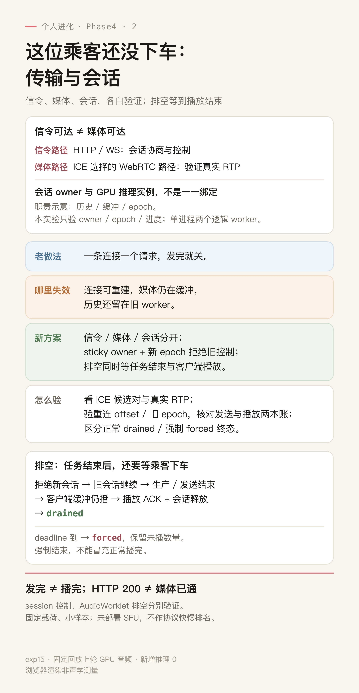
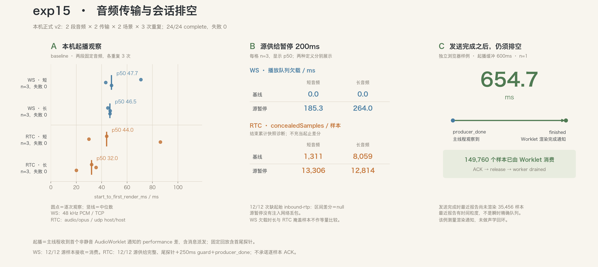

# 进化之路 P4·2 ｜ 这位乘客还没下车：传输与会话

> 进化之路 · Phase 4 · 2。上一站量到音频开始播放。这一站把时间再往后拉一点：服务器已经发完，乘客可能还在听；网络重新连上，也不代表接回了刚才那段对话。
> exp15 固定回放上一实验的 GPU 音频，把传输、会话归属与排空分别跑一遍。

---

## 一、请求结束了，旅程还没结束

调度员看见一趟任务完成，准备收车。司机却说：后排还有人在听，最后一句还没播完。

语音里，这很容易发生。生成已经结束，音频已经发给浏览器，浏览器还攒着几百毫秒没播。服务器只看“发送完”，就会把一趟仍在路上的旅程记成结束。

反过来也一样。乘客换了一个车门重新上来，连接是新的，刚才的对话却应该继续。如果每次连接都重新挑一辆车，旧车上的状态怎么办？

这一站要分清三件事：**消息怎么过去，状态留在哪里，什么时候才算可以收车。**

---

## 二、一页纸：信令、媒体、会话各自有账

| 栏 | 内容 |
|---|---|
| 老做法 | 一条连接当一次请求，服务器发完就关 |
| 哪里失效 | 连接重建了，状态还在旧 worker；服务端结束了，客户端还在播 |
| 新方案 | 信令与媒体分开验证；会话固定 owner，重连换 epoch；排空同时等任务与播放 |
| 怎么验 | 看实际媒体路径、重连进度与旧连接控制，核对发送/渲染两本账，区分正常与强制结束 |

owner 是持有会话状态的处理者。它可以管理历史、音频进度和在途任务，再把推理交给 GPU 池。**会话跟谁走，与推理占哪张卡，是两种绑定。**

本实验只在一个进程里放两个逻辑 owner：a、b。实际保存的是归属、连接版本、轮次和样本进度；没有做对话历史、KV cache 或多 GPU 的迁移。

---

## 三、网页打开了，声音未必有路走

先做一条最容易控制的路径：WebSocket 里发 PCM 波形，浏览器自己维护音频队列。包长、采样率、顺序、起播缓冲、欠载和播放确认，都由两端约定。

换成 WebRTC，会多一套媒体协商与传输机制：用 ICE 找可达路径，协商 Opus 等编解码，接收端处理 RTP、解码和抖动缓冲。发起连接的 HTTP/WS 信令，与真正承载声音的路径要分别看。UDP、TCP 或中继到底用了哪条，不能只凭协议名字猜。[RFC 8835](https://www.rfc-editor.org/rfc/rfc8835)

这次 DARYU 就给了一个很具体的例子。它在 WSL 私网里，浏览器通过公网 SSH 的 TCP 转发访问实验服务：

| 检查 | 实际结果 |
|---|---|
| 打开页面、提交 WebRTC 协商 | 能到服务端，返回回答 |
| WS 音频回放 | 完整收发并观察到播放 |
| WebRTC 媒体与控制通道 | 15 秒观察内未完成 ICE / DataChannel 连接 |

这条部署只转发了 TCP 入口，没有另外配置 STUN/TURN，也没有证明协商出的私网媒体候选能互达。页面能打开，解决的是到门口的路；声音可能还在找另一条路。

所以这组远端记录只用来验证可达性。不能拿它与本机 UDP 的延迟拼成“WS 与 WebRTC 谁快”的排名。

LiveKit 等系统把房间和媒体路由做得更完整，信令实例还可以代理到房间所在节点；它自己的缩容也有排空过程。接到这样的媒体层以后，我们仍要另外定义：谁持有应用会话，谁执行推理，谁报告播放完成。[LiveKit 的分布式路由与排空](https://docs.livekit.io/transport/self-hosting/distributed/)

---

## 四、固定音频，先把传输这段量清楚

这轮没有重新调用模型。取 exp14 的两段真实 GPU 输出，原长 2.4 秒和 14.95 秒，统一为 48 kHz PCM16，再加首尾探针与零尾，得到 **3.12 秒、15.68 秒**两条载荷。

两种实现都在同一台 Mac 上跑：

- **WS / PCM**：每包 20 ms，应用先攒 60 ms，再开始消费。
- **WebRTC / Opus**：aiortc 发音频轨道，Chrome 用原生媒体链路接收，AudioWorklet 观察渲染。

每条载荷各做正常供给与“源端暂停 200 ms”两种场景，每种重复三次，共 **24 条最终回放**。暂停的是音频生产者，没有注入网络丢包，也没有据此验证公网拥塞或重传行为。

起播时间从浏览器发送“开始供给”控制算起，到主线程收到首个非静音 AudioWorklet 通知为止。它包含消息派发；载荷早已准备好，探针也不是用户的问题。因此这不是“说完一句话到听见答案”的延迟。

正常供给时，每条路径有 6 次观测（两条载荷，各三次）。下表为 p50，单位 ms：“就绪”包含信令、连接和本次播放器准备，“起播通知”从之后发出的开始控制算起。

| 路径 | 就绪 | 起播通知 |
|---|---:|---:|
| WS / PCM | 94 | 47 |
| WebRTC / Opus | 292 | 34 |

这两份实现里，前面的准备与后面的媒体启动给出了不同结果。WebRTC 的 12 条最终记录都实际选中了 UDP、host/host 候选；编码、缓冲与观察节点准备却不相同，这些数只能描述本次配置。

播放器结束也要分开验。WS 的 12 条，源、接收、渲染消费的样本数逐条相等。WebRTC 是有损编解码，最后核对的是源供应完整、尾探针渲染后再等 250 ms，以及源结束控制，不能拿解码样本数冒充逐字节确认。

而且，播到末尾不代表中间从没卡过。WS 记录队列欠载；WebRTC 的 `concealedSamples` 记录由接收端合成替代的样本，迟到和丢失都可能触发。两者定义不同，不能放进同一个“卡顿毫秒”栏里直接比大小。[W3C 的统计定义](https://w3c.github.io/webrtc-stats/)

源端暂停场景里，短、长载荷的 WS 累计欠载 p50 为 **185 / 264 ms**；WebRTC 结束快照里的掩盖样本 p50 为 **13306 / 12814**，每格三次。它们不是同一指标，正常供给的 WebRTC 也有掩盖，不能全归因于暂停。

开始供给前，RTC 还没有 `inbound-rtp` 对象，因此本次区间掩盖量、区间收包量与区间平均抖动缓冲延迟都保留为空；结束快照明确按累计值标注。WS 的 264 ms 也包含整次运行的其他等待，不能说注入 200 ms 就恰好欠载 200 ms。

首轮还遇到一个顺序问题：两条 WebRTC 回放里，尾探针已回来，“源结束”控制却还没到。修复成**两个条件都满足才收尾**，再重跑完整 24 条；首轮保留诊断，没混进最终统计。

媒体到哪里，控制到哪里，都要各有证据。

---

## 五、重连回来，先认状态，再认连接

接下来单独测会话控制。a、b 都是逻辑 worker；固定音频仍通过真实 HTTP/WS 收发。

| 场景 | 这次验证了什么 |
|---|---|
| 同一连接连续两轮 | owner、epoch 保持，连续完成两轮 |
| 请求错误 owner、并发再连 | 升级前返回 409，不另开一份会话 |
| a 开始排空 | a 拒绝新会话，新会话去 b，已有会话仍归 a |
| 断线后重连 | 保留进度，连接版本递增，旧版本控制被拒绝 |

整组控制实验（含后面的强制结束）共有 4 个场景、56 项断言，逐帧核对了 639 帧真实 PCM。不过脚本里的播放 ACK 是合成控制，只证明状态规则，不能当成声音已经播放。

重连那组，客户端曾确认到第 **9600 个样本**。连接断开后，owner 没变，新连接的 epoch 从 **1 变成 2**，从保留的确认位置重发。迟到的 epoch 1 ACK 被拒绝。

还得防另一种越界：服务器历史上发过后半段，不代表新连接已经拿到后半段。新 epoch 的 ACK 只能推进到这一连接实际重发过的位置。

这里把“确认过的进度”当成重放起点，是这个固定载荷实验的选择。真实系统如果只确认到较粗的位置，重连就可能重播一小段；如果历史丢了，仅有 sticky 路由也不能凭空恢复。

**连接 ID 负责这一扇门，会话 ID 与版本负责接回哪段旅程。**

---

## 六、发完以后，乘客还在听

再补一条真实浏览器播放，把合成 ACK 换成 AudioWorklet 的实际消费计数。

为了让这段差额看得见，特意先攒 **600 ms** 才起播，使用 3.12 秒短载荷。服务端发送完，客户端最近一次进度报告里还有 **35456 个样本**没有确认渲染；此时请求排空，worker 保持 `draining`。

这个数来自最近一次报告，报告有间隔，不能当成该瞬间的精确队列长度。

从浏览器观察到 `producer_done` 算起，又过约 **655 ms** 才收到 worklet 的 `finished` 通知，此时完整消费 **149760 个样本**。客户端发送完整 ACK、释放会话后，a 才进入 `drained`。

这条数据只有一次，缓冲也是实验指定的，不拿来当普遍延迟或推荐配置。它验证的是一个先后关系：

**发送完成 → 客户端仍在渲染 → 完整 ACK → 会话释放 → 正常排空。**

这仍然量到浏览器渲染，没有声学回环，不能说扬声器已经把最后一个字送到耳朵。

---

## 七、等不到时，要写“强制结束”

如果连接再也不回来，或者客户端一直不给确认，收车不能永远等下去。

另一个控制场景设了 200 ms 排空期限，实际定时器约 **201 ms** 后触发。账上已发送 149760 个样本，合成 ACK 只确认到 24000，剩下 **125760 个样本未获播放确认**。

结果记为 `forced`，没有补 ACK，也没有把它改成正常 `drained`。

这不是测到乘客少听了多少——该场景没有实际播放。它证明强制收车时，系统仍保留了没对上的账。

本轮实验的正常排空、断线重连和强制结束都在单进程里完成；实验服务与专用隧道已关闭，原有 GPU 服务保留。这不能代替多机宕机迁移、共享状态恢复或真实长会话验证。

下一站才让乘客真的插话。到时不仅要停生成，还要清掉旧音频、停止播放，并决定这半句该怎样留在历史里。

---

## 带走的一条

> **重连要接回旧状态，排空要等到播放确认。连接通、源发完、客户端播完，每件事都要单独证明。**

**几个可以讨论的问题**

1. 信令已经正常，媒体一直连不上，应该先查哪条实际路径？
2. 会话 owner 已经排空，短时断线的旧会话还能回来吗？它可以等多久？
3. 服务器发完后，客户端还积着一秒音频，按请求数做缩容会漏掉什么？
4. 强制结束时，哪些进度是已确认，哪些只是服务器推测？

---

## 附：读了什么、用了什么

- [RFC 8835：WebRTC 的传输](https://www.rfc-editor.org/rfc/rfc8835)：ICE、STUN、TURN 与不同可达路径。
- [W3C WebRTC stats](https://w3c.github.io/webrtc-stats/)：RTP、抖动缓冲、替代样本等字段，缺失不填零，累计量按起止差分。
- [LiveKit：端口与防火墙](https://docs.livekit.io/transport/self-hosting/ports-firewall/)、[分布式路由与排空](https://docs.livekit.io/transport/self-hosting/distributed/)：信令、媒体与房间节点的边界，本次未部署 LiveKit/SFU。
- [aiortc 官方接口](https://aiortc.readthedocs.io/en/latest/api.html)：本轮 WebRTC 音频轨道与浏览器互通实现。
- 自有数据：两条固定音频、24 条最终媒体回放、4 组 HTTP/WS 控制场景、1 条真实浏览器排空，以及独立远端可达性检查。失败 pilot 与首轮完成条件不足的批次另存。

口径：2026-10-22。Mac Chrome 155，媒体正式批次为 headless 实际渲染；aiortc 1.15.0、Opus、48 kHz。两条路径的编码、缓冲和计时边界不同，未隔离桌面负载，不代表纯协议速度、线上容量或弱网优劣。DARYU 只用于独立可达性检查，载荷取自上一轮 GPU 实测，本轮新增推理为 0。无麦克风上行、AEC、声学回环、主观音质或多人/SFU 压测。
