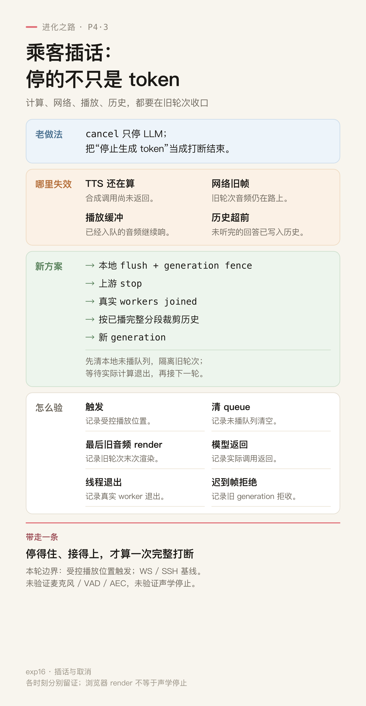
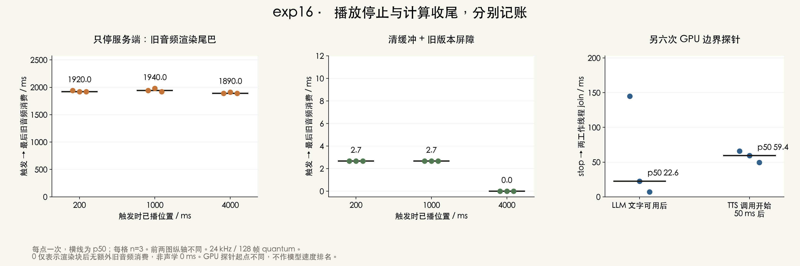

# 进化之路 P4·3 ｜ 乘客插话：停的不只是 token

> 进化之路 · Phase 4 · 3。上一站，服务器发完以后，乘客还在听。这一站，乘客不想继续听了：怎样让旧回答停住，又让下一句话接得上？
> exp16 在 DARYU 上实际运行 LLM / TTS，再用浏览器按播放位置触发取消，分别核对计算、发送、渲染和历史。

---

## 一、调度员喊停，车里还在说

乘客听到一半，插了一句：“等一下，先说另一件事。”

调度员马上给司机发了停止指令，后台也打印了 cancelled。可车里的广播还在往下念。下一轮聊起来，司机甚至提到了一段乘客还没听过的安排。

问题藏在“停”这个字里。有人把它理解为不再生成文字，有人理解为不再合成声音，有人理解为不再往外发送。乘客关心的却更直接：旧回答还要说多久，新问题能不能接上？

一句回答经过了模型、合成、网络和播放器。**停止信号到了其中一处，并不意味着其余地方也已经结束。**

---

## 二、一页纸：一次插话，要收四份回执

| 栏 | 内容 |
|---|---|
| 老做法 | 发 cancel，看到任务取消就开始下一轮 |
| 哪里失效 | TTS 调用还没返回，旧音频仍在路上或队列里，历史已经写到了未来 |
| 新方案 | 本地清播放缓冲、拒绝旧轮音频；上游停止并等待线程退出；按实际播放进度裁剪历史 |
| 怎么验 | 分别查最后一次生成、最后一次发送、最后一次旧音频渲染，以及下一轮实际收到的历史 |

这四份回执分别回答：计算停了吗，发送停了吗，播放器停了吗，历史修正了吗。

它们可以并行推进。播放器没有必要等远端 GPU 完全收工后才闭嘴；GPU 也不能因为前端已经安静，就被记作没有剩余计算。

---

## 三、先看清这次按下的是哪个按钮

本轮继续用 DARYU 的 RTX 4060 Laptop，8 GB 显存。Qwen3-0.6B 以 BF16 生成文字，Kokoro 中文模型以 FP32 合成 24 kHz 音频，二者实际运行在 CUDA 上。

固定问题是安排一次周末城市散步。文字按最多 12 个字符切成 TTS 小段，声音按 20 ms 分包；服务端最多发送约两秒尚未获播放确认的音频。短分段用来观察取消边界，这次没有评价它对口语连贯性和音质的影响。

插话由测试脚本按**已经渲染消费的音频位置**触发：旧回答播到 200、1000、4000 ms 时，播放器发出标记。这里没有录麦克风，也没有运行 VAD 或回声消除。因此能量到的是控制触发之后的停止过程；用户真实起音、检测等待、物理扬声器停止时间，均未测量。

两种处理各做三次，共 18 条最终浏览器运行：

- **只停服务端**：取消上游任务、停止普通音频发送，已经进入播放器的队列继续消费。
- **完整取消**：相同上游停止，同时清除本地播放队列，使旧 generation 失效。

generation 是一次回答的版本号。旧回答是 1，新回答是 2；声音、控制和进度都带着自己的版本，不能只凭同一条连接就混在一起。

每条旧轮结束后，还实际生成并完整播放一轮新回答。另做 LLM 首段文字出现后取消、TTS 调用开始 50 ms 后取消，各三次，单独观察模型边界。

浏览器通过 SSH/TCP 隧道访问 WS 实验服务。这不是弱网或协议优劣测试。固定提示和重复运行，也不代表覆盖了 18 种自然对话。

---

## 四、服务端停了，队列还能念多久

从触发点到最后一个旧音频消费样本的结束位置，下表是 p50，单位 ms，每格三次：

| 已播位置 | 只停服务端 | 完整取消 |
|---|---:|---:|
| 200 ms | 1920 | 2.67 |
| 1000 ms | 1940 | 2.67 |
| 4000 ms | 1890 | 0 |

完整取消组的 0 和 2.67 ms，来自本轮固定触发点在 128 帧音频块里的位置。24 kHz 下，一块约 5.33 ms；200 / 1000 ms 点落在块中间，后面又消费了 64 个旧样本；4000 ms 点落在块尾，下一块没有再消费旧音频。**0 表示这个渲染边界之后没有额外旧样本，不表示扬声器零延迟静音。**

差别不难理解。停止服务端发送，只管住还没出门的声音。此前已经送到浏览器的内容，仍然会被播放器取出来。缓冲越深，这种“后台停了，前台继续”的尾巴就可能越长。

完整取消在本地做两件事：先清掉旧队列，再让旧版本失效。清队列处理已经到达的声音；版本检查处理稍后才到的声音。否则刚清空的队列，又可能被在途旧帧填回来。

本轮在服务端收到取消后，刻意延后 30 ms 再发一条旧版本探针，长度 20 ms。它明确标记为受控迟到帧，不计入普通音频发送量，也不是网络自动重传。完整取消组让它走相同的播放器入队入口，以核对版本屏障是否真的生效。

完整取消的 9 次运行，9 条探针都由 generation 屏障拒绝；清空确认后，旧版本的消费计数保持不变。两组的普通音频账也逐条核对，服务端停止信号之后，没有再提交普通旧音频。只停服务端组忽略这条受控探针，避免把它混入播放尾巴对照。

这里的停止时间按 AudioWorklet 自己的帧位置计算。它观察的是音频图中的消费与渲染边界；设备内部的输出缓冲和空气里的声音没有回环测量，不能把这个数字叫作用户听到的停止延迟。[Web Audio 的 currentFrame 定义](https://www.w3.org/TR/webaudio/#dom-audioworkletglobalscope-currentframe)

---

## 五、播放器闭嘴了，GPU 还要收尾

在另一份账里，我们只用服务端的单调时钟计算：停止信号设下去，到实际 LLM / TTS 线程 join 完成，过了多久。

LLM 使用生成循环中的停止条件。它在循环检查时响应取消，并不会把已经提交的计算从 GPU 上凭空抹掉。本轮同时记录每步 token 位置、模型调用返回与线程退出，避免把“停止标志已经设成 true”当作计算已经停止。[Transformers 4.51.3 的 StoppingCriteria](https://huggingface.co/docs/transformers/v4.51.3/en/internal/generation_utils#transformers.StoppingCriteria)

TTS 的边界更粗。本次适配器调用一次合成，等波形返回才交给发送队列。取消若发生在调用内部，先等这次调用退出，再丢弃返回的旧音频，不把下一段送进去。这不等于中途抢占正在执行的 CUDA kernel。

两种独立 GPU 探针各做三次，得到的是“停止信号 → 两个工作线程 join”的服务端时间：

| 触发边界 | p50 | 范围 |
|---|---:|---:|
| LLM 文字可用后 | 22.6 ms | 7.3–145.0 ms |
| TTS 调用开始 50 ms 后 | 59.4 ms | 49.6–65.9 ms |

两种触发边界不同，这张表不作模型速度排名。LLM 三次都以取消退出；TTS 三次都等当前调用返回，各丢弃了 92400 个样本，也就是 **3.85 秒长的合成音频**。音频长度不等于 GPU 又计算了 3.85 秒，表里的收尾等待只有几十毫秒。

回到 18 条浏览器实验，全部线程收尾等待在 9.3–230.9 ms 之间；其中 6 条在收到取消前，LLM 本身已经自然结束，剩下的仍是发送与播放这条链路。不能把每次插话都写成“成功抢占了 LLM”。

所以要同时看两条线：本地尽快停止旧回答，远端完成可验证的资源收尾。把播放停止拖到最后，会让乘客多听一截；把线程收尾省略掉，又可能让下一轮和旧任务争资源。

本实验选择等旧线程退出、旧播放到达终态，再启动下一轮。这是单卡串行的有界验证，尚未测试更激进的并发抢占策略。

---

## 六、历史只记已经播出的那一段

旧回答停止后，还有一本容易漏掉的账：模型以为自己说过什么。

假设它已经生成了整段散步安排，合成出了前几段，浏览器只播了第一段的一半。若把完整文字留在历史，下一轮模型会以为后面的安排已经交代过，乘客却从没听到。

LiveKit 的官方设计也把打断和历史裁剪放在一起：中断发言时，修正对话上下文，使其跟播放进度相符。具体能裁到多细，仍取决于实际的文本与音频对齐能力。[LiveKit 的回合与打断](https://docs.livekit.io/agents/logic/turns/)

本轮没有词级对齐，只能保守处理：给每段合成文字记下音频起止 sample offset，**只保留完整渲染过的整个 TTS 文本段**。插话所在的未播完段，连同后面尚未播放的部分一起删除。

这会舍掉一些确实已经播出的片段，换来不把未播文字写成已完成发言。它也只是渲染记录，并不证明人听见或理解了每个字。

完整取消组播到 4 秒的三次运行都只保留了第一小段：它的音频结束在第 **92400 个样本，3.85 秒**；最终消费到第 **96000 个样本，4.00 秒**。第二段只播了约 150 ms，整段文字被保守舍弃。

例如，应用已经从 LLM 流里取到了“出门前先查好路线，带上相机记录风景……”以及后续安排，最终历史只留下第一段的“出门前先查好路线，带上相”。

这个截断也暴露了短段策略的局限：12 字符上限会把“相机”拆开。它验证了分段边界的机制，产品里还需要更合适的短句切分或词级对齐。更早在 200 / 1000 ms 插话的六次运行，没有完整播完第一段，助手历史为空。

裁剪不是只改一份展示日志。实验把裁剪后的 messages 真正传给第二轮 LLM，并核对第二轮的输入记录；新轮音频也重新核对生成、发送和消费的样本数。

---

## 七、下一轮接上，才算处理完插话

把这一趟重新接起来，顺序就清楚了：

乘客触发插话，本地清旧缓冲并拒绝旧版本；服务端停止继续生产和发送，等待正在执行的调用返回；播放器上报最终消费位置，历史据此裁剪；旧任务收尾后，新 generation 再继续。

其中“是否真的有人在插话”，是另一个需要单独验证的问题。背景说话、回声、一声短促的回应，都可能让检测器误判。这轮用确定的播放位置控制绕开了检测质量，因而不能证明麦克风场景已经可用。

**带走一条：停止一次回答，要同时管住剩余计算、在途声音、播放缓冲和对话历史。**

下一站 P4·4，再把时间往前推：输入还没说完、转写还在变化时，哪些工作值得提前做，哪些草稿必须作废？

---

### 实验口径与复现

最终 18 条浏览器运行、6 次 GPU 边界探针全部完成，18 条后续新轮的生成 / 发送 / 渲染样本数相等。4 项 Python 机制测试与 12 项 worklet 测试通过。整卡采样最高 2347 MiB，包含模型常驻及其他开销，不当作单任务峰值。实验服务与专用隧道已关闭，原 gpu-router 正常，清理后整卡占用回到 342 MiB。

- 代码与运行方法：`phase4/exp16/README.md`；原始事件、浏览器记录、环境与源码哈希保留在 `phase4/results/exp16/`。
- 只测固定问题的取消机制和下一轮衔接，不作语音质量、真实插话检测、自然对话能力或生产 SLO 的结论。
- 浏览器帧、主线程通知和服务器单调时钟分别记账，没有直接跨时钟相减；声学停止延迟为空。
- 查询官方资料日期：2026-10-22。
