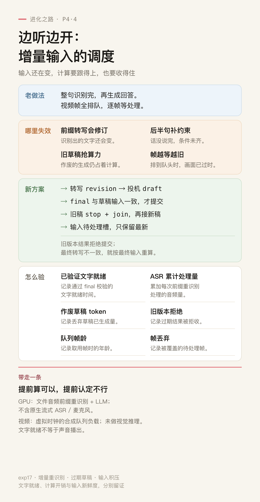
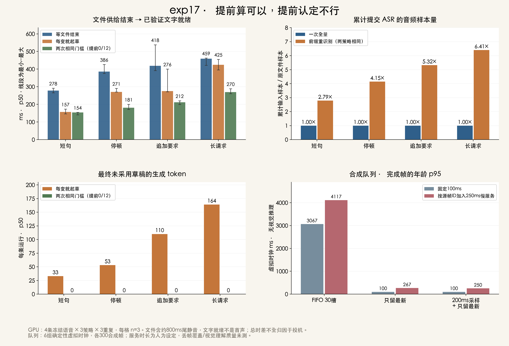

# 进化之路 P4·4 ｜ 边听边开：增量输入的调度

> 进化之路 · Phase 4 · 4。上一站，旧回答要停得住。这一站，把时间再往前推：乘客还没说完，司机能先准备多少？
> exp17 实际运行 GPU 前缀识别与回答草稿；再用一组明确标注的合成队列，观察输入积压以后会发生什么。

---

## 一、可以先看地图，别急着报站

乘客说：“请先比较步行和骑车……”

司机已经准备给建议，乘客又补了一句：“再考虑下雨的情况，最后给我一个出行建议。”

等整句话说完再开始，省事，但前面几秒都在等。边听边准备，有机会把一些工作藏进这段时间；只是先准备好的路线，未必还能用于最后的问题。

这里有两种变化。声音还没到齐，识别出来的字可能被后面的音频改写；即使前面的字都没错，后半句也可能补上新的条件。

**提前算出来的东西，先是一份草稿。能不能采用，要等后面的输入来核对。**

---

## 二、一页纸：输入、草稿、提交各有版本

| 栏 | 内容 |
|---|---|
| 老做法 | 整句识别完再生成；输入帧来了全部排队 |
| 哪里失效 | 转写会修订，后半句补条件，旧草稿占算力，排队的画面越来越旧 |
| 新方案 | 转写带 revision，草稿带版本；最终输入一致才提交，旧稿停止并等线程退出；待处理输入有界 |
| 怎么验 | 查文字就绪、重复识别量、作废 token、旧版本提交，以及队列里的帧龄和丢弃 |

revision 是转写版本。草稿记住自己依据的版本，提交时再核对最终输入，不能只认“这是刚才那个请求”。

待处理输入也不必无限攒着。已经在处理的任务能否中断、尚未处理的输入该留哪一份，是两个独立决定。

---

## 三、这次做的是前缀重识别

语音实验复用四条冻结输入：2.68 秒短句、5.34 秒句中停顿、6.66 秒追加要求、8.14 秒长请求。原文自写，由 macOS Tingting 合成，包含约 800 ms 尾静音。

DARYU 上，faster-whisper-small 以 CUDA INT8/FP16 转写，Qwen3-0.6B 以 CUDA BF16 生成。文件按 20 ms 步长供给，识别器只能拿到当时已经供给的前缀；每隔 800 ms 请求一次重识别。文件供给完成后，再对完整文件做最终转写。

它是在同一进程里按节奏重放文件，没有麦克风或网络输入。为了拆开识别和调度，本轮用**文件供给结束**作明确提交点，没有运行 VAD 判断端点，也没有用离线能量标注来提前截断音频。

每次识别都把已有前缀重新交给模型，并非复用上一块的声学状态。faster-whisper 的分段结果虽通过生成器读取，也要实际遍历才能执行转写；换成生成器接口，不会自动省掉前缀重算。[faster-whisper 官方用法](https://github.com/SYSTRAN/faster-whisper)

真正面向流式场景的稳定前缀方法，还会设计哪些字可以确认、音频缓冲怎样推进。例如 Whisper-Streaming 论文讨论了 LocalAgreement。下面的“两次相同”只是本轮完整文本相等的简单门槛，不能当成那个算法的复现。[Whisper-Streaming 论文](https://aclanthology.org/2023.ijcnlp-demo.3/)

这次比较三种处理，各用四条输入重复三次，共 **36 条正式 GPU 运行**，另有四条完整输入热身：

- **等文件结束**：供给完后识别一次，再开始生成。
- **每变就起草**：前缀转写一变，旧稿失效，开始新稿；最终转写匹配当前草稿，才采用它。
- **两次相同门槛**：final 之前，连续两次完整转写相同才投机起草；final 到来时仍可直接生成。

本轮比较时做了 NFKC、小写和去空白、标点，原始文字另存。这个键只用于当前受控输入；标点、数字和语义可能相关，不能把这种归一化直接当作通用语义相等判断。

---

## 四、先把版本管住，再看快了多少

第一条短句给出了很直观的变化。按已经供给的音频位置看，一次正式运行得到：

| 位置 | 识别结果片段 |
|---|---|
| 0.8 秒 | 请解释一下 |
| 1.6 秒 | 请解释一下什么是缓子 |
| 2.4 秒 | 请解释一下什么事缓存 |
| 文件结束 | 请解释一下什么事缓存 |

同一个请求，前面“缓子”后来被改了；最后稳定下来的“什么事”，对照原文仍应是“什么是”。另一条输入则把“步行和骑车”识别成了“不行和骑车”。

**转写不再变化，只说明这次观察相同，并不证明识别正确，也不证明乘客已经说完。** 本轮三种策略的最终转写逐条一致，提前重识别没有改善这些最终识别错误。

草稿的处理因此分成两步。输入变化，立即使旧版本失效；如果旧线程还在运行，发停止信号并等待实际退出，再起新稿。草稿文字先留在缓冲里，最终转写匹配当前草稿依据的文本时，才写入实际提交记录。

这与上一站的取消衔接起来了：失效要先管住输出，计算收尾也要留证。LiveKit 的预生成同样要考虑后续上下文或工具状态变化，已有投机回答可能需要丢弃重做。本轮固定了系统提示与上下文，只验证转写这一条依赖。[LiveKit 的预生成说明](https://docs.livekit.io/agents/multimodality/audio/)

实际事件核对中，36 条运行都只提交了最终选中的草稿；没有在最终转写返回前提交文字。旧版本拒绝也有单独机制测试，不过正式 GPU 运行没有观察到迟到旧片段撞上拒绝分支，不能把测试夹具当成线上竞争已经出现的证据。

---

## 五、少等一点，要多做多少

先看文字何时可以提交。计时从**文件供给完成**开始，到当前版本第一段文字通过最终转写核对、进入提交记录为止。首段指流里第一个非空文本片段，可能只有一两个字，不要求完整句子。没有接 TTS 和播放器，因此它不是首声延迟，也不能用来宣称达到了系列的 800 ms 语音目标。

下表为 p50，单位 ms，每格三次：

| 输入 | 等结束 | 每变起草 | 相同门槛 |
|---|---:|---:|---:|
| 短句 | 278 | 157 | 154 |
| 停顿 | 386 | 271 | 181 |
| 追加要求 | 418 | 276 | 212 |
| 长请求 | 459 | 425 | 270 |

这些数字描述整份实现的运行。进一步查草稿账，才能知道哪些差别确实来自提前生成。

“每变就起草”的 12 条全部采用了最终转写返回前已经启动的草稿。最终 ASR 返回后，到第一段已验证文字提交，各输入组的 p50 只剩 **约 0.02–0.03 ms 的本地状态处理**；直接新起一轮 LLM 的对应等待约为 24–33 ms。这不是网络或用户听感时间。

而“两次相同门槛”在这四条输入上，**提前起草是 0/12**。它每次都等到 final 后才生成。虽然整段计时更短，但不能用它证明“两次相同就能带来预生成收益”：本轮最终 ASR 调用本身的耗时也不同，运行路径、资源状态等没有被隔离成单一变量，原因未进一步确定。

长请求还留下另一种等待。“每变就起草”组文件供给结束时，最后一次前缀识别往往还在跑；最终识别等到可执行的时间，p50 约 **237 ms**。即使已有可用草稿，也要等最终输入核对完。待处理槽只留最新快照，已经在运行的 ASR 调用仍须返回。

再看代价。等待结束的 12 条只调用 ASR **12 次**；另外两组各 **93 次**。按累计送入识别器的样本数，短句、停顿、追加要求、长请求分别达到原文件的 **2.79、4.15、5.32、6.41 倍**。这是重复提交的音频量，不能直接换算成 GPU FLOPs 或同倍率费用。

“每变就起草”一共起了 **78 份草稿**，最后只采用 12 份，其余累计生成 **1079 个 token**。其中 65 份失效时已经自然完成，只有 1 份失效时线程仍在运行。浪费常常发生在“已经算完，后来没用上”，不能全写成取消没及时生效。

本轮“两次相同门槛”只起了 12 份最终稿，没有作废 token，却仍付出了 93 次识别的成本。它展示了一个保守门槛在这四条输入上的行为，尚不足以推荐给更广的自然对话。

---

## 六、看得勤，还要看得新

把输入换成连续画面，会遇到同类的调度问题：新帧已经来了，处理者却还在看旧画面。

这里先不运行视觉模型，只用**确定性虚拟时钟**做队列负载：10 秒、30 fps，共 300 个合成帧；一个工作者处理，每帧耗时人为设为 100 ms。另一个场景按源帧编号加入 250 ms 慢服务。没有真实视频、编码或视觉理解结果。

三种策略各管不同的事：FIFO 最多留 30 个待处理帧，满了丢新帧；只留最新帧的策略，用新帧替换尚未处理的旧帧，但不打断正在运行的任务；采样策略则先把接纳间隔限到 200 ms，再使用最新帧槽。

固定 100 ms 服务场景中，从捕获时间到处理完成的帧年龄 p95 为：

| 策略 | 完成 / 300 | 丢弃 | 帧龄 p95 |
|---|---:|---:|---:|
| FIFO | 130 | 170 | 3067 ms |
| 只留最新 | 101 | 199 | 100 ms |
| 采样后留最新 | 50 | 250 | 100 ms |

画面更“新”的同时，保留下来的帧也更少。统计对象只有已完成帧，丢掉的画面没有被填成零延迟；它们可能包含任务需要的瞬间，覆盖损失和理解质量这轮都没测。

同一场景在输入停止后，FIFO 又用 **3000 ms** 才排空；最新帧策略用 100 ms，采样策略在输入结束时已无剩余任务。换到慢服务场景，三者完成帧龄 p95 约为 4117、267、250 ms。

这些是虚拟队列的结果。不同策略还会选择不同的快慢帧组合，不能据此推导真实视觉模型容量，或认定丢更多帧就一定更好。

语音的最新识别快照槽和视频的最新帧槽，也有一个区别：前者每次仍携带从开头到当前位置的完整音频前缀，替换待处理快照不会丢掉其中的早期声音；后者是在主动舍弃画面。实现前要先看清，排队的是累积状态，还是不可替代的独立观察。

---

## 七、先准备，确认以后再提交

这一站没有给“边听边算”贴一个统一的加速倍数。准备工作可以提前，但最终输入可能修订；更小的整体计时，也要拆开阶段才能解释。

调度器需要知道每份草稿依据什么版本、何时作废、是否真正退出，以及何时允许提交。输入积压时，还要知道保留最新会丢掉什么，而不是只盯队列长度。

**带走一条：提前算可以，提前认定不行。**

下一站 P4·5，把这些首声、等待、取消、重算和常驻资源放到同一本账里：一分钟会话，到底该怎样算？

---

### 实验口径与复现

36 条正式 GPU 运行全部完成，另四条热身独立保存；26 项机制测试通过。六组队列是一次性、确定性虚拟时钟计算，不作统计重复。整卡资源采样观测最高 2235 MiB，含常驻与其他开销，不是每请求峰值。实验进程已退出，原 gpu-router 正常，清理后整卡读数 350 MiB。

代码与口径：`phase4/exp17/README.md`；原始事件、环境、输入哈希与源码快照：`phase4/results/exp17/`。ASR 严格字符错误率未做繁简转换，不把繁简字形差异全部解释成语义错误；未评分 LLM 回答质量。

没有麦克风、在线 VAD、TTS、播放、视觉模型、工具执行或公网实验。引用官方资料查询日期：2026-10-23。
