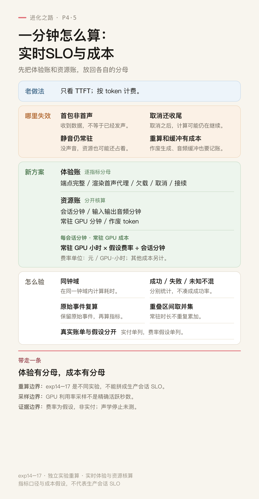
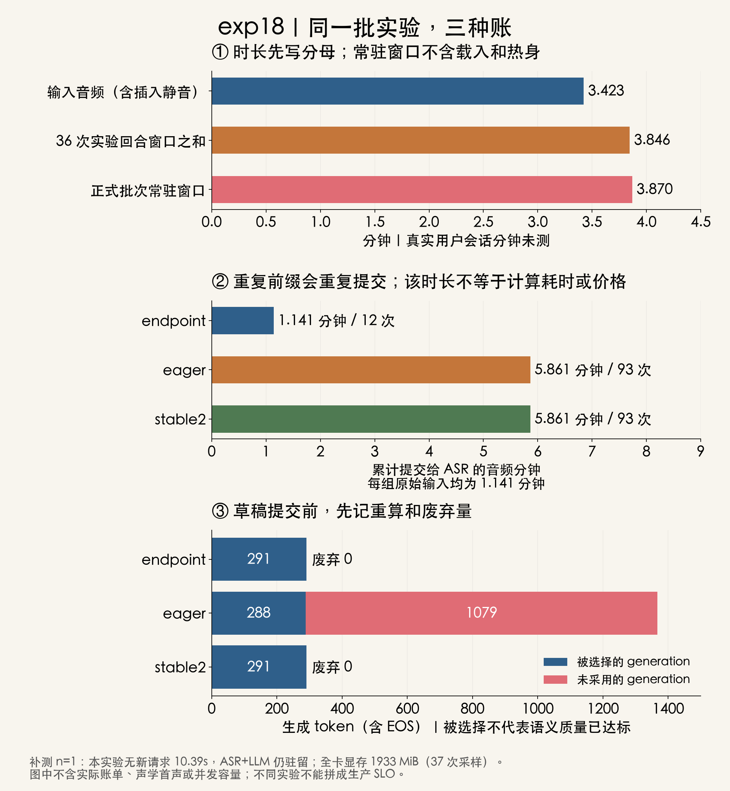

# 进化之路 P4·5 ｜ 一分钟怎么算：实时 SLO 与成本

> 进化之路 · Phase 4 · 5。车能开、话能接、乘客插话也能停下来，最后还要问：这一分钟，体验怎样，资源花在哪里？
> exp18 重算前四组实验的原始记录，再补一段真实 GPU 常驻观测。先写清分母，再谈达标和价格。

---

## 一、车开得快，还得看乘客有没有坐好

如果只看司机报站有多快，一辆车可能看起来很出色：开口早、话说得连贯，每句话也没花多少 token。

乘客却可能有另一份记录：自己还没说完，司机已经抢答；耳机里刚响起一句，又停了一阵；说了“先等等”，旧回答仍然接着播。车停在路边等人时，发动机也没有关。

前四篇把这些问题拆开测过。收尾时，很容易把它们重新揉成两个漂亮数字：“响应延迟”和“每分钟成本”。

可一分钟究竟是谁的一分钟？用户连着会话的一分钟，音频文件的一分钟，还是模型占着 GPU 的一分钟？响应结束又是哪一刻：文字出来、音频包到达、播放线程消费，还是耳朵听见？

**分母和终点没写清，快慢与便宜都可能算错。**

---

## 二、一页纸：体验有分母，成本有分母

| 栏 | 内容 |
|---|---|
| 老做法 | 看首 token；用 token 数解释全部成本 |
| 哪里失效 | 首包还没播放，取消仍在收尾，输入静音时仍会推理，草稿作废也花工作量 |
| 新方案 | 体验按回合和动作记；资源按音频、常驻时间、重算和废弃量记 |
| 怎么验 | 同一时钟算差值，成功/失败/未知各留分母；区间去重，假设费率与实付分开 |

SLO 在这里指准备给服务设定的体验目标。给目标写一个数字之前，先把它对应的测量规则写出来。

“说完后多久开始听到回答”，需要定义“说完”和“听到”；“插话后多久停住”，需要定义插话起点和停止边界；“成功率”，需要定义哪些回合有资格进入分母。

这次产出的是这些规则，以及规则能从现有记录里算出多少。它们还不是一套已经达标的生产承诺。

---

## 三、先检查有没有把失败删掉

第一组实验 exp14 有 108 条正式记录，三种策略各 36 条。它们都走到了 `stop` 终态。

但 A/B/C 三组分别有 6、9、9 条提前端点。乘客还没把整句话说完，系统就已经把输入收走了。

如果把 `stop` 当成成功，会得到 108/108；如果查输入是否完整，三组分别是 30/36、27/36、27/36。两份统计回答的是不同问题。

还可以对完整回合算速度：从客户端按冻结音频的离线能量参考推算的说话结束，到客户端收到首个 PCM，三组 p50 约为 1837、1385、1396 ms。这里的起点是参考标注，终点是收到数据；它不包含“扬声器已经响了”的证明。

**只给完整回合的延迟，必须同时写出被排除的提前端点。** 否则，抢话越多的策略，留下的延迟样本反而可能越好看。

同理，没有返回音频、客户端断开、取消超时的回合，不能悄悄从服务统计里消失。应当先列出所有符合条件的回合，再标成功、失败、未知；没有数据时，未知不会自动变成零延迟。

本系列曾把 800 ms 作为探索目标。它需要配套具体起终点，也需要保留失败分母，不能直接拿来当作普遍的人类感知阈值。

若把“端点完整、自然结束、数据校验通过，且参考结束到首 PCM 不超过 800 ms”一起检查，A/B/C 分别为 0/36、6/36、6/36。B、C 中确有少量回合符合这条首包规则；另测的三条浏览器非静音渲染代理则都超过 800 ms。两种终点、两批记录，不能混成同一个达标率。

---

## 四、一张体验表，保留几种不同的终点

前四组实验可以整理出下面这张表。每行都有用，但不能把它们拼成同一批用户的体验。

| 项 | 已有证据 |
|---|---|
| 端点 | exp14 三组各 36 条；完整 30、27、27 条 |
| 首声 | exp14 另有 3 条浏览器播放记录；是渲染代理，声学首声未测 |
| 连播 | exp15 最终 24 条媒体回放；WS 欠载、RTC concealment 分开统计 |
| 停播 | exp16 共 18 条双轮浏览器对照；按客户端音频帧位置计算 |
| 收尾 | exp16 服务器从停止信号到线程退出，使用服务器自己的时钟 |
| 接续 | exp16 的 18/18 新轮完整播放；回答语义质量没有因此自动通过 |

比如，exp16 只停服务端时，旧音频渲染尾巴的各点位 p50 约为 1.89～1.94 秒。清队列并隔离旧 generation 后，对应值为 0 或 2.67 ms。这是浏览器渲染块的位置关系，不能说人耳在 2.67 ms 内听不见旧声音。

服务器上的工作线程，退出还需要另一个时间。播放停止和计算收尾应各有一栏，不能看到队列清空，就把后面的计算费用也归零。

exp15 还有一个真实浏览器排空回合：浏览器收到 `producer_done`，再到报告 `finished`，相隔 654.7 ms。生产者停了，播放器里仍有待消费的东西。这一条只能说明该缓冲配置下的排空过程，不能变成全服务的 p95。

WS 播放器没拿到数据而欠载，与 RTC 的 concealment 也不能直接相加成“卡顿率”。后者是接收端的媒体统计。本轮 RTC 起始统计缺项，部分区间增量算不出来，就保留未知。

如果接下来要写“一个好回合”，我会先定三个条件：输入完整，播放满足已选的连续性要求，插话和接续按规则完成。首声再加自己的时间目标。

然后，在**同一批真实会话**里记录这些条件的交集。不能把 exp14 的完整率、exp15 的媒体结果、exp16 的接续率相乘，造出一个从没实际观测过的成功率。当前实验缺少这批联合记录，生产会话 SLO 仍待测。

---

## 五、输入没声音，GPU 未必没事情做

算资源时，先看上一组 exp17。

四条冻结音频、三种策略、各重复三次，共 36 次正式 GPU 回合。每条文件按 20 ms 步长供给；模型可能在文件仍在供给时识别前缀、生成草稿。

把这批原始记录重新加总，会得到三个时长：

| 口径 | 分钟 |
|---|---|
| 输入音频，含静音 | 3.423 |
| 36 次实验回合窗口之和 | 3.846 |
| 正式批次模型常驻窗口 | 3.870 |

回合窗口从开始供给到该回合工作线程全部退出。常驻窗口从首个正式回合开始，到最后一个正式回合的工作线程全部退出；同一进程中的 ASR 和 LLM 在此期间一直保留，模型载入、热身和窗口外驻留没有算进来。

这批回合按顺序运行。若多个会话重叠，算一张 GPU 的常驻时间时，重叠区间只能算一次；用户的会话分钟则可以分别累计。这两份账的相加规则也不同。

音频里明确插入的停顿和尾静音，共 42.57 秒，已经逐段核对为全零 PCM。它只覆盖合成时明确插入的静音，不等于全部自然停顿。更不能把这 42.57 秒叫作“GPU 空闲”：识别器可能正在处理此前的声音，LLM 也可能正在生成草稿。

为看清另一种情况，exp18 补了一个很短的观测：在 DARYU 的 RTX 4060 Laptop 8 GB 上，把 ASR 和 LLM 放到 CUDA，各热身一次并同步，然后本实验不再提交新推理请求。

这个窗口实际为 10.39 秒，37 次采样的全卡显存均为 1933 MiB。进程退出后，独立检查回到 342 MiB，原有网关仍在运行。

这说明在该配置和窗口里，**没有新请求，模型仍然占着显存**。它不是整张卡完全无活动的证明，也没有包含 TTS。利用率首个采样为 40%，后续为 0%；这类读数带有统计窗口，不能直接倒推出精确的 GPU 执行秒数。

---

## 六、早算出来的 token，也要有去处

exp17 每种策略各有 12 个回合，各自原始输入都为 1.141 分钟。端点后识别的 endpoint 提交 ASR 12 次；反复识别前缀的 eager、stable2 各提交 93 次。

后两组累计提交的音频各为 5.861 分钟。它把重叠前缀重复算进去了，描述的是输入工作量；不同长度的识别执行效率并不相同，不能把这个倍数直接当成 GPU 时间或账单倍数。

LLM 这边，endpoint 生成 291 token，stable2 也生成 291 token，没有废弃的 generation。eager 生成 1367 token，其中 1079 token 来自未采用的草稿，最后选择的 generation 共 288 token。这里沿用生成器计数，含 EOS。

eager 确实选用了提前生成的草稿，代价也真实存在。是否划算，需要一起看实际收益、废稿和上游重复工作，不能只看最终发给用户的字。

stable2 更提醒人谨慎：它要求连续两次转写一致才准备草稿，但这组数据里，最终选中的草稿提前开始为 0/12。即使整体文字就绪时间较短，也不能把时差归功于预生成；识别等待等路径并没有完全控制一致。

被选择的 generation 同样不等于好答案。原始转写仍有同音错字。若后续拿“有效会话分钟”做成本分母，还得先定义有效：只要求技术链路跑完，还是还要求识别和回答质量？这次没有补出一套语义质量验收，因此这栏仍然空着。

---

## 七、先算一项明白的费用

先只算常驻 GPU 这一项。设费率为 R，单位是元／GPU·小时：

**每会话分钟的 GPU 项 = 常驻 GPU 小时 × R ÷ 会话分钟。**

分子和分母需要来自同一统计范围。共享 GPU 的重叠常驻区间取并集；如果是多张卡，再按每张卡的时长和费率分别累计。

这批实验没有真实多轮用户会话，只有实验回合窗口。所以实际每会话分钟成本仍然不能填。

为了看清算式，可以**自定一个 R＝2 元／GPU·小时的假设**。它不是市场报价，也不是实付账单。

用正式批次的 232.191 秒常驻窗口，GPU 项约为 0.129 元；再除以 3.846 个实验回合分钟，约为 0.03354 元／实验回合分钟。换成输入音频分钟，数值又会变化。名字必须跟着分母一起改。

这份演算没计模型载入和热身，也没计窗口外的等待、CPU、内存、网络、存储或外部 API。它只能帮助检查核算方法，不能拿去报一个上线价格。

并发也一样。如果一张卡常驻一小时，在同一小时内累计服务了更多合格的会话分钟，分摊后的 GPU 项会下降。可是这台 8 GB 卡到底能承受多少同时在线、同时说话和同时合成的会话，需要另做带体验约束的负载实验。权重放得下，不代表并发已经有结论。

成本表至少该同时保留：假设或实付的来源、GPU 常驻时长、会话分钟、输入/输出音频分钟、重算与废弃量，以及没有测到的项目。

---

## 八、车能接话之后，要开始记完整的账

这一阶段，我们让一句话经过识别、生成、合成和播放；拆开连接与会话；让旧回答停下来；再试着在乘客说完前准备草稿。

最后一篇没有把这些结果压成一张“全面达标”的成绩单。它把已经测到的东西放回各自的分母，把还缺的联合会话、声学测量、质量验收和实际账单留出来。

接下来若做真实服务，先补一条贯通的会话记录：同一个 session、turn 和 generation，能查到输入、媒体、播放、取消、计算退出和资源归属。再在同一批负载里看体验目标与资源消耗。

**体验账告诉我们这一分钟过得怎样，资源账告诉我们为了这一分钟占用了什么。两份账都清楚，才轮到讨论贵不贵。**

---

*本篇依据 exp18 对 exp14～17 原始记录的重算，以及一段新增 GPU 常驻观测。补测新增 ASR、LLM 热身各一次；其余为离线核算。可重放合成输入、浏览器渲染代理与真实声学输出分别标注；假设费率不代表实际账单。*
