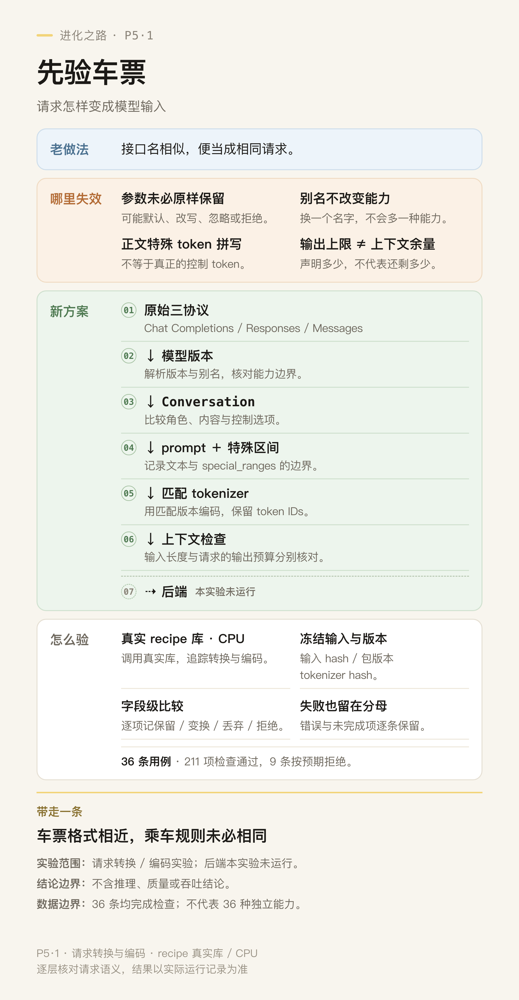
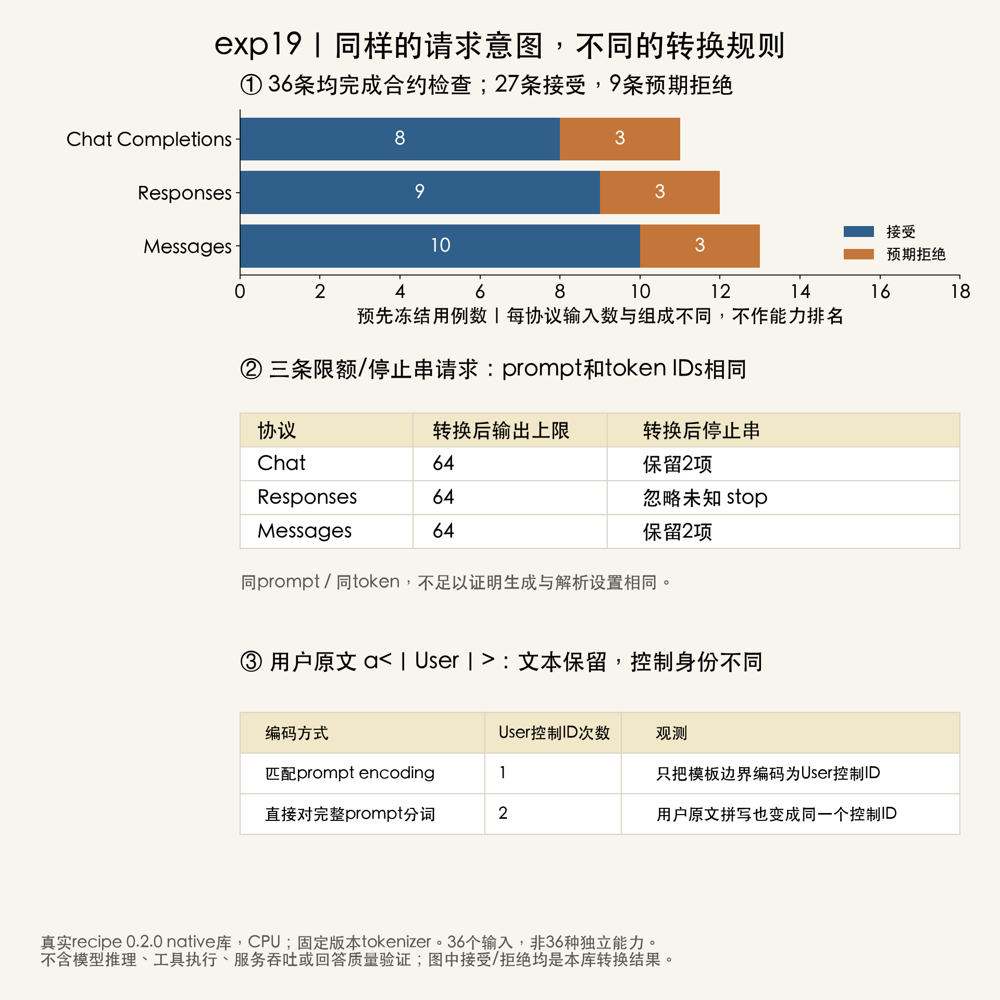

# 进化之路 P5·1 ｜ 先验车票：请求怎样变成模型输入

> 进化之路 · P5 · 1。前几站，我们测了车怎么排队、怎样接话。这一站回到入口：乘客递来的几种车票，经过转换，还是原来的乘车要求吗？
> exp19 实际调用 deepseek-recipe 的原生库，在CPU上核对请求转换、prompt编码与上下文检查。

---

## 一、票面不同，能不能坐同一辆车

一个应用用 Chat Completions，另一个用 Responses，还有一个用 Messages。它们都能表达“用户说了一句话”，于是网关很容易先做一张字段对照表：这个字段挪到那里，那个名字换成这里，模型就能接起来。

像三种车票，都写着目的地，我们便以为只需要换个票夹。

可票面上还可能写着：允许中途改道、这站一定下车、最多坐几站、能不能叫一位工作人员帮忙。转换时，哪些被保留，哪些用了默认规则，哪些被忽略，哪些直接拒绝？

这些区别发生在模型开始算之前。只看最后能不能回一句话，很容易把它们漏过去。

**接口名相似，只说明车票有些栏目相近。乘车规则要逐项核对。**

---

## 二、一页纸：先看请求怎样变形

| 栏 | 内容 |
|---|---|
| 老做法 | 字段能映射， 就认为请求等价 |
| 哪里失效 | 默认值、忽略字段， 版本、控制标记， 预算都可能改语义 |
| 新方案 | 请求、对话与设置， 提示词、编码结果， 分别留证 |
| 怎么验 | 真库、固定输入， 匹配分词器， 拒绝也保留分母 |

这次选择 deepseek-recipe 作为入口。它提供Rust库和Python bindings，能把三种协议请求转成统一的 Conversation，再渲染为相应DeepSeek模型的prompt，并把模型输出转回协议响应。推理、工具执行和HTTP传输由调用方提供。

所以本轮先看“请求怎样成为模型输入”。下一站再看输出怎样分段返回。

---

## 三、这次真正跑了什么

运行环境是macOS ARM64、Python 3.12.10，独立虚拟环境中安装官方 `deepseek-recipe 0.2.0` wheel。两份tokenizer分别对应V4、V4.1，取自固定源码版本，并逐份核对文件哈希。

阅读源码固定到 `935817c`。执行的wheel另存版本与SHA256；它附带的Python接口声明与固定源码逐字节一致，但这还不足以证明原生二进制恰由该commit构建，两份身份分别保留。

输入共36条，覆盖普通文本、多轮、思考设置、工具声明、输出上限、停止串、模型别名、特殊token原文与错误输入。三协议的输入数和组成不同。

| 协议简写 | 输入／接受／拒绝 |
|---|---|
| Chat | 11／8／3 |
| Resp | 12／9／3 |
| Msg | 13／10／3 |

Chat、Resp、Msg分别指Chat Completions、Responses、Messages。总计27条转换接受，9条按预期拒绝。全部36条都完成了各自声明的检查，没有意外失败或未知项。

同一条输入会检查多个属性，本轮共有211项声明检查；它们不是211种独立能力，更不是模型回答的正确率。接受数也不能拿来给协议排名，因为用例组成不同。

全过程没有模型推理，没有执行工具，也没有启动API服务。

---

## 四、prompt一样，规则仍可能不同

我们给三种协议各写了一条请求：最多输出64个token，并在请求里放入两条停止串。

Chat通过自己的 `stop` 表达，Messages通过 `stop_sequences` 表达。Responses这条输入也带了顶层 `stop`，但本次库的Responses schema没有这个字段，转换时把它忽略了。

最后，三条请求得到的prompt相同，token IDs也相同；输出额度都是64。差异留在解析设置里：前两条保留了停止串，Responses那条没有。

**如果只比较prompt或token IDs，这组检查会看起来完全一致。实际交给后续流水线的停止规则已经不同。**

还有一组更直接的区别。我们把输出额度设为393217，超过库默认的转换上界393216。Chat与Responses拒绝；Messages接受，并把额度截到393216。

同样是“多要一个”，有的票退回重填，有的票被改成最多允许的站数。只记“请求成功了”，无法知道它是否仍按原要求执行。

web_search声明也有差异：库默认对Responses丢弃这类工具，对Messages拒绝；显式改变转换选项后，接收结果也会改变。接受一条请求，不等于真的进行了联网搜索。

这些都是本次版本的**转换行为**。它们没有证明外部API服务使用同样的必填项、默认值或错误规则。

---

## 五、别名选的是规则，不能替模型换能力

`deepseek-chat` 看起来像一个合理的模型名，但这次库的默认映射并不包含它。没有注册时，三协议都拒绝。

随后，我们把这个名称显式注册为V4.1，再注册为V4，分别运行。两种配置都能通过，但其含义是“按哪一版模型的编码和参数规则处理”，不是简单地给字符串改个名字。

在关闭thinking、输入 `top_p=0.6` 的这组样例里，V4.1映射后的值为1，V4映射后仍约为0.6。请求里的相同数字，经过版本规则后不一定保持原值。

另一个默认值也值得先查清：本库的默认转换选项开启thinking。这次显式关闭thinking的输入，历史助手消息中的reasoning内容会被清空；开启max effort的样例，则按对应规则转换思考与采样设置。

模型名因此需要连着版本、tokenizer、模板和生成设置一起记录。把一个别名映射到DeepSeek编码规则，也不会让Qwen或其他模型自动获得兼容能力。

---

## 六、正文里写了一个站牌，不等于真的到站

有一条很短的用户原文：`a<｜User｜>`。

后半段的拼写，看起来与模板用于标记用户角色的特殊token一样。我们没有删掉它，也没有替乘客改写原话，而是分别走两条编码路径。

第一条使用匹配的prompt encoding。渲染结果除了字符串，还带着 `special_ranges`，指出哪些位置是模板显式插入的控制token，哪些只是普通文字。编码器按这份边界处理。

第二条只拿完整prompt字符串，直接调用tokenizer分词。

结果是：第一条的User控制ID出现1次，对应模板边界；第二条出现2次，用户原文中的那段拼写也被编码成了同一个控制ID。原文在两条路径里都还存在。

**只复制prompt字符串，丢掉它附带的边界信息，会改变输入语义。**

像乘客在纸上写了一个“下一站”的站牌，验票员不能把那张纸当成车上的报站指令。

这里的Python区间使用Unicode字符下标，Rust对应字段使用UTF-8字节偏移。复制一组数字之前，也要核对单位。本轮只验证了这项编码边界，没有验证模型会不会服从各种提示，也没有得到通用的安全性结论。

---

## 七、额度获批，还要看车上剩多少位置

请求转换以后，未显式填写的 `max_tokens` 仍可为空。真正编码出输入长度后，调用方再用 `resolve_max_tokens` 检查上下文，并解析要发给后端的输出额度。

在我们人为传入“余量充足”的上下文参数时，非thinking默认解析为8192，普通thinking为65536，max effort为131072；如果只剩7个位置，相应默认额度便降为7。

这描述的是本地函数怎样计算额度，没有测出真实模型能够提供多大的上下文。

显式额度则有另一条检查。比如输入编码后有14个token，又明确请求64个输出token。传入上下文上限78时通过，传入77时拒绝。这条错误出现在编码后的预算阶段，不能混成“协议请求根本转换不了”。

还有一个边界值得留下：当未填写输出额度，而输入长度恰好等于传入的上下文上限时，本版函数返回1。本轮如实保存了这个行为。它没有证明模型还能在满上下文中继续生成；实际接入时，调用方与后端仍要核对剩余空间。

**转换上界、编码后余量和后端实际限制，是三道不同的门。**

---

## 八、验票记录要能一路跟到后端

这次没有急着把三个接口接到同一个模型上，而是把中间几次交接分别留下：原始请求和配置、转换后的对话、生成与解析设置、prompt与特殊区间、token IDs、上下文检查和错误阶段。

预期拒绝的9条也在总分母里。模型名未注册、超上界、空停止串和不支持的工具声明，各有原始错误；编码或记录器出错，不会被算成转换器正确拒绝了请求。

每条结果还绑定完整用例合约的摘要。输入、选项或预期改了，就不能沿用上一次的“通过”；tokenizer也在加载前核对固定版本哈希，目录名字叫V4并不算证明。

对网关来说，这些记录最后还需要跟到真实后端：参数有没有实际传到，约束有没有执行，停止条件怎样触发，usage从哪来。这些是后续几篇的实验问题。

先验清车票，再决定怎样发车，能少一类很难查的问题：字是回来了，乘车要求却在入口悄悄变了。

---

## 几个可以讨论的问题

- 一个参数被静默忽略和被明确拒绝，你希望网关分别怎样对待？
- 缓存身份只记模型名，能否覆盖别名、模板和生成设置的变化？
- 如果prompt相同，而停止规则不同，这两条请求还应该共用一份结果吗？

下一站P5·2，继续看模型输出怎样穿过分块、thinking和工具标记，变成客户端看到的流式事件。

---

## 资料与实验入口

- [deepseek-recipe中文README](https://github.com/deepseek-ai/deepseek-recipe/blob/935817c66f5d6e64838f419692545f06787e485f/README.zh.md)：库的职责与支持范围。
- [tokenizer指南](https://github.com/deepseek-ai/deepseek-recipe/blob/935817c66f5d6e64838f419692545f06787e485f/docs/tokenizer.zh.md)：匹配tokenizer、特殊区间与上下文检查。
- [Python接口声明](https://github.com/deepseek-ai/deepseek-recipe/blob/935817c66f5d6e64838f419692545f06787e485f/deepseek-recipe-python/python/deepseek_recipe/_native.pyi)、[上游bindings测试](https://github.com/deepseek-ai/deepseek-recipe/blob/935817c66f5d6e64838f419692545f06787e485f/deepseek-recipe-python/tests/test_bindings.py)：逐项核对的接口与反例。
- 自有数据：`phase5/exp19/`为运行器与冻结输入，`phase5/results/exp19/`保留原始转换、编码和检查记录。

口径：2026-10-23；真实recipe 0.2.0原生库、CPU、36条冻结请求、匹配版本tokenizer。阅读源码commit与执行wheel身份分别保留；本轮没有模型推理、工具执行、HTTP服务、回答质量或服务吞吐结论。
