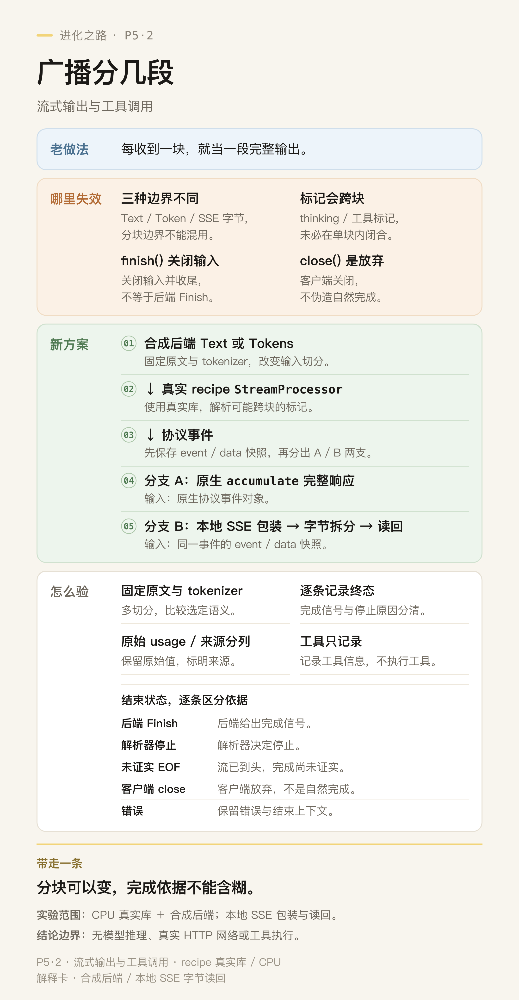
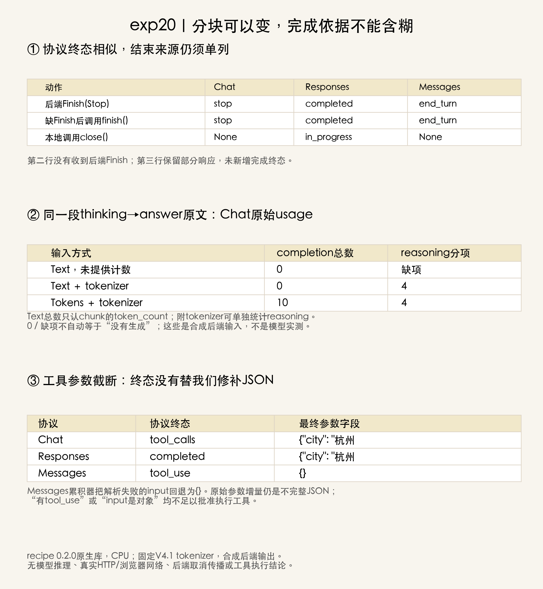

# 进化之路 P5·2 ｜ 广播分几段：流式输出与工具调用

> 进化之路 · P5 · 2。上一站验车票，这一站听报站：一句话分几次传来，什么时候才算说完？
> exp20 实际调用recipe原生流处理器，用合成后端输出核对分块、工具参数、终态和usage。

---

## 一、收到一段，不等于听懂一段

公交车上的广播有点断续：“下一站……”先传过来，“人民广场”随后才到。听众可以慢慢拼，可负责执行指令的人还要知道：这是完整站名，还是一句没说完的话？

流式接口也有这层区别。网关收到一个chunk，里面可能只有半个标记、一点工具参数，或者一个汉字所需的部分token。把每块直接当成完整消息处理，正常短句很容易跑通，遇到边界才出错。

上一站，我们看请求怎样转成模型输入。这一站沿相反方向走：后端交来的输出，怎样变成客户端能理解的事件。

**块是怎样送来的，和一句话是否完整，是两件需要分别核对的事。**

---

## 二、一页纸：把三种分块分开



这次仍使用deepseek-recipe 0.2.0官方原生wheel，在CPU上运行。阅读源码固定到`935817c`，执行包和源码身份分别保留；没有证明二进制由该commit构建。

后端输出由固定fixture提供，不调用模型。我们给同一段原文三种切法：整块、逐单元、大小交替，再比较选定的内容和终止语义。

但“单元”有三种，不能混用。

**Text层**接收有效字符串。可以把`</think>`拆成几次送入，但不能递给它半个UTF-8字符的字节。

**Tokens层**接收token ID序列。一个汉字或emoji可能需要多个ID，解码器会等后续ID补齐。本轮先编码完整原文，再切同一份ID序列；不会把特殊标记拆开分别编码，又声称输入没变。

**SSE字节层**位于协议事件之后。我们先保存库产出的event/data，再包装为SSE，按字节拆分并增量读回。这里才故意切开中文、emoji和换行的字节边界。

这像广播稿、播音片段和线上传输的数据包。名字都叫“一段”，所在的层却不同。

---

## 三、分块可以变，比较的东西要先说清

正式集合有19个输入定义，包含11组主要输出，以及usage和生命周期反例；按协议、输入方式和切分展开为222条配置流。

这些流全部符合冻结预期。它们产生的事件又做了666次本地SSE字节重放，读回内容一致。记录器共有2004项声明检查，许多检查在不同配置中重复；这些数字都不是模型调用量、独立能力数或回答正确率。

普通文本、thinking转answer、一个工具、两个工具、停止串、长度限制、内容过滤、缺Finish、主动放弃和不完整标记，都留在集合里。

我们比较的是答案文本、reasoning、工具名称与参数、终态及停止串。工具ID带随机成分，另查非空和唯一性；不要求跨运行的ID、时间或事件条数完全相同。

完整响应也要交代来源：它由同一个原生处理器的事件，按顺序交给`accumulate`得到。整块和多块是**同一套解析器的分块对照**，不是两个独立实现互相证明正确。

因此，最终响应和原始事件都保留。尤其不能只看最后那份完整JSON，便把中间增量是否完整的问题略过去。

---

## 四、三个“结束”，不能共用一个意思

最值得留下的，是一组很短的反例。

我们输入“未完待续”，没有发送后端的`InferenceChunk.finish`，随后调用处理器的`finish()`，表示输入已到头，请排空缓冲。

库仍会给出正常协议终态：Chat为`stop`，Responses为`completed`，Messages为`end_turn`。`processor.finished`也变成了真。

它把输入流收尾了，却没有替我们证明后端为什么结束。若网络断开或上游异常也被调用方一律转成这种EOF，客户端就可能看到一份看似正常完成的响应。

所以记录里另留一栏：**有没有收到后端Finish，结束依据是什么。** 本轮缺Finish的路径标为“完成来源未证实”，不会因协议字段写了completed便升级为后端自然结束。

另一条路径输入“说到一半”后调用`close()`。已有部分文字仍保留，但没有新增成功终态。这里用本地close模拟放弃，尚未验证真实客户端断开怎样传播到后端。

第三条是命中停止串。解析器可能在后端Finish到来之前已经结束，此后继续push会报“已经完成”。运行器会停止提交剩余块，并记录未提交部分。**解析器不再接收，仍不等于GPU已经停算。** 后端取消传播要等后续网关实验再验。

后端Finish、输入关闭收尾、主动close，各自有自己的责任。不能因为都发生在最后几行代码，就共用一条成功路径。

---

## 五、工具说要调用，参数未必已经完整

我们用DeepSeek格式的工具标记，构造了一个天气查询：名称为`weather`，参数是`{"city":"杭州"}`。完整输入在不同切分下，都能还原名称与参数；两个工具的样例也保留了调用次序。

接着，把参数停在这里：

```text
{"city": "杭州
```

缺了结尾引号和右花括号。然后让合成后端发送Stop。

Chat与Responses的最终参数字段保留了这段不完整字符串。Messages的累积器尝试解析，失败后把最终`input`回退成了`{}`。三种协议的原始参数增量，仍然都是上面那段残缺内容。

与此同时，Chat的终态是`tool_calls`，Messages是`tool_use`，Responses是`completed`。

**终态表示这条解析路径怎样结束，没有替工具执行器证明参数已经完整。** 如果只检查“有工具名”“input是对象”，Messages里的回退值就可能把问题藏起来。

这次只记录调用名称、参数、ID和顺序，不执行任何工具。实际接入还需要保留原始参数，验证JSON完整性、schema及执行权限；不能收到几个增量，就边拼边执行。

像广播里说“请工作人员去……”，工作人员还得等目的地说全，而不是听见“请”便出发。

---

## 六、usage里的0，也要问从哪来

另一组输入是同一段合成原文：先给thinking内容，再用`</think>`切到答案“42”。没有模型真的进行这次思考；我们测的是库如何解释和计数。

以Chat的原始usage为例，下面的“输出”对应`completion_tokens`，不包含prompt；包含prompt的`total_tokens`在这三行分别为13、13、23。

| 输入方式 | 输出／思考计数 |
|---|---|
| Text | 0／缺项 |
| Text附分词器 | 0／4 |
| Tokens附分词器 | 10／4 |

Text默认的`token_count`为0，库不会因为附上tokenizer，就自动补算completion总数。但它可以单独统计reasoning，于是出现了“总数为0，reasoning为4”的组合。

Responses在没有这项reasoning计量时会给出默认0；Messages的原始usage没有相同的reasoning分项。原始字段各有协议表达，不能把缺项和默认0强行归成同一份已测数据。

本轮prompt侧的13个token、其中3个缓存命中，是fixture显式提供的合成数值；另有一条Text显式给7的对照，也只是验证计数传递。它们都不是模型计费证据。

所以账本要同时保存原始usage和来源：后端提供、chunk显式计数、库的分项分词，还是根本未计量。未计量就标未计量，不能见到0便写成“没有生成”。

命中停止串时也有类似区别：一个大块已经交来的尾部，和解析器结束后根本没再提交的小块，计数范围可能不同。**内容相同，不自动保证成本相同。**

---

## 七、SSE最后一行，不负责证明整趟车开完



三协议的收尾形式也不同。Chat的`[DONE]`由传输层另行包装；Responses有自己的completed或incomplete事件；Messages以message_stop收尾。不能给每种流都硬塞一个相同的结束标记。

本轮把真实库事件包装后，逐字节送进本地增量解码器。中文、emoji和事件分隔符跨块时，都能读回同一份event/data。再故意去掉最后一个空行，未被完整终止的最后事件不会因EOF而自动派发。

这一层参考WHATWG的SSE解析规则，但辅助器只实现本实验用到的字段与行边界，不实现浏览器重连；非法UTF-8采用明确报错的策略，也不宣称与浏览器错误恢复相同。

它验证了内存中的包装与读回。真实HTTP服务、代理缓冲、浏览器接收、断线和取消传播，都没有在这轮发生。

协议终态、SSE事件完整送达、后端自然结束，是三份证据。某一份齐了，不能替另两份签收。

---

## 八、网关要保留的，不只是拼好的答案

这次留下的交接记录包括：原始后端片段及切分方式、库产出的全部事件、累积后的部分或完整响应、后端Finish是否出现、解析器状态、异常阶段，以及原始usage与来源。

Tokens缺tokenizer、logprob数量不匹配、重复后端Finish、完成后继续push、close后再finish，都按真实行为单列。错误发生前已经收到的事件不会被抹掉，记录器自身出错也不会冒充库按预期拒绝。

每条配置绑定完整输入与预期的摘要。改了输入、选项或验收要求，就不能沿用旧记录的通过状态。

到这里，我们还没有把模型网关接完，但已经可以少留几处含糊：这一段属于谁，参数拼全没有，这个0是否计量过，这次结束到底凭什么认定。

**分块可以变，完成的依据要能追到来源。**

---

## 几个可以讨论的问题

- 协议显示completed，却没有后端Finish，业务应当怎样展示、重试和记账？
- 工具参数最终变成了`{}`，该怎样区分合法空参数与解析失败回退？
- 总输出为0而reasoning有计数时，账本还能只留一个“成功token数”吗？

下一站P5·3，继续核对结构化输出：声明了JSON或schema，究竟由哪一层保证它成立。

---

## 资料与实验入口

- [固定版本流处理指南](https://github.com/deepseek-ai/deepseek-recipe/blob/935817c66f5d6e64838f419692545f06787e485f/docs/streaming.zh.md)、[原生processor](https://github.com/deepseek-ai/deepseek-recipe/blob/935817c66f5d6e64838f419692545f06787e485f/deepseek-recipe/src/stream/processor.rs)：输入、计数和结束来源。
- [输出解析器](https://github.com/deepseek-ai/deepseek-recipe/blob/935817c66f5d6e64838f419692545f06787e485f/deepseek-recipe/src/stream/output_parser.rs)、[Messages累积逻辑](https://github.com/deepseek-ai/deepseek-recipe/blob/935817c66f5d6e64838f419692545f06787e485f/deepseek-recipe/src/protocol/anthropic/messages/response/schema.rs)：标记状态与参数回退。
- [WHATWG SSE解析规则](https://html.spec.whatwg.org/multipage/server-sent-events.html#parsing-an-event-stream)：UTF-8、行分隔和事件派发。
- 自有数据：`phase5/exp20/`为固定输入、源码笔记和运行器；`phase5/results/exp20/formal-v1/`为正式逐条记录。

口径：2026-10-23；真实recipe 0.2.0原生库、CPU、合成后端输出、固定V4.1 tokenizer；19个输入定义展开222条配置流。无模型推理、真实HTTP/浏览器网络、后端取消传播或工具执行结论。
