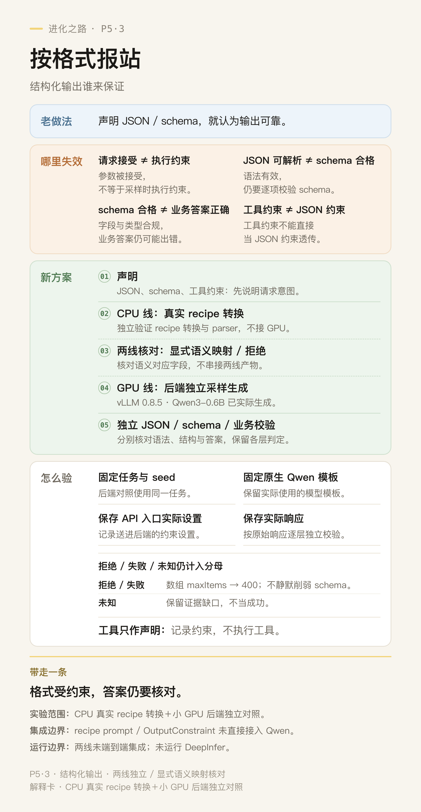
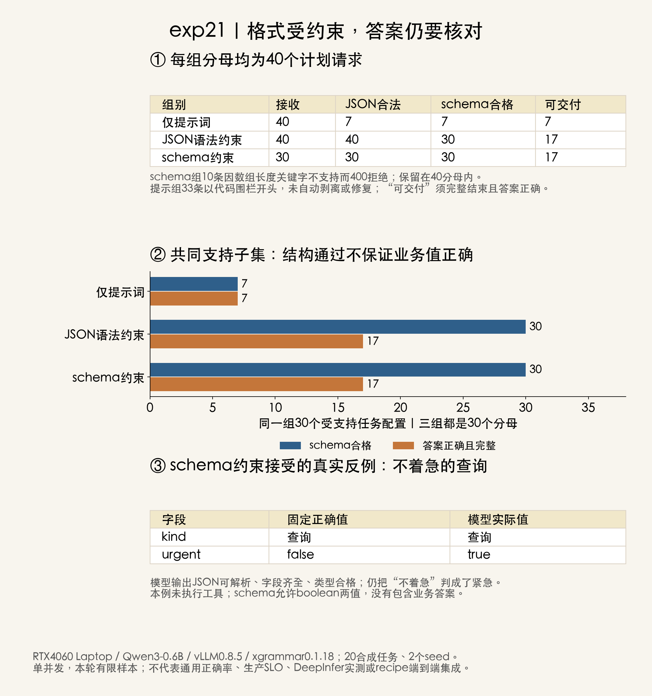

# 进化之路 P5·3 ｜ 按格式报站：结构化输出谁来保证

> 进化之路 · P5 · 3。上一站听广播有没有说完，这一站给广播一张格式表：栏目填齐了，内容就一定对吗？
> exp21 先跑真实recipe转换，再用小GPU后端做独立对照，逐层核对声明、约束与答案。

---

## 一、站名填进框里，还是可能报错站

一张报站表，规定有“站名”“是否紧急”两个栏目。工作人员每次都填齐，站名写成文字，紧急程度写成是或否，系统便能接着处理。

这已经比一段自由广播容易接入。但如果乘客说“不着急”，表里却填了“紧急”，栏目和类型都没有错，业务仍然错了。

结构化输出解决的，是这条链上的几种不同问题：请求能不能表达要求，转换有没有保留，后端有没有执行，结果能不能解析，内容是否符合schema，最后才是答案对不对。

把它们都缩成一个“支持JSON”，很容易在交接时漏掉责任。

**格式是一项合约，业务正确性还需要自己的验收。**

---

## 二、一页纸：沿五次交接找证据



这次分两条线。

CPU线实际调用deepseek-recipe 0.2.0，检查三协议请求怎样变成`OutputConstraint`。GPU线使用DARYU上的RTX 4060 Laptop、Qwen3-0.6B和现有vLLM 0.8.5/xgrammar 0.1.18，比较提示词、JSON语法约束与schema约束。

两条线按语义对应，没有把recipe渲染的DeepSeek prompt交给Qwen，也没有把它的约束对象直接透传。这次没有运行DeepInfer。源码阅读与执行包身份分别记录，不把接口相似当成端到端集成完成。

五栏记录保留下来：**声明、转换、后端映射、执行、独立校验。** 每一栏都有自己的证据，不能由前一栏替后一栏签字。

---

## 三、请求被接受，先别替后端答应

CPU矩阵有126条配置，90条转换接受、36条按预期拒绝，全部按固定源码逐项核对。三协议的输入组成不同，不能按接受数给它们排名。

其中一个反例很直接：非法正则表达式`[`可以被转换接受，库把它留成了regex约束。这个阶段没有替后端编译正则。

另一些请求声明了strict schema，随后给parser一段不合格的合成文本，文本仍可能被转发。parser在解释输出格式，不等于它已经做了通用schema实例验证。

Messages的格式字段也有被忽略的样例。字段写进请求，不足以证明转换产物里已经有了相应约束。

工具声明还有另一道映射门。recipe的`tool_call`、`tool_call_required`不能因为内部装着JSON，就直接当成DeepInfer compiler的`json`或`ebnf`。工具列表、JSON Schema和模型格式语法，表达的东西不同。

本轮对这类直传显式拒绝；JSON/regex的对应也只记为源码候选，没有假装跑过DeepInfer编译与采样。

像报站表交给调度员，调度员能收下，不代表车上的设备已经能按这张表播报。

---

## 四、让约束字段单独证明一次作用

GPU部分先做控制请求，不直接看漂亮的成功率。

提示词要求“只输出单词FREE”。不加格式字段，模型输出`FREE`；使用JSON语法约束，输出变成`{}`。

再把一个只允许`CONSTRAINED21`的枚举放进API schema，提示词里不写这个值。实际输出成为：

```json
{"flag":"CONSTRAINED21"}
```

非法schema类型则返回400。这样，证据里除了“字段被接收”，还有约束通道影响真实生成的对照。

后端入口另留了专用记录。正式120条请求的请求体SHA256与HTTP状态，都与客户端逐条一致。它证明设置确实到达模型API入口；安装源码、运行配置和控制生成一起说明执行路线。我们没有把入口日志称为逐token的CUDA mask追踪。

这套旧环境还暴露了接口细节：CLI接受`xgrammar`，禁止回退的选项放在每条请求的`guided_decoding_backend`里。不能把带后缀的请求值直接抄成CLI参数。

---

## 五、120条请求，保留每一道门的分母

正式输入是20个合成任务：抽取、意图分类、整数计算和保序选择，各5个；每个使用两个seed。三组收到相同任务说明、JSON要求和schema文字，只改变API约束字段。使用Qwen原生模板，关闭thinking，单并发运行。

schema规定类型、枚举和范围，没有写入任务正确答案。每组40条计划请求，结果依次为“接收／JSON合法／schema合格／可交付”：

| 组别 | 四层计数 |
|---|---|
| 仅提示词 | 40／7／7／7 |
| JSON语法约束 | 40／40／30／17 |
| schema约束 | 30／30／30／17 |

“可交付”要求完整结束、结构合格且与冻结答案相符。110条接受响应均以Stop结束；另10条不是生成失败，而是schema组因数组长度关键字不支持，被明确400拒绝。

我们没有删除`minItems/maxItems`再宣称兼容，也没有把这10条从40的分母里拿掉。它们没有生成文本，对应校验项保持未测。

提示组的33条解析失败，则全部以代码围栏开头。这里按事先约定检查**整条输出**，不自动剥围栏或提取JSON子串。因此7/40描述的是严格输出合约，不代表其余33条围栏里的内容全都错误。

剔除schema组不支持的数组任务，再比较三组相同的30个配置：两种约束组都达到30条schema合格，但都只有17条可交付。这个子集也没有显示schema约束提高了业务正确率。

还有一条数据口径要留下：折扣题原文写作“75折”，冻结答案按原价75%支付解释，题面有歧义。原记录不改；共同支持子集剔除该题后，两种约束组都为28条结构合格、17条可交付，提示组为7条可交付。核心反例使用没有这项歧义的“不着急”查询。

这些是本轮固定小样本的观察，两次seed也不是两份独立任务。不能由此给模型能力、生产成功率或容量下结论。

---

## 六、schema合格的那13条错在哪里



schema组实际接受的30条中，有13条结构通过、业务答案错误。下面这条就很清楚：

输入是“查一下车次，不着急”，并明确约定只有表达紧急时才把`urgent`填成true。固定答案为：

```json
{"kind":"查询","urgent":false}
```

模型实际给出：

```json
{"kind":"查询","urgent":true}
```

两个字段都在，`kind`属于允许的枚举，`urgent`也是boolean。schema没有理由因为这个值是true而拒绝，因为它不知道这次查询到底急不急。

这条记录没有执行工具。它说明的是：约束可以把输出限制在允许的表达范围里，但业务值仍可能选错。

独立校验因此分三步：先严格解析整个JSON，再用固定draft的schema校验器检查结构，最后拿任务oracle核对业务值。重复键、非有限数字、代码围栏和截断也分别保留，不在统计前悄悄修好。

像一张格式完全正确的报站表，仍然需要核对车到底开到了哪一站。

---

## 七、遇到不支持，网关要明说

本轮最容易被“兼容”两个字吞掉的，是那10条400。

后端不支持某个关键字，调用方可以明确拒绝、换一个经过验证的后端，或者与业务重新约定一个更弱的合约。每条路径都需要自己的验收。

直接删掉限制、静默回退，最后只留下一个200，会让上游以为原要求仍然成立。尤其工具执行前，不能只检查“JSON能读”“对象有几个字段”，就替业务作出批准。

这次保留原schema，使用no-fallback，把不支持留在结果里。这个选项只阻止切换后端，并不会自动修复编译器实现的所有语义边界；源码笔记里的额外native matcher反例，也没有混入GPU分母。

后续真正把组件接成网关时，需要的仍是这五栏：哪一份要求，被哪一层接收，怎样映射，在哪里执行，最终由谁验收。

实验结束后，我们停止了专用模型服务与隧道，回读端口关闭、显存恢复；其他服务没有因这轮实验被停止。

**格式受约束，答案仍要核对。**

---

## 几个可以讨论的问题

- 后端不支持schema里的一个关键字，网关该拒绝、换后端，还是重新协商合约？
- 自动剥代码围栏之后成功，和原始输出直接合格，是否应该记成同一种成功？
- 工具参数结构合格后，哪些业务条件仍须由执行器独立核对？

下一站P5·4，进入引擎：班次表藏在哪里，调度循环怎样影响不同乘客。

---

## 资料与实验入口

- [recipe请求与输出约束类型](https://github.com/deepseek-ai/deepseek-recipe/blob/935817c66f5d6e64838f419692545f06787e485f/deepseek-recipe/src/request/mod.rs)：转换产物与调用方责任。
- [vLLM 0.8.5结构化输出](https://docs.vllm.ai/en/v0.8.5/features/structured_outputs.html)：接口参考；本轮另保存实际安装源码、版本与调用链。
- [jsonschema 4.25.1校验说明](https://python-jsonschema.readthedocs.io/en/v4.25.1/validate/)：schema合法性与实例校验分别处理。
- 自有数据：`phase5/exp21/`为输入、源码笔记和运行器；`phase5/results/exp21/`保留CPU矩阵、120条GPU请求、入口对账与清理记录。

口径：2026-10-26；CPU真实recipe转换与Qwen3-0.6B小GPU后端独立对照，126条转换配置、18条parser探针、120条正式GPU请求；无DeepInfer推理、recipe→Qwen端到端集成、工具执行或生产性能结论。
