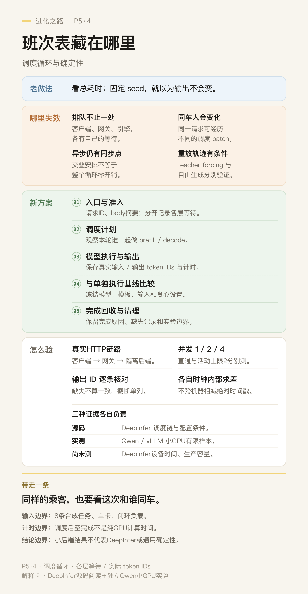
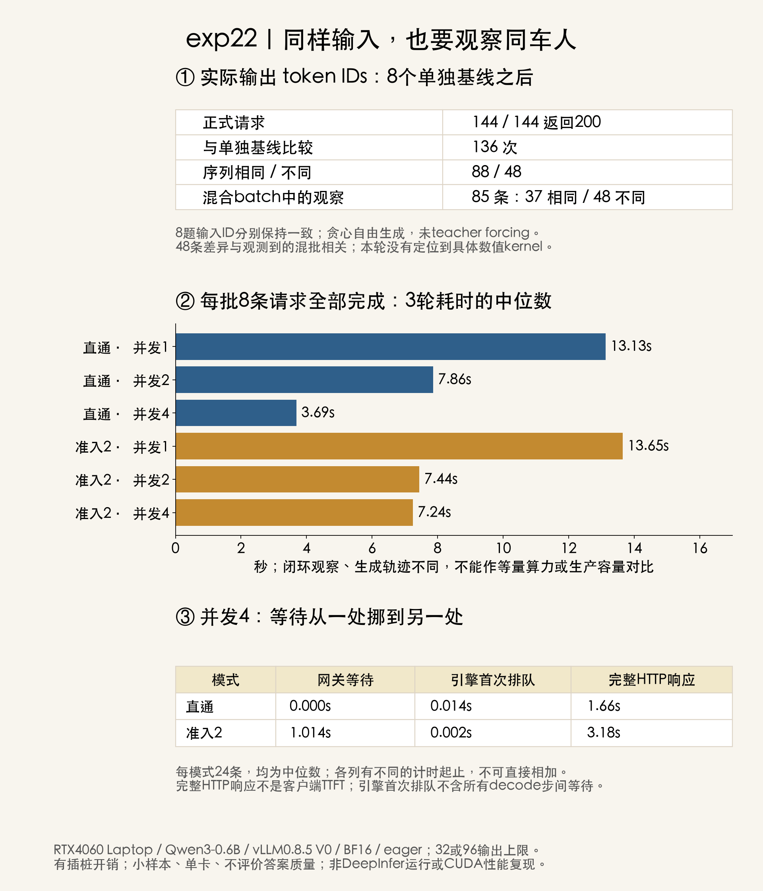

# 进化之路 P5·4 ｜ 班次表藏在哪里：调度循环与确定性

> 进化之路 · P5 · 4。上一站给报站内容定格式，这一站看班次怎样安排：同一个乘客，换一批同车人，旅程还会完全一样吗？
> exp22 阅读DeepInfer调度源码，并在独立的小GPU后端运行144条真实请求，记录各层等待与实际输出token IDs。

---

## 一、同一句话，这次为什么换了说法

我们问模型：“用一句话解释公交专用道的作用。”

单独执行时，它回答：“公交专用道是为公交车行驶而设置的专用道路，以提高公交车的通行效率和安全性。”

混合执行时，出现了另一句：“公交专用道是为公交车提供专用道路，以提高通行效率和安全性。”

意思接近，文字不同。实验里，模型、模板、实际输入token IDs和贪心设置都没换；变化出现在与其他请求共同被调度的执行中。我们保存的实际输出token序列，从第7个token开始就不一样。

如果业务只要一段通顺解释，这点改写未必碍事。但回归测试、缓存命中或结果复现，可能要求更严格的一致。这时，只保存问题和回答还不够。

**请求写了什么，要核对；这次和谁一起计算，也要观察。**

---

## 二、一页纸：班次表、等待和输出分开看

车站外有人排队，站内有人等发车，车上还有人等下一站。把这些等待合成一个总耗时，很难判断该加车、改班次，还是先控制进站人数。

模型服务也有几处交接：客户端提交，网关准入，引擎排队，调度器决定这一轮处理谁，设备计算，再把输出送回来。

其中一个batch，可以理解为这一轮一起处理的一组乘客。它会随请求到达、结束和资源状态变化，不必从头到尾都是同一批人。

---

## 三、DeepInfer的班次表，怎样转起来

这次把DeepInfer阅读版本固定到`9bd9cf2`。读的是公开的离线推理链路，没有在小显卡上运行它。

从入口看，`LLM.generate`把请求交给引擎。引擎每次`step`先调用调度器，生成本轮计划，再派给Worker执行，最后处理输出、更新状态。循环结束前，还要收拢仍在途的结果。

第一次处理输入，通常称为prefill：先理解乘客递来的整张路线单。之后逐步生成，称为decode：沿着已经走过的路线，决定接下来怎样走。两种工作需要的计算和资源不同，调度器要决定本轮安排哪一种、安排哪些请求。

DeepInfer的NORMAL引擎还会在数据并行组内协调本轮的步型。有的尝试点要求全组都有prefill工作，有的允许一个rank提出需求。这是在组内协调步型；服务外部怎样把新请求分给不同副本，还需要自己的负载均衡安排。

源码里的异步调度，关键在交接顺序。开启ZOS时，一轮decode可以先发起当前步的forward，再处理上一步已经采样的结果，随后发起当前步采样。当前步的一部分收尾留到下一轮，争取让CPU工作与设备执行交叠。

但收尾仍要等相应事件完成，最后flush也可能同步。forward和sample的局部区域避免同步，不代表整个循环没有同步点。没有设备trace，就不能画一张“CPU完全被GPU遮住”的实测时间图。

连默认值也要沿调用链读：底层环境项的ZOS默认是False，标准`EngineArgs`却默认NORMAL，并据此把未设置的ZOS环境值补成1。已有环境值会被保留。实际部署需要看构造后的有效设置；只摘其中一处默认值，容易得出相反结论。

---

## 四、先说清楚，测的是哪一种“一样”

文本一样、输出token序列一样，以及同一条生成轨迹上的概率数值一样，是不同的检查。

DeepInfer官方的batch-invariant测试，先批量生成，再把生成出的token轨迹交给单条重放，比较token和概率等结果。后一步使用`golden_token_ids`，采样器会用指定token推进。这种teacher forcing像让司机沿同一条已知路线重走，便于比较沿途计算；它不能直接替代两次自由生成的一致性实验。

官方对确定性采样也写了条件：NVIDIA路径、启用batch-invariant、关闭可变长度MTP，再给定固定`seq_seed`。这里关闭的是可变长度开关，不能转述成关闭所有MTP。

我们的小GPU实验采用另一条明确边界：**贪心自由生成，比较真实输出token IDs，没有指定答案轨迹。** `temperature=0`，同时记录seed17；这不是随机采样实验，也不能拿来验证DeepInfer的确定性功能。

---

## 五、144条请求，真的看见了不同同车人

后端使用DARYU的RTX4060 Laptop、Qwen3-0.6B原生模板，运行vLLM 0.8.5的V0、BF16、eager配置。

输入固定为8条合成任务，包含短问题和30条班次记录组成的长输入；交互任务输出上限32，批处理任务96。请求经过真实本地HTTP网关，再经SSH隧道到隔离后端。

直通模式立即转发；准入模式最多同时转发2条，另有2个等待位置。分别用客户端并发1、2、4，各跑3轮，共144条正式请求。4条预检另存；正式记录全部返回200，客户端、网关和后端入口的请求摘要与状态逐条对账。

我们还给这个隔离后端加了两类观察：调度器每轮返回的同批请求名单，以及引擎实际返回的输入/输出token IDs。输入ID按任务保持一致；调度计划里实际观察到过1、2、3、4个请求同批，未仅凭客户端并发数推测batch大小。

最先单独执行的8条，作为各任务的基线。余下136次比较中，88次输出token序列相同，48次不同。

其中，85条观察经历过混合batch，37条与单独基线相同，48条不同。仅观察到单请求batch的59条里，8条是基线，另外51次比较全部相同。

这使batch变化成为本轮需要关注的条件，但我们没有进一步定位具体数值kernel，也没有隔离所有底层运行因素。不能把48条差异改写成某个算子已被证明有问题，更不能写成模型的一般“不一致率”。

另有54条因输出上限结束，90条正常stop。截断没有删掉；比较的是生成到本次上限为止的实际序列，不代表完整答案或答案质量已经验收。

---

## 六、把排队搬到网关，并不自动更快

准入模式确实把同时进入后端的请求限制为2；调度记录里也没有超过2个请求同批。但在本轮并发4时，它没有带来更短的完整响应时间。

以下每模式24条，均取中位数：

| 观察项 | 直通 | 准入2 |
|---|---:|---:|
| 网关等待 | 约0秒 | 1.014秒 |
| 引擎首次排队 | 0.014秒 | 0.002秒 |
| 完整HTTP响应 | 1.66秒 | 3.18秒 |

引擎里的首次等待少了，网关里的等待多了。每批8条全部完成的耗时中位数，也从3.69秒变为7.24秒。

本轮没有看到把上限设为2的时延收益，不能仅凭“后端队列变短”宣布优化成功。它也不是一场等量生成速度对照：不同执行中的输出序列和长度会变化；各配置3轮的实际输出token总数在1282～1323之间；并发4的两种模式恰好都是1300，但逐请求生成轨迹并不相同。这里报告整条链的实际观察，不据此计算一个通用的吞吐提升比例。

这还是闭环小负载：一次提交8条，客户端线程空出来才发下一条。我们另存了线程池自身的等待；它与网关收到请求后的等待分开。没有模拟持续到达的生产流量，也没有发生正式准入拒绝，不能据此给生产SLO或最优阈值。

计时同样各有起止。引擎的“首次排队”不覆盖所有decode步间等待；从首次调度到完成，也包含主机侧工作。客户端收到的是完整非流式响应，这个耗时不叫客户端TTFT。几个中位数不能直接相加，更不能拿两台机器的绝对时间戳相减，推算单向网络时间。

同机墙钟也要检查。这次独立审校发现3条引擎墙钟时长与同机单调时钟跨度不符。原始值保留，受影响的引擎时延统计分开处理；上面并发4的表格没有受到影响。记录中不足以判断墙钟变化的具体原因。

---

## 七、网关需要留下哪些线索

对网关来说，这一站值得保留的记录并不复杂：请求身份和输入摘要，准入及转发时刻，模型/模板与采样设置，后端完成原因，以及能获得的实际token IDs。

调度和设备内部信息未必每个后端都提供。拿不到时就标明缺口；只有文字，就只报告文字比较。后端能提供调度计划和输出ID时，再把它们按请求身份接起来。

排队变短，先看等待去了哪里。结果变了，先核对输入和生成设置，再看batch等运行条件。给回归测试写“一致”之前，还要说明一致到哪一层、在哪些条件下成立。

**同样的乘客，也要看这次和谁同车。**

---

## 资料与实验入口

- [DeepInfer引擎循环](https://github.com/deepseek-ai/DeepInfer/blob/9bd9cf243fc53ef9afbf8f04d391d989117d6ab9/deepinfer/engine/llm_engine.py)：调度、派发和输出回收。
- [DeepInfer Worker](https://github.com/deepseek-ai/DeepInfer/blob/9bd9cf243fc53ef9afbf8f04d391d989117d6ab9/deepinfer/worker/worker.py)：forward、post-process、sample与同步点。
- [DeepInfer配置条件与测试入口](https://github.com/deepseek-ai/DeepInfer/blob/9bd9cf243fc53ef9afbf8f04d391d989117d6ab9/README.md)：batch-invariant、确定性采样及硬件边界；测试轨迹细节见本期源码笔记。
- 自有记录：`phase5/exp22/`保存设计、运行器和源码笔记；`phase5/results/exp22/`保存144条HTTP响应、网关/API对账、实际token IDs、调度计划及分析结果。

口径：2026-10-26；DeepInfer源码阅读＋独立Qwen小GPU实测。未运行DeepInfer，没有CUDA kernel时间线、随机采样确定性或生产容量结论。
