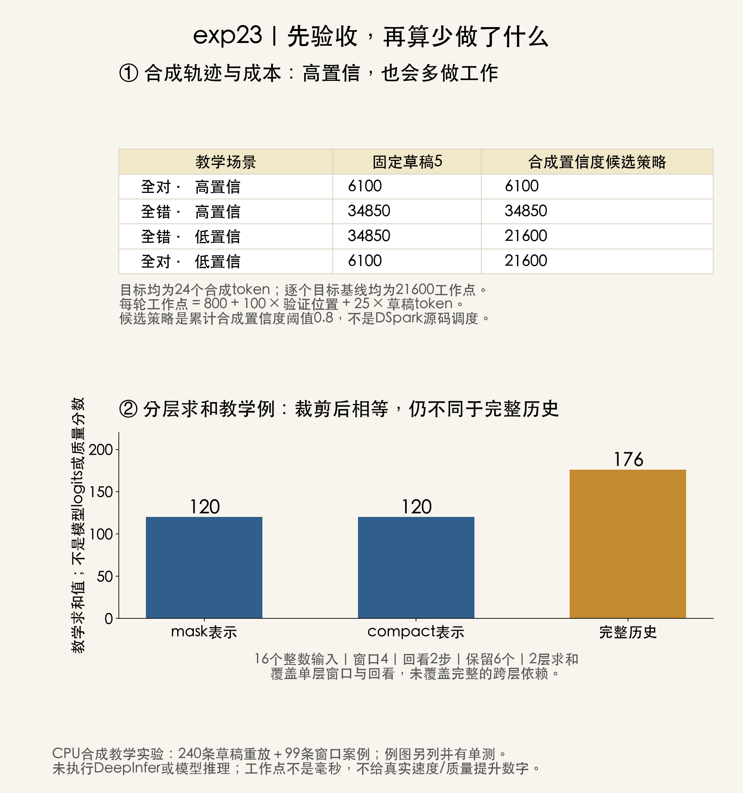

# 进化之路 P5·5 ｜ 少跑几圈：草稿、验收与有界回放

> 进化之路 · P5 · 5。上一站看班次怎样安排，这一站看怎样少做重复工作：先写的草稿，哪些真能留下？丢掉的历史，哪些必须补回来？
> exp23 阅读DeepInfer的DSpark与SWA源码，执行CPU教学重放和隔离的源码探针；本期不测真实模型速度或质量。

---

## 一、提前写好几站，不代表都能播出去

公交车还没到下一站，工作人员先按路线单草拟后面几站的广播。司机核对后，前两站没问题，第三站要改。此时，第三站之后的草稿也不能直接照播，因为它们接在一段尚未确认的路线后面。

提前准备有机会省事，前提是知道什么时候可以提交、哪里必须作废。

Phase4里，我们做过另一种提前准备：用户还在说话，系统先为可能的完整输入准备回答。后续输入改了，旧草稿按输入版本失效。模型级的投机解码则在生成内部起草，再由目标模型验证。两者都有草稿，却有不同的验收对象和作废条件。

**先把“起草了多少”和“最后留下多少”分开，才能讨论少做了多少工作。**

---

## 二、一页纸：起草、验收、提交、回放

这一篇读两处节省重复工作的机制。

一处向前猜：先准备多个候选token，让目标模型一轮检查更多位置。另一处向后补：状态需要重建时，能否只回放一段有限后缀，避免从很早的位置重新计算。

前者需要证明提交结果经过了正确验收；后者需要说明删掉了哪些依赖，以及接受什么近似。仅看草稿变长、回放变短，还不能判断优化是否成立。

---

## 三、DSpark的置信度，负责安排验证

这次阅读固定在DeepInfer的`9bd9cf2`版本。

源码里的DFlash会生成最大长度D的草稿，后续调度决定这一轮验证其中多少。配置中的最大草稿长度，不能直接当成每轮提交长度。

DSpark的可变验证调度还会看全批请求：结合累计置信度、已有graph性能曲线和运行耗时反馈，选择一轮的验证预算，再把额外位置分给不同请求。置信度高的前缀，有机会获得更多验证位置。

这不是每个请求各自套一个固定阈值。异步执行还涉及不同轮次的估计与在途结果，不能只摘一行confidence就解释整个调度器。

更要紧的是，**置信度参与安排验证，接受与拒绝仍有自己的规则。** 官方采样参考实现会用目标分布、草稿分布和随机数作接受判定，拒绝后另行采样。它不是把候选文字与一份预先写好的标准答案逐字比较。

拿到接受结果之后，才处理连续前缀。通常接受a个草稿，会再带出一个纠错结果，或者全接受后的新token；停止条件还可能把提交截短。后续KV计数要按实际提交量修正，临时消费草稿的grammar状态也有自己的回滚步骤。

所以，一份有用的账至少分清：草稿、验证位置、接受、提交与撤销。把它们统称为“生成token”，很容易把试算过的工作写成交付收益。

---

## 四、240条教学重放，先核对能留下什么

为了把交接过程看清，我们先做一个明确简化的CPU实验：给定目标token序列、每个位置的草稿对错，以及合成置信度。用这份固定输入检查提交状态机，不运行模型。

草稿出现首个错误时，只提交之前的正确前缀和一个目标纠错token；后面的草稿撤销。全接受时可以多提交一个目标token，到了结束标记就停止，不能凭空多出一次提交。

基线分别固定起草0、1、3、5个；另设一个教学候选策略：在上限5内，选择累计合成置信度乘积不低于0.8的最长前缀，允许不起草。**这是本实验选择的阈值策略，不是DSpark的源码策略。**

8种轨迹、2种目标长度、3种成本假设、5种策略，共240条重放。全对、全错、交替拒绝、成块拒绝和置信度误校准都保留。240条最终都提交了给定目标；这检查的是教学记录器和提交不变量，不是模型生成质量。

算账时，连被拒绝的试算也要算。以下例子都交付24个合成token，预先声明每轮工作点为：

`800 + 100 × 计划验证位置数 + 25 × 起草token数`

逐个目标生成的基线都是21600工作点。首个位置就拒绝，也不删掉本轮已经安排的其他验证位置成本。

| 教学轨迹 | 固定起草5 | 阈值候选策略 |
|---|---:|---:|
| 全对、高置信 | 6100 | 6100 |
| 全错、高置信 | 34850 | 34850 |
| 全错、低置信 | 34850 | 21600 |
| 全对、低置信 | 6100 | 21600 |

高置信且全错时，多起草没有多提交，反而增加了作废草稿和验证工作。低置信却全对时，候选策略又会因为过于保守，错过一次验证更多位置的机会。

在这套“每轮固定成本较高”的假设下，与固定起草5相比，候选策略在16组配对轨迹里8组工作更少、4组相同、4组更多。换成另外两套成本假设，比较结果也会变化，逐个目标生成的基线也可能更省。这些预设轨迹不是统计抽样，不能把比例解释成策略的一般胜率。

还要保留一个与源码的区别：教学模型允许策略改变实际起草数量，并据此计费；DFlash源码会生成最大D，再选择验证长度。真实起草成本、设备计算曲线和缓存工作，都不能直接套进这张表。工作点也不能改个单位就叫毫秒，更不能据此给出DSpark加速比。

---

## 五、少回放一段，先查保留范围

另一条线看SWA，即滑动窗口注意力。可以把它理解为每一步主要查看附近一段记录。状态丢失需要重建时，若能只重算有限后缀，就有机会少做前面很长一段的工作。

但保留长度有条件，不能只按窗口大小随意裁剪。固定版本的配置把最大回退容量算作：原始配置值与“最大草稿长度加1”两者的较大值。

默认草稿上限5，所以回退容量至少6。以下取窗口128、默认草稿上限5，原始回退配置不超过6，即实际回退容量为6。开启这套prefill截断时，后缀至少要覆盖128＋6。

我们原样执行了官方配置解析器，并隔离执行源码中的局部断言块：

| 保留token数 | 这条下限检查 |
|---|---|
| 133 | 拒绝 |
| 134 | 通过 |
| 140 | 通过，亦是推荐配置 |

140不是这里的最小值。反过来，134通过的也只是这条下限检查：模型还需要相应consumer层等前提；没有加载模型、检查全部运行条件，就不能宣布服务已经可用。

这条线共保留16组配置结果：7组通过局部断言，5组按预期触发断言，4组非法值在解析时拒绝。每例都用独立的受控配置，避免首次解析缓存掩盖后续变化；没有读取主机上的真实配置或凭证。

源码里的mask与compact也有具体区别。mask保留全部query行，收窄SWA可见域；compact在consumer边界移除可裁的行，并保留原绝对位置。某个chunk即使完全在保留后缀之前，也仍会留下一个占位输出行，不能想当然地改成零行。

本次另执行了官方示例中隔离出来的参考可见域和索引展开函数，覆盖10组形状。完整C++ metadata路径与官方L1没有运行；这些参考函数检查，不能写成真实mask/compact metadata已验证等价。

---

## 六、两个裁剪实现相同，仍可能一起少了东西

假如两个实现都只重放最后一段，它们彼此相同，能说明这段历史重建得和完整重算一样吗？

先看一个独立的教学反例。我们用16个整数输入，每层只把附近4个位置相加，共两层。在倒数第3个位置查询，保留最后6个输入。

这6个输入覆盖了一层窗口和回看范围。但第二层要用第一层的结果，第一层的边界结果又依赖更早的输入。裁剪后重新计算时，那些依赖已经不在了。

把同一个裁剪范围存成mask和compact两种教学表示，两者结果都是120；完整历史的结果却是176。

99组窗口教学案例里，两种裁剪表示全部相同，其中54组也等于完整历史；另有18组已经覆盖单层窗口及回看范围，仍不同于完整历史。这里没有attention权重、位置编码或模型缓存，数字也不是模型质量分数。反例只是说明：**两个裁剪实现彼此相同，不能自动推出它们与完整历史相同。**

DeepInfer的部署说明本身就把相关重建描述为近似SWA状态。要评价真实模型，还要做自己的输出、概率或任务质量验收；不能把玩具求和的差值换算成模型损失，也不能用这套玩具公式替换源码的配置条件。

---

## 七、先验收能留下什么，再算少做了什么

向前起草，要看哪些结果真正提交，哪些试算被撤销。向后回放，要看裁剪范围覆盖什么、遗漏什么，以及业务能否接受相应近似。

这也给网关留下一条记账原则：输入版本、生成草稿、目标验收、实际交付和缓存重建，是不同的事件。把身份、边界和工作量分开记录，才有机会解释一次优化究竟省在哪里。

**先验收能留下什么，再算少做了什么。**

---

## 资料与实验入口

- [DSpark验证预算调度](https://github.com/deepseek-ai/DeepInfer/blob/9bd9cf243fc53ef9afbf8f04d391d989117d6ab9/csrc/engine/mtp_varlen.hpp)：全批预算、置信度与运行反馈。
- [SWA配置下限](https://github.com/deepseek-ai/DeepInfer/blob/9bd9cf243fc53ef9afbf8f04d391d989117d6ab9/deepinfer/worker/model_runner.py)：源码局部断言及相关运行路径。
- [官方YoCo比较示例](https://github.com/deepseek-ai/DeepInfer/blob/9bd9cf243fc53ef9afbf8f04d391d989117d6ab9/examples/yoco/yoco_equiv.py)：参考可见域、metadata比较与后续模型检查的层次。
- [部署中的有界回放说明](https://github.com/deepseek-ai/DeepInfer/blob/9bd9cf243fc53ef9afbf8f04d391d989117d6ab9/doc/inference_deployment_qa.md)：近似SWA状态与重建范围。

自有记录：`phase5/exp23/`保存设计、源码对应和运行器；`phase5/results/exp23/`保存冻结输入、240条重放、99条窗口案例、隔离源码探针与原始账本。

口径：2026-10-26；CPU教学实验和源码探针，无模型推理、DSpark或完整DeepInfer复现、GPU性能或模型质量提升结论。
