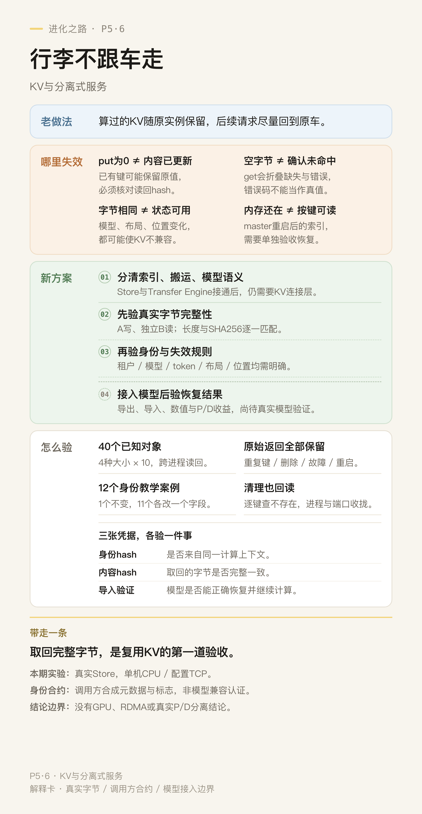
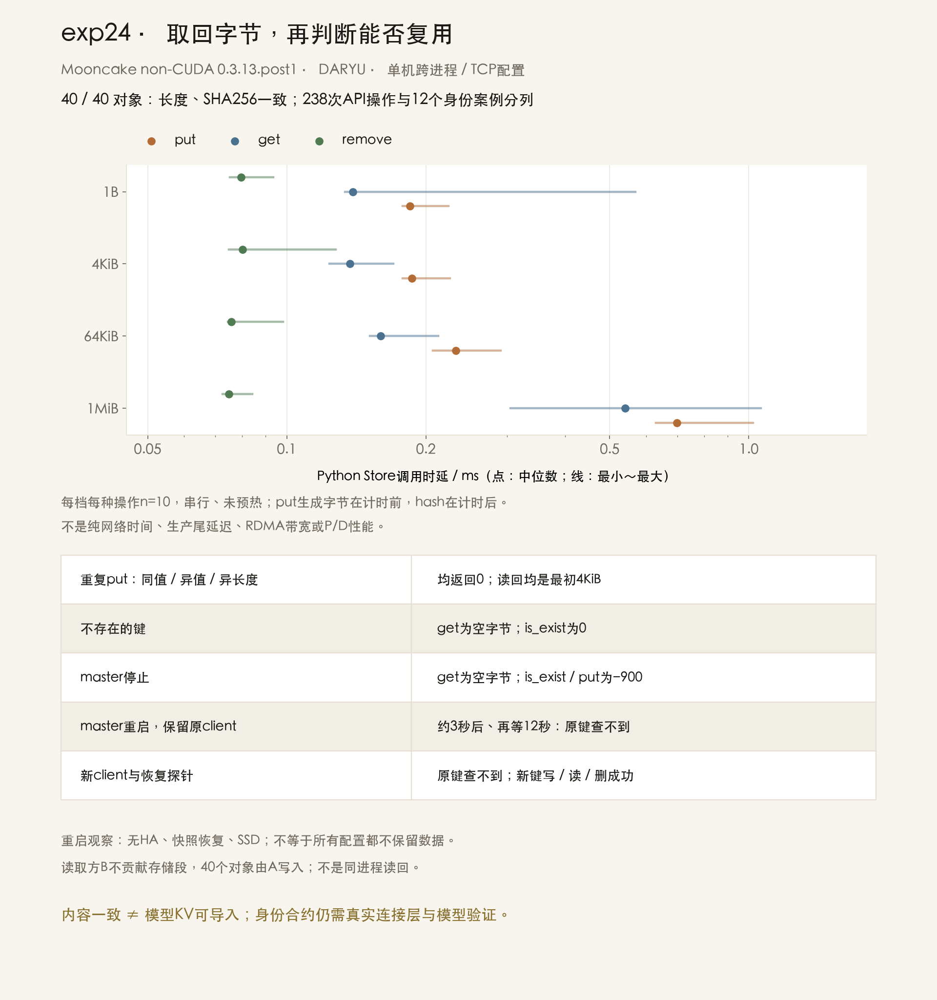

# 进化之路 P5·6 ｜ 行李不跟车走：KV与分离式服务

> 进化之路 · P5 · 6。上一站看怎样少做重复工作，这一站看算过的状态能不能交给另一辆车。
> exp24 运行真实 Mooncake Store，用独立进程读回已知字节；模型KV的导出、导入与P/D分离，仍是后面的接入工作。

---

## 一、行李寄存好了，另一辆车就能接着开吗

P3·4《拆车》里，我们把搬行李和跑圈分给两种车：Prefill先处理输入，Decode再逐个生成。两边交接的关键，是已经计算出的KV状态。

这次向前走一步：行李不用一直绑在原来的车上，可以交给一个独立的寄存系统。后来的车拿着编号取走，或许就能少算一遍。

但取到一只完整箱子，和知道这只箱子该怎么用，是两道验收。

同样大小的箱子，可能装着另一版模型的状态；同样一句话，换了模板或tokenizer，实际输入也可能不同。甚至寄存接口说“成功”，箱子里还可能是上一次的内容。

**先证明搬回来的是什么，再决定它能接到哪条计算链上。**

---

## 二、一页纸：索引、字节和模型状态



这次把三层责任拆开看。

模型引擎知道KV怎样计算、布局和更新；连接层负责把引擎状态变成可交接的对象，并在另一侧恢复；Store与传输层负责定位和移动对象。后两层接通，还需要第一层认可收到的内容。

用公交车的比喻：寄存台管理编号，搬运员负责送箱子，车辆工作人员负责确认箱子里的东西适用于这班车。编号查得到，不能替代最后这次确认。

---

## 三、源码里，谁管状态，谁管搬运

DeepInfer仍按本阶段固定的`9bd9cf2`阅读。它内部有KV与分叉、回退等状态管理。上一站看过的草稿验收，也要修正实际保留的KV范围。

它的cache engine还描述了具体的存储区域、层序、对齐和压缩格式。一个物理`uint8`缓冲区，内部可能同时包含压缩数据与scale。**字节数相等，不代表两边对每一段字节有相同解释。**

同时，这次公开发布没有包含完整的外部KV系统、完整的Prefill/Decode分离服务及相关跨副本负载均衡。这与内部存在KV管理并不矛盾。不能把“引擎有cache代码”写成“分离服务已搭好”。依据见[DeepInfer固定README](https://github.com/deepseek-ai/DeepInfer/blob/9bd9cf243fc53ef9afbf8f04d391d989117d6ab9/README.md)。

Mooncake这边，Store的master管理对象及副本位置，数据位于提供存储空间的client所贡献的内存段等介质中；Transfer Engine承担实际搬运。取对象时，调用方先查副本，再把数据放进自己的缓冲区。数据并不是都经过master转发。

单机配置TCP模式就能走通这个过程，不要求RDMA硬件。官方也提供了这样的[Quick Start](https://kvcache-ai.github.io/Mooncake/getting_started/quick-start.html)。本轮先用它验证交接，再讨论接模型时缺什么。

版本要分开记录：源码阅读固定Mooncake的`c67a88f`，该源码声明`0.3.12.post1`；实际运行的是Linux non-CUDA wheel `0.3.13.post1`。wheel的SHA256和安装后的原生文件已核对，但没有证明它由前述commit构建。下面的返回值，以本轮实际记录为准。

---

## 四、40只箱子，换个进程再打开

DARYU上建立独立环境，只使用CPU、内存和配置TCP。

master负责索引；进程A提供128MiB存储空间；进程B只提供读取缓冲区，不贡献存储段。A写入，B读回，避免同一个进程读自己的对象，误把本地读回当成跨进程交接。

1B、4KiB、64KiB、1MiB，每档10个确定性字节块，共40个对象。逐个核对读回长度与SHA256，**40个全部匹配**。随后逐个强制删除，并确认对应的`is_exist`为0。

第一次同进程预跑也保留了，但没有并入这40个跨进程对象的分母。最终记录共238次API操作：228项符合预先声明的返回或内容检查，10项为单列的异常/重启探索观察，缺失与超时均为0。它们不是238次模型请求。

调用时延只作本机小样本描述。计时使用同一个工作进程的单调时钟；`put`的字节生成在计时前，读回hash在计时后。每档每种操作仅10条，未预热，没有并发压测。

| 对象大小 | put中位数 | 跨进程get中位数 |
|---|---:|---:|
| 1B | 0.185ms | 0.139ms |
| 4KiB | 0.187ms | 0.137ms |
| 64KiB | 0.232ms | 0.160ms |
| 1MiB | 0.698ms | 0.540ms |

这是配置为TCP的本机Store接口测量。日志还显示本地复制优化自动开启；本轮没有逐次跟踪载荷的传输分支或socket字节，因此不把时延解释成纯TCP链路延迟、RDMA带宽、生产尾延迟或模型首字收益。



---

## 五、三个返回值里的陷阱

### 1. 重复put为0，内容仍然是旧的

同一个键，先写入一份4KiB内容，再依次写入同值、同长度异值、不同长度异值。四次`put`都返回0，四次读回都是最初那份内容的hash。

固定源码中也能找到对应分支：已有对象的写入在客户端被当作成功处理，并不覆盖原值。见[已有键处理](https://github.com/kvcache-ai/Mooncake/blob/c67a88f381f69e869045f353539e90c76e738830/mooncake-store/src/client_service.cpp#L2016-L2036)。

所以，不能拿一次`put == 0`证明模型版本已经更新。若调用方要保存不同状态，应先定义不可变对象的身份；需要更新时，再选择并验证适用的更新接口。本轮没有测试`upsert`。

### 2. get的空字节，分不清“没找到”和“服务出错”

一个不存在的键，`get`返回`b''`。停掉master后，原本存在的键也返回`b''`。

但`is_exist`留下了区别：前者为0，后者为`-900`；故障期间的`put`也是`-900`。固定源码将这个码定义为RPC失败。

Python里负整数也是真值，因而不能写成：

```python
if store.is_exist(key):
    use_cache()
```

至少要区分`== 1`、`== 0`和`< 0`。而且，`is_exist`与随后的`get`是两次调用，中间仍可能发生删除或故障；它们不能合成一个原子的“已确认命中”。固定源码的[`get`失败路径](https://github.com/kvcache-ai/Mooncake/blob/c67a88f381f69e869045f353539e90c76e738830/mooncake-store/src/real_client.cpp#L3842-L3964)也说明，空字节会折叠多种失败。

### 3. 内存还在，不等于重启后还能按键找回

本轮关闭HA、快照与恢复，也没有SSD卸载。A、B进程保留，只重启master。

原键重启、等待约3秒后首次查询是0；再等12秒仍是0。新建的进程C也查不到，三次读取均为空字节。与此同时，新键仍可以重新写入、读回并删除。

观察支持的是：**在这套配置和观察窗口里，旧对象没有恢复为可读取的键，新一轮服务可以工作。** 它没有证明A里的旧字节被物理擦除，也不能推广为Mooncake所有持久化和HA配置的行为。

清理时还要记住租约。固定源码中的成功读取和存在性检查会刷新读租约；普通删除可能因此被拒绝。本轮暂停并发读取后使用`force=True`清理，没有验证普通租约到期或并发删除安全。强制删除也并非绕过所有检查，副本就绪与复制任务仍有约束。

---

## 六、给箱子贴什么标签，才敢复用

前面的40个对象只是已知字节。接到模型时，还需要一份调用方的身份合约。

本轮另做纯CPU合约检查，要求以下信息完全一致：

| 身份 | 要防止什么 |
|---|---|
| 模型revision、tokenizer与模板版本 | 同一文本进入不同计算过程 |
| 租户或授权共享域 | 把别人的状态当作自己的缓存 |
| 精确token前缀及顺序 | 用文本相似或字符前缀代替真实输入 |
| KV布局、精度与并行分片身份 | 两边对字节含义解释不同 |
| 位置、RoPE和注意力命名空间 | token相同，但位置或可见范围不同 |
| 多模态输入身份、合约版本 | 漏掉图片等输入，或沿用旧规则 |

先把这些字段规范化，再计算带版本的身份hash。**这份hash标识计算上下文；读回内容的hash核对字节完整性，两者用途不同。**

12个冻结案例中，1个保持完全一致，另11个各改一个字段。结果是1个身份相同、11个不同。完全一致时，还要求“内容hash已验证”和“导入器兼容”两个明确条件；缺少任意一个都拒绝复用。

这里的导入器兼容只是教学输入标志，没有运行模型作兼容认证；租户字段也是合成输入，没有接认证系统或验证Store的多租户权限。合约只检查完整前缀相等，没有实现部分前缀匹配、KV块引用或语义缓存。

旧P3网关的前512字符亲和路由，则是在选择更可能已有本地前缀缓存的后端。它没有搬运KV，也不能代替这份身份合约。

---

## 七、回看拆车算表，还差最后几道交接

P3那张表按既定模型、输入输出长度和性能假设，估算了搬运体积与P/D配比。它仍然有用，但属于预算。

这次复核还要补一个限制：旧表的整数配卡循环只取P、D计算容量的较小值，没有把网络容量一起纳入。若16卡共用同一条理论10GbE链路，原来的计算上限约18.08req/s，还要再受约10.64req/s的搬运上限约束。这里仍是原假设下的纸面重算，不是新测得的网络能力。

| 验收层 | 现在拿到的证据 |
|---|---|
| 搬多少、是否值得拆 | P3预算；本轮补充共享链路约束 |
| 字节是否正确交接 | exp24单机、跨进程、40个对象hash一致 |
| 身份变化是否失效 | 调用方合约，12个合成案例 |
| 模型能否接着算 | 尚需真实KV导出/导入、布局与数值检查 |
| 分离后是否更划算 | 尚需同资源、同负载的P/D与合车对照 |

下一步接模型时，连接层要处理块映射、已计算前缀长度、位置与层序、缓冲区生命周期，以及失败时怎样回到重新计算。接入成功后，再用匹配模型检验恢复状态与重新prefill的结果，最后才比较首字、逐字、有效完成率和总成本。

这一站把真实字节交接、返回值陷阱和身份规则先走通。下一站P5·7《把站台接起来》，将把能力声明、准入、路由、缓存和逐次调用账本接入同一条实验请求。

**带走一条：取回完整字节，是复用KV的第一道验收。**

---

附：本期源码阅读为DeepInfer `9bd9cf2`与Mooncake `c67a88f`；运行库为Mooncake non-CUDA `0.3.13.post1`。238次API操作、40个跨进程对象和12个身份案例分别记账。未运行模型、GPU、RDMA或真实P/D服务。本地证据入口：`phase5/exp24/README.md`，原始记录与冻结计划保留在`phase5/results/exp24/`。
