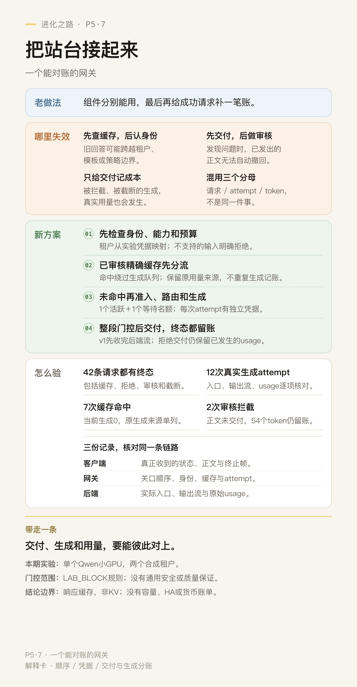
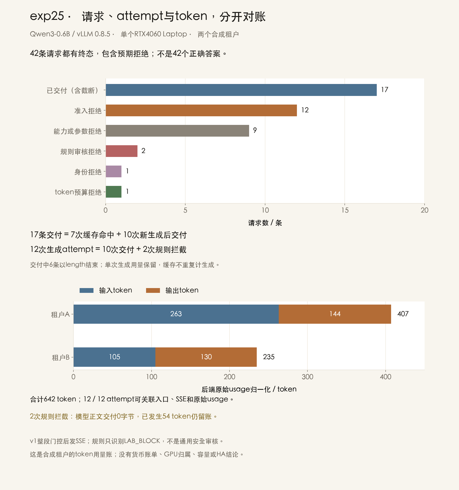

# 进化之路 P5·7 ｜ 把站台接起来：一个能对账的网关

> 进化之路 · P5 · 7。前面分别验过车票、广播、调度和寄存，这一站把它们接进同一条请求。
> exp25：两个合成租户、一个真实小GPU后端、42条请求。客户端收到了什么，后台生成了什么，账本留下什么，逐项核对。

---

## 一、每个站台都能用，接起来还会出什么事

验票台会认票，候车区会排队，寄存台能取箱子，广播也能播出去。把这些组件并排放好，还不算一条能运营的线路。

顺序一变，结果就变了。

先查缓存、再认身份，可能把别人的回答递给当前乘客；先发广播、再审核，发现问题时已经无法收回；只给成功交付的请求记账，后台白跑的几圈就消失了。

这一站要回答的，是一条请求如何依次经过各个关口，以及每次离开时带走哪张凭据。

**组件能用，要再加上交接顺序和对账规则，才能形成服务。**

---

## 二、一页纸：先过哪些关，在哪处分流

v1按这条顺序走：

`身份 → 能力与实际token预算 → 已审核精确缓存 → 有界准入 → 路由与后端 → 完成检查与规则门控 → 缓存、交付、终态账本`

缓存命中在中间分流：它可以绕过生成队列，却不能绕过身份、能力或预算检查。命中内容还必须来自相同租户和配置身份下已经通过门控的完成响应。

账本则从入口一路跟随。拒绝、未命中、排队、生成、审核和交付都是事件；有的请求没有生成attempt，有的生成了却没有交付，不能只在HTTP 200后补一行“成功”。

---

## 三、这次接的是什么，保留了哪些边界

后端仍是DARYU上的Qwen3-0.6B，使用原生模板、关闭thinking，vLLM 0.8.5、BF16、eager。权重、tokenizer及配置文件的hash重新核对，来源revision没有确认的地方继续记为null。

模型网关支持的是一组明确的文本接口：Chat Completions形状的输入、`stream=true`、固定贪心设置，以及有界输出长度。不支持的tools、图片内容、response_format、模型名和参数直接拒绝。

这没有把recipe的DeepSeek编码发送给Qwen，也没有运行DeepInfer。前面源码阅读给出的职责边界，落实成了这里的能力声明；两个实验路径仍分别留证。

旧P3网关提供了准入与亲和路由经验；exp22把活跃、等待名额分开；exp13说明发出后再审核的内容无法撤回；exp12则提醒我们区分后端usage与无法还原的成本。新的实验网关把这些责任重新接在同一条请求上，没有把旧脚本的成功率拼成一次集成验收。

这次还有一个会直接影响体验的选择：**先收完后端流，做整段规则检查，再向客户端发送SSE内容。** 后端在流式生成，客户端却需要等这一段全部检查完成。它不是实时逐字审核；首段延迟里会包含这段等待。

门控规则使用无害实验标记`LAB_BLOCK`。它验证“被拦时有没有交付、成本有没有留下”，不承担通用内容安全判断。

---

## 四、42条请求，为什么只有12次生成

先把整个分母摆出来。正式输入在执行前冻结，网关和运行器使用归档代码；4条预检与正式记录分开。

| 请求终态 | 条数 |
|---|---:|
| 已交付 | 17 |
| 身份拒绝 | 1 |
| 能力或参数拒绝 | 9 |
| 输入token预算拒绝 | 1 |
| 准入拒绝 | 12 |
| 规则审核拒绝 | 2 |
| 合计 | 42 |

42条都有唯一请求ID和终态，逐项符合冻结场景的预期。这个“全部对上”是功能验收，不能改写成42个正确答案。

17条交付里，7条来自精确缓存，10条来自新生成。后者有6条以`length`结束，包括2条专门的短上限探针和4条突发负载中的长回答；因此17条也不能全部称作完整回答，更没有验收它们的事实质量。

另有2次生成经过规则门控后被拒绝交付，所以实际生成attempt是：

`10次生成后交付 ＋ 2次生成后拦截 = 12次`

缓存判定也有自己的分母：7次命中、24次未命中、11次在入口检查时结束而未查缓存。24次未命中中，12次在准入处被拒绝，剩下12次才调用后端。

---

## 五、同一个问题，先确认是谁在问

租户A先问“只输出数字7”，第一次调用后端，第二次命中缓存。租户B问完全相同的问题，仍要先生成自己的那份，之后才可以命中。

专门再加一个反例：使用A的实验凭据，却在客户端头里声称自己是B。网关仍按A处理，没有照信这个租户头。正式路径使用的是专用测试Bearer到两个合成租户的映射，并没有接入真实组织认证系统。

精确响应缓存的身份包含租户、实际输入与生成设置、模型/tokenizer/模板指纹，以及策略和路由版本。这是**完成响应缓存**，不是上一站的KV存储。

同一问题改输出上限会未命中；换到第二个逻辑路由配置也会未命中。两个逻辑路由仍指向同一个GPU，不代表两套物理模型或独立容灾。策略、模型指纹和模板变化的失效边界另有CPU测试，不能说成实际更换权重后的GPU验证。

缓存命中时，当前请求的生成usage为0、attempt为空，同时保留原生成的请求ID、attempt ID和原始usage。原先那次回答消耗过资源，但不能每被读一次，就再算一次生成token。

缓存本轮只接收非空、`finish=stop`、usage可核对并通过实验规则的响应。截断、缺计量和审核拒绝都不会成为这类缓存条目。这里检查的是完成与规则条件，没有证明内容在业务上正确。

---

## 六、没播出去的两句，也确实跑过模型

两条输入都要求模型只输出`LAB_BLOCK`。后端各生成一次，规则门控分别拦截；客户端收到422，没有拿到这段模型正文。

但两次attempt的usage都保留：每次24个输入token、3个输出token，共27。两次合计54个token，交付正文为0字节。

这组对照把三件事分开了：

- 后端是否生成：是，入口和响应流有记录。
- 网关是否发出模型正文：否，规则检查先拒绝。
- 客户端是否收到该正文：否，客户端原始响应也已核对。

不能因为最后没有交付，就把54个token从账本擦掉。反过来，这54也不是从文本字符数估算的，而是后端流末帧的原始usage。

本轮12次attempt均能关联唯一后端入口，请求体hash、HTTP状态、原始SSE与usage逐项相符。后端usage的三项总和为642，其中租户A为407，租户B为235。每次输入token数也与网关使用原生模板计算的长度核对一致。

这是两个**合成租户的后端token用量账**。没有真实客户账单、货币价格、每请求cached_tokens或GPU占用归属结论；缺少的字段没有用0或文本长度补出来。

---

## 七、队列挡住了谁，缓存又让谁直接通过

网关配置一个生成活跃名额、一个等待名额。两轮突发各并发提交8条不同的长请求，同时再读一次已经缓存的回答。

每轮长请求中，2条进入生成链路，6条被准入拒绝；两条缓存读取都可以交付。本轮网关时钟内记录到的生成调用区间最多重叠1个，和活跃名额设置一致。这是API调用区间，不是CUDA执行时间线。

队列有用，但它没有增加这张卡的生成能力。缓存读取能绕过生成名额，也不意味着它可以跳过身份和策略检查。

时延同样分别看：客户端记录自己何时收到首段正文，网关记录何时解析到后端首段、何时审完，以及何时开始交付。三个组件各自在自己的单调时钟内求差，没有把跨进程时间戳直接相减。

17条交付请求混有7条缓存命中，也混有不同生成长度和排队情况。不能把这批混合延迟概括成一个网关开销，更不能据两次小突发宣布容量或SLO达标。

---

## 八、接上以后，旧反例还要留在旁边

语义缓存没有在这条正式链路中启用。本轮另做独立CPU诊断，重放exp11保存的三个近邻分数组：若套0.88阈值，它们仍会选错候选。

这里没有重新生成embedding，也没有将三个分数硬配给某三句问题。旧分数摘要缺少逐句ID和输入hash，只能按分组引用；现存改写输入与旧摘要的数量也不一致，不能声称完整复现了旧扫描。

exp13的历史记录也继续保留：审核器有漏判；异步识别出问题时，内容仍可能已经交付。本轮的整段门控改变了交付顺序，却没有把识别问题自动解决。将当前`LAB_BLOCK`规则应用到保留的历史风险句子，它也不会拦截，这正说明它只是一条实验规则。

先把接口接通，再让错误可见，才能决定下一步替换哪一环。若只保留接入成功的例子，反而看不见最需要补的部分。

### 补验：换到4B，先把最短的一条链核对

2026年11月10日，我们另开一份Kaggle Notebook，把模型换成Qwen3-4B、FP16。平台给了两张T4，模型实际只放在第一张卡上。后端改用Transformers的`generate`，先接一个只在Notebook内部访问的最小文本服务。

这次只发5条串行请求：不存在的模型名、超过接口输出上限的参数、普通回答、同一问题的流式回答，以及只允许输出1个token的探针。

前两条分别返回404和422，原生记录里没有生成调用；后面三条真正运行模型，输出分别是20、20、1个token。每次输入都是26个token，所以本轮原生用量为输入78、输出41，合计119。输出ID直接取自模型生成序列，包含实际出现的结束token，没有把返回的中文重新编码来补账。

普通回答和流式回答的输入ID、输出ID与正文，在这两个串行请求里都相同；1-token探针只返回“天空”，以`length`结束。接口按要求收尾，不代表这两个字已经回答了问题。

这里把“没进入生成”和“生成后只交付了一部分”分清了。它只补验最短的请求链，没有在Kaggle重跑前面的双租户、缓存、准入和审核网关；这5条也不并入exp25的42条请求。

**带走一条：同一条请求的交付、生成和用量，要能彼此对上。**

下一站P5·8《半路抛锚》，再处理取消、排空、断流和重试：哪次attempt可以作废，哪部分资源已经发生，什么时候还能换车。

---

附：本期为单个Qwen小GPU后端、两个合成租户，42条正式请求、12次真实生成attempt；7次精确响应缓存命中。未运行recipe→Qwen集成、DeepInfer、KV迁移、多GPU容灾或生产部署。历史语义/审核诊断单列，不新增模型样本。复现与原始证据：`phase5/exp25/README.md`、`phase5/results/exp25/formal-v1/`。
