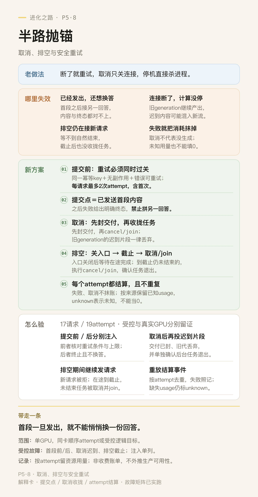
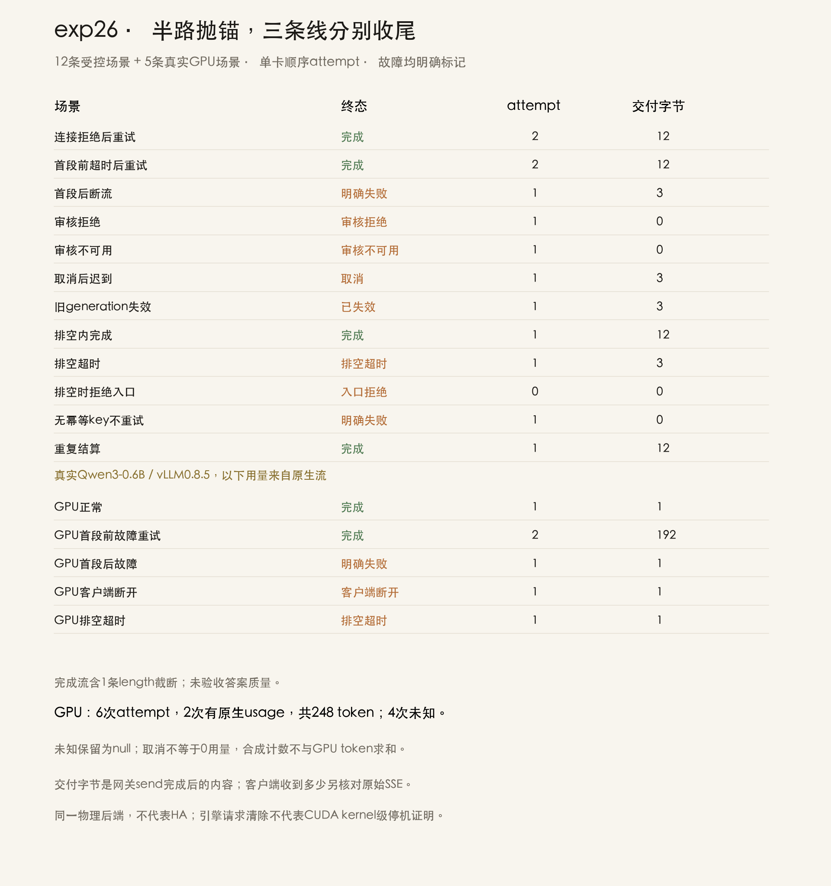

# 进化之路 P5·8 ｜ 半路抛锚：取消、排空与安全重试

> 进化之路 · P5 · 8。上一站把网关接通，这一站让它在半路出问题时，也能说清谁停了、谁还在跑、谁该记账。
> exp26：可控故障与真实小GPU分别留证。单卡、顺序逻辑attempt，不把换一次尝试写成生产高可用。

---

## 一、广播已经播了半句，还能换辆车吗

乘客刚上车，发动机就没打着。把人请到另一辆车，重新出发，通常还讲得通。

如果已经开过两站，广播说了半句，调度台却把下一辆车的广播直接接上，乘客听到的可能是两条线路拼起来的报站。

流式回答也有这条边界。

连接失败、等待首段超时、已经发出正文后断流，都可能在日志里留下一个“失败”。但它们允许做的下一步不同。尤其是第一段内容已经交到下游以后，换一个后端重新生成，不能保证接上的是同一份回答。

**能否重试，要看交付走到哪里，不能只看错误码。**

---

## 二、一页纸：先封住旧广播，再收拢车和账

这一站把一次请求拆成三条需要分别收尾的线：

- **交付线**：旧generation是否还能往客户端发送内容。
- **计算线**：网关工作任务是否退出，后端引擎是否仍持有这个请求。
- **账本线**：每次attempt是否留下结果，用量未知时有没有被写成0。

客户端关掉页面，只能说明第一条线的一端离开了。网关取消一个协程，也不能自动证明远端计算已经结束。

因此取消顺序是：先让旧输出失效，再传递取消，等待拥有的工作任务退出，最后核对后端请求状态与账本。网络关闭和后台退出各有证据。

---

## 三、提交点放在哪，决定能不能换车

这次的实验网关把“提交”定义在：**首个包含模型正文的ASGI发送调用成功返回。**

它不是HTTP响应头发出，不是后端已经开始生成，也不是网关刚收到第一个token。客户端是否真正收到，还要看另一份客户端原始SSE记录。

提交前允许透明重试，需要同时满足几个条件：当前接口只有无外部副作用的文本生成；业务幂等key存在；错误在允许重试的范围内；总尝试次数还没有达到2次。

重试时，先前的attempt必须先取消并join，再启动新的attempt。一次业务请求保留同一个request_id，每次后端尝试使用新的attempt_id。这样可以看出一次请求到底叫了几次车，而不是让第一次失败从账里消失。

提交后遇到断流，即使故障类型本来可以重试，也不再换后端接着播。客户端拿到明确的失败终态，保留已经收到的部分内容。是否重新发起一条请求，由上层产品按自己的交互处理。

本轮两个逻辑目标共用同一张GPU；只有顺序attempt，没有两套独立故障域。没有执行工具，也没有自动重放任何外部副作用。

---

## 四、故障矩阵里，每一种离开都有名字

正式计划在执行前冻结，共17条请求、19次attempt：12条受控场景对应13次attempt，5条真实GPU场景对应6次attempt。逐条原始记录与计划相符。

| 终态 | 请求数 |
|---|---:|
| 完成流 | 6 |
| 后端失败，明确结束 | 3 |
| 审核拒绝 / 审核不可用 | 1 / 1 |
| 主动取消 / 旧generation失效 | 1 / 1 |
| 排空超时 / 排空时入口拒绝 | 2 / 1 |
| 客户端主动断开 | 1 |

6条“完成流”里，有一条真实GPU回答以`length`结束，达到了192个输出token的上限。它是协议正常收尾的截断回答，不是完整自然结束，也没有验收答案质量。

三个首段前重试场景分别是：受控连接拒绝、受控等待超时、真实GPU首段被实验延迟后的超时。每个都留下2次attempt；没有幂等key的连接失败只留下1次。

首段后断流分别用受控后端和真实GPU跑一次，都只有1次attempt。真实GPU那条已经交付1字节，随后收到失败终态，没有接上第二份回答。

故障由实验主动注入的地方，都在记录中标出。连接拒绝是真实TCP连接失败，但目标端口是实验有意选择的关闭端口；延迟首段、首段后中断和排空截止时间也是可控条件。它们验证状态规则，不提供自然故障率。

审核同样使用可控结果：拒绝与不可用各有终态。本轮在首段交付前结束，已经发生的生成仍保留；这不是通用内容安全能力，也没有证明已经发出的文字能够撤回。

---

## 五、乘客下车，不等于发动机停了

真实GPU的6次attempt都有独立的原生引擎请求映射。其中2次正常结束，另外4次分别来自首段前超时、首段后注入断流、客户端主动断开和排空超时。

这4次都留下了原生abort调用和返回记录；随后在同一后端时钟域的状态快照中，调度队列不再持有未完成请求，request tracker的活跃流、新请求队列与取消队列也都清空。正式运行没有审计观测错误；6次attempt最终都能找到请求状态归零的记录。

这比“HTTP断开了”多了一层证据，仍是CPU侧引擎与队列观测。没有逐CUDA kernel追踪，不据此声称精确的GPU停止时刻。真实重试案例里，第二次原生请求进入时，第一次的清空快照已经出现；这次观察成立，不把它外推成网络关闭天然保证引擎已停。

受控后端还专门模拟了一个不那么听话的工作任务：收到取消后，继续吐出“迟到”片段。取消和旧generation替换分别跑一次，片段在生成记录中可见，在客户端内容里不可见。

这里验证的是旧输出失效规则。实验没有跑一套新的完整会话系统；generation_id用于隔离当前这次交付，旧会话管理的其他能力仍以此前章节为准。

排空也拆成两步：先关闭新请求入口，再给已经运行的请求一个截止时间。能在期限内完成的自然收尾；超时的先封交付、再取消并join。健康回读里的active和workers归零，是网关任务的收拢证据。后端是否退出，继续看它自己的观测。

已经进入发送调用的在途片段无法撤回；规则保证取消以后不再开始新的内容发送，客户端实际收到多少仍逐项保留。

---

## 六、取消了也不能抹账，没拿到也不能填零

每个attempt都有一条结算记录。重复提交完全相同的attempt结算，会被当作同一笔；内容冲突则拒绝。这个幂等性在本轮实验进程内成立，没有接入持久数据库或跨进程事务。

失败与取消的attempt仍然在列表里。能拿到原生usage，就按它核对；没有等到原生usage帧的，保留null及未知来源。它可能已经跑过模型，不能写成“生成0 token”，也不能从部分字符串倒推出完整计费用量。

真实GPU的6次attempt中，只有2次收到了完整原生usage：输入54、输出194，合计248个token。其余4次保留未知，**248只是已知小计，不能代表全部真实消耗。** 这4次的引擎输出记录确实表明模型已经运行，但部分token记录不等于完整的后端计量。

受控后端另有13次attempt，4次留下固定synthetic计数，合计28；另外9次未知。这个28只验证教学账本规则，不能与248相加。

重复结算场景重放同一个attempt后，账本仍只有一条；原始结算来源和客户端终态帧逐项核对。最终17条请求都有终态记录、19次attempt都有结算行。客户端主动断开的那条没有收到终态帧，这一点保留在客户端记录里，不能假装用户收到了“取消成功”。

如果后端已经有有效usage，而网关没有收到，验收会保留两份记录、标出计量差异，并拒绝发布“核对通过”的汇总。已经收到的第一份有效usage也不能被后来的坏帧或零值帧覆盖。

因此这次的账本首先解决“有没有漏掉一次尝试、有没有重复记同一次”，没有给出GPU独占时间或货币账单。受控后端的synthetic计数和真实后端原生usage分别统计。

---

## 七、这一站带走什么

一个可用的取消按钮，需要把旧广播、后台任务和账本一起收尾。

首段前的重试有条件；首段后的失败有明确终态；新generation上来以后，旧片段没有继续交付；排空关入口后，还要等车真正收拢。即使最终没有完整回答，那次已经发生过的尝试也要留下来。

收尾审校的3项计量修复经53项CPU回归和6条原生输出离线重放验证；正式GPU原始记录未改写，修复后没有新增GPU调用。

### 补验：正常收尾，也得有凭据

2026年11月10日，另开的Kaggle实验使用Qwen3-4B、FP16和Transformers后端，补看一条正常流怎样收尾。

客户端收到首段文字后继续读下去：拼完整段正文，再核对`finish=stop`、末尾usage和`[DONE]`。这条回答的20个原生输出token，与服务端生成序列逐项对上，拼接正文也与普通响应一致。本轮实际读到23个HTTP响应体片段，不能把它们当成23个模型token。

流式请求的首个非空内容约在117毫秒出现，完整收尾约1126毫秒。先跑的普通请求则在收齐JSON后，约2079毫秒才解析出正文。两者的“首内容”观测方式不同，又有先后执行和首次推理的影响，不能相除后宣布流式让模型快了多少。

这次没有注入故障。它补齐正常流的核对凭据；前面的取消、排空和安全重试，仍由exp26自己的原始记录证明。

下一站P5·9，把前面各站的证据放进同一份交班验收：体验、资源和贡献，分别拿什么说话。

---

实验与复现：[exp26结论](../phase5/results/exp26-结论.md)、[复现命令](../phase5/exp26/README.md)、[源码笔记](../phase5/exp26/源码笔记.md)、[正式摘要](../phase5/results/exp26/formal-v1/summary.json)。
