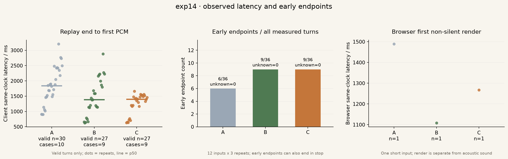
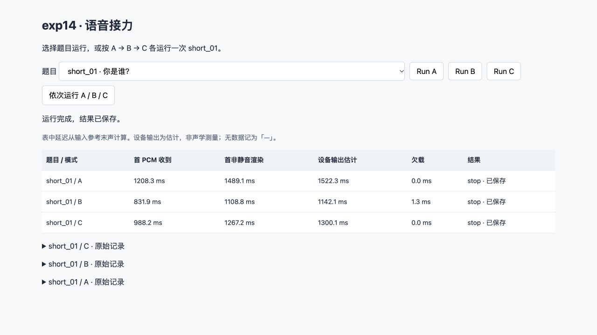

# exp14 · 一句语音的接力时间线

2026-10-22。已完成同卡GPU语音级联、108条正式对照和修复后浏览器播放复验。脚本在 `phase4/exp14/`，原始数据在 `phase4/results/exp14/`。

## 实验条件

RTX 4060 Laptop 8188 MiB；CPU Silero VAD，GPU faster-whisper-small INT8/FP16、Qwen3-0.6B BF16、Kokoro 中文 FP32。三个模型同卡常驻，CTranslate2与PyTorch分别核对CUDA设备，没有CPU回退。

12条Tingting合成中文输入：6短句、3带300/600 ms句中停顿、3长回答请求；16 kHz单声道PCM16，按20 ms帧实时发送，800 ms以上尾静音。每题每模式3次，共108条；另存3条热身。输入末声来自10 ms RMS窗口推导的参考区间，非人工声学标注，也没有传给在线VAD。

| 配置 | 尾静音策略 | TTS收到文字的时机 |
|---|---:|---|
| A | 500 ms | 完整回答 |
| B | 200 ms | 完整回答 |
| C | 200 ms | 句末或32字符分段，尾段补齐 |

Python采集端运行在DARYU回环链路；浏览器另经Mac到DARYU的SSH隧道。两条路径和计时边界不同，不混算为一个延迟分布。这里是Transformers/CTranslate2实验，没有改现有router/vLLM服务。

## 一、先把提前端点拿出来

| 模式 | 正式请求 | 提前端点 | 可计入本次成功延迟的回合 | 参考末声→客户端首PCM p50 |
|---|---:|---:|---:|---:|
| A | 36 | 6 | 30 | 1837 ms |
| B | 36 | 9 | 27 | 1385 ms |
| C | 36 | 9 | 27 | 1396 ms |

108条传输及模型生成终态全部为 `stop`，但其中24条没有等完整问题说完。提前端点有时会得到负的“参考末声→首PCM”：它表示回答已经抢在剩余输入前出来，不是可用的低延迟。

本表“成功”仅表示无提前端点、无采集错误且自然完成，不代表回答内容正确或音频质量达标。A的有效题目与B/C不同；在三种模式都有效的27个配对回合上，p50分别为1719/1385/1396 ms。12条独立问题仍是12条，不能把重复次数称为泛化样本量。

## 二、分句收益依赖回答长度

| 有效样例类别 | 每模式回合数 | A首PCM p50 | B首PCM p50 | C首PCM p50 |
|---|---:|---:|---:|---:|
| 6条连续短句 | 18 | 1508 ms | 1148 ms | 1201 ms |
| 3条长回答请求 | 9 | 2436 ms | 2200 ms | 1518 ms |

在这组长回答中，C能在全文完成前送出第一段；短回答没有表现出普遍收益，整体有效回合p50也没有优于B。此处尚未用同样的长回答做播放欠载对照，不能从首包推断整段更流畅。

A/B共36个配对，有12对ASR文本和最终回答不同。尾部音频长度会影响转写和标点，不能把所有时延差额都归因于少等300 ms。B/C的36对转写/回答相同，但12对合成样本数不同；分句会改变合成上下文、韵律或时长，不能只盯首包。

## 三、组件计时不等于回合计时

组件固定样例与上述12题逐回合分布分开保留。单独运行、排除首轮热身后，ASR p50约69 ms，LLM首文本约40 ms，TTS首PCM约61 ms；三模型共驻而依次执行时，对应约71/45/55 ms。

ASR包括PCM转换和完整迭代转写，LLM首文本包括提示词准备/预填充并以非空文本增量为界，TTS首PCM包括中文前处理、推理和首段CPU波形返回，模型加载不计。保留的组件 `tts.total_ms` 还包含波形拼接、PCM序列化和WAV落盘，不能拿来当纯模型合成时间；本报告使用 `first_pcm_ms`。

固定TTS样例首包内还带有约280 ms的起始低能量音频（组件阈值为绝对幅度0.01），所以“首包很快”不能直接换成“已经听见”。在线每题音频长度、文字长度与同卡交叠不同，也不能把几个独立p50相加预测回合p50。

## 四、浏览器证据的边界

Codex内置浏览器对 `short_01` 按A/B/C做真实AudioWorklet播放，输入参考末声、接收和渲染均映射在浏览器自己的时钟域。渲染非静音使用10 ms RMS、PCM16阈值120；设备采样率48 kHz，输出通过 `getOutputTimestamp()`估计。下表采用EOF修复后 `server-eof-fixed/` 的最终3条记录，每模式仅一轮，前一轮保留在 `server-fixed/` 作诊断，不混入。

| 模式 | 参考末声→首PCM收到 | →首非静音渲染 | →设备输出估计 | 本轮欠载 |
|---|---:|---:|---:|---:|
| A | 1208 ms | 1489 ms | 1522 ms | 0 ms |
| B | 832 ms | 1109 ms | 1142 ms | 1.3 ms |
| C | 988 ms | 1267 ms | 1300 ms | 0 ms |

三轮均完整消费62400个24 kHz样本并排空尾部；B记录32个24 kHz等效欠载样本，不省略这次短缺。初始等待和terminal后的正常静音不计欠载。首PCM到非静音渲染约277–281 ms，之后设备输出估计又多约33 ms。三者是不同的边界；本组浏览器回合没有达到800 ms目标。

没有声学回环，`acoustic_first_sound_ms` 保留null；设备输出估计不冒充可闻首声。该短句浏览器证据不能代替108条的完整播放分布，更不能声明达到800 ms线上SLO。

## 五、可回查与限制

- 108条正式数据及3条热身逐条核对输入/输出PCM哈希；生成的 `tts_pcm_chunk.samples` 总和与接收样本数一致。所有LLM和TTS线程均有退出证据。
- 最终审阅发现EOF尾包竞态，确定性交错测试复现960生成/480发送，已修复并增加生成/发送总量保护。正式批次未出现生成/发送样本不符，原始运行源码快照保留；修复后另跑3条GPU回合和3条浏览器回合，均完整交付，不覆盖108条。83项Python测试、32项播放测试通过。
- CER做NFKC/去标点/空白处理，未做繁简转换，不能作为业务识别错误率。中文TTS前端未配置English G2P，12个回合的回答含Latin字符，英文片段可能被省略；未做独立合成质量打分。
- 输入为同一系统音色的合成语音；仅单会话，没有噪声、口音、并发容量、真实麦克风AEC或WebRTC验证。300/600 ms停顿与200/500 ms端点阈值都是实验选值。
- 整卡已用显存采样峰值3191 MiB，包含桌面/其他进程基线，不当作精确单进程峰值；单靠Torch allocator也不能覆盖CTranslate2的所有分配。实验服务与监控已停止，显存回到342 MiB，原gpu-router仍active，专用SSH转发也已停止。800 ms仍为目标，没有把未观测项补成0。

浏览器原始结果截图：

