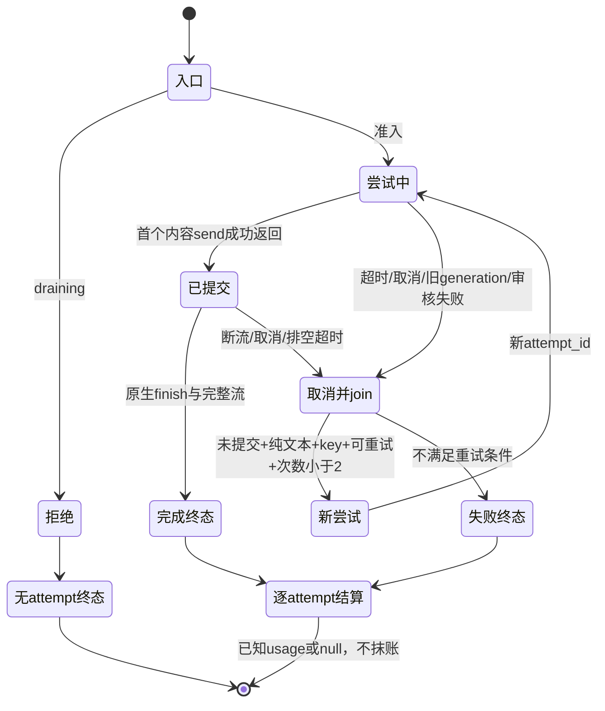

# exp26：取消、排空与安全重试

仅用于隔离实验：单个Qwen3-0.6B / vLLM0.8.5 V0后端、受控故障、只读文本生成，无工具执行。两个逻辑目标仍是同一物理GPU，不是HA。该网关在loopback开放冻结场景接口，不作为可直接对外部署的产品。

- [设计](设计.md)、[进度与决策](进度.md)、[源码笔记](源码笔记.md)、[故障状态图](state-machine.mmd)
- [结论](../results/exp26-结论.md)、[正式证据](../results/exp26/formal-v1/summary.json)
- [P5·8正文](../../27-Phase5·8-半路抛锚/正文.md)

故障状态图（已提交状态不会回到新尝试）：



本地CPU边界检查：

```bash
phase5/.venv-exp25/bin/python -m pytest phase5/exp26 -q
```

远端运行需要已有 `/root/vllm-env` 与 `/opt/models/Qwen3-0.6B`。不要用历史PID停止服务；先检查8026/8126及GPU，复制本目录Python源码至全新实验根目录。`manage_backend.py`使用`/opt/p2/stub`和`VLLM_USE_V1=0`，所有启动参数保存在backend-startup.json；管理脚本只停止自己记录且cmdline仍匹配的实验进程组。

```bash
/root/vllm-env/bin/python manage_backend.py start --root /opt/exp26-20261026-p5h
# /health确认8026已就绪以后，创建全新输出目录；不能覆盖已有正式证据。
/root/vllm-env/bin/python run.py --out /opt/exp26-20261026-p5h/formal-v1 --root /opt/exp26-20261026-p5h
/root/vllm-env/bin/python manage_backend.py stop --root /opt/exp26-20261026-p5h
```

`run.py`先冻结计划与代码，再执行归档中的run.py。每条请求保留客户端原始SSE、网关事件/attempt/结算以及独立的原生后端HTTP/引擎记录。失败也写入原始记录；独立审计不通过时退出非零，finally仍收拢拥有的网关进程。后端由外层管理脚本负责回收，最终另外回读PID、端口、GPU及模型hash。

CPU预检、边界测试、正式GPU请求是不同分母。`preflight/cpu-http.json`是12条受控后端的真实loopback HTTP预检，不是模型调用；正式数据以formal-v1为准。

离线重算：

```bash
phase5/.venv-exp25/bin/python phase5/exp26/analyze.py --out phase5/results/exp26/formal-v1
/tmp/exp14-local-env/bin/python phase5/exp26/plot.py
```

审计器不导入gateway，不把它自己宣称的终态当作唯一真相。取消attempt缺少原生usage时保留null，受控synthetic计量单列；不通过时不发布成功总量。实验内存结算表不保证跨进程重启后的幂等事务。

最终分析采用formal_native证据要求；HTTP-only fixture仅供单测显式API参数使用，不是CLI正式验收的自动降级。审校修复后的gateway/analyze/test与重放代码在analysis-revision2；正式GPU执行仍引用原code快照。53项CPU回归及6条捕获原生输出重放通过；3项重要问题见review-resolution.json，不二审、没有新增GPU调用。
