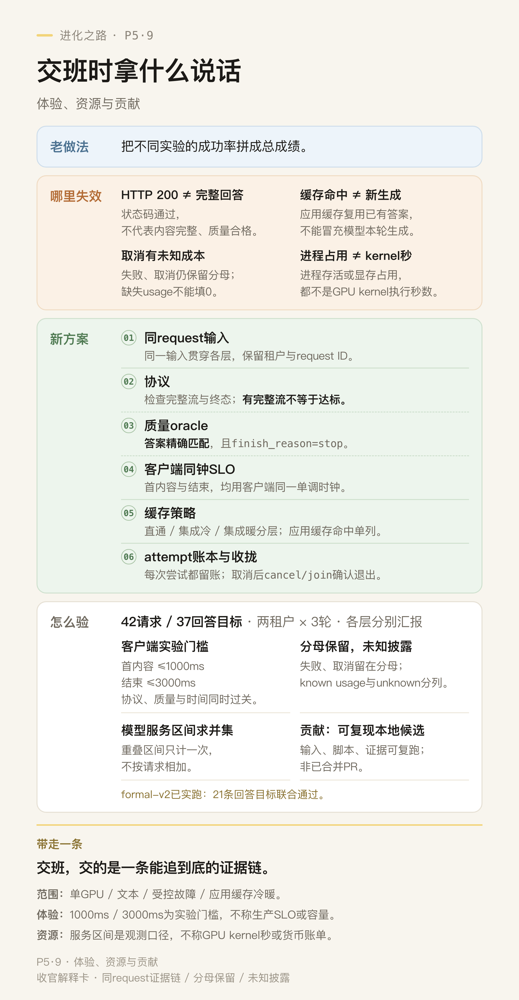
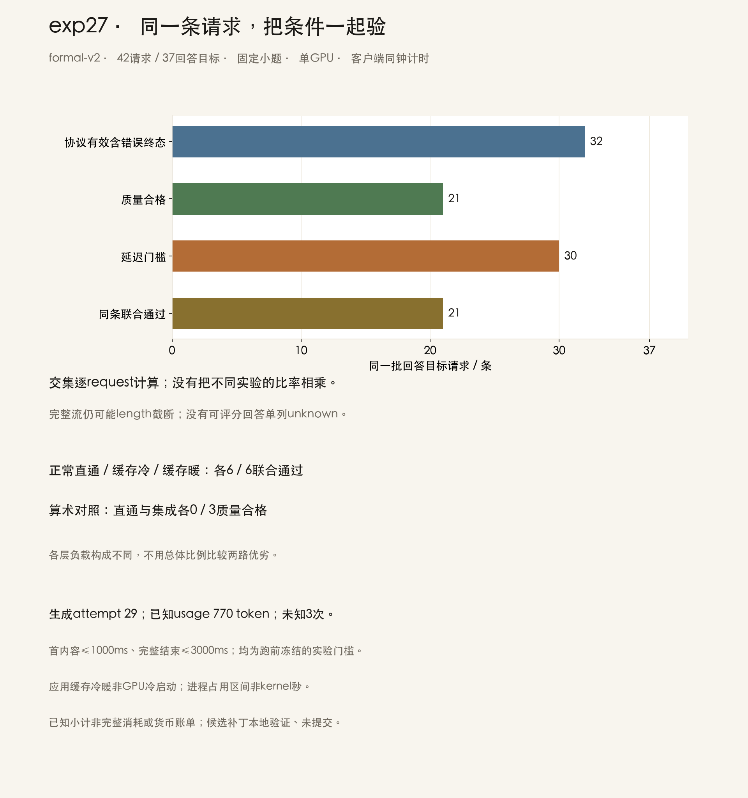

# 进化之路 P5·9 ｜ 交班时拿什么说话：体验、资源与贡献

> 进化之路 · P5 · 9。最后一站不再加一块组件，把前面各站接成一份能移交的证据。
> exp27：同一批请求，同时核对输入、交付、质量、延迟、缓存、attempt用量和资源收拢。

---

## 一、每个站台都说自己没问题，整条线路呢

验票台说请求接住了，广播台说内容发出去了，调度台说队列清空了，账本上也有一串token。

交班的人却还得回答一个更具体的问题：乘客这一趟，究竟有没有按要求到达？

HTTP 200可能只发出响应头；正常结束的流也可能在输出上限截断；缓存命中的旧回答不需要重新生成，却需要确认它属于当前租户和配置；乘客离开以后，后台仍可能跑了一段时间。

前面几站的成功率各有分母。拿其中一个乘上另一个，拼不出一条真实请求的完整经历。

**这一站的验收单位，是同一条request。**

---

## 二、一页纸：交班要能沿着一条记录追到底

本轮先把条件写下来，再运行。

完整流要求协议终态、结束标记与attempt对得上。质量要求去掉空白以后与预先写定的答案完全相同，而且原生finish是`stop`。延迟门槛定为首内容不超过1000ms、完整结束不超过3000ms，都从同一客户端的请求起点计算。

同时，还要检查缓存来源、实验规则、用量结算和取消收尾。每条记录有自己的判定，再按直通、集成、缓存冷暖和故障分层展示。

这些是小实验的验收门槛。样本、负载和硬件都有限，没有通过它们就换算生产容量或生产SLO。

---

## 三、42条请求，为什么保留两种分母

先重新执行当前exp25的31项、exp26的53项CPU边界检查，确认被复用的闭环仍然成立。历史实验的成功率没有放进本轮乘法。

正式计划有42条请求，其中37条是回答目标：即使后来排队被拒绝、取消或断流，也留在这37条的分母里。其余5条是专门的身份、能力、预算、规则拒绝和排空入口探针，分别核对预定终态，不作为回答质量目标。

正常对照采用两个合成租户、三轮重复：每轮依次跑直通、集成缓存未命中、集成缓存命中，共18条。这里的冷暖指**应用精确响应缓存**，没有测GPU硬件冷启动。

另有三道固定整数计算的直通与集成对照、一个截断探针、六条有界突发、首段前重试、已提交后注入中断、客户端取消、排空以及配置与租户隔离探针。

直通与集成使用相同Qwen原生模板与固定贪心设置。集成沿用整段缓冲后做`LAB_BLOCK`实验规则检查的选择，规则通过后才交付内容；缓存是完成响应缓存。它承担了额外检查，也改变了首内容等待的含义，不能只拿某一个延迟数字讲“网关加速”。

---

## 四、先看完整回答，再看同条记录的交集

先区分三个结果：**请求状态为completed的是30条，SSE协议收尾有效的是33条，联合通过的是21条。** 有效的错误终态可以让协议正确收尾，却不能因此变成完整回答。

在37条回答目标中：

| 同条记录的判定 | 通过 | 不通过 | 未知 |
|---|---:|---:|---:|
| 协议有效 | 32 | 5 | 0 |
| 预定质量标准 | 21 | 10 | 6 |
| 延迟门槛 | 30 | 1 | 6 |
| 联合通过 | 21 | 16 | — |

因此回答目标的交集是21/37；若把所有探针也留在总分母里，则为21/42。它们不是产品成功率，不能省掉分母说明。

正常三组各6条全部联合通过。首内容/结束延迟的样本中位数，直通为49.59/75.17ms，集成缓存冷为79.49/79.81ms，缓存暖为1.21/1.34ms。每组只有6条，固定先后顺序、同一模型进程且带观测；这些数只描述本次对照，不外推通用速度收益。

三道算术题的两路共6条，都正常返回，但质量全不合格。例如要求只给结果，模型却输出算式或带算式的结果。原始正文保留，没有在看完回答后放宽标准。

六条突发有2条生成完成、4条准入拒绝；两条回答质量都不合格，其中一条首内容1332.85ms，超过1000ms门槛。排队、拒绝和不合格回答都还在分母里。唯一的length探针也不能算完整质量通过。

延迟这一列衡量有首内容时的流收尾时刻，可能包含明确错误终态；业务完成另看completed，联合判定还要经过质量关。

质量标准是这些固定小题的精确答案，不覆盖开放问答、事实可靠性、工具行为或通用安全。规则只识别实验标记；出现拒绝，不等于安全能力已经充分。

unknown也有明确含义：没有收到可评分回答、没有首内容时间，或取消前没有拿到完整usage，都各自保留。不能因为总表需要一个数字，就把未知改成成功或零消耗。

---

## 五、资源账为什么不能按每条请求的占用相加

29次真实GPU attempt中，26次有原生usage，输入624、输出146，共770个token；3次未知，继续保留null。缓存命中6次，本次没有再生成，其来源usage单列，不重复加入770。

5次非完成attempt中，有2次已知用量合计76，其余3次未知。重试产生的后继attempt另有1次已知50；这些都是29次内部的切片，已经计入770，不能再加一次。770仍只是已知小计。

模型服务与网关的进程区间并集是19.423秒，ready区间并集8.036秒；CPU wait4回收统计32.227秒。CPU可并行累积，数值大于墙钟区间不代表多了一份GPU时间。每个组件的原始区间与CPU记录也分别保存。

服务进程先启动、加载模型、进入ready，再承接这批请求，最后退出。请求之间可能有空闲，也可能排队；对常驻服务，不能为每条请求重复计一遍共同占用的时间。

本轮用同一个supervisor时钟，分别记录模型服务与网关的启动至退出区间，以及ready至请求停止的区间，再求区间并集。前者包含加载和退出，后者是可接服务的观测窗口；它们都不等于精确的权重驻留或CUDA kernel执行时间。

CPU另用进程回收的wait4统计，说明它覆盖进程及已回收后代。GPU利用率快照只作环境与清理证据，没有换算成分租户GPU秒数。

没有实际费率与账单来源，货币实付继续为空。请求都是文本，也没有把它们换成虚构的语音会话分钟。

---

## 六、源码读完以后，怎样留下一个小贡献

本轮从exp19已有反例里挑出一个很小的候选：解释recipe的`resolve_max_tokens`在满上下文边界的行为，并补绑定测试。

真实native转换与编码得到41个输入token；然后由实验人为把上下文上限定在41。省略输出额度时helper返回1，显式请求1时却报400。再对上限40和42做对照，总计6次helper调用，没有模型生成或后端派发。

原因能沿着固定源码读到：省略额度先按0参加超界检查，随后返回值又被抬到至少1。Rust API说明和Python stub已经提到最小值，两份使用指南没有把这个零余量边界讲完整。

上游已有相关issue，以及一个关闭未合并的行为修改PR。这次不把已知边界包装成新发现，也不猜测PR关闭原因。候选只补中英文指南和6个当前行为的绑定用例：本地6项边界测试通过，相关上游筛选由原来的1项变成补丁后的7项通过。

这些检查共用同一个recipe wheel，不能相加成更多独立场景。当前默认分支和固定阅读源码已经核对为同一SHA，但发行wheel的构建commit仍未知；实测wheel行为与源码阅读的身份分别保留。

候选没有提交上游。它交付的是触发条件、预期、原始复现和最小补丁，是否接受、是否调整契约，留给上游决定。

---

## 七、这一班交出去什么

复现材料包括冻结输入、代码和模型身份hash、三端原始trace、能力与故障清单、资源区间与清理结果、迁移检查项，以及本地贡献候选。运行器会归档计划后执行归档代码，失败也保留，最后回收自己启动的服务。

首次formal-v1因观测请求头编号和缓存绕过故障前置条件被拒绝，完整保留；修正后重新独立执行formal-v2。两轮没有合并样本，质量答案和延迟门槛没有放宽。首轮另观察到25次attempt，保留为未完成独立对账的运行历史，不能当零成本；770并不是整个调试过程的总消耗。最终清理确认两个owned进程已回收、8027/8127关闭、GPU630MiB/0%、四个模型文件hash未变。

迁移时还要接上真实身份、持久结算、配置版本与回滚，重验协议、模板、租户额度和独立故障域。那是下一套环境的工作，不能把这张小卡的通过表直接盖到生产上。

Phase5从“请求怎样成为模型输入”走到“故障后怎样交班”，源码与网关两条线各自留下证据：recipe原生库的CPU合约、DeepInfer机制的源码与局部探针、真实Store API，以及Qwen小GPU上的接口、调度、集成和故障实验。

DeepInfer没有在这张小卡上完整运行，recipe也没有被包装成Qwen的端到端协议适配器。移交时保留这些边界，比用同一张总成绩表盖住差异更有用。

**交班，交的是输入能追到结果、结果能追到来源的一条证据链。**

---

实验与复现：[exp27结论](../../exp27-结论.md)、[复现入口](../../../exp27/README.md)、[能力与迁移清单](../../../exp27/能力与迁移清单.md)、[贡献候选](../../../exp27/contribution/候选说明.md)、[正式摘要](../formal-v2/summary.json)。
