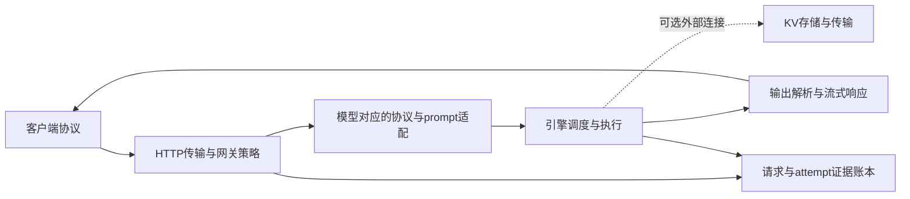

# Phase5：读通推理栈，做成一个模型网关

规划日期：2026-10-23；状态更新：2026-10-26。九篇本地稿与exp19～27全部完成；exp27最终formal-v2已真实GPU执行，accepted=true。P5·1～9已于2026-10-26通过API上传公众号草稿箱并回读核验，九篇草稿齐，未群发。正文、一次最终独立审校与一轮离线修复已完成。贡献候选仍未提交上游；后续由用户选择迁移或贡献。

## 1. 本阶段要得到什么

用户选择：**源码阅读与网关实战两条线并重，接受更多篇幅和实验。**

沿用系列原目标：在现有后端/Agent 工作基础上，能够承担模型网关层。阶段结束时应能沿一条请求解释协议、prompt、调度、KV、生成、流式返回和账本的责任边界，并拿出一个有故障验证和逐请求证据的实验网关。

每篇交付两份互相校验的产物：

1. 源码笔记：固定版本、入口到出口的调用链、关键数据结构、状态/不变量及相应源码链接。
2. 实验记录：输入、环境、时钟、原始事件、成功/失败/未知分母和结论。阅读结论、真实库调用、真实GPU和合成机制实验分别标明。

文章继续使用公交车比喻及“老做法→哪里失效→新方案→怎么验→带走一条”的骨架。Phase5 站色为黄色 `#F2D479`，封面眉题统一为“进化之路 · P5 · 序号”。先取得证据，再写正文与图卡。

## 2. 三份材料放在哪一层

| 材料 | 本轮核对的官方定位 | 本阶段用途 |
|---|---|---|
| [deepseek-recipe](https://github.com/deepseek-ai/deepseek-recipe/tree/935817c66f5d6e64838f419692545f06787e485f) | 请求协议→Conversation→DeepSeek prompt/token IDs；模型输出→各协议响应。调用方负责推理、工具执行和HTTP传输 | 读协议、编码、流解析、参数和usage边界；先用真实库做CPU合约实验 |
| [DeepInfer](https://github.com/deepseek-ai/DeepInfer/tree/9bd9cf243fc53ef9afbf8f04d391d989117d6ab9) | 当前公开版提供离线推理及规模化服务的引擎核心；支持DeepSeek-V4.1-Flash，官方硬件为SM100/Ascend950 | 读调度循环、运行时、DSpark、SWA回放、确定性和性能测量方法 |
| [Mooncake](https://github.com/kvcache-ai/Mooncake) | KV中心化的分离式系统；Transfer Engine、Store及推理框架连接路径 | 理解KV身份、数据移动、外部缓存与P/D分离；做小型真实Store实验并注明不代表PD复现 |

三者处于互补层次，但不能据此声称已经官方集成为一套完整在线服务。DeepInfer README 明确列出本次发布不含完整KV cache系统、完整VE/Prefill/Decode分离服务及P/D两侧跨DP副本的负载均衡。内部KV管理/分叉等实现与这项发布边界同时存在，不能写成“引擎完全没有KV管理”。

DeepInfer NVIDIA路径要求Linux、GCC≥13、Python3.12、CUDA13；RTX4060Laptop不是当前声明的SM100支持平台。公开benchmark所用的4卡prefill/64卡decode是其测量配置，不能冒充最小运行需求，也不能换算成DARYU容量。

recipe的prompt/特殊token/输出解析针对相应DeepSeek格式。**Qwen小模型不能直接接收DeepSeek渲染结果，再据此宣称验证了recipe与DeepInfer的端到端对接。**

官方依据及固定版本见[资料地图](资料地图.md)。

## 3. 推荐九篇，分三组推进

不是九篇仓库介绍；每篇由一个工程问题串起源码与实验。

| 篇 | 暂定标题 | 源码主线 | 实验与主要产出 |
|---|---|---|---|
| P5·1 | 先验车票：请求怎样变成模型输入 | recipe的三种协议、Conversation、模型版本/别名、prompt/tokenizer | exp19：真实库转换合约与能力矩阵；同义请求哪些等价、哪些不等价 |
| P5·2 | 广播分几段：流式输出与工具调用 | recipe流解析、reasoning/tool分支、stop与finish、usage；HTTP/SSE由调用方承担 | exp20：按各层输入粒度拆分输出，核对终态、截断与完整/流式语义；工具先记录不执行 |
| P5·3 | 按格式报站：结构化输出谁来保证 | recipe的OutputConstraint与DeepInfer采样约束；字段接收、prompt提示、约束执行各在何处 | exp21：真实库约束转换＋小GPU后端能力探针/对照；分别统计请求接受与实际schema合格 |
| P5·4 | 班次表藏在哪里：调度循环与确定性 | DeepInfer请求→引擎→异步scheduler→runtime；batch invariant及确定性采样条件 | exp22：小模型混合负载和固定输入的batch组成对照；构建时间线，避免把代理实验叫作DeepInfer复现 |
| P5·5 | 少跑几圈：草稿、验收与有界回放 | DeepInfer DSpark、验证调度、SWA bounded replay；与P4提前回答草稿的区别 | exp23：从源码提炼状态/边界，做CPU机制重放；量化回滚与重复工作，不报告DeepInfer实测加速比 |
| P5·6 | 行李不跟车走：KV与分离式服务 | DeepInfer内部KV/分叉与外部系统边界；Mooncake Store/TE及P/D连接关系 | exp24：真实Mooncake本机TCP Store put/get/删除/异常；缓存身份与失效合约单列，传输对象不冒充可用模型KV |
| P5·7 | 把站台接起来：一个能对账的网关 | 既有gw.py与新学到的协议/引擎边界；缓存、准入、路由、审核、记录的顺序 | exp25：单个小GPU后端＋两个合成租户的纵向闭环；每次调用可追到所有attempt与账本；formal-v1已完成，42条请求全部关联，P5·7已于2026-10-26 API上传公众号草稿箱并回读核验，未群发 |
| P5·8 | 半路抛锚：取消、排空与安全重试 | 流的所有权、提交点、取消传播、后端退出、重试与fallback | exp26：首段前/首段后/断连/审核失败/排空故障注入；同时验客户端、工作线程与账本 |
| P5·9 | 交班时拿什么说话：体验、资源与贡献 | 从客户端到后端的统一事件；SLO有效完成、usage来源、资源归属、证据打包 | exp27：同一批会话/请求内联合验收，形成复现包、接入说明与一个有最小复现的贡献候选；formal-v2真实GPU完成、accepted=true，P5·9已于2026-10-26 API上传公众号草稿箱并回读核验，未群发 |

如果P5·5的DSpark与SWA证据各自较厚，允许拆上下篇，仍保留同一站色；不为凑篇数合并不相干结论。

## 4. 两条线怎样汇合

参考架构把责任分成以下几层；这是本阶段学习后的设计图，不是三仓库已集成的运行事实。

本期实际验证分两条明确标识的路径：

- **recipe合约路径**：真实recipe库、对应DeepSeek编码/输出格式、冻结fixture和mock backend，主要运行于CPU。验协议/解析，不验模型推理、生成质量或吞吐。
- **小模型GPU路径**：DARYU、已有可用的小模型后端和模型原生模板。先明确支持Chat Completions文本流，再逐项打开确实支持的能力；不支持的协议/参数显式拒绝。验真实生成、网关控制、故障与账本。

两条路径共用请求/attempt/事件定义、能力声明、测试场景和报告方式。只有具备匹配DeepSeek模型、tokenizer、引擎、硬件并跑通之后，才新增“recipe→DeepInfer真实推理”的端到端结论。它不作为本阶段单卡基础路线的完成前提。

## 5. 接上过去的工作

| 现有资产 | Phase5复用方式 | 新增验证 |
|---|---|---|
| P2 exp1～4基线与客户端/服务端指标 | 选少量冻结负载作直通基线 | 集成网关后的增量开销与证据完整性 |
| [P3网关](../phase3/gateway/gw.py)、exp5～7 | 复用准入、队列、优先级、指标与路由经验 | 真正可关联的request_id/attempt_id、取消传播和能力边界 |
| [P3b集成待办](../phase3b/大纲.md)、exp11～13 | 缓存阈值、账本函数、审核门控作为组件候选 | 将独立实验接进同一真实请求；验证顺序、租户/版本隔离与重复记账 |
| [P4](../phase4/README.md)、exp14～18 | 复用会话/turn/generation与时钟规则、播放和计算分账 | exp27采集同批联合记录，避免拼接旧实验成功率 |

默认先做精确缓存及已审核响应的身份/失效规则。语义缓存沿用exp11暴露的反例，作为单独开关做真实错命中验收；不默认把旧阈值直接投入新链路。审核也先保留exp13各方案的已知漏判，不能把“串起来了”当作风险消除。

原看板的上游贡献目标保留：贡献可以是测试、文档、观测字段或明确修复，不以“PR被合并”作为可由我们保证的结题条件。真实语音产品预算仍为条件性后续项，先明确产品与可用观测点，再执行。

## 6. 推进顺序与停点

1. **资料冻结与exp19**：先取得固定版本、安装可行性、协议合约与第一份真实库记录。成功后写P5·1。
2. **接口组exp20～21**：把流解析、终态、usage及结构约束拆清；取得该组证据再成稿。
3. **引擎组exp22～24**：源码调用链与机制验证并行；Mooncake先做本机TCP数据面，不抢跑多机PD。
4. **落地组exp25～27**：单卡纵向集成、故障矩阵、同批联合验收，形成可移交的复现包。

具体输入、验收、资源和失败处理见[实验计划](实验计划.md)。本文件确定课程和实验问题；具体实现设计、依赖变更及运行命令在各实验开始时再按实际版本形成。

## 7. 完成标准与状态

- [x] 用户选择两条线并重。
- [x] 新输入DeepInfer/deepseek-recipe官方定位和版本核对；Mooncake官方路径复核。
- [x] 九篇/exp19～27初版规划、复用清单和资源边界落盘。
- [x] 用户确认九篇规划与exp19起步。
- [x] exp19安装预检、详细设计与真实库实验：36条输入、211项声明检查通过；P5·1正文、图卡、封面与本地微信预览完成。
- [x] exp20正式formal-v1：19个输入定义展开222条配置流，2004项重复声明检查通过、666次本地SSE字节重放一致，失败0、未知0；48项本地回归（25项记录器＋23项字节层）及上游单文件48项测试通过；P5·2已于2026-10-26 API上传草稿箱并回读核验，未群发。
- [x] exp21于2026-10-26完成：CPU真实recipe 126条配置（90接受/36预期拒绝）及18条真实parser探针；GPU Qwen原生模板正式120请求（110接受/10条数组长度关键字不支持400），运输错误0，120条入口body SHA256/HTTP状态匹配；P5·3已于2026-10-26 API上传草稿箱并回读核验，未群发。
- [x] exp22真实HTTP/GPU实验与P5·4本地正文/图卡。
- [x] exp23 CPU教学重放/固定源码探针与P5·5本地正文/图卡；独立审校问题已通过回归修复。
- [x] exp24真实Mooncake Store API formal-v3与P5·6本地正文/图卡完成。
- [x] exp25纵向网关formal-v1与P5·7本地正文/图卡完成；42条请求、12次真实GPU attempt，31项CPU测试通过。
- [x] exp26故障矩阵formal-v1与P5·8本地正文完成；17条请求、19次attempt，受控与GPU计量分列；原生取消收尾仅证明CPU侧状态。
- [x] P5·9正文／最终独立审校收尾；2项重要与1项轻微问题均经一轮离线修复，22项CPU检查通过，复现包解包检查通过，不二审。
- [x] 本阶段九篇文章全部上传草稿箱（P5·1～9已于2026-10-26 API上传并回读核验，九篇草稿齐，未群发；贡献候选仍未提交上游）。

当前exp19～27已完成，P5·1～9已本地成稿；[P5·1](../20-Phase5·1-先验车票/正文.md)、[P5·2](../21-Phase5·2-广播分几段/正文.md)、[P5·3](../22-Phase5·3-按格式报站/正文.md)三篇均已于2026-10-26通过API上传公众号草稿箱，未群发。逐篇draft/get回读、完整正文文字相等检查及每篇两张正文CDN图HEAD 200均通过，见[批量回读证据（未收录：发布或账号材料）](../docs/PRIVACY.md)；各篇上传记录见[Phase5进度](README.md)。exp19～20为CPU真实recipe 0.2.0原生库＋合成后端输出，exp20另有本地SSE字节重放；两项均未执行模型推理、真实HTTP网络或工具。exp21的CPU合约实验与DARYU RTX4060 Laptop上的Qwen3-0.6B原生模板GPU对照独立，后端为vLLM 0.8.5/xgrammar 0.1.18；每组计划40，接收/JSON/schema/可交付依次为提示40/7/7/7、JSON 40/40/30/17、schema 30/30/30/17。清理记录确认PID、8021和隧道已收拢，GPU回667MiB。未做recipe→Qwen端到端集成、工具执行或生产变更，DeepInfer仅源码阅读、未执行；HiMarket/Higress等现有系统是后续迁移落点，本阶段先在实验环境把证据链跑通。

P5·4～9本批[回读（未收录：发布或账号材料）](../docs/PRIVACY.md)6/6通过，[全文与图片核验（未收录：发布或账号材料）](../docs/PRIVACY.md)确认六篇全文一致、12张正文图HEAD 200；[上传后清单（未收录：发布或账号材料）](../docs/PRIVACY.md)共14稿，其中P5·1～9各一份，ID与前三篇旧记录及本批六份收据匹配。九篇均为公众号草稿，未群发；贡献候选仍未提交上游。

2026-10-26新增：[exp22结论](results/exp22-结论.md)、[P5·4正文](../23-Phase5·4-班次表藏在哪里/正文.md)。144条实际小GPU请求，8基线之后136次token序列比较88同48异；仅为Qwen/vLLM贪心自由生成与闭环负载观察，不是DeepInfer运行或随机采样确定性证明。P5·4已于2026-10-26 API上传公众号草稿箱并回读核验，未群发。

2026-10-26新增：[exp23结论](results/exp23-结论.md)、[P5·5正文](../24-Phase5·5-少跑几圈/正文.md)。240条草稿重放与99窗口案例为CPU教学，16组官方配置/局部guard探针及参考函数另列；未执行模型/GPU或完整L1，合成工作点不作速度与质量结论。P5·1～9均已上传公众号草稿箱并回读核验，未群发。

2026-10-26新增：[exp24结论](results/exp24-结论.md)、[复现](exp24/README.md)、[最终formal-v3摘要](results/exp24/formal-v3/summary.json)、[P5·6正文](../25-Phase5·6-行李不跟车走/正文.md)。DARYU上真实Mooncake non-CUDA 0.3.13.post1，配置TCP、单机跨进程Store API；238次操作含228项声明检查通过、10项探索观察，40个已知对象（1B/4KiB/64KiB/1MiB各10个）长度/hash全匹配，197项本地测试通过。独立调用方身份合约12例为1不变可通过/11变化不匹配；v1/v2保留，不并入v3。载荷分支未逐次追踪，无GPU/模型/RDMA/真实P/D或纯网络性能结论。最终5个owned PID及11个静态/日志实际端口已收拢，命名键经API读回不存在；这不证明物理内存擦除。P5·1～9均已上传公众号草稿箱并回读核验，未群发。

2026-10-26新增：[结论](results/exp25-结论.md)、[复现](exp25/README.md)、[正式摘要](results/exp25/formal-v1/summary.json)。exp25正式formal-v1完成42条请求，全部关联且符合预期终态：delivered 17（含6条length截断）、认证拒绝1、能力拒绝9、预算拒绝1、准入拒绝12、实验审核拒绝2；delivered不等于完整自然结束或业务质量合格。缓存hit 7、miss 24、not_checked 11。12次真实GPU attempt的原生usage共642 token（租户A 407、B 235）；审核拒绝仍消耗54 token，下游模型正文交付为0，该消耗已保留在总账。

后端为DARYU Qwen3-0.6B / vLLM 0.8.5，1张GPU、2个合成租户、两个逻辑路由共用同一GPU。原生文件hash已核验，revision=null；使用完整响应缓冲后的LAB_BLOCK实验门控，审核后才向下游发送SSE；缓存为精确响应缓存，不是KV缓存。未执行recipe/DeepInfer，不据此声称HA、取消传播、安全重试或生产容量。模型/模板/策略变化仅由CPU测试覆盖；legacy的3组分数引用与3条标记探针为独立CPU旧资料诊断，不并入42条请求或12次GPU attempt。exp25最终31项CPU测试通过，见[测试记录](results/exp25/tests.txt)。清理回读为后端PID不存在、8025/8125均关闭、GPU 664MiB/利用率0%。[P5·7正文](../26-Phase5·7-把站台接起来/正文.md)已完成；P5·1～9均已上传公众号草稿箱并回读核验，未群发。exp27联合验收、一次最终独立审校收尾与九篇草稿上传均已完成。

2026-10-26新增：[结论](results/exp26-结论.md)、[复现](exp26/README.md)、[P5·8正文](../27-Phase5·8-半路抛锚/正文.md)、[正式formal-v1摘要](results/exp26/formal-v1/summary.json)、[原生收尾分析修订](results/exp26/formal-v1/analysis-revision2/summary.json)。17条请求、19次attempt：12条受控请求/13次attempt，5条真实GPU请求/6次attempt；全部故障为实验安排，不是自然故障率或HA测试。GPU的6次attempt中2条known原生usage共248 token（输入54、输出194），其余4条unknown保留null；受控13次attempt中4条known synthetic计数共28，其余9条unknown。两类计量分列、不相加，248只是原生已知小计，不代表全部消耗或货币账单。

终态来自[gateway.jsonl](results/exp26/formal-v1/gateway.jsonl)：completed 6、backend_error 3、review_rejected 1、review_unavailable 1、cancelled 1、superseded 1、drain_timeout 2、draining 1、client_disconnected 1；completed仅为协议收尾，GPU重试后的length截断不算完整回答或质量合格。6次GPU attempt全部映射到实际engine request；2条正常结束，4条取消路径均有原生abort_done及后续tracker/队列清空快照，6次attempt最终均无pending/unfinished、无observation_error。真实重试的下一原生请求晚于前次清空快照；证据为CPU侧原生钩子与调度状态，不是CUDA kernel停止证明，也不支持HA结论。

[cleanup.json](results/exp26/cleanup.json)回读确认owned后端PID125928已退出、8026/8126关闭、GPU663MiB/0%，4个模型文件hash未变。本地CPU检查最终53项通过，以[tests.txt](results/exp26/tests.txt)为准。P5·1～9均已上传公众号草稿箱并回读核验，未群发；上方P5·8/exp26原始问题与设计保持原文，实际结果以本执行记录为准。

## 8. 本地收官与后续停点（2026-10-26）

九篇本地稿与exp19～27全部完成；exp27最终formal-v2已真实GPU执行，accepted=true。P5·1～9已于2026-10-26通过API上传公众号草稿箱并回读核验，九篇草稿齐，未群发。正文、一次最终独立审校与一轮离线修复已完成。贡献候选仍未提交上游；后续由用户选择迁移或贡献。

[P5·9正文／图文](../28-Phase5·9-交班时拿什么说话/正文.md)、[exp27结论](results/exp27-结论.md)、[复现](exp27/README.md)已落盘。上方九篇上传核对项已据实勾选；九篇草稿均已回读核验，未群发。

exp27最终[formal-v2](results/exp27/formal-v2/summary.json)已真实GPU执行、accepted=true，仅表示证据验收通过。42请求／37eligible／29attempt，正常18条（两租户三轮直通／冷／暖）全部quality＋SLO合格，算术6条正常返回但质量全失败；同request交集21/37，全42为21/42。其余拒绝／故障／unknown以summary细表为准，HTTP 200或completed不作业务成功。

GPU26known原生usage770 token（624输入／146输出）、3unknown；failed5中2known76／3unknown，retry后继1known50均在770内、不另加。模型服务＋网关进程union19.423秒、ready union8.036秒、CPU wait4累计32.227秒；backend-only interval见[资源原始记录](results/exp27/formal-v2/resources.json)，非kernel／模型独占／租户GPU或货币账。[cleanup](results/exp27/formal-v2/cleanup.json)确认PID127352／127245已回收、8027／8127关闭、GPU630MiB／0%、模型4hash未变。失败v1留存，旧编号header、末事件计时及缓存绕过故障前置条件已修，两轮不合并样本。main＋audit测试最终以 `results/exp27/tests.txt` 为准，不固化条数。

[贡献候选](exp27/contribution/候选说明.md)是recipe满上下文预算的中英文指南＋6测试，已有上游#42／#44讨论；真实native编码41 token／6 helper calls，补丁后选定上游测试7 passed。属于真实CPU库调用，不是模型调用或新bug，未提交／推送／创建PR／联系上游。DeepInfer仍未执行，原生取消收尾仅是CPU钩子／调度状态证据，不证明CUDA kernel停止或HA。

迁移范围见[能力与迁移清单](exp27/能力与迁移清单.md)；上游是否接受贡献与本地课程完成分别记录，整个公众号阶段未标为已发布。
